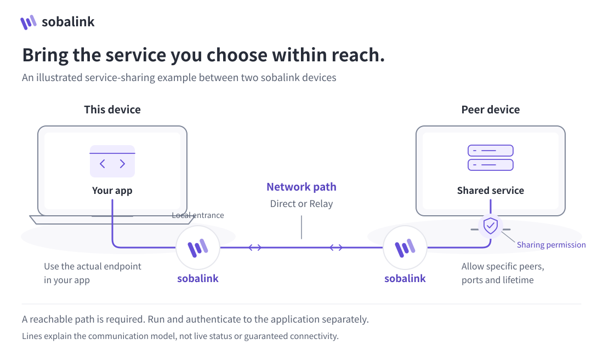

# sobalink

[日本語](README.md) · [User guide](docs/GENERIC.en.md) · [Verification](docs/VERIFICATION.en.md)

This is an experimental open-source project; no user support is provided. These self-service notes do not promise responses, fixes or compatibility.

**Close, even from afar.** Connect devices and use their applications through selected TCP/UDP services. Start `soba`, choose a peer in its local Web UI, then connect to SSH/SFTP, web, database or other application ports. Share a local service with explicit peers and a chosen lifetime. Text, images, files and folders are also available. The embedded React UI and CLI use the same Go authorization checks.

**Share only the services you choose, without requiring administrator privileges or router port forwarding.** sobalink runs as an ordinary user process without requiring TUN, OS route/firewall changes, or router port-forwarding setup. Choose the peers, ports and lifetime of each share. The selected network still needs a reachable path; existing firewalls or client isolation can prevent connections. Application/server installation and authentication have their own requirements.

**v0.5.0-alpha.1 · Experimental software.** Check [sobalink Releases](https://github.com/webkaz-labs/sobalink/releases) for a published version's source, signed assets and verification results. Source feature descriptions alone do not establish acceptance for that version. Real-device enrollment, application compatibility, phone QR, native IME, OS sign-in and sleep/wake need separate checks. [Exact-source verification results](docs/VERIFICATION.en.md)

<picture>
  <source media="(prefers-color-scheme: dark) and (max-width: 959px)" srcset="docs/assets/visuals/connection-en-dark-narrow.svg">
  <source media="(max-width: 959px)" srcset="docs/assets/visuals/connection-en-light-narrow.svg">
  <source media="(prefers-color-scheme: dark)" srcset="docs/assets/visuals/connection-en-dark-wide.svg">
  
</picture>

Your app uses the actual local endpoint; sobalink routes traffic to the peer’s explicitly permitted service. A reachable network path and separate application authentication are required. Ordinary Tailnet services do not require sobalink on the target.

## Get started

### Install

Follow [signed-release installation](docs/DISTRIBUTION.md#install-a-signed-prerelease) to select an exact version and start it. The [verification record](docs/VERIFICATION.en.md#current-integration-and-published-baseline) is authoritative for the published version, source and completed checks. For a source checkout, use the [build instructions](docs/DISTRIBUTION.md#build-this-checkout). Node is not required to run the resulting binary.

Published releases and development sources can have different features. Check the [user guide](docs/GENERIC.en.md) for its target version and profile compatibility first. This release includes request-and-accept connection setup and durable text queueing. Profile format 3 is incompatible with v0.4.0-alpha.4 and earlier: keep old state untouched and use a separate empty `--state-dir`. There is no automatic migration or deletion.

### After starting

1. Open the printed `http://127.0.0.1:PORT` in a browser on the same device, then enter the one-time code shown in the terminal. The code is never part of the URL. Run `soba ui` in another terminal to issue a new code
2. Choose a network. For an existing Tailnet, enroll sobalink's separate node through the official Tailscale sign-in page. Tailcat LAN setup is available in the local UI and CLI, using an explicit trusted relay and pairing. See the [LAN guide](docs/LAN.en.md). The release also provides explicit [relayless LAN](docs/DIRECT_LAN.en.md) and [mixed connections](docs/MIXED_CONNECTIONS.en.md); review their current verification limits before use
3. Review the peer, ports and lifetime before sharing or connecting a service. Use the actual endpoint in your application and verify its authentication and operation
4. To exchange messages or files, review the current identity and trust the intended sender. Send text explicitly; review images, multiple files and folders as a batch
5. The receiver normally chooses a directory and accepts each batch. Autosave requires an explicit choice of backend, trusted peer, current trust generation and destination
6. Stop an individual service, use `soba stop-shares` for all inbound shares, revoke trust, or run `soba stop` when finished

Examples use `soba` as an executable on PATH. Substitute `./bin/soba`, or `./bin/soba.exe` on Windows, for a source build. Keep its starting terminal open. A fresh profile has no selected network and starts no enrollment or sharing. [Complete UI and CLI guide](docs/GENERIC.en.md)

## Capabilities and boundaries

| Action | Scope |
| --- | --- |
| Service sharing | Explicit peers; finite 1-hour default or explicit until-revoked; compact TCP ranges, with reserved endpoints excluded |
| Connections | Until-stopped by default; ordinary Tailnet services work without sobalink on the target |
| Saved workflows | Stopped definitions, profiles, groups, reviewed import/export and leased local tasks; saving never starts a listener |
| Capacity | Explicit default/limited/unlimited logical choices, separate adjustable finite resource budgets |
| Text, images, files and folders | Explicit send, reviewable batches and manual text copying |
| Receiving | Per-batch acceptance by default; per-peer autosave to a fixed destination is optional |
| Immediate-send retry | Retry unfinished whole files during the same running session; no partial-byte or restart resume |
| Explicit durable queues | [Files and folders](docs/DURABLE_OUTBOX.en.md) and [text](docs/DURABLE_TEXT.en.md) are available. Recovery keeps original IDs, deadlines and save evidence; local acceptance is not delivery |
| Local management | Exact `127.0.0.1` on an ephemeral port, one-time code, session, Origin and CSRF checks |

Received files are never automatically opened, executed or allowed to overwrite existing files. Executable attributes and links are not preserved. Browser APIs can omit empty folders; use the CLI and verify the resulting tree when exact folder structure matters.

A broad TCP share also permits applications started later inside that range while the permission remains active. Keep the range narrow and use exclusions. Discovery `54543`, peer API `54544`, pairing `54545` and backend-internal endpoints are excluded from service sharing. UDP and local connection listeners use a separately adjustable finite budget, initially 64 listeners. Counts such as 32 share peers and batches of 256 entries / 1 GiB are initial logical defaults, not fixed product maxima. Removing a logical limit never removes identity, path-safety, protocol or resource checks. [Capacity choices](docs/CAPACITY.en.md) · [Security boundaries](SECURITY.md)

Direct and Relay describe the encrypted traffic's route; reconnecting means communication is being re-established. Unknown routes remain unknown instead of being inferred from latency. A single-backend profile never changes its selected network. In mixed mode, only new connections may choose another explicitly approved route for the same authenticated peer when availability failure is positively established; permission denial or unknown state never triggers fallback. Existing TCP sessions are not migrated or replayed. Tailcat never falls back to arbitrary public relays. [Network design](docs/ARCHITECTURE.md)

## Choose a connection method

Outside the LAN, normally use Tailscale. For LAN use, see [explicit relay pairing and route preparation](docs/LAN.en.md), [relayless LAN](docs/DIRECT_LAN.en.md), and [mixed connections](docs/MIXED_CONNECTIONS.en.md). Optional WAN candidates require an already reachable compatible pinned relay. Use [request-and-accept connection setup](docs/CONNECTION_SETUP.en.md) for the shortest supported pairing path. First-use key acceptance (TOFU) does not prove the intended physical device; independently compare the full fingerprint when stronger initial verification is needed.

Prepared routes do not promise seamless migration of existing TCP or physical-NIC isolation. Application reconnection, immediate-file retry and explicit durable queues are separate workflows. [Route contract](docs/ROUTE_RECOVERY_DESIGN.en.md) · [Evidence and limits](docs/VERIFICATION.en.md#route-recovery-gate)

## Short CLI example

For this two-sobalink Tailnet example, first enroll each device and inspect its current peers:

```sh
soba setup --network tailnet
soba login --browser
soba peers
```

### On the device sharing the service

Run the SSH server and configure its authentication separately. Replace `CLIENT_PEER_ID` with the permitted client device:

```sh
soba --dry-run share --preset ssh --peers CLIENT_PEER_ID
soba share --preset ssh --peers CLIENT_PEER_ID
```

### On the device using the service

Replace `SERVICE_PEER_ID` with the device hosting SSH, then use the printed endpoint in your SSH client:

```sh
soba connect --preset ssh --peer SERVICE_PEER_ID
soba status
```

The SSH preset suggests target TCP 22 and local port 2222. `--preset web` suggests TCP 8080/local 8080; change ports explicitly with `--ports` and `--local-port`. Application authentication is still required. An ordinary permitted Tailnet service does not require the sharing-side sobalink steps. Omitted names use an unused name and never overwrite saved settings.

### Optional: messages and files

On the **receiving device**, run `soba trust SENDER_PEER_ID` after checking the sender's identity. On the **sending device**, explicitly send to that receiver:

```sh
soba message RECEIVER_PEER_ID "Hello"
soba send RECEIVER_PEER_ID ./image.png ./notes.txt ./sample-folder
```

The receiver normally selects a directory and accepts the batch. This receiving permission is separate from service sharing. When finished, run `soba stop` on each device where you want to stop the agent.

Use the local UI or [guided CLI](docs/CLI_GUIDE.en.md) to select, edit and review a service; explicit CLI flags support automation. LAN host/relay setup, invitation files, receive folders, autosave and saved-service save/inspect/copy/restart need no JSON editing. [Private browser/link/QR sign-in](docs/SIGN_IN.en.md), [saved services, groups and tasks](docs/SAVED_SERVICES.en.md), and [startup/logout](docs/LIFECYCLE.en.md) have dedicated guides. See `soba help examples`, `soba lan --help` and `soba service --help`. `--dry-run` checks inputs before applying; it is not a reachability or free-port test. Language is automatic, with `soba --locale ja ...` / `en` overrides. Status, peers, groups and service workflows provide localized human views; use `--json` for machine output. Advanced typed actions retain structured results. Explicit login display modes give private human guidance. `--json-errors` writes failures as `{code,error}` to stderr. [Detailed CLI guide](docs/GENERIC.en.md#language-automation-and-troubleshooting)

An optional [authenticated TCP proxy and diagnostics](docs/PROXY_DIAGNOSTICS.en.md) are also available. [Explicitly permitted transfer-setting management](docs/RESOURCE_MANAGEMENT.en.md) is a separate, limited feature. Broadcast delivery and remote filesystem browsing are not included.

[Explicit startup and private proxy profiles](docs/STARTUP.en.md) · [Application settings and RustDesk](docs/CLIENT_HELPERS.en.md) · [Local Web controls](docs/WEB_CONTROLS.en.md) · [Feature parity and acceptance](docs/FEATURE_PARITY.en.md) · [Documentation index](docs/README.en.md)

[Common questions](docs/FAQ.en.md) · [Things to check yourself](docs/TROUBLESHOOTING.en.md)

## Development and verification

Follow the shared [development and usability principles](docs/DEVELOPMENT_PRINCIPLES.en.md). See [architecture](docs/ARCHITECTURE.md), [distribution](docs/DISTRIBUTION.md), [verification](docs/VERIFICATION.en.md), and [roadmap](docs/ROADMAP.en.md).

Retain Go race/vet checks and frontend unit tests, native Linux x64/ARM64, macOS ARM64 and Windows x64 CI, reproduction of locked frontend assets, repeated package builds, signing, provenance and actual installed-binary verification. Results from earlier releases are not evidence for this source.
