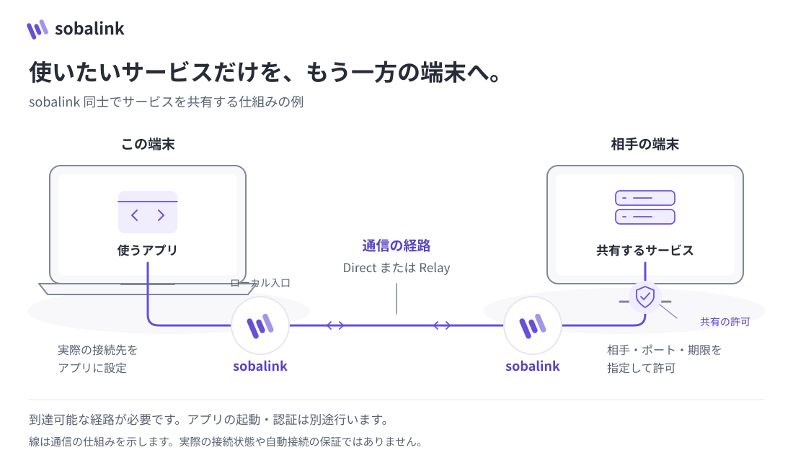

# sobalink

**0.5.2-alpha.1 リリース候補（このチェックアウト）。** オフラインでの画面再表示、確認付きの保存済み接続再開、停止状態の正確な表示、複数プロファイルのブラウザー利用を追加します。以前に公開・検証した基準は 0.5.1-alpha.1 です。候補のソースだけでは公開済みとは判断せず、導入前に署名付きリリースと同一ソースの検証結果を確認してください。実機での受入は別途必要です。

[English](README.en.md) · [使い方](docs/GENERIC.ja.md) · [確認範囲](docs/VERIFICATION.md)

実験的な OSS プロジェクトであり、利用者向けサポートは提供しません。文書は自分で確認するための資料で、回答・修正・互換性を約束するものではありません。

**離れていても、すぐそばに。** 端末同士をつなぎ、必要な TCP/UDP サービスを通じてアプリを使います。`soba` を起動し、ローカル画面で相手を選んで、SSH/SFTP・Web・データベースなどのポートへ接続します。この端末のサービスも、相手と有効期間を決めて共有できます。文字・画像・ファイル・フォルダーの送信にも対応します。Go に埋め込んだ React 画面と CLI は同じ許可判定を使います。

**管理者権限やルーターのポート開放を前提にせず、必要なサービスだけを共有。** sobalink は通常ユーザーのプロセスとして動き、TUN、OSの経路・ファイアウォール変更、ルーターのポート転送設定を必要条件にしません。共有する相手・ポート・有効期間を選びます。利用するネットワークでの到達性は必要で、既存のファイアウォールや端末間通信の分離によって接続できない場合があります。アプリやサーバー自身の導入・認証条件は別です。

**v0.5.1-alpha.1・実験的なソフトウェアです。** 公開版は [sobalink Releases](https://github.com/webkaz-labs/sobalink/releases) で版・ソース・署名付き資材と検証結果を確認してください。ソースの機能説明だけでは、その版での受入を示しません。実端末での認証・アプリ互換性・スマートフォン QR・ネイティブ IME・OS サインインとスリープ復帰は別の確認が必要です。[ソースごとの検証結果](docs/VERIFICATION.md)

<picture>
  <source media="(prefers-color-scheme: dark) and (max-width: 959px)" srcset="docs/assets/visuals/connection-ja-dark-narrow.svg">
  <source media="(max-width: 959px)" srcset="docs/assets/visuals/connection-ja-light-narrow.svg">
  <source media="(prefers-color-scheme: dark)" srcset="docs/assets/visuals/connection-ja-dark-wide.svg">
  
</picture>

[図を元の大きさで開く（横長）](docs/assets/visuals/connection-ja-light-wide.svg) · [縦長版](docs/assets/visuals/connection-ja-light-narrow.svg)

アプリには実際のローカル接続先を設定し、sobalink が相手の明示的に許可したサービスへ転送します。到達できる経路とアプリ側の認証は別途必要です。通常の Tailnet サービスでは相手側に sobalink は不要です。

## まず使う

### 導入する

[署名付き公開版の導入](docs/DISTRIBUTION.md#install-a-signed-prerelease)で、版を固定して起動します。正確な公開版・ソース・確認済みの範囲は[検証記録](docs/VERIFICATION.md#現在の統合と公開済みの基準)を正本とします。ソースから使う場合は[ビルド手順](docs/DISTRIBUTION.md#build-this-checkout)を参照してください。実行に Node は不要です。

公開版と開発ソースの機能は同じとは限りません。[利用ガイド](docs/GENERIC.ja.md)の対象版とプロフィール互換性を先に確認してください。この版には依頼・承認型の接続セットアップとテキストの永続送信待ちが含まれます。プロフィール形式 3 は v0.4.0-alpha.4 以前と非互換です。旧データを保全し、別の空の `--state-dir` を使ってください。自動移行・消去は行いません。

### 起動後の操作

1. 別の端末ウィンドウで `soba ui` を実行すると、コードをコピーせず同じ端末のブラウザーで開けます。手入力する場合は `soba ui --no-browser` を実行し、表示された正確な `http://127.0.0.1:ポート` で非公開の一回用コードを入力します。画面のない環境や SSH ではこの手動指定、非公開の機械向け出力には `soba ui --json` を使います
2. ネットワークを選びます。既存の Tailnet を利用する場合は、sobalink の独立ノードを公式の Tailscale 認証ページで参加させます。Tailcat LAN は明示した信頼できる中継先とペアリングを使います。ローカル画面と CLI から設定できます。[LAN 手順](docs/LAN.ja.md)。この公開版には明示して選ぶ[中継なしLAN](docs/DIRECT_LAN.ja.md)と[接続方式の併用](docs/MIXED_CONNECTIONS.ja.md)もあり、利用前に現在の検証範囲を確認してください
3. 相手・ポート・有効期間を確認してサービスを共有または接続します。表示された実際の接続先をアプリで使い、認証と動作を確認します
4. 文字やファイルを送る場合は、現在の識別情報を確認して意図した送信者を信頼します。文字は明示して送り、画像・複数ファイル・フォルダーは一括内容を確認します
5. 受信側は原則として一括ごとに保存先を決めて承認します。自動保存は、特定のバックエンド・信頼済み相手・信頼の世代・保存先を指定した場合だけ有効です
6. 使い終わったら個別停止、受信共有を止める `soba stop-shares`、信頼取消、または本体を止める `soba stop` を使います

例では `soba` を PATH 上の実行ファイルとして表記します。ソースビルドでは `./bin/soba`、Windows では `./bin/soba.exe` に読み替えます。起動した端末は開いたままにします。初回のネットワークは未選択で、勝手に認証や共有を始めません。[日英の画面・CLI手順](docs/GENERIC.ja.md)

## できることと境界

| 操作 | 範囲 |
| --- | --- |
| サービス共有 | 明示した相手、既定は有限の1時間、明示して解除までにも変更可能。TCP 範囲は予約入口を除いて扱う |
| 接続 | 既定は停止まで。通常の Tailnet サービスにも接続でき、相手側の sobalink は不要 |
| 保存した操作 | 停止状態の定義、プロフィール、グループ、確認付き入出力、リース付きローカルタスク。保存だけでは開始しない |
| 容量 | 論理制限は既定・有限・無制限から選択。調整できる有限の資源予算は別に管理 |
| 文字・画像・ファイル・フォルダー | 明示して送信。複数項目を一括確認。文字のコピーも手動 |
| 受信 | 一括承認が既定。保存先を固定した相手別の自動保存は希望制 |
| 即時送信の再試行 | 同じ起動中の未完了ファイルを先頭から再送。途中バイト・再起動後の再開はしない |
| 明示的な送信待ち | [ファイル・フォルダー](docs/DURABLE_OUTBOX.ja.md)と[テキスト](docs/DURABLE_TEXT.ja.md)に対応。元の ID・期限・保存記録を保って復旧し、ローカル受付と配達完了を区別する |
| ローカル操作 | 正確な `127.0.0.1` の一時ポート、一回用コード、セッション・Origin・CSRF の検査 |

受信ファイルを自動で開く・実行する・既存ファイルを上書きすることはありません。フォルダーの実行属性やリンクは引き継ぎません。ブラウザーからの空フォルダー選択にはブラウザー API の制限があるため、完全なフォルダー構成が必要なら CLI でも確認してください。

TCP の広い共有範囲は、許可期間中にその範囲で新しく起動したアプリにも適用されます。必要な範囲まで狭め、除外を設定してください。探索 `54543`、ピア API `54544`、ペアリング `54545` とバックエンド内部の入口はサービス共有から除外します。UDP とローカル接続の実待受には、既定64件の調整可能な有限予算があります。共有相手32件や一括256項目・1 GiBは論理制限の初期値で、固定の製品上限ではありません。論理制限を外しても、本人確認・パス安全性・通信形式・資源の検査は残ります。[容量の選択](docs/CAPACITY.ja.md) · [安全性](docs/SECURITY.ja.md)

Direct・Relay は暗号化された通信の経路、再接続は通信を作り直す状態です。経路が不明なら不明と表示し、遅延から推測しません。単一方式の設定では選択したネットワークを変更しません。併用モードでは、認証済みの同じ相手に明示許可した経路について、利用不能が確認できた場合に限り新しい接続で別経路を選べます。許可拒否や状態不明では切り替えず、既存 TCP の移行・再送は行いません。Tailcat に任意の公開中継先への自動フォールバックはありません。[ネットワークと設計](docs/ARCHITECTURE.md)

## 接続方法を選ぶ

LAN 外には通常 Tailscale を使います。LAN 内は[明示した中継でのペアリング・経路準備](docs/LAN.ja.md)、[中継なし LAN](docs/DIRECT_LAN.ja.md)、[接続方式の併用](docs/MIXED_CONNECTIONS.ja.md)を参照してください。任意の WAN 候補には、到達可能な互換中継と固定 pin が必要です。短い手順で接続するには[依頼・承認型のセットアップ](docs/CONNECTION_SETUP.ja.md)を使います。初回の鍵の受入（TOFU）は意図した実物の端末を証明しません。初回の確認を強める場合は、完全な指紋を独立した方法で照合してください。

経路準備は既存 TCP の無停止移行や物理 NIC の隔離を保証しません。アプリの再接続と、即時ファイルの再試行・明示的な送信待ちは別に扱います。[経路の契約](docs/ROUTE_RECOVERY_DESIGN.ja.md) · [検証と限界](docs/VERIFICATION.md#経路復旧の条件)

## CLI の短い例

sobalink 同士を Tailnet でつなぐ例です。まず各端末で登録し、現在の相手を確認します。

```sh
soba setup --network tailnet
soba login --browser
soba peers
```

### 共有する端末

SSH サーバー自身の起動と認証設定を別に行います。`CLIENT_PEER_ID` は利用を許可する端末に置き換えます。

```sh
soba --dry-run share --preset ssh --peers CLIENT_PEER_ID
soba share --preset ssh --peers CLIENT_PEER_ID
```

### 利用する端末

`SERVICE_PEER_ID` は SSH を提供する端末に置き換え、表示された実際の接続先を SSH クライアントに設定します。

```sh
soba connect --preset ssh --peer SERVICE_PEER_ID
soba status
```

SSH プリセットは TCP 22、接続側のローカル入口は 2222 です。Web は `--preset web` で TCP 8080／入口 8080 を候補にし、`--ports`・`--local-port` で明示的に変更できます。アプリ自身の認証は別に必要です。通常の許可済み Tailnet サービスを使う場合は、共有側の sobalink 操作は不要です。省略した名前には未使用名を選び、既存設定を上書きしません。

### 任意：文字・ファイルを送る

**受信する端末**で送信者の識別情報を確認し、`soba trust SENDER_PEER_ID` を実行します。**送信する端末**では受信先を指定して明示的に送ります。

```sh
soba message RECEIVER_PEER_ID "Hello"
soba send RECEIVER_PEER_ID ./image.png ./notes.txt ./sample-folder
```

受信側は通常、保存先を選んでバッチを承認します。この受信許可はサービス共有とは別です。終わったら、本体を停止したい各端末で `soba stop` を実行します。

ローカル画面または[案内付き CLI](docs/CLI_GUIDE.ja.md)でサービスを選択・編集・確認でき、明示した CLI オプションで自動処理も行えます。LAN のホスト／中継設定、招待のファイル入力、受信先、自動保存、サービスの保存・確認・コピー・再開始も JSON 編集なしで操作できます。[ブラウザー・リンク・QRによる認証](docs/SIGN_IN.ja.md)、[保存サービス・グループ・タスク](docs/SAVED_SERVICES.ja.md)、[起動・ログアウト](docs/LIFECYCLE.ja.md)も参照できます。`soba help examples`、`soba lan --help`、`soba service --help` を参照してください。`--dry-run` は適用前の入力確認で、到達性や空きポートの試験ではありません。言語は自動選択し、`soba --locale ja ...` / `en` で切り替えます。`status`・`peers`・グループ・サービス操作は日英の人向け表示を用意し、機械向け出力には `--json` を使います。詳細な型付き操作は構造化結果を返します。明示した認証表示では非公開の人向け案内を出します。`--json-errors` 指定時の失敗は標準エラーの `{code,error}` です。[詳しい CLI 手順](docs/GENERIC.ja.md#言語自動処理困ったとき)

任意の[認証付き TCP プロキシと診断](docs/PROXY_DIAGNOSTICS.ja.md)も用意しています。[明示的に許可した転送設定の管理](docs/RESOURCE_MANAGEMENT.ja.md)は限定した別機能です。ブロードキャスト送信や遠隔ファイル一覧は含みません。

[明示的な起動時接続・非公開プロキシ設定](docs/STARTUP.ja.md) · [アプリ設定・RustDesk](docs/CLIENT_HELPERS.ja.md) · [ローカル画面の操作](docs/WEB_CONTROLS.ja.md) · [0.3 系列の機能対応履歴](docs/FEATURE_PARITY.ja.md) · [文書一覧](docs/README.md)

[よくある疑問](docs/FAQ.ja.md) · [自分で確認できること](docs/TROUBLESHOOTING.ja.md)

## 開発と検証

[開発・使いやすさの基本方針](docs/DEVELOPMENT_PRINCIPLES.ja.md)を実装・文書・レビューの共通基準にします。[設計](docs/ARCHITECTURE.md)、[配布](docs/DISTRIBUTION.md)、[検証](docs/VERIFICATION.md)、[残る受入条件](docs/ROADMAP.ja.md)を参照してください。

Go の race / vet と画面の単体試験に加え、Linux x64/ARM64・macOS ARM64・Windows x64 のネイティブ CI、ロック済み画面資材の再生成、配布物の反復ビルド・署名・provenance・実導入確認を維持します。旧版の合格結果を新しいソースの証拠にはしません。
