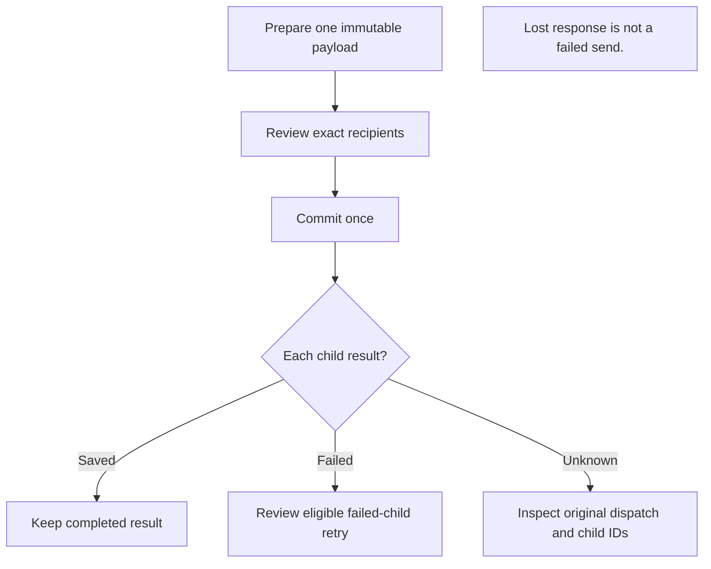

# Multiple-recipient send acceptance

[日本語](BATCH_SEND_ACCEPTANCE.ja.md) · [User guide](GENERIC.en.md)

The reviewed-send implementation and its automated fixtures are separate from
real-device acceptance. Passing a mocked backend, protected local IPC or a
three-process loopback test does not establish enrollment, browser behavior,
WAN/NAT reachability, OS login/suspend recovery or installed-package behavior.

## Choose the evidence you need

| Question | Start here | What a pass establishes |
| --- | --- | --- |
| Does reviewed dispatch preserve the exact content and recipients? | Narrow reproducible checks below | CLI/Core and protected-IPC contracts, within the stated fixtures |
| Does a partial failure retry only the failed recipient? | Three-process native case | Real loopback transport and exact saved bytes |
| Can the UI recover a lost commit response without another send? | Actual browser recovery check | Production UI/Core recovery against synthetic receivers |
| Does it work on physical devices after sleep or network changes? | [Verification](VERIFICATION.en.md) | A separate device/application acceptance record is required |



Text equivalent: prepare one payload, review the exact recipients, commit once, inspect each child result, then explicitly retry only failed children. A lost response calls for status recovery, not an assumed failed send.

## Narrow reproducible checks

Use the repository-pinned Go, Node and npm versions, prepare the pinned engine
with `go run ./cmd/prepare-engine`, and retain the ordinary transport build tags.
These commands perform local validation only; they do not publish or release.

```sh
export GOFLAGS='-mod=readonly -tags=ts_omit_portmapper,ts_omit_captiveportal,ts_omit_useproxy'
go test -race -count=1 -timeout=2m ./cmd/soba -run '^TestTransferDispatchCLI'
go test -race -count=1 -timeout=4m ./internal/core -run '^Test(Dispatch|UploadDispatch|SharedPayload|OutgoingDispatch|PreparedDispatch|OutgoingRetryUsesGlobal|QueuedDispatch)'
go test -race -count=1 ./internal/webui ./internal/capacity
go vet ./cmd/soba ./internal/core ./internal/webui ./internal/capacity
```

`TestTransferDispatchCLIProtectedIPC` exercises the real CLI, private native
socket or named pipe, production command routing, actual staging and Core DTOs
in both locales. Peer inventory and transport are bounded fixtures; this test
does not establish delivery.

`TestTransferDispatchCLIInProcessCoreContract` separately exercises the same
CLI/Core content and receipt assertions without an IPC endpoint. Its pass is
in-process contract evidence, never a replacement for protected-IPC acceptance.

Run the separate real-transport case on a supported native host:

```sh
SOBALINK_RUN_DIRECT_INTEGRATION=1 python .github/scripts/ci-go-test.py --exact \
  --expect github.com/webkaz-labs/sobalink/internal/core:TestTransferDispatchThreeProcessPartialRetry \
  -- go test -race -count=1 -timeout=4m \
  -tags=lanlink_integration,directlan_integration,ts_omit_portmapper,ts_omit_captiveportal,ts_omit_useproxy \
  ./internal/core -run '^TestTransferDispatchThreeProcessPartialRetry$'
```

This case uses one sender and two independent receiving Core processes with
native peer HTTP and synthetic files. It requires an exact pass, never a skip.
It checks no offer before commit, one staged payload, immutable reviewed bytes,
exact ordered recipients, stable repeated commit/status receipts, one completed
recipient plus one partial failure, retry of only the failed child, preservation
of previously saved files, and cleanup after the final owner completes. The
partial failure removes and restores one synthetic staged file; peer replies
and saved bytes are not substituted.

The native CI job runs this exact case on all four existing native targets.
Adding the fixture to CI does not mean any particular revision has passed it.
Keep unavailable native execution recorded as unperformed; do not alter socket,
browser sandbox, trust or transport protections to make a restricted host pass.

## Actual browser recovery check

The existing transfer browser harness also runs
`TestTransferDispatchThreeProcessBrowser` on its supported browser host. It uses
the production UI and authenticated Core Web endpoint: select two recipients,
upload once, observe the genuine prepared response with no outgoing children,
let Core commit once, and lose only that successful response. The English UI
must prevent resending; an explicit status check in Japanese at a narrow width
must recover the same dispatch and child IDs. Both independent receivers then
save the original bytes exactly once, and final staging is removed.

With the repository-pinned Node, npm and official Playwright Chromium prepared:

```sh
SOBALINK_RUN_DIRECT_INTEGRATION=1 SOBALINK_RUN_TRANSFER_BROWSER_NATIVE=1 \
  python .github/scripts/ci-go-test.py --exact \
  --expect github.com/webkaz-labs/sobalink/internal/core:TestTransferDispatchThreeProcessBrowser \
  -- go test -race -count=1 -timeout=4m \
  -tags=lanlink_integration,directlan_integration,ts_omit_portmapper,ts_omit_captiveportal,ts_omit_useproxy \
  ./internal/core -run '^TestTransferDispatchThreeProcessBrowser$'
```

The existing private login/CSP, bounded process cleanup and browser settings
remain in use. Public summaries contain fixed counters and booleans only, never
login material, recipient identities, paths or receipts. This additional gate
is authored coverage until the exact revision actually passes; it does not
replace real-device or installed-package acceptance.

## Frontend and remaining acceptance

After the source is stable, run `npm --prefix web run build`, then
`python .github/scripts/check-frontend.py`. The latter installs the exact lock
twice, runs the frontend tests, and compares both rebuilds to checked-in assets.
Retain the existing browser configuration and run its normal acceptance job for
the final commit. Unit checks are not a substitute for real browser acceptance.
Real-device and installed-binary gates remain separate release requirements.
