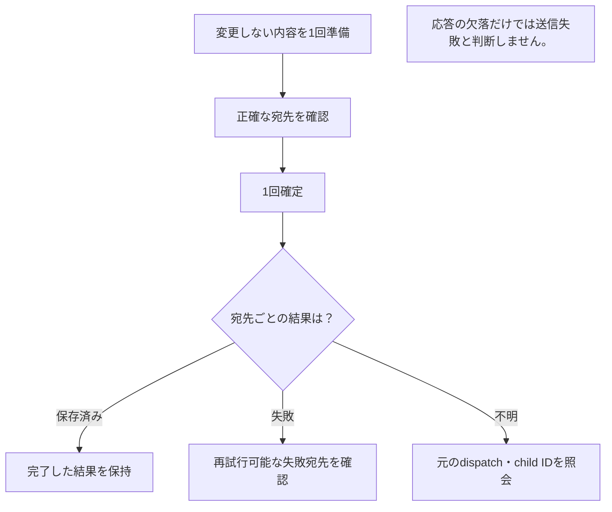

# 複数相手への送信の受入確認

[English](BATCH_SEND_ACCEPTANCE.en.md) · [利用ガイド](GENERIC.ja.md)

確認付き送信の実装と自動試験は、実機での受入確認とは別です。
模擬バックエンド、保護されたローカル IPC、3プロセスのループバック試験に
成功しても、登録、実ブラウザー、WAN/NAT 到達性、OS ログイン・サスペンド後の
復旧、インストール済み配布物の動作を確認したことにはなりません。

## 必要な証拠から選ぶ

| 確認したいこと | 参照先 | 合格から分かる範囲 |
| --- | --- | --- |
| 確認した内容と宛先を保持するか | 下記の範囲を絞った検査 | 記載した fixture 内の CLI/Core・保護された IPC の契約 |
| 一部失敗で失敗した宛先だけ再試行するか | 3プロセスの native ケース | 実 loopback 通信と保存内容の一致 |
| commit 応答消失後に再送せず復旧できるか | 実ブラウザーでの復旧確認 | 架空の受信側に対する製品 UI/Core の復旧 |
| 実端末の休止・ネットワーク変更後も動くか | [検証](VERIFICATION.md) | 別途、実端末・アプリの受入記録が必要 |



図の説明: 内容を1回準備し、宛先を確認して確定した後、各宛先の結果を確認します。再試行は失敗した宛先だけ明示的に行います。応答消失時は送信失敗と決め付けず、状態を取得して復旧します。

## 範囲を絞った再現可能な検査

リポジトリ指定の Go・Node・npm を使い、`go run ./cmd/prepare-engine` で
固定したエンジンを準備します。通常の転送用ビルドタグを維持してください。
以下はローカル検証のみで、公開やリリースは行いません。

```sh
export GOFLAGS='-mod=readonly -tags=ts_omit_portmapper,ts_omit_captiveportal,ts_omit_useproxy'
go test -race -count=1 -timeout=2m ./cmd/soba -run '^TestTransferDispatchCLI'
go test -race -count=1 -timeout=4m ./internal/core -run '^Test(Dispatch|UploadDispatch|SharedPayload|OutgoingDispatch|PreparedDispatch|OutgoingRetryUsesGlobal|QueuedDispatch)'
go test -race -count=1 ./internal/webui ./internal/capacity
go vet ./cmd/soba ./internal/core ./internal/webui ./internal/capacity
```

`TestTransferDispatchCLIProtectedIPC` は、実際の CLI、専用のネイティブ
ソケットまたは名前付きパイプ、製品のコマンド処理、実ファイルの準備、Core の
DTO を日英で検査します。相手一覧と転送先は有限の模擬実装のため、配送確認には
なりません。

`TestTransferDispatchCLIInProcessCoreContract` は、同じ CLI/Core の内容と
受付結果を IPC の待受なしで別途検査します。成功はプロセス内の契約確認であり、
保護された IPC の受入確認の代わりにはなりません。

対応するネイティブ環境では、実転送の独立した試験を実行します。

```sh
SOBALINK_RUN_DIRECT_INTEGRATION=1 python .github/scripts/ci-go-test.py --exact \
  --expect github.com/webkaz-labs/sobalink/internal/core:TestTransferDispatchThreeProcessPartialRetry \
  -- go test -race -count=1 -timeout=4m \
  -tags=lanlink_integration,directlan_integration,ts_omit_portmapper,ts_omit_captiveportal,ts_omit_useproxy \
  ./internal/core -run '^TestTransferDispatchThreeProcessPartialRetry$'
```

この試験は送信側1つと受信側2つの独立した Core プロセス、ネイティブの相手間
HTTP、架空のファイルを使います。対象試験の明示的な成功が必要で、スキップを
成功とは扱いません。確定前のオファーがないこと、準備コピーが1つだけであること、
確認済み内容の固定、宛先と順序の一致、commit/status の反復で受付 ID が変わらない
こと、一方の完了と他方の部分失敗、失敗した子バッチのみの再試行、保存済みファイル
の維持、最後の所有者の完了後の削除を検査します。部分失敗は架空の準備ファイル1つ
を一時的に削除して再現し、相手の応答や保存データは差し替えません。

ネイティブ CI は既存の4対象すべてでこの試験を実行します。CI への追加自体は、
特定のリビジョンが試験に成功した証拠ではありません。実行できない環境では未実施と
記録し、通過させるためにソケット、ブラウザーの sandbox、信頼、転送の保護を
変更しないでください。

## 実ブラウザーでの復旧確認

既存の転送用ブラウザー試験は、対応するブラウザー環境で
`TestTransferDispatchThreeProcessBrowser` も実行します。製品 UI と認証済みの
Core Web 接続を使い、2つの宛先を選択して1回だけアップロードします。実際の
準備応答と送信子バッチがまだないことを確認した後、Core は1回だけ確定し、その
成功応答だけを失わせます。英語 UI は再送を防ぎ、狭い画面の日本語 UI から明示的に
状態を確認すると、同じ送信 ID と子バッチ ID が復元される必要があります。
独立した両受信側で元の内容が1回ずつ保存され、最後に準備用データが削除されます。

指定の Node・npm と公式 Playwright Chromium を準備して実行します。

```sh
SOBALINK_RUN_DIRECT_INTEGRATION=1 SOBALINK_RUN_TRANSFER_BROWSER_NATIVE=1 \
  python .github/scripts/ci-go-test.py --exact \
  --expect github.com/webkaz-labs/sobalink/internal/core:TestTransferDispatchThreeProcessBrowser \
  -- go test -race -count=1 -timeout=4m \
  -tags=lanlink_integration,directlan_integration,ts_omit_portmapper,ts_omit_captiveportal,ts_omit_useproxy \
  ./internal/core -run '^TestTransferDispatchThreeProcessBrowser$'
```

既存の非公開ログイン・CSP、時間制限付きのプロセス終了処理、ブラウザー設定を
維持します。公開する要約は固定の件数と真偽値だけで、ログイン情報、宛先の識別情報、
パス、受付結果は含めません。この追加条件は、対象のリビジョンが実際に通過するまで
実装済みの検査であり、実機やインストール済み配布物の受入確認には代わりません。

## フロントエンドと残る受入確認

ソースを確定して `npm --prefix web run build` を実行した後、
`python .github/scripts/check-frontend.py` を実行します。後者は同じ lock を2回
インストールしてフロントエンド試験を実施し、両方の再ビルド結果を登録済み資産と
比較します。既存のブラウザー設定を維持し、最終 commit に対して通常の受入ジョブを
実行してください。単体検査は実ブラウザー受入の代わりにはなりません。
実機とインストール済み配布物の検証は、別のリリース条件として残ります。
