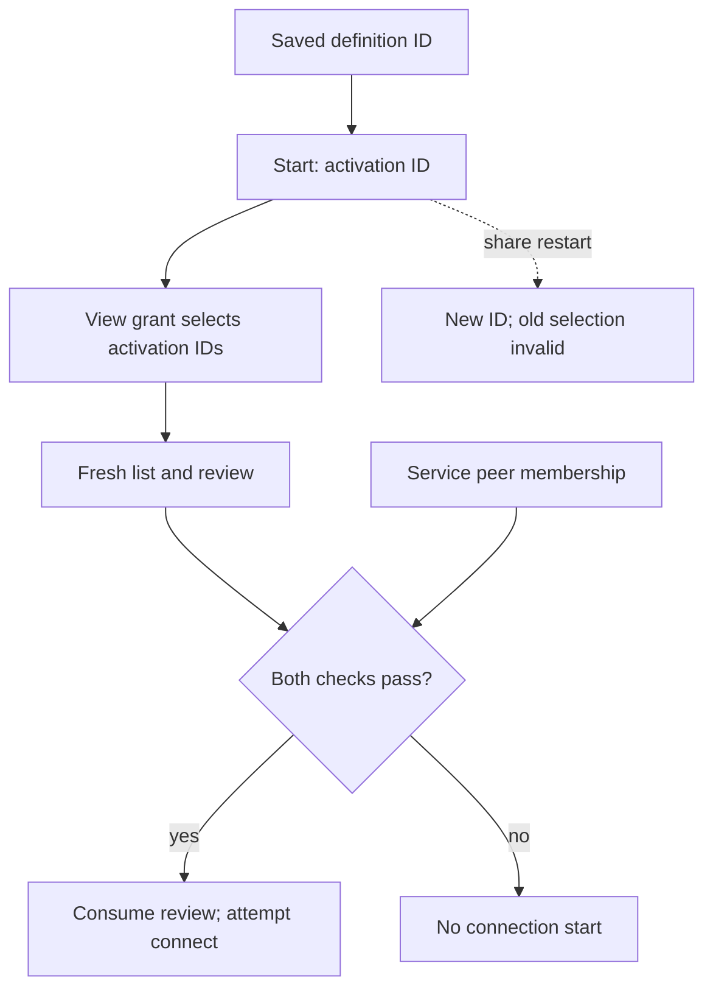

# Shared-service catalog view contract

[日本語](CATALOG_VIEW_CONTRACT.ja.md) · [Development principles](DEVELOPMENT_PRINCIPLES.en.md) · [v0.5.0-alpha.1](https://github.com/webkaz-labs/sobalink/releases/tag/v0.5.0-alpha.1)

This implementation adds eligibility data, owned private storage, explicit local
approval/revocation and a bounded peer list exchange. It retains original transport
attribution and implements Web/CLI review flows. Native DirectLAN tests exercise
list/connect over genuine transports within one test process and independent child
processes. Linux CI verifies the actual browser workflow against those child
processes; use the exact commit's CI result as acceptance evidence. Historical catalog rows remain
stale and viewing does not authorize a connection.
Release and exact-source acceptance status belong to the [verification record](VERIFICATION.en.md).

## View, review, then connect

The finite view grant selects current activation IDs for one exact peer; it does not add that peer to the service’s connection membership. Connect re-fetches the selection and validates the original transport, share generation, review conditions and current membership, then consumes the review before attempting a start. A failed or uncertain start needs a new list/review. Restarting a share requires a new explicit activation selection; save-only keeps configuration, not catalog authority.

## Exact selection and coexistence

`resourcegrant.CatalogViewEnvelope` is independent of the existing inspection and
management `Envelope`. Their decoders reject each other's data. Existing grant
records, revisions, clock, single-active rule and runtime fences remain unchanged.
The catalog envelope has its own revision history, clock and at most one active
catalog grant, stored in `resource-catalog-views/state.json`. Unknown, corrupt,
replaced or previously observed missing state is denied. No legacy grant migration
creates catalog authority. Approval and revocation preserve the existing grant file.

Each catalog record selects one managed DirectLAN `Relationship` (target key,
peer key and immutable pair binding), one resource target, and a sorted, unique
list of 1–16 shared-service activation IDs. Those IDs are minted by the existing
share activation, not saved service configuration IDs. Restarting a share produces
a different ID and requires a new explicit selection. No wildcard, connection,
settings inspection or management action can be represented in this model.

`MatchesSelection` narrows eligibility only: it rejects another relationship,
pair binding, activation ID, revoked/expired state and an invalid lifetime.
It is not a transport admission gate. The owning coordinator retains
monotonic expiry, checks current ownership and relationship, and performs bounded
final disclosure under the original publication origin and current view grant.
Connection still uses the existing independent service permission.

## Publication attribution

Discovery retains the single actual HTTP application's transport origin while
publishing its result under the existing publication permit. Cache deletion and
backend reset clear that origin too. DirectLAN catalog reads use the retained
origin; they cannot reconstruct it by capturing today's peer. Missing, stopped
or replaced origins reject the captured source. Multiple-route attribution is
unsupported. Historical local-catalog rows remain `stale`. The separate catalog-view exchange
uses explicit grant admission and retained provenance; changing a timestamp
cannot make a historical advertisement current.

## Local control and list exchange

The standard owning agent enables the implementation without creating a catalog
grant. Authenticated local commands are `resource.catalog.view.preview`, `confirm`,
`inspect`, `revoke` (each with the same prefix) and `resource.catalog.view.list`.
Preview selects target, peer key, exact service IDs and finite expiry without
writing. Confirm requires the unchanged review and explicit `confirm: true`;
revoke requires exact target, grant ID/revision and confirmation. Review hashes
are bound to this process. Saving failure freezes catalog access before activation.
Reopen preserves the absolute expiry and anchors a new boot's remaining monotonic
cutoff; it never gives another full lifetime. Clock uncertainty denies disclosure.

List selects one remote peer and an exact versioned target/grant selector. The
peer POST `/v1/catalog/services` accepts no self-claimed peer identity. It uses the
existing owned DirectLAN HTTP connection, managed relationship and original origin.
Only granted, active share generations are returned. `connectAllowed` separately
reports the current share's peer membership; viewing never changes that membership.
After final ownership, grant and service checks, the same revocable fence admits
one precomputed bounded response. A response admitted before revocation may finish;
revocation closes the fence before fallible persistence and denies later admission.

The receiver retains one explicitly selected view and original attribution in
private memory. Its public review revision is only a local reference. It cannot
promote historical catalog rows or replace remote grant revalidation before connect.

## Connection review and local entry points

The local CLI now exposes `resource catalog view preview|confirm|inspect|revoke|list`.
Providers choose current `shares[].activationId` values from local status, which
are distinct from saved definition IDs. The receiver chooses one DirectLAN peer
and an exact target/grant/revision. The Web services view passes an allowed row
to the existing ServiceDialog; CLI connect accepts `--catalog-review` and
`--catalog-service` alongside the exact peer and ordinary connection conditions.

`service.connect` re-fetches the exact selector before starting. It checks the
retained receipt/process, original authenticated transport generation, managed
relationship, selected share generation, all returned conditions and current
connection membership. It consumes that receipt before saving or starting, then
uses the existing service transport. A failed or unknown start requires a new
list/review. Original transport stop or advertised share expiry cancels the
connection lifetime, including established streams. Remote revocation after an
already-admitted list response is not an atomic transaction with a local start;
the existing provider-side service membership still controls actual traffic.

The UI discards old selections after input/context changes or navigation away,
prevents concurrent repeated submissions and ignores late canceled results.
Save-only stores ordinary connection configuration, without catalog authority
or a durable share-generation review; it explains that another list is required.

## Test coverage and acceptance boundaries

Data/storage and in-process integration tests cover consent/revoke, failed save,
prepared disclosure versus revocation, legacy-grant preservation, retained-origin
rejection, view-only denial, fresh review, actual HTTP forwarding and review reuse.
Web component/navigation tests use fixtures and remain distinct from real-browser tests.

The [three-process integration tests](../internal/core/resource_catalog_view_process_integration_test.go)
exercise managed DirectLAN list/connect and a separately selected actual-browser
workflow. The [CI workflow](../.github/workflows/ci.yml) runs the browser case against
independent agents. This supersedes the earlier fixture-only development description;
it does not make every race or physical scenario verified. Use the exact source's
recorded results rather than test existence as evidence of a pass.

Physical devices, actual LAN/VPN transitions and OS lifecycle acceptance remain
separate. Final-source regression and signed distribution retain their own gates;
see [verification](VERIFICATION.en.md). Existing browser sandbox protections and CI
requirements are unchanged.
