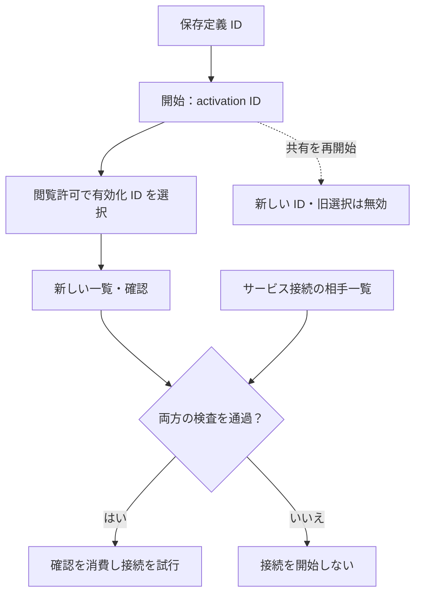

# 共有サービス一覧の閲覧契約

[English](CATALOG_VIEW_CONTRACT.en.md) · [開発原則](DEVELOPMENT_PRINCIPLES.ja.md) · [v0.5.0-alpha.1](https://github.com/webkaz-labs/sobalink/releases/tag/v0.5.0-alpha.1)

閲覧許可の適格性データ、所有権を確認する private 保存、明示承認・取消、容量を
限定した相手との一覧取得を実装しています。元の transport origin を保持します。
Web／CLI のレビュー導線も実装しました。同一テストプロセスと独立した子プロセスの
実 DirectLAN 通信で一覧と接続を検査します。Linux CI は実子プロセスに接続する
ブラウザー導線を検査し、受入の証拠には正確なコミットの CI 結果を使います。既存 catalog 行は stale
のままで、閲覧は接続権限を与えません。公開状況と正確なソースの受入は
[検証記録](VERIFICATION.md)に従います。

## 閲覧・確認・接続を分ける

有限の閲覧許可は正確な相手1台に現在の activation ID を選びますが、接続可能な相手には追加しません。接続は選択を再取得し、元の通信・共有の世代・確認条件・現在の相手の所属を検査して、開始を試みる前に確認を消費します。開始失敗や結果不明の場合は新しい一覧・確認が必要です。共有の再開始には新しい有効化の明示選択が必要で、保存のみの操作は設定を残しますが、カタログの権限は保持しません。

## 明示選択と既存許可との共存

`resourcegrant.CatalogViewEnvelope` は既存の検査・管理用 `Envelope` から独立し、
それぞれのデコーダーは相互のデータを拒否します。既存の許可レコード、世代、
時刻、active 最大1個の制約、実行時 fence は変更しません。閲覧用には独立した
世代・時刻と active 最大1個の契約を用意し、`resource-catalog-views/state.json`
に保存します。未知・破損・置換・観測済み状態の消失は拒否します。既存許可からの
移行で閲覧権限を作らず、承認・取消の前後で既存の許可ファイルを保持します。

閲覧レコードは、1つの managed DirectLAN `Relationship`（提供元鍵、相手鍵、
不変のペア binding）、1つのリソース、重複のない昇順の共有 activation ID
1～16個に限定します。ID は既存の共有開始時に生成され、保存設定の ID とは
異なります。共有を再開した場合は ID が変わり、改めて明示選択が必要です。
ワイルドカード、接続、設定検査、管理操作の許可は表現できません。

`MatchesSelection` は適格性の絞込みであり、別相手・別ペア binding・別 activation
ID・取消・期限切れ・不正な期限を拒否します。通信の admission ではありません。
所有権を確認する coordinator は単調な期限、現行の所有権と関係を保持・
確認し、元の publication origin と現行の閲覧許可の下で最終開示を制御します。
接続には引き続き独立した既存のサービス許可が必要です。

## 元の公開情報の保持

発見情報は、既存の publication permit の下で結果を公開するとき、実際の HTTP
処理の単一 transport origin を保持します。キャッシュ削除・backend 初期化時に
origin も消去します。DirectLAN の catalog は保持した origin を使い、現在の相手
を再取得して過去の提供元情報を作り直しません。origin の欠落・停止・置換は
取得元の拒否になります。複数経路の帰属は未対応です。過去のローカルカタログ行は
`stale` のままです。独立した一覧閲覧の通信で、明示した許可の admission と保持した
提供元情報を使います。取得時刻の更新だけで古い広告を current にしません。

## ローカル操作と一覧取得

標準の所有者プロセスは実装を有効にしますが、閲覧許可は作りません。ローカル
認証済みコマンドは `resource.catalog.view.preview`、同じ接頭辞の `confirm`、
`inspect`、`revoke` と `resource.catalog.view.list` です。preview は提供元・相手鍵・
共有 ID・有限期限を選択し、保存しません。confirm は変更のないレビューと明示した
`confirm: true`、revoke は正確な提供元・許可 ID／世代と確認を要求します。レビュー
のハッシュは起動プロセスに結び付けます。保存失敗時は有効化前に閲覧を拒否します。
再起動は絶対期限を保持し、その起動の残り時間を単調な cutoff に結び付けます。
元の期間を新たに付け直しません。時刻の不確実性は開示を拒否します。

list は相手1台と、版・提供元・許可 ID／世代を明示します。相手への POST
`/v1/catalog/services` は自己申告の相手 ID を受け取りません。既存の所有権を
保持する DirectLAN HTTP 接続、managed 関係、元 origin を使い、許可された現在の
共有世代だけを返します。`connectAllowed` は現在の共有の相手一覧への所属を別に
示し、閲覧でその所属を変更しません。最後の所有権・許可・共有の確認後、取消可能な
同じ fence が計算済みで容量を限定した応答1回を承認します。取消前に承認済みの
応答は完了できます。取消は保存より先に fence を閉じ、その後の承認を拒否します。

取得側は明示選択された一覧1件と元 origin を private メモリーに保持します。公開する
レビュー世代はローカル参照に限り、既存 catalog 行の current 化や接続前の相手側
許可の再確認の代わりには使いません。

## 接続レビューとローカルの導線

CLI に `resource catalog view preview|confirm|inspect|revoke|list` を追加しました。
提供側はローカル状態の `shares[].activationId` で現在の共有世代を選びます。
保存済み定義の ID とは別です。閲覧側は DirectLAN の相手1台と正確な対象・許可・
変更番号を選びます。Web は接続可能な行を既存 ServiceDialog へ渡します。
CLI は通常の接続条件と正確な相手に `--catalog-review`・`--catalog-service` を添えます。

`service.connect` は開始直前に同じ許可情報で一覧を再取得し、保持したレビュー・
起動世代・元の認証済み transport 世代・managed 関係・共有世代・全条件・現行の
接続許可を検査します。保存・開始より先にレビューを1回消費し、既存のサービス転送路を
使います。開始失敗・結果不明の後は新しい一覧と確認が必要です。元 transport の停止や
共有の期限到達は、確立済みの接続を含む接続の lifetime を取り消します。
すでに承認した一覧応答の後の遠隔取消とローカル開始は単一の同時操作ではありません。
実通信の許可は既存の提供側サービスの相手一覧で引き続き検査します。

Web は入力・相手・起動世代などの変更や画面離脱で古い選択を破棄し、重複送信と
取消後の遅延応答を抑止します。「保存のみ」は通常の接続設定を保存し、閲覧許可や
共有世代の確認は保存しません。後で接続するには一覧の再取得が必要だと表示します。

## 試験範囲と受入の境界

データ・保存と同一プロセスの統合試験は、承認・取消、保存失敗、準備済み開示と取消、
既存許可の保持、元 origin の拒否、閲覧のみの接続拒否、新しい確認、実 HTTP 転送、
レビュー再利用の拒否を扱います。画面・ナビゲーションの fixture 試験と実ブラウザー
試験は区別します。

[3プロセスの統合試験（オンラインのソース）](https://github.com/webkaz-labs/sobalink/blob/main/internal/core/resource_catalog_view_process_integration_test.go)は、
managed DirectLAN の一覧・接続と、別に選択する実ブラウザー導線を扱います。
[CI（オンラインのソース）](https://github.com/webkaz-labs/sobalink/blob/main/.github/workflows/ci.yml)は独立した本体プロセスに接続する browser ケースを実行します。
以前の fixture のみという開発段階の説明は現在の試験構成に当てはまりません。ただし、
すべての競合・実機シナリオの合格を意味しません。試験の存在を合格の証拠にせず、
正確なソースで記録された結果を使います。

実端末、実 LAN／VPN 移動、OS ライフサイクルの受入は別です。最終ソースの回帰と
署名付き配布にも個別の条件があり、[検証記録](VERIFICATION.md)に従います。
既存のブラウザー sandbox 保護と CI 条件は変更しません。
