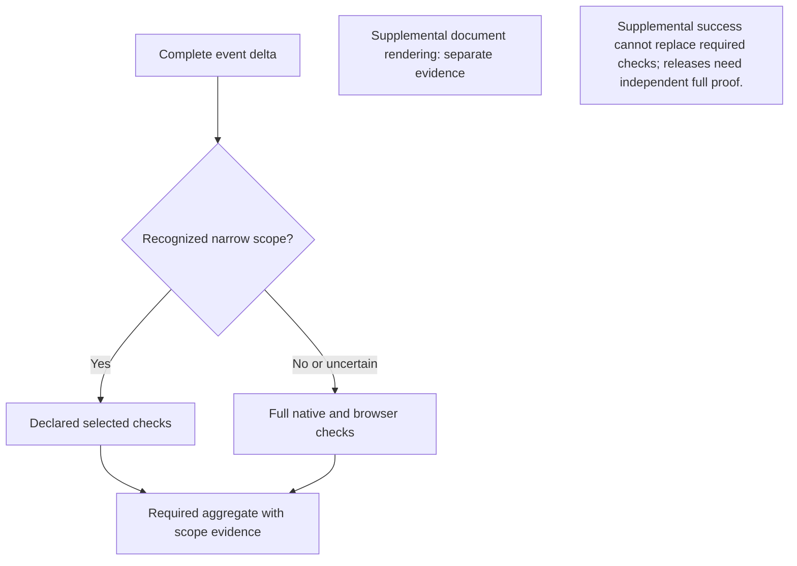

# CI matched to the change

[日本語](CI_EFFICIENCY.ja.md) · [Verification](VERIFICATION.en.md) · [Development principles](DEVELOPMENT_PRINCIPLES.en.md)

Run the checks affected by the complete change. Ordinary documentation does not need an application build or four operating systems. Frontend changes need frontend and browser checks. Sensitive, shared or uncertain changes keep the complete native matrix. Every prerelease still runs the independent full validation and distribution/signature/install gates.

Here, a **native matrix** is the set of OS/CPU targets and independent test lanes. A **gate** is a check that must pass before proceeding. A **receipt** records the source, checks and results; it does not replace executing those checks. **Provenance** records where build inputs and artifacts came from.

## Choose a check, then read its scope

1. Classify the **complete** PR/main change using the scope table below. Unknown, policy or provenance paths stay full.
2. Read `ci-required` and the named jobs for that exact source and attempt. A green skipped-job aggregate does not mean the application ran.
3. Before a prerelease, require exact-source full validation plus the independent signing, provenance, public retrieval and installed-binary gates.

Text equivalent: classify the complete change; run only a recognized narrower suite or the full suite; report the actual scope. Release eligibility still requires its independent exact-source full proof.

## Scope

| Complete change | Checks |
| --- | --- |
| Ordinary root README/SECURITY, top-level `docs/*.md`, explicitly reviewed internal/Web prose, or known document SVG variants | Required document checks: immutable Git scope proof, Markdown/local links/anchors/alt text and safe SVG validation. Changed diagrams also require reproduction/rendering; application tests, builds and packages are not run |
| `web/src` TypeScript/TSX/CSS or existing `web/browser/*.mjs` acceptance code, optionally with ordinary prose | Linux frontend unit tests, two matching exact-lock builds, fixture safety tests and real browser acceptance |
| Accompanying generated `web/dist` changes | Included in frontend scope only with a frontend source change; regeneration must match |
| Reviewed Go-only changes in `internal/servicepresets` or `internal/boundedlog`, optionally with ordinary prose | Changed packages and transitive reverse dependencies, including test imports, tested with race detection and vet on Linux |
| Reviewed CLI presentation changes on PRs or main, optionally with ordinary prose | All four native short/safety suites, browser and package/manifest checks; three real-time lifecycle/lease gates and native resource inspection, management and fixed-group catalog are not run |
| Reviewed existing native companion UI files, optionally with ordinary prose | Documents and shared policy checks, all four companion race suites with protected IPC pass evidence, MyGo vet/format/compile and Windows/macOS product package build/smoke; backend qualification and browser/manifest checks are not run |
| Transport, authentication, Core, configuration, timers, shared helpers, dependencies, lockfiles, build configuration, CI policy/workflows, or any unknown path | Full native Linux amd64/arm64, macOS arm64, Windows amd64, browser and package/manifest validation |
| Combinations of the reviewed CLI presentation, frontend and scoped-Go domains | All four native short/safety suites, browser and package/manifest checks; three real-time lifecycle/lease gates and native resource inspection, management and fixed-group catalog are not run |
| Platform-specific Go, cgo, unreviewed imports, policy/provenance Markdown, unsafe modes/types or unverifiable input | Full |
| Daily scheduled validation, manual full validation or any prerelease | Full |

### Required document checks

Every selected scope runs the `documents` job, and `ci-required` rejects a missing, skipped, failed or cancelled document job or required check step. Static checks cover all tracked Markdown and the reviewed SVG set. Ordinary prose changes do not install Node, Chromium or rendering dependencies. A changed Mermaid block, diagram image or local image reference selects rendering; uncertain selection and full CI render conservatively. Rendering dependencies are installed from the exact lock into a temporary directory outside the checkout, and generated images never modify the source tree.

The extra prose and 88 SVG variants are file-level allowlists in `ci-impact.py`; an arbitrary README, SVG or Python file is not enough to qualify. Document generators, rendering/checking scripts, dependency manifests/locks, workflow changes, agent/development policy and unknown paths still require full application CI. Both old and new rename endpoints and file modes remain part of classification. The document checker independently verifies the current event/commit/tree and reproduces selection; an artifact or a previous successful run cannot grant a skip.

Performance targets, excluding runner queue time, are a required result within three minutes for prose-only changes and five minutes for diagram changes. These are measured targets, not verified timing guarantees; receipts retain current job timings. A document-only success is never application, native or release-validation evidence.

### Native-short for reviewed changes

The `native-short` allowlist contains exactly `cmd/soba/help.go`, `cmd/soba/errors.go`, `cmd/soba/errors_test.go`, `cmd/soba/human_output.go` and `cmd/soba/human_output_test.go`. New paths, new imports, build directives and mixtures with unreviewed categories remain full. Combinations with the existing frontend and scoped-Go domains use all four native-short targets. Pure docs/frontend/scoped-Go changes retain their narrower existing scopes. Both old and new changed blobs are checked, including complete affected scoped-Go packages even in mixed plans. The complete authenticated PR merge or main-push diff must qualify; a later presentation-only commit cannot hide an earlier runtime change. Generated assets still require a corresponding frontend source change.

This scope omits natural direct-LAN rekey/idle lifecycle, guarded relay real-time lease continuity, relay-only real-time lease/idle continuity, and the separate full-only native resource inspection, management and fixed-group catalog gates. Four-target race/vet, repeated IPC, Windows directory barriers, context TCP/TLS control, managed activation/restart, functional direct/relay recovery, synthetic expiry/rekey, browser, packages and manifest validation remain. The independent seven-case Web and two-case product jobs retain their native-short PR/manual entry conditions and failure behavior; proven documentation-only PRs omit these jobs, while scheduled full runs require both. Test repetition counts and production timers are unchanged.

Authenticated main pushes can use the same closed native-short selection as PRs. Created/deleted/forced main pushes and unsupported events still require full validation. Keep the exact-source full validation gate below in place before deploying this main-shortening policy; a short green workflow cannot establish release eligibility. Related transport/lifecycle changes remain full; the native-short allowlist, per-family long-test routing and test repetition counts are unchanged. Daily full runs are described below.

The Go allowlist is deliberately small. It is not permission to run any Go change on one operating system. OS-specific files, build constraints and dependencies outside the reviewed package boundary require the full matrix. The scoped runner uses current Go import graphs, including integration-tag variants for reverse-dependency selection, but executes ordinary Linux tests rather than the long native integration suites. If graph discovery is uncertain, it runs all ordinary Go packages. Failed commands and missing actual test passes remain failures.

Markdown used as development policy or upstream source provenance is not ordinary prose. The required root documents must remain present. Guides are included in release archives, but that alone does not require rebuilding the application for every prose edit. Code and release validations continue checking the package contents. The separate resource and relay measurement workflows are triggered by their implementation inputs, not wording changes in their reports.

### Native UI-only changes

`native-ui` accepts modifications of the exact files in `NATIVE_UI_IMPORTS` in
`.github/scripts/ci-impact.py`: ten existing view/theme/presentation files and
three individually reviewed UI test files. Both old and new blobs must remain
regular text with reviewed imports and no build/embed/link directives. Added,
deleted, renamed or unknown files stay full. Operational files (`app.go`,
`model.go`, `exchange.go`, pane operations, `tray.go`, `filepane_dialog.go`),
module manifests, packaging and UI policy documents stay full. A native UI edit
combined with Web, scoped-Go or CLI changes also stays full initially.

These files share `package main` and can invoke operations without a new import.
This is a reviewed coverage boundary, not proof of pure presentation. The
required `native-ui` lane checks the exact PR merge/main tree on Linux x64/ARM64,
macOS ARM64 and Windows x64. Each target runs the complete companion race suite
with `native_integration`; `ci-go-test.py` must observe an actual successful
`TestNativeProtectedIPCCoreExchange`. Go 1.27.3 and the module-pinned MyGo tool
perform vet, formatting and compilation checks. Windows/macOS additionally use
the normal Go 1.27.1 product packager, its nested native module toolchain and the
archive smoke verifier, including companion identity and offline execution.
Pinned Node/npm and locked `npm ci` supply package/license inventory only; Web
tests and builds are not repeated. The extracted archive binaries also retain
the old device/message/file pane renders and both binaries’ unsigned Windows or
ad-hoc macOS signature-state checks. The checks do not sign binaries.
Documents and the common policy job must also succeed.

Only a separately proven native UI merge scope suppresses duplicate HEAD-only
`native-poc` work. All other scopes, manual runs and uncertain classification
retain that workflow's existing checks. UI-only PRs build/smoke product archives
locally instead of producing the separate device-test kit. Manual `native-poc`
still creates and tests its runner-local kit; neither route uploads downloadable
kits or archives. This output change is separate from the test scope reduction.
Native UI-only PRs also omit the
independent Web/product activation jobs; other existing entry conditions remain.
Scheduled and manual full CI, dependency/policy changes and release qualification
retain complete coverage. No previous run, cached test result or HEAD-only job
is used as merge evidence.

A UI-only receipt sets `full_native=false`, records the four `native_ui` targets
and two `native_ui_packages` targets, binds the reusable workflow hash in
`native_ui_workflow_sha256`, and leaves backend `targets`,
`long_checks`, browser and manifest as `not_run`. These UI-only fields are
absent from other scope receipts. Timings describe this attempt, not a claimed
speedup or a sum of parallel job times. This does not establish real enrollment,
installed UI interaction, OS-login/suspend or authenticated-signing acceptance.

### Manually exercise the native UI lane

Main CI and the opt-in manual check call the same
`.github/workflows/native-ui-checks.yml`; its pinned commands are not copied.
In the existing **Native UI PoC validation** workflow, choose the source branch
and set **ci_lane_smoke** to true. The default false preserves the existing
standalone kit validation. Selecting smoke instead runs the reusable four-target
checks without also running those standalone jobs. No unrelated full PR gains
an extra four-job matrix.

The manual route verifies its caller, selected commit/tree and clean checkout,
then runs the actual companion tests and product archive checks. It does not
classify the change as UI-only, download a CI impact plan, emit a coverage
receipt or create `ci-required`. Its `ci-lane-smoke / companion (<target>)` jobs
cannot satisfy the main aggregate, which requires the separately verified
`native-ui / companion (<target>)` jobs from the same main CI attempt. A successful
manual smoke is command-execution evidence only, never branch-protection,
UI-scope or full-release qualification. Actual runner results must be checked
before claiming this new route has passed.

## Complete diffs and an honest required check

The workflow runs on every supported PR/main push. It does not use a whole-workflow `paths-ignore` filter, which could leave the required check pending.

For a PR, the classifier checks the complete effective change between the verified base parent and the tested merge commit. For a main push it checks event `before` through `after`, including all pushed commits. It never judges only the latest commit. A PR that contains a Core change therefore remains full even if its latest commit fixes a browser test. Previous successful jobs are not reused.

For PRs, the tested source is the Actions `GITHUB_SHA` and exact `refs/pull/<number>/merge` checkout. Its two parents must match the event's base and head commits in that order. A well-formed `merge_commit_sha` hint from the PR's background mergeability calculation may be stale; it cannot replace or override this proof. Malformed hints, wrong refs or mismatched actual parents still require full validation. This uses the fixed event and Git objects, not a mutable live-PR API read. See GitHub's [Actions merge-branch identity](https://docs.github.com/en/actions/reference/workflows-and-actions/events-that-trigger-workflows#pull_request) and [mergeability field semantics](https://docs.github.com/en/rest/pulls/pulls#get-a-pull-request).

The classifier checks full Git tree inventories, both rename endpoints, file modes and repository/event identity. Missing history, incomplete or malformed diffs and unknown changes choose full validation. The aggregate repeats the scope proof; an artifact cannot grant itself a smaller scope. A classifier failure does not silently skip application validation.

`ci-required` remains the required status. It runs even when application jobs are skipped and verifies the actual required jobs and named steps for the current attempt. Documentation results say **“Documentation only; application tests, builds and packages NOT RUN”**. Frontend and Go results identify their limited coverage. Only complete native, browser and package execution can produce `full_native=true`. Schema-3 `native-short` receipts identify each target as `short_checks_passed`, each target’s `long_checks` as `not_run`, and `full_native=false`; browser and manifest checks are recorded as successful only after they pass. Other unexecuted domains remain `not_run`. Short coverage is never a reusable full baseline. The aggregate requires each of the three omitted real-time steps and each of the three separate native resource steps (inspection, management and fixed-group catalog) to have exactly one completed/skipped record, not a failure, missing record or executed result. The existing `long_checks` field still describes only the three real-time gates; native resource gates are tracked separately by the literal `FULL_ONLY_STEPS` policy and their named step timings.

Repository protection settings need no change when this workflow is adopted: keep requiring `ci-required`. Main runs have separate concurrency identities, so a later documentation push cannot cancel an earlier code-validation run. Updated commits to the same PR may still cancel superseded PR runs.

To request every check, use **Actions → Cross-platform CI → Run workflow** and leave **force_full** checked. There is no force-skip override. Release workflows do not consume the change-impact plan. A partial job rerun without complete current-attempt evidence cannot issue a full receipt.

## Two independent native lanes per target

Full and native-short scopes use an explicit eight-entry matrix: the same four
OS/CPU targets, each with a `unit` and an `integration` lane. `fail-fast: false`
lets every selected lane finish its own evidence. Unit job names retain their
existing `native (<runner>, <GOOS>, <GOARCH>)` identities; integration jobs are
`native-integration (<runner>, <GOOS>, <GOARCH>)`. `ci-required` and the package
manifest wait for all eight jobs. Narrow docs/frontend/Go/native-UI scopes keep
their existing selection.

The unit lane owns complete ordinary/race/vet tests, engine admission, Windows
retirement barriers and required platform discovery. Windows/macOS whole-Core
qualification remains one prepared race binary and its complete test inventory,
followed by the complementary packages. It is not split with `-run` or replaced
by receipts from a different source, run or attempt. The integration lane owns
tagged native acceptance, the existing three background real-time checks and
serial resource gates, companion checks, and native package build/smoke/upload.
Existing test counts, timers, native-short omissions and prerelease tests are
unchanged. Separate runners isolate ports, processes, temporary profiles,
compilation and measurement; the split adds no CPU-heavy work to resource gates.

Both lanes reproduce locked frontend assets and verify their exact target,
toolchain and prepared engine. Native Python regressions run only in the unit
lane. Shared setup and cache restoration are deliberately duplicated rather than
sharing mutable workspaces or distributing unverified binaries. Both lanes can
restore their isolated cache, but **only integration saves it**, after its own
checks pass. This is a compilation-cache success condition, not proof that the
unit lane passed. A failed unit lane still blocks the aggregate and release.
No cached test result, engine tree or receipt authorizes success. Timing artifact
names include the lane; package and Core/discovery receipts have one producer.

Coverage requires the exact successful gates for each lane and completed/skipped
records for gates assigned to the other lane or platform. Both jobs must belong
to the same authenticated event and effective run attempt. Exact-source release
proof requires both lanes, while preserving the whole-Core and discovery
producer checks. A missing, duplicated, unknown or wrong-lane result fails closed.

### Measure latency and duplicated work

The split is a scheduling change, not a measured speed guarantee. Compare the
same source and scope with warm and cold caches separately. Record queue time,
per-lane elapsed time, setup/install/cache-transfer time, each test gate and
package time, plus the sum of runner-seconds across all jobs. The critical path
is the latest required finish, not the sum of overlapping steps. Extra setup and
four additional runners may increase total runner time even if the wait falls;
limited concurrent runners can erase the benefit. Check the repository's actual
runner allowance and billing, rather than assuming every matrix job starts at
once. Inspect the exact eight job outcomes and both receipt families before
comparing end-to-end success. Do not mix this comparison with changed test
frequency, different cache states or unrelated source changes.

## Exact-source full validation before release

After the reviewed commit is on main, run **Cross-platform CI → Run workflow → force_full=true** for that exact commit. The prerelease entry requires an explicit main `workflow_dispatch` full-validation run. Every manual CI dispatch is conservatively treated as full intent; a dispatch with `force_full=false` cannot qualify by omitting required checks. An ordinary main push, even if green, is not this explicit release proof.

The release gate audits the latest manual attempt by attempt-start time, not merely run ID or the latest successful result. A newer failed/cancelled full attempt blocks an older success; any pending manual validation must finish or be cancelled and superseded by a later successful full attempt. A newer ordinary canonical CI success does not erase unchanged full evidence. A newer ordinary failure, cancellation or pending run blocks publication until resolved or superseded by a later successful full validation. Unclear chronology and incomplete API inventories fail closed.

GitHub's effective current-attempt jobs can include carried-forward successful work when only failed jobs are rerun. Those current-attempt records are accepted, including original timestamps. The verifier never assembles successes across different runs or manually fills missing jobs from old attempts. Past failures remain in GitHub's history.

The proof binds exact commit/tree, workflow and policy source hashes, current effective attempt, all four native runner targets and every required named step, including real-time gates, native resource inspection, management and fixed-group catalog gates on every target, browser, manifest, ci-required, Web7 and product2. The exact Go event helper source is also hash-bound. The proof statically requires the literal three-member full-only tuple and each reviewed serial workflow invocation; missing, duplicated, skipped or non-successful native resource steps cannot qualify. Both the entry gate and publication-time check independently query read-only GitHub APIs. A saved JSON receipt cannot authorize a pass by itself. Publication can use a newer successful full attempt for the same source, but cannot ignore a newer failure. Proof artifacts are retained for 90 days; they are audit evidence, not additional signed release assets. Distribution signing and installed-package checks remain independent and unchanged.

Docs/frontend/scoped-Go/native-short/native-ui successes all fail full-release eligibility until a complete explicit full run is established. Scheduled runs add coverage but do not replace this manual release proof.

## Daily full validation

The reviewed workflow schedules one full run per day at **18:00 UTC, or 03:00 JST (UTC+09:00) the following day**, using `0 18 * * *` in `.github/workflows/ci.yml`. It becomes active only after that workflow is merged into the default branch (`main`). GitHub uses the latest default-branch commit, including when no source changed. The classifier explicitly selects `full`; it cannot select `native-short` from an empty or documentation-only delta.

Each scheduled run requires all four native targets, all real-time gates, the separate native resource inspection, management and fixed-group catalog gates, browser, package/manifest, seven-case Web acceptance and two-case product acceptance. `nightly-full-check` waits for `ci-required` and both acceptance jobs, and checks their actual required steps; skipped, missing, cancelled or failed gates cannot produce a successful receipt. Manual acceptance entry conditions and ordinary `ci-required` dependencies remain intact; proven documentation-only PRs omit the acceptance jobs; short PR feedback does not wait for this schedule-only aggregate. Separate run concurrency identities prevent a schedule from cancelling a push or explicit manual release audit. Existing cache trust rules and read-only repository permissions remain unchanged.

This consumes one additional complete CI run per day, including the longer native and acceptance jobs. Review observed stability, runner time and cost before reducing frequency; change the single cron entry through review, never automatically taper it. A scheduled success is **not** the manual release proof required above. A newer scheduled failure or pending run blocks release until resolved or superseded by a later successful manual full validation of the same source.

GitHub may delay or drop scheduled work under load, especially at the start of an hour; 03:00 JST is a requested start time, not an exact-minute guarantee. Public-repository schedules may be disabled after 60 days without repository activity. See [GitHub scheduled-workflow conditions](https://docs.github.com/en/actions/reference/workflows-and-actions/events-that-trigger-workflows#schedule). No external scheduler or new credential is used.

## Reading a documentation-only result

Open the latest **Cross-platform CI** run for the exact PR head, then read the **ci-required** job summary on the workflow run’s **Summary** page. The impact decision and `ci-coverage` receipt must identify scope `docs`, the required check must succeed, and the result must explicitly say that application tests, builds and packages were **NOT RUN**. A green skipped native job on its own is not the required result. The receipt records `full_native=false` and the application domains as `not_run`.

This path proves that the complete change is ordinary prose; it does not borrow an earlier application-test pass. The full validation of the workflow change is a separate rollout check. If a PR also contains source/configuration changes, use its complete diff and the scope table above rather than judging its last commit.

## Caches and measurements

Compilation caches accelerate builds; they do not turn a previous test result into a new pass. Native development caches, scoped-Go caches, browser caches and trusted-main caches use separate write namespaces. Native jobs first restore their own PR/branch cache. Only after a miss may they read a trusted-main seed with identical OS, architecture, runner, Go version and dependency/adaptation hash. This is one-way reuse: development never writes trusted-main keys. Only a successful main integration lane writes trusted-main cache entries; the aggregate separately requires the unit lane to pass. Release retains exact-source restoration and reruns its full gates. Scoped Go tests use `-count=1` to execute their tests.

The browser lane independently caches only Go modules and build outputs, after all its checks succeed. Its key binds the same toolchain/dependency inputs and an isolated main, same-repository PR or hashed manual-branch scope. Fork PRs cannot populate this cache. Generated engine trees, frontend outputs, test receipts and browser profiles are not cached; pinned-source preparation/verification, both clean locked frontend builds and all tests still run. Browser caches cannot satisfy native or release evidence.

Before adding caches, compare download, extraction and save costs. Runs [42199018319](https://github.com/webkaz-labs/sobalink/actions/runs/42199018319) and [42199045343](https://github.com/webkaz-labs/sobalink/actions/runs/42199045343) restored existing Linux native Go fallback caches of about 1.2 GB in 22–44 seconds. Web npm installs took 1–3 seconds; Chromium downloads took about 6–9 seconds, within 19-second browser dependency/font steps. These observations favor Go compilation reuse over adding npm/Chromium caches everywhere, not a measured speedup from this change. Additional cache entries can evict useful native caches. Keep the key schema deliberate and compare cold/warm exact-source runs before expanding caching. [GitHub cache limits and trust](https://docs.github.com/en/actions/reference/workflows-and-actions/dependency-caching) and [Playwright browser-cache guidance](https://playwright.dev/docs/next/ci#caching-browsers) explain the retention, transfer and Linux system-dependency limits.

Content-free timings record fixed suite/job names, elapsed time, result and return code. They do not contain command arguments, environment values, file contents or raw logs. A command failure remains a failure if timing recording fails. Compare cold and warm runs separately; parallel job durations must not be added to describe elapsed waiting time.

The earlier real-time-only optimization was measured before this scope policy: full canonical main took 29m11s; a documentation PR still running ordinary native/browser/package checks took 24m57s with four development-cache misses, then 12m57s with four fallback cache hits. Both selected runs omitted 12 real-time steps and explicitly recorded `full_native=false`. Those are historical observations of a different coverage policy, not timing promises for this workflow. [Full run](https://github.com/webkaz-labs/sobalink/actions/runs/37456053817) · [Cold selected run](https://github.com/webkaz-labs/sobalink/actions/runs/37460427507) · [Warm selected run](https://github.com/webkaz-labs/sobalink/actions/runs/37464624901)

The warm run's longest job was Windows at 11m46s: ordinary/native test stages took 7m31s, frontend checks 1m41s, and cache restoration/saving 1m09s. This is why prose changes now avoid those application jobs instead of relying on more caching.

### Japanese rendering fonts

Linux diagram, browser and companion checks share the `japanese-fonts` action.
It downloads only **Noto Sans CJK JP 2.004 Regular and Bold** and the SIL Open Font
License from the [official upstream commit](https://github.com/notofonts/noto-cjk/tree/523d033d6cb47f4a80c58a35753646f5c3608a78).
The manifest pins each file's SHA-256 and size. These two JP OTF faces retain the
family and glyph metrics of the same-version JP faces in the much larger Ubuntu
multi-language CJK collection. No font is bundled into product archives.

The 33,504,657-byte cold download avoids the Ubuntu mirror's full CJK and core
font packages. An exact manifest-key cache stores only these upstream files;
every hit is rehashed before installation, followed by fontconfig family, style,
version and exact selected-file checks. Missing or corrupt files are fetched
with bounded HTTPS retries; a failed download or mismatched font fails the step.
No previous image, test result or acceptance receipt is reused. Existing diagram,
Playwright typography/screenshot and native checks remain required.

Hosted runner inventories do not promise this CJK family. Trusting any preinstalled
font would make rendering depend on image updates. Switching apt mirrors would
still download the full collection on a cold runner; caching that collection
would retain unnecessary languages. The pinned two-face source keeps cold bytes
smaller and warm runs independent of the apt font mirror. Other system libraries
and Chromium's official dependencies still use their existing installers. Compare
actual cold and warm runner timings before claiming an end-to-end speedup.

## Native fixture and release coverage

Full native validation retains race detection, vet, Windows retirement barriers, repeated IPC cleanup, synthetic key checks, engine negative controls, native discovery, direct/relay recovery and the original natural lifecycle/lease waits. Production timers, payloads, assertions and test timeouts are not shortened by scope selection.

In Cross-platform CI and prerelease validation, Windows and macOS run one complete Core race suite immediately after Go setup, before frontend and policy workloads or cache restoration. The unchanged collector prepares dependencies, builds and warms the exact race inventory, then uses private temporary state and bounded JSON capture with the existing 600-second package timeout. The later phase runs every other package from the same exact `go list -race ./...` inventory, without repeating Core. Both phases and their official artifact bytes are bound to the tested commit/tree and producing attempt, including verified carried-forward jobs. Existing helper/platform skips remain explicit; missing, failed or unfinished tests and unexpected top-level skips fail qualification. Linux, tagged/repeated gates, frontend, vet, browser and package checks remain unchanged. This setup change does not establish the cause of earlier timeouts; diagnostic success is not required-validation credit.

Required DNS-SD and native-package artifacts must match exactly one completed, commit-pinned upload action in the original producer's official job log, including the API name, ID, ZIP digest and size. Missing, truncated or ambiguous upload evidence fails closed. This is reviewed-job-log association, not cryptographic step identity; the existing source, attempt, native-result and immutable API checks remain required.

Fixtures requiring TCP and UDP on one endpoint reserve both protocols on the exact loopback address, with bounded real-bind attempts and cleanup. The helper is imported only by tests. Browser teardown drains pending intercepted requests before stopping the fixture and still propagates failures. A failed required target or step fails `ci-required`.

Automated CI evidence remains separate from physical-device enrollment, network, OS-login and suspend acceptance.

## Full-only native remote resource inspection

`Verify native remote resource inspection` is one serial step after ordinary
direct-enabled recovery, while the three asynchronous real-time gates run. It
uses the same full-tier condition, without joining or enlarging `LONG_STEPS`.
The classifier's allowlists, three background gates, required wait,
Node 24 pins and `setup-go` `cache: false` policy are unchanged.

The step checks exact Go `go1.27.1` and the matrix GOOS/GOARCH before one
`ci-go-test.py --exact` invocation. Five exact `internal/core` cases cover the
first remote inspection, both Core restart directions preserving original
expiry, revoke denying a new inspection, and a port collision preserving the
existing owner. The anchored five-case selector, race detector, `-count=1`,
`-timeout=8m`, and the five reviewed build tags are fixed in the source policy.
The helper requires one run/pass for every expected case and one start/pass for
its package; extras, skips, duplicates and missing events fail. No warmup or
retry is added. The child is bounded to ten minutes and the outer step to twelve.

All seven proxy override variables (`HTTP_PROXY`, `HTTPS_PROXY`, `ALL_PROXY`,
`http_proxy`, `https_proxy`, `all_proxy`, `TS_PROXY`) must be empty or unset;
nonempty values fail before the toolchain probe and are never silently removed
or printed. Both explicit fixture opt-ins are set only in the child environment.
Fixtures own numeric `127.0.0.1` peers and synthetic temporary profiles. They do
not activate real-user grants or change OS security, routes or firewall policy.

Source review and offline policy tests establish wiring only. A local Linux
fixture result does not establish Linux ARM64, macOS or Windows acceptance, nor
exact-source four-target CI. Automated Core close/open checks are not OS-process
restart, physical-device, enrollment, sign-in, suspend or application acceptance.
Only results actually obtained on the exact source and target support those
specific native claims; distribution and installed-binary gates remain separate.

## Full-only native management and fixed-group catalog

`Verify native remote resource management` keeps its three exact cases, six
reviewed build tags, race detector, default vet, eight-minute test budget and
child-only management/activation opt-ins. It immediately follows inspection.
`Verify native fixed-group resource catalog` adds exactly one serial FULL-only
step immediately after management and before the required join of the three
background gates. `FULL_ONLY_STEPS` contains exactly inspection, management and fixed-group
catalog in that order; none is added to `LONG_STEPS` or native-short execution.

The new step checks exact Go `go1.27.1` and matrix GOOS/GOARCH, then invokes
`ci-go-test.py --exact` once for
`internal/core:TestResourceGroupCatalogNativeFixedTwoTargetOneShot`. Its anchored
single-case selector, `-race`, default vet, `-count=1` and `-timeout=4m` are fixed.
The seven build tags are `ts_omit_portmapper`, `ts_omit_captiveportal`,
`ts_omit_useproxy`, `directlan_activation_native`, `resource_inspection_native`,
`resource_management_native` and `resource_group_catalog_native`. The child is
bounded to six minutes and the outer step to eight; no retry or warmup is added.
The exact-event helper requires precisely one test run/pass and one package
start/pass, rejecting extra tests/packages, skips, duplicates and missing events.

Only the child environment removes all seven proxy override variables listed
above and inherited inspection/management opt-ins. It sets
`SOBALINK_RUN_RESOURCE_GROUP_CATALOG_NATIVE=reviewed-three-core-loopback-v1` and
`SOBALINK_RUN_ACTIVATION_NATIVE=1`, without printing environment values or changing
the parent environment. The fixture owns three in-process Cores, exact numeric
loopback endpoints and synthetic temporary profiles. It observes one fixed
two-target preview/apply, local catalog state, exact-repeat/status evidence and
rejected mismatched confirmations within explicitly confirmed synthetic grants.

The available local N1 result is one Linux `CGO_ENABLED=0` execution without race
detection. This source wiring and mocked Python coverage do not establish the
new hosted race run, four-platform acceptance, browser, separate-process,
group-restart/recovery, cancellation/fault or physical-device acceptance. The
fixture's pre-consent controller close/open is setup, not group recovery proof.
Actual hosted results must identify their exact source and target before those
claims are made. Manual release proof now requires this unique successful step
on every native target and binds workflow, policy and exact-event-helper source;
distribution/signature/install gates and existing acceptance suites remain intact.

## Isolated real-time step concurrency

The three existing natural-lifecycle, guarded-lease and relay-only lease gates use
GitHub Actions `background` steps with a named, required `wait` immediately before
packaging. Their names, exact expected Go pass events, timeouts, race flags and
native-short skip rules are unchanged. The four native targets remain required.
The wait and each individual gate must succeed for full-CI or nightly evidence;
failed, cancelled, skipped or missing gates never receive full-coverage credit.

The three wait-heavy groups start before resource inspection, management and
fixed-group catalog. Those resource gates remain serial with each other and
overlap the three background gates. Earlier native tests have built the same
tagged package variants; build caches may still need work if entries are evicted.
No extra runner or duplicate setup is added. Companion checks, package creation,
uploads, cache saves and timing summaries follow the wait. Only natural-lifecycle writes the existing timing JSONL in this
region, so there are no concurrent timing writers. Adding another requires
separate storage and a validated post-wait merge, rather than shared appends.

These are synthetic, separate-process fixtures: application ports belong to
separate userspace network stacks; host sockets request ephemeral ports; state is
in memory or test-local. The guarded engine retains its normal UDP socket behavior
and loopback-only destination policy. This does not establish real-device or
physical-network acceptance. Host resource contention and existing ephemeral-port
reservation/rebind races still require four-target CI verification.

No speedup is claimed from source review or offline tests. Compare successful
full runs on the same targets and cache conditions, using job wall time and the
individual named step times. Verify native-short skipped-step joins separately.
See [GitHub's background and wait syntax](https://docs.github.com/en/actions/reference/workflows-and-actions/workflow-syntax#jobsjob_idstepsbackground).
