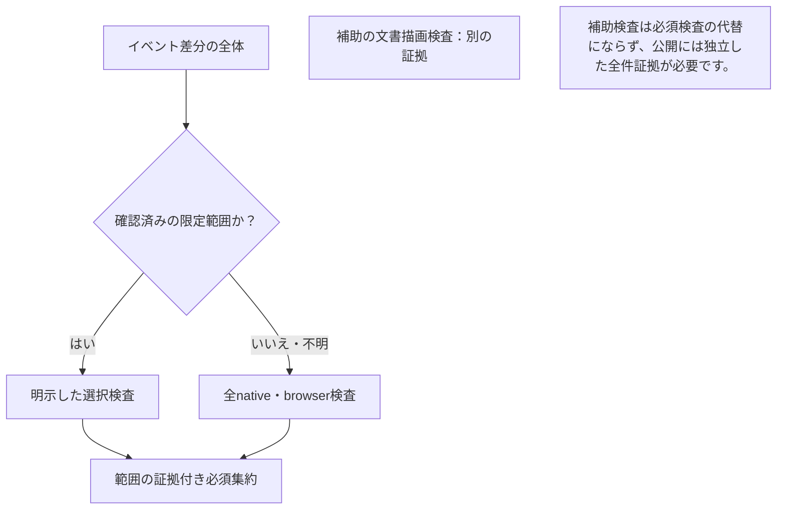

# 変更範囲に合わせたCI

[English](CI_EFFICIENCY.en.md) · [検証](VERIFICATION.md) · [開発原則](DEVELOPMENT_PRINCIPLES.ja.md)

変更の影響がある検証を実行します。通常の文章修正にアプリのビルドや4環境の試験は不要です。フロント変更ではフロントとブラウザーを確認し、通信・共通処理・影響不明の変更では全件を実行します。プレリリースは引き続き、独立した全件検証と配布物・署名・実インストールの検証を行います。

この文書では、次の用語を使います。

- **ネイティブ検査**：対象の OS と CPU 構成で実行する検査。4対象は Linux x64/ARM64・macOS ARM64・Windows x64 です。
- **ゲート**：次の工程へ進む前に合格が必要な検証。
- **検証記録（receipt）**：対象ソース・検査・結果を結び付けた記録。検査の実行そのものに代わるものではありません。
- **来歴（provenance）**：ビルドに使ったソースや生成物の出所を示す記録。
- **リース**：更新が必要な期限付きの利用許可。
- **race / vet**：並行処理による不正なデータアクセスの検出と、Go の静的検査。

## 検査を選び、実行範囲を読む

1. 下表で PR/main の**差分全体**を分類します。不明なパス・方針・来歴を扱うパスは full のままです。
2. 正確なソースと試行に対応する `ci-required` と各ジョブを確認します。ジョブを省略した集約結果の成功は、アプリを実行した意味ではありません。
3. プレリリース前には同一ソースの全件検証に加え、独立した署名・来歴・公開取得・導入済み実行ファイルの検証を必須とします。

図の説明: 差分全体を分類し、確認済みの限定検査または全件検査を実行して、実際の範囲を記録します。公開の適格性には、別途、正確な同一ソースの全件証拠が必要です。

## 実行範囲

| 変更全体 | 実行する検証 |
| --- | --- |
| 通常のルートREADME/SECURITY、直下の `docs/*.md`、個別確認済みの内部/Web説明文、既知の文書SVG | 必須の文書検証：不変のGit差分証明、Markdown・ローカルリンク・見出し・代替文・SVG安全性。図の変更時は再生成・描画も確認。アプリ試験・ビルド・配布物作成は実行しない |
| `web/src` のTypeScript/TSX/CSS、既存の `web/browser/*.mjs` のブラウザー試験コード。通常文書との混在も可 | Linuxでフロント単体試験、同一ロックファイルからの2回の再生成一致、試験用環境の安全性試験、実ブラウザー試験 |
| 上記に伴う生成済み `web/dist` の変更 | フロントソース変更がある場合のみフロント範囲。再生成の一致は必須 |
| `internal/servicepresets` または `internal/boundedlog` の確認済みGo変更。通常文書との混在も可 | 変更パッケージと、テストからの参照を含む推移的な逆依存をLinuxでrace検出・vet |
| 上記2パッケージの `*_test.go` だけの変更 | 変更パッケージの全テスト・race検出・vetをLinuxで実行。Gitの差分全体を再確認できた場合だけ、変更のない逆依存と依存グラフの探索を省略 |
| PRまたはmainの確認済みCLI表示ファイル変更。通常文書との混在も可 | 4ターゲットの短時間・安全性試験、ブラウザー、配布物・マニフェスト検証。起動・終了処理とリースを実時間で確認する3工程とネイティブ検査（資源の照会・管理・固定グループの一覧）は未実行 |
| 確認済みの既存native companion UIファイル。通常文書との混在も可 | 文書・共通方針検査、4対象のcompanion全race suiteと保護IPCの実pass、MyGo vet・整形・コンパイル、Windows/macOSの製品パッケージbuild・smoke。バックエンド全件検証、ブラウザー、マニフェストは未実行 |
| 通信、認証、Core、設定、タイマー、共通補助処理、依存・lock、ビルド設定、CI判定・ワークフロー、その他不明なパス | Linux amd64/arm64、macOS arm64、Windows amd64の全ネイティブ試験、ブラウザー、配布物・マニフェスト検証 |
| 確認済みCLI表示・フロント・限定Goの組み合わせ | 4ターゲットの短時間・安全性試験、ブラウザー、配布物・マニフェスト検証。起動・終了処理とリースを実時間で確認する3工程とネイティブ検査（資源の照会・管理・固定グループの一覧）は未実行 |
| OS固有Go、cgo、未確認の依存パッケージの読込み、方針・出所情報のMarkdown、不正なモード・種類、判定できない入力 | 全件 |
| 毎日の定期全件確認、手動の全件確認、すべてのプレリリース | 全件 |

### 必須の文書検証

すべての検証範囲で `documents` ジョブを実行し、ジョブや必須工程の欠落・省略・失敗・取消は `ci-required` が拒否します。静的検査は追跡中のMarkdown全体と確認済みSVGを対象にします。通常の文章変更ではNode・Chromium・描画依存を導入しません。Mermaidブロック・図の画像・ローカル画像参照の変更で描画を選択し、判定不能や全件CIでは保守的に描画します。描画依存は固定したロックファイルから作業コピー外の一時ディレクトリへ導入し、生成画像でソースツリーを書き換えません。

追加の説明文と88種類のSVGは `ci-impact.py` のファイル単位許可リストに限定します。任意のREADME・SVG・Pythonを対象にはしません。文書生成コード、描画・検証スクリプト、依存manifest/lock、ワークフロー、agent/開発方針、未知のパスは引き続きアプリの全件CIが必要です。rename前後の両端とファイルmodeも判定します。文書検証は現在のevent・コミット・ツリーと選択結果を独立に確認し、成果物や過去の成功だけで省略を許可しません。

実行環境の待ち時間を除き、文章のみは必須チェック完了まで3分、図変更は5分を性能目標にします。これは実測対象の目標であり、確認済みの時間保証ではありません。記録には現在のジョブ実行時間を残します。文書のみの成功をアプリ・ネイティブ検査・リリース検証の証拠として扱いません。

### 確認済み変更のnative-short

`native-short` の対象は `cmd/soba/help.go`、`cmd/soba/errors.go`、`cmd/soba/errors_test.go`、`cmd/soba/human_output.go`、`cmd/soba/human_output_test.go` の5ファイルだけです。新しいパス・依存パッケージの読込み・ビルド対象を指定する指示、未確認の区分との混在は全件に戻します。既存のフロント・限定Goとの組み合わせは4ターゲットのnative-shortで確認します。文書・フロント・限定Goだけの場合は従来の限定範囲を維持します。変更前後の両方を確認し、混在時も変更対象の限定Goパッケージ全体を調べます。確認済みPR mergeまたはmain pushの差分全体が条件を満たす必要があり、最後の表示修正だけで先行するruntime変更を隠せません。生成資材には引き続き対応するフロントのソース変更が必要です。

この区分では、direct-LAN の実時間での鍵更新・待機中の起動終了処理、送信先を制限した中継での実時間のリース継続、中継のみの構成での実時間のリース継続・待機に加え、別枠の全件専用のネイティブ検査（資源の照会・管理・固定グループの一覧）を省きます。4ターゲットのrace/vet、IPC反復、Windows directory barrier、TCP/TLSのcontext制御、managed activation/restart、direct/relayの機能・復旧、合成expiry/rekey、ブラウザー、配布物、マニフェスト検証は残します。独立したWeb 7件とproduct 2件のジョブもnative-shortのPR・手動実行条件と失敗扱いを維持します。文書のみと証明できたPRでは省略し、定期全件実行では両方を要求します。試験の反復回数や製品タイマーは変更しません。

正当性を確認したmain pushもPRと同じ限定native-short判定を使えます。新規作成・削除・force pushされたmainや未対応イベントは全件に戻します。このmain短縮を導入する前から、下記の同一ソース全件検証を要求するリリース入口を維持します。短時間ワークフローの緑色だけではリリース条件を満たしません。通信・起動・終了処理変更は全件のままです。native-shortの対象ファイル、関連する長時間試験の選択、試験の反復回数は変えません。毎日の全件実行は下記のとおりです。

Goの対象リストは小さく限定しています。任意のGo変更を1環境だけで済ませる意味ではありません。OS固有ファイル、ビルド制約、確認済み境界を超える依存は全環境の対象です。限定Go実行は、統合試験のビルドタグも含む現在のパッケージ依存関係から逆依存を選びます。実行するのは通常のLinux試験で、長時間のネイティブ統合試験ではありません。依存関係を確定できない場合は通常Goパッケージ全件を実行します。コマンド失敗や実際のテスト成功が確認できない場合は失敗です。

上記2パッケージの `*_test.go` だけを変更した場合は、確認済み計画の
baseとheadのコミット間をGitで再比較します。rename前後の両方を含む差分が
一致した場合だけ、変更パッケージの全テストを `-race -count=1` で実行し、
続けてvetを実行します。テストファイルは他パッケージが読み込む製品コードを
変えないため、この場合は逆依存の試験と6回の依存グラフ探索を省きます。
証拠の欠落・不正・不足・不一致があれば従来の逆依存を含む検査へ戻し、
そこで依存グラフを取得できなければ通常Goパッケージ全件を実行します。
製品コード変更、文書とテストの混在、その他の区分は従来の検査範囲を維持します。
毎日の全件検査、依存更新、正確なSHAに対するリリース条件は変えません。
削減するのは選択した処理であり、実時間の短縮幅は対象パッケージとキャッシュに依存します。

開発方針や上流ソースの出所情報として使うMarkdownは、通常の説明文に含めません。必須のルート文書は存在している必要があります。ガイドが配布物に同梱されるという理由だけで、文章修正のたびにアプリを再ビルドしません。コード変更時とリリース時には配布内容を確認します。別の資源・中継計測ワークフローも、報告文書の文章変更ではなく計測実装の変更で起動します。

### ネイティブUIのみの変更

`native-ui` の対象は `.github/scripts/ci-impact.py` の `NATIVE_UI_IMPORTS` に
列挙した既存view・theme・presentationの10ファイルと、個別に確認したUIテスト3ファイルの
修正だけです。変更前後とも通常のテキストファイルで、確認済みimportだけを使い、
build・embed・link指令がないことを検証します。追加・削除・改名・不明なファイルは全件です。
操作実装（`app.go`、`model.go`、`exchange.go`、pane操作、`tray.go`、
`filepane_dialog.go`）、module manifest、梱包処理、UI方針文書も全件のままです。
Web・限定Go・CLI変更との混在も、まずは全件へ戻します。

これらは同じ `package main` に属し、新しいimportなしでも操作を呼び出せます。
純粋な表示処理という証明ではなく、確認済みの検査範囲です。必須 `native-ui` laneは
正確なPR merge/mainのtreeをLinux x64/ARM64、macOS ARM64、Windows x64で検証します。
各対象で `native_integration` を付けたcompanion全race suiteを実行し、`ci-go-test.py` が
`TestNativeProtectedIPCCoreExchange` の実際の成功を確認します。Go 1.27.3とmoduleで固定した
MyGoでvet・整形・コンパイルを検査します。Windows/macOSでは、通常のGo 1.27.1製品packagerと
そのnative module用toolchainで実パッケージを作り、companionのidentityとoffline実行を含む
archive smoke検証を行います。固定Node/npmとlocked `npm ci` はpackage・license一覧のためだけに使い、
Webテスト・buildは繰り返しません。展開したarchiveの実バイナリで、従来の端末・メッセージ・
ファイルpane描画と、両バイナリのWindows未署名/macOS ad-hoc署名状態の検査も維持します。
検査が署名を行うことはありません。文書と共通方針jobの成功も必須です。

独立に証明したnative UI merge scopeだけが、HEADのみを検証する `native-poc` の重複実行を
省略します。それ以外のscope、手動実行、不確かな分類では従来の検査を維持します。
UIのみのPRでは製品archiveをrunner内で作成・smokeし、別のdevice-test kitは作成しません。
手動 `native-poc` は引き続きrunner内のkitを作成・検査します。どちらもダウンロード用の
kit/archiveはuploadしません。この出力の違いは、テスト範囲の削減とは分けて扱います。
native UIのみのPRでは独立したWeb/product activation jobも省略し、それ以外の既存起動条件は
維持します。定期・手動full、依存・方針変更、リリース適格性は全件検証のままです。
過去の実行、テスト結果cache、HEADだけのjobをmergeの証拠にはしません。

UIのみのreceiptは `full_native=false` とし、`native_ui` に4対象、
`native_ui_packages` に2対象の成功を記録し、`native_ui_workflow_sha256` で共通workflowのhashを
結び付けます。バックエンドの `targets`、
`long_checks`、browser、manifestは `not_run` です。UI専用フィールドは他scopeのreceiptには
含めません。時間は今回の実測であり、速度向上の保証や並列job時間の合算ではありません。
実enrollment、導入済みUIの対話操作、OSログイン・suspend、認証された署名の受入を
完了した意味ではありません。

### ネイティブUI laneを手動で確認する

main CIと明示的な手動確認は、同じ `.github/workflows/native-ui-checks.yml` を呼び出します。
固定した検査commandのコピーは作りません。既存の **Native UI PoC validation** workflowで
ソースbranchを選び、**ci_lane_smoke** をtrueにします。既定のfalseは従来のstandalone kit検証を
維持します。smokeを選んだ場合だけ共通4対象検査へ切り替え、standalone jobは重ねません。
無関係なfull PRに新しい4job matrixを追加することもありません。

手動経路は呼出元、選択したcommit/tree、変更のないcheckoutを確認してから、実companion試験と
製品archive検査を行います。UI限定差分とは判定せず、CI impact planのdownload、coverage receiptの
出力、`ci-required` の作成も行いません。手動の `ci-lane-smoke / companion (<target>)` jobでは、
main CIの同一試行で独立にscopeを確認した `native-ui / companion (<target>)` jobを要求する
集約判定を満たせません。手動smoke成功はcommandの実行証拠だけであり、branch protection、
UI限定scope、全件リリースの適格性には数えません。この新経路が成功したとする前に、
実runnerの結果を確認する必要があります。

## 差分全体と必須チェック

対象のPR/main pushごとにワークフローを起動します。必須チェックが未完了のまま残り得る、ワークフロー全体の `paths-ignore` は使いません。

PRでは確認済みbase親と試験対象のmerge コミット間の変更全体を確認します。main pushではイベントの `before` から `after` まで、push内の全コミットを確認します。最後の1コミットだけでは判断しません。Core変更を含むPRは、最後のコミットが画面試験の修正でも全件対象です。以前の成功したジョブを再利用する仕組みではありません。

PRの試験対象はActionsの `GITHUB_SHA` と、正確な `refs/pull/<number>/merge` のcheckoutです。実コミットの親は2つに限り、順序もイベントのbase、headと一致する必要があります。PRの背景mergeability計算による `merge_commit_sha` の参考値は、形式が正しくても古い場合があり、この証明の代わりにはしません。不正な参考値、誤ったref、実際の親の不一致は引き続き全件へ戻します。変化する最新PRのAPI応答ではなく、固定されたイベントとGitオブジェクトで判定します。GitHubの[Actions merge branchの識別](https://docs.github.com/en/actions/reference/workflows-and-actions/events-that-trigger-workflows#pull_request)と[mergeability項目の説明](https://docs.github.com/en/rest/pulls/pulls#get-a-pull-request)を参照してください。

完全なGit ツリー一覧、renameの両端、ファイルmode、リポジトリとイベントの同一性を確認します。履歴不足、不完全・不正な差分、不明な変更は全件に戻します。集約側も差分判定を再実行するため、成果物の記載だけでは検証範囲を縮小できません。判定処理の失敗によってアプリ検証を無条件に省略しません。

必須ステータスは引き続き `ci-required` です。アプリジョブが対象外でも必ず起動し、今回の試行で必要なジョブと各工程が実際に成功したことを確認します。文書だけの場合は **「Documentation only; application tests, builds and packages NOT RUN」** と表示します。フロントと限定Goも実行した範囲を明示します。全対象 OS の検査・ブラウザー検査・配布物検査を実行した場合のみ `full_native=true` とします。schema 3の `native-short` 記録は各対象を `short_checks_passed`、各対象の `long_checks` を `not_run`、`full_native=false` とし、ブラウザーとマニフェストは実際に成功した場合だけ成功を記録します。他の未実行範囲は `not_run` のままです。短時間検証を再利用可能な全件検証として扱いません。省略した実時間3工程と別枠のネイティブ資源検査の3工程（照会・管理・固定グループの一覧）には、それぞれcompleted/skippedの記録が正確に1件必要です。失敗・欠落・実行済みの結果は認めません。既存の `long_checks` は引き続き実時間3工程だけを示し、ネイティブ資源検査の工程はリテラルの `FULL_ONLY_STEPS` 方針と名前付き工程の時間記録で別に追跡します。

このワークフローの採用にリポジトリ保護設定の変更は不要です。`ci-required` の必須指定を維持します。mainの各実行は別のconcurrency識別子を使うため、後の文書pushが実行中のコード検証を中止しません。同じPRの更新では、古いPR実行の中止を引き続き許可します。

全件を実行するには **Actions → Cross-platform CI → Run workflow** で **force_full** を有効のまま実行します。強制省略の指定はありません。リリースワークフローは変更範囲の判定を参照しません。今回の試行に必要な結果が揃わない一部ジョブの再実行では、全件検証記録を発行できません。

## ブラウザー検証を2つのジョブで実行する

ブラウザー検証が必要な範囲では、同じ検証対象ソースを別々の Ubuntu 環境で確認する
`browser` と `browser-native` を両方実行します。`browser` はフロントの試験、
lock 固定の2回の資材ビルド、fixture の安全性、通常の UI 試験、合成 pairing UI を担当します。
engine と資材の確認後、fixture バイナリのビルドを公式 Chromium の導入と並行して進めます。
`browser-native` は診断情報のプライバシーに関する race 試験、実ブラウザーの UI 起動、
別プロセスを使う6つのブラウザー受入工程を担当します。固定した Node 依存を導入し、
追跡中の埋め込み資材を使うため、フロントの試験とビルドは繰り返しません。

`ci-required` は両ジョブを待ち、同じ実行・有効試行・ソースで、担当する全工程が
成功したことを要求します。リリース前の全件証明も、同じ識別情報と確認済みのジョブソースを
独立に検査します。片方の成功だけではブラウザー検証は完了しません。UI 画像と native の
要約は成果物名を分け、非公開の native 証拠は引き続き公開対象から除外します。
試験数・再試行・テスト単位の制限時間は変更せず、通常の Playwright の2 worker と直列工程の区分も
維持します。既存のブラウザー用 Go キャッシュは両ジョブで復元しますが、保存するのは
自身の検査に成功した native ブラウザージョブだけです。重い race コンパイルを保持し、
キャッシュの系統や保存担当を増やしません。

この分割では実行環境が1つ増え、toolchain・npm・Chromium の準備も重複します。
短縮効果と費用は、同等の cold/warm 条件で、両ジョブの時間、遅い方の完了時刻、
実行環境の利用時間の合計を比較して判断します。coverage 記録には両ジョブと必須工程の
時間を残します。並列ジョブの所要時間の合計は待ち時間ではありません。
ソース上の分割だけで高速化を主張せず、hosted 実行の結果で確認します。

native とブラウザーの全件証明が必要な PR は、対象ブランチを `main` にします。
既存の native ソース識別検査は、別の作業ブランチを対象にした PR を拒否します。
依存する PR を積み重ねても、この境界は緩めません。対象を `main` に切り替える場合は、
依存先を含む差分全体をレビューし、検証します。

## OSごとの独立した2つのnative lane

fullとnative-shortは、従来の4つのOS・CPUそれぞれに`unit`と`integration`を
持つ8件の明示的なmatrixを使います。`fail-fast: false`を維持し、各laneの証拠を
最後まで収集します。unitは既存の`native (<runner>, <GOOS>, <GOARCH>)`名を保持し、
integrationは`native-integration (<runner>, <GOOS>, <GOARCH>)`となります。
`ci-required`とpackage manifestは8件すべてを待ちます。文書・frontend・限定Go・
native-UIの狭いscopeは従来どおりです。

unitは通常試験・race・vet、engine admission、Windowsのretirement barrier、
必須のplatform discoveryを担当します。Windows/macOSのwhole-Coreは、準備済みの
単一race binaryで完全な試験inventoryを実行し、残りのpackageを続けます。
`-run`で分割せず、別ソース・別run・別attemptのreceiptに置き換えません。
integrationはtag付きnative acceptance、既存3件のbackground実時間試験と
直列resource gate、companion検証、packageのbuild・smoke・uploadを担当します。
試験回数、timer、native-shortの省略範囲、prerelease試験は変えません。
別ランナーによりport・process・一時profile・compile・測定を分離し、resource gateと
同じランナーにCPU負荷の大きな試験を追加しません。

両laneでlock固定frontendを再現し、target・toolchain・準備済みengineを検証します。
native Python回帰試験はunitだけで実行します。可変workspaceや未検証binaryを
共有せず、setupとcache復元を意図的に重複させます。両laneが同じ隔離cacheを
読めますが、**保存はintegrationだけ**が自身の検査成功後に行います。
これはコンパイルcacheの条件であり、unitの成功証明ではありません。unit失敗は
aggregateとreleaseを阻止します。cache内の試験結果・engine tree・receiptを成功の
代わりにしません。timing artifact名はlaneを含み、packageとCore・discovery receiptは
それぞれ単一のproducerに限定します。

coverageはlaneごとの必須gate成功と、他lane・他platform所属gateのcompleted/skippedを
厳密に要求します。両jobは同じ検証済みeventと有効なrun attemptに属する必要があります。
リリース用の同一ソース証明も両laneを要求し、whole-Coreとdiscoveryのproducer検証を
維持します。欠落・重複・未知の結果・誤ったlaneでの実行は失敗として扱います。

### 待ち時間と重複処理を測る

この分割はスケジュールの変更であり、実測済みの短縮保証ではありません。同一ソース・
同一scopeでcoldとwarmを分け、queue時間、laneごとの経過時間、setup・install・cache転送、
試験gate、package、全jobのrunner秒合計を記録します。critical pathは最後の必須完了であり、
重なったstep時間の合計ではありません。追加setupと4ランナーにより、待ち時間が減っても
総runner時間は増える場合があります。同時実行枠が不足すると利点が消えるため、実際の
repositoryのrunner枠と課金を確認します。8件のjob結果と両receiptを確認し、試験頻度変更・
cache状態差・無関係なソース変更を混ぜて効果を説明しません。

## リリース前の正確な同一ソース全件検証

確認済みコミットがmainに入った後、その正確なコミットで **Cross-platform CI → Run workflow → force_full=true** を実行します。プレリリース入口はmainの明示的な `workflow_dispatch` 全件検証を要求します。CIの手動dispatchは保守的にすべて全件実行の意思として扱い、`force_full=false` で必要な試験を省いた実行は条件を満たしません。通常のmain pushは、成功していてもこの明示的なリリース証拠にはなりません。

入口はrun IDや過去の成功だけでなく、試行開始時刻で最新の手動試行を判定します。新しい全件試行の失敗・取消を古い成功で無視しません。進行中の手動検証は完了させるか、取り消した後に新しい全件検証を成功させます。新しい通常CIの成功は、同一ソースの全件証拠を無効化しません。新しい通常CIの失敗・取消・進行中は、解決するか、それより後の全件検証が成功するまで公開を止めます。時系列が不明、API一覧が不完全な場合も止めます。

失敗したジョブだけを再実行すると、GitHubは成功済みの処理を現在試行の有効なジョブ記録として引き継ぐことがあります。この現在試行の記録は、元の時刻を保持していても受け入れます。異なるrunの成功を組み合わせたり、欠落したジョブを古い試行から手作業で埋めたりはしません。過去の失敗はGitHubの履歴に残ります。

証拠は正確なcommit/tree、ワークフロー・判定ソースのhash、現在の有効試行、4つのネイティブ対象と必須工程すべてを結び付けます。実時間試験、各対象のネイティブ検査（資源の照会・管理・固定グループの一覧）、ブラウザー、マニフェスト、ci-required、Web 7件、product 2件も対象です。Goイベント検証補助処理の正確なソースもhashに結び付けます。全件専用の3工程を固定した組と各工程の確認済み直列ワークフロー呼び出しを静的に検証し、ネイティブ資源検査の工程の欠落・重複・省略・成功以外の結果では条件を満たせません。入口と公開直前の両方で、読み取り専用GitHub APIを独立に確認します。保存JSONだけで成功を許可しません。同じソースの新しい全件成功は公開時に使えますが、新しい失敗は無視しません。証拠成果物の保持は90日です。監査記録であり、追加の署名済みリリース資産ではありません。配布物の署名・実インストール検証は独立したまま変更しません。

文書・フロント・限定Go・native-short・native-uiの成功は、明示的な全件検証が揃うまでは全件リリース条件を満たしません。定期実行は検証を追加しますが、この手動リリース証拠の代わりにはしません。

## 毎日の全件検証

確認済みワークフローは `.github/workflows/ci.yml` の `0 18 * * *` で、**毎日18:00 UTC、翌日の03:00 JST（UTC+09:00）**に1回の全件実行を予約します。このワークフローがdefault branch（`main`）へmergeされて初めて有効になります。変更がなくても、GitHubはdefault branchの最新コミットを使います。判定は明示的に `full` とし、空の差分や文書だけの差分から `native-short` にはしません。

定期実行は4つのネイティブ対象、全実時間工程、別枠のネイティブ検査（資源の照会・管理・固定グループの一覧）、ブラウザー、配布物・マニフェスト、Web 7件、product 2件を要求します。`nightly-full-check` は `ci-required` と両acceptanceジョブを待ち、必須工程の実行結果も確認します。未実行・欠落・中止・失敗を成功の証拠にはしません。手動acceptanceの入口条件と通常の `ci-required` の依存関係は維持します。文書のみと証明できたPRではacceptanceジョブを省略します。短時間PRの結果は、この定期専用aggregateを待ちません。実行ごとに別のconcurrency識別子を使うため、定期実行がpushや明示的な手動リリース監査を中止することはありません。キャッシュの信頼範囲と読み取り専用のrepository権限も変えません。

長時間のネイティブ・acceptanceジョブを含む全件CIが毎日1回増えます。頻度を減らす場合は安定性・実行環境時間・費用の実績を確認し、cronの1行をレビューして変更します。自動で頻度を減らしません。定期実行の成功だけでは、上記の手動リリース証拠を満たしません。新しい定期実行が失敗・保留中なら、解消するか同じソースの後続手動全件検証が成功するまでリリースを止めます。

GitHubの混雑時、特に毎時00分には遅延や実行の欠落があり得ます。03:00 JSTは開始希望時刻であり、正確な開始時刻の保証ではありません。公開repositoryでは60日間の活動がないと定期ワークフローが無効になる場合があります。[GitHubの定期実行条件](https://docs.github.com/en/actions/reference/workflows-and-actions/events-that-trigger-workflows#schedule)を参照してください。外部schedulerや新しい認証情報は使いません。

## 文書だけの実行結果の読み方

対象PRの正確なheadに対応する最新の **Cross-platform CI** を開き、実行の **Summary** ページで **ci-required** のジョブ要約を確認します。影響判定と `ci-coverage` 記録のscopeが `docs`、必須チェックが成功、アプリ試験・ビルド・配布物が **NOT RUN（未実行）** と明記されていることが条件です。対象 OS のジョブの緑色の省略表示だけでは必須チェックの結果になりません。記録は `full_native=false`、アプリの各範囲は `not_run` です。

この経路は変更全体が通常の文章であることを確認し、以前のアプリ試験の成功を借用しません。ワークフロー変更そのものの全件検証は、導入時の別の確認です。PRにソースや設定の変更も含まれる場合は、最後のコミットだけで判断せず、差分全体と上の範囲表で確認します。

## キャッシュと実測

コンパイルキャッシュはビルドを高速化します。以前の試験結果を今回の成功に置き換えるものではありません。ネイティブ開発用、限定Go用、ブラウザー用、trusted-main用は保存先の名前空間を分けます。ネイティブは自分のPR・ブランチ用を優先し、miss時だけ、OS・アーキテクチャ・runner・Goバージョン・依存と適合処理のハッシュが一致するtrusted-mainを読み取り専用で利用します。逆方向には利用せず、開発実行からtrusted-mainへ保存しません。trusted-mainへの保存はmainのintegration lane自身の全検査成功時に限ります。unitも含む成功はaggregateで別途必須です。リリースは同一ソースのキャッシュ復元と全件の再検証を維持します。限定Goも `-count=1` で試験を実行します。

共有するブラウザー用 Go モジュールとコンパイル出力のキャッシュは、native ブラウザージョブだけが自身の検査が成功し、互換キャッシュを復元できなかった場合だけ保存します。UI ブラウザージョブは読み取り専用で復元し、両ジョブの成功は必須集約で別途確認します。復元時は自分の PR・ブランチ用を優先し、次に同じ対象と依存情報を持つ main のブラウザー用キャッシュを試します。キーは同じtoolchain・依存情報と、main・同一repositoryのPR・ハッシュ化した手動ブランチの範囲を区別します。fork PRはこのキャッシュを作りません。生成engineツリー、フロント出力、試験receipt、ブラウザープロファイルは保存対象外です。固定ソースの準備・検証、2回のクリーンなlock固定フロントビルド、全試験を維持し、ブラウザー用キャッシュをネイティブ・リリースの成功証拠にしません。

重複した保存で有用なキャッシュを追い出さないよう、ネイティブ開発用は自分の範囲とtrusted-mainの両方がmissした場合だけ保存します。ブラウザー用も完全なmiss時だけ保存し、完全一致やfallbackで復元できた内容をソースごとに複製しません。変更した入力はGoが再コンパイルし、試験は現在のソースで実行します。PRの各更新で生成した出力を残すより、再利用できる依存のビルドを保持する方針なので、後続のソース変更では追加のコンパイルが必要な場合があります。trusted-mainのネイティブ用は、リリース復元に必要なソース完全一致のキーで保存し続けます。この方針では既存キャッシュの削除や容量上限の変更は行いません。

追加前にdownload・展開・保存の費用を比較します。[42199018319](https://github.com/webkaz-labs/sobalink/actions/runs/42199018319) と [42199045343](https://github.com/webkaz-labs/sobalink/actions/runs/42199045343) では、既存LinuxネイティブのGo fallback cache約1.2 GBの復元は22～44秒でした。Webのnpm installは1～3秒、Chromium取得は約6～9秒で、ブラウザーの依存・フォント工程全体は19秒でした。これはGoコンパイルの再利用を優先する根拠であり、今回の変更による高速化の実測ではありません。キャッシュ追加で有用なネイティブ用が削除される可能性もあるため、キーを不用意に増やさず、同じソースのcold・warm実行を比較してから対象を広げます。[GitHubの容量と信頼範囲](https://docs.github.com/en/actions/reference/workflows-and-actions/dependency-caching) と [Playwrightのブラウザーキャッシュ方針](https://playwright.dev/docs/next/ci#caching-browsers) に、保持・転送・Linuxシステム依存の制約があります。

計測記録には固定のsuite/job名、経過秒、成否、終了コードだけを保存します。コマンド引数、環境変数、ファイル内容、生ログは含めません。計測保存に失敗しても、コマンド失敗を成功へ変更しません。coldとwarmは分けて比較し、並列ジョブの時間を足して待ち時間と説明しません。

以前の「実時間待機だけを省く」方式では、全件mainが29分11秒、通常ネイティブ・ブラウザー・配布物を残した文書PRが開発キャッシュ4件missで24分57秒、その後4件fallback hitで12分57秒でした。後者2回はいずれも実時間試験12工程を省略し、`full_native=false` を明記しました。今回とは検証範囲が異なる過去の観測であり、このワークフローの所要時間を保証するものではありません。[全件](https://github.com/webkaz-labs/sobalink/actions/runs/37456053817) · [cold](https://github.com/webkaz-labs/sobalink/actions/runs/37460427507) · [warm](https://github.com/webkaz-labs/sobalink/actions/runs/37464624901)

warmの最長Windowsジョブは11分46秒で、そのうち通常・ネイティブ試験が7分31秒、フロント工程が1分41秒、キャッシュ復元・保存が1分09秒でした。そのため、文章修正ではキャッシュ追加よりもアプリ検証自体を対象外にする方針へ変更しています。

### 日本語描画用フォント

Linux の図・ブラウザー・companion 検証は共通の `japanese-fonts` action を使います。
[公式上流の固定コミット](https://github.com/notofonts/noto-cjk/tree/523d033d6cb47f4a80c58a35753646f5c3608a78)
から **Noto Sans CJK JP 2.004 の Regular と Bold**、SIL Open Font License だけを取得します。
manifest で各ファイルの SHA-256 とサイズを固定します。この日本語 OTF 2書体は、
Ubuntu の多言語 CJK パッケージにある同版の日本語書体と family・字幅を保ちます。
製品の配布アーカイブには同梱しません。

cold 時の取得は計33,504,657バイトで、Ubuntu ミラーから CJK 全言語と core フォント群を
取得する必要がなくなります。manifest と完全一致するキーで上流ファイルだけを保存し、
cache hit でもインストール前にハッシュを再検証します。さらに fontconfig で family・
書体・版・描画側が選ぶファイルの一致を確認します。欠落・破損したファイルは上限付きの HTTPS
再試行で取得し、取得失敗や不一致は工程の失敗にします。過去の画像・試験結果・受入記録は
再利用しません。既存の図、Playwright の文字・画面、ネイティブの検証は維持します。

標準 runner の一覧はこの CJK family を保証しません。搭載済みフォントを無条件に使うと
イメージ更新に描画が左右されます。apt ミラーの変更だけでは cold 時の全言語取得が残り、
パッケージ全体のキャッシュにも不要な言語が含まれます。固定した2書体に絞り、cold の
取得量を減らし、warm 時は apt の CJK 配信に依存しない構成にします。Chromium の残りの
公式依存は次節の独立した導入経路を使います。全体の高速化は、
実際の runner で cold と warm を分けて計測してから判断します。

### Playwright の全システム依存

main と診断ワークフローの Chromium 準備7箇所は、Ubuntu 24.04 x64 上で
`.github/scripts/ci-playwright.py` を使います。lock で固定した Playwright CLI の
`install-deps chromium` で全依存を導入し、続けて通常ユーザーで `install chromium`
を実行します。フォント・ライブラリーの省略、runner の別版 Chromium への置換、
Playwright の依存検証の無効化は行いません。

依存導入コマンドだけに一時的な `APT_CONFIG` を渡し、Ubuntu 公式の HTTPS archive と
security archive を選びます。標準の Ubuntu archive keyring によるメタデータの署名と
パッケージのハッシュ検証は維持し、取得元の設定ファイル・信頼鍵・セキュリティー設定は
置き換えません。パッケージの版はセキュリティー更新を含む Ubuntu 24.04 の署名済み
リポジトリーに従います。依存一覧を別に保守せず、Azure archive の遅い実体取得経路を
避けます。既存の準備・ジョブの時間上限は維持し、導入失敗は CI の失敗にします。

標準イメージには依存がすべて入っているわけではなく、障害時の実行ではフォント関連
9パッケージ、21.1 MB の取得に9分50秒かかりました。`install-deps` の省略は試験環境を
変えてしまいます。ブラウザー本体のキャッシュではこの apt 取得をなくせず、
[Playwright 公式も本体のキャッシュを推奨していません](https://github.com/microsoft/playwright/blob/v1.63.0/docs/src/ci.md#caching-browsers)。
導入済みシステムディレクトリーの復元はパッケージ管理の状態を迂回します。
検証付き `.deb` キャッシュは選択肢ですが、まず公式 archive の経路を試すためには
不要です。試験や受入結果はキャッシュしません。全体の高速化を判断する前に、導入の
実測時間と hosted runner 上のブラウザー・activation 検証全体の結果を確認します。

## native fixtureとリリース検証

全ネイティブ検証ではrace検出、vet、Windows retirement barrier、IPC反復、合成時刻による鍵の試験、通信エンジンの負例、ネイティブ discovery、direct/relay復旧、元の実時間lifecycle/lease待機を維持します。範囲判定のために製品タイマー、通信データ、アサーション、試験の制限時間を短縮しません。

Cross-platform CI と prerelease 検証では、Windows/macOS の Core 全体を Go セットアップ直後、フロント・方針テスト・キャッシュ復元より前に1回実行します。既存 collector が依存を準備し、正確な race 対象一覧のビルドで準備した後、非公開の一時領域と上限付き JSON 収集を使います。パッケージの制限時間は600秒のままです。後段では同一の `go list -race ./...` 一覧にある Core 以外の全パッケージを実行し、Core を再実行しません。両段階と公式成果物の内容を、実際の commit/tree・生成試行に結び付け、正当に引き継いだ成功も検証します。既存の子プロセス補助処理・OS 固有省略は明示したままとし、欠落・失敗・未完了・予期しない最上位省略は資格確認を通しません。Linux、別枠のタグ付き・反復テスト、フロント、vet、ブラウザー、配布物の検証は維持します。これは実行準備の変更であり、過去の時間切れの原因は未確定です。診断の成功を必須検証の代わりにはしません。

必須の DNS-SD・ネイティブパッケージ成果物は、元の生成ジョブの公式ログにある、コミット固定の upload action の完了記録1件と照合し、API の名前・ID・ZIP ハッシュ値・サイズを一致させます。アップロード記録が欠落・途切れ・曖昧な場合は不合格です。これは確認済みジョブログによる関連付けであり、工程の暗号学的な同一性証明ではありません。既存のソース・試行・ネイティブ結果・API 再確認の条件も引き続き必須です。

TCPとUDPに同じ接続先が必要な試験用環境は、正確なループバックアドレスで両方を予約し、回数を限定した実際の待受開始と後片付けを行います。補助処理はテストからだけ読み込みます。ブラウザー終了時は処理中のinterceptを完了してから試験用環境を停止し、失敗は伝播します。必要な対象や工程が失敗すれば `ci-required` も失敗します。

自動CIの結果は、実機での登録、ネットワーク、OS ログイン、スリープの確認とは分けて扱います。

## 全件専用のnative remote resource inspection

`Verify native remote resource inspection` は、通常の直接通信を有効にした構成の復旧試験後、
実時間3工程がbackgroundで動く間に実行する直列ステップです。同じ全件条件を使いますが、
`LONG_STEPS` には追加しません。判定対象リスト、backgroundの3工程、必須wait、
Node 24の固定、`setup-go` の `cache: false` 方針は変更しません。

正確なGo `go1.27.1` と対象構成の GOOS/GOARCHを確認した後、`ci-go-test.py --exact` を
1回だけ呼び出します。`internal/core` の正確な5件で、最初の遠隔照会、元の
有効期限を維持する両方向のCore再起動、許可を取り消した後の新しい照会の拒否、既存所有者を
維持するポート競合を確認します。5件だけに一致する対象指定、race検出、`-count=1`、
`-timeout=8m`、確認済みの5つのビルドタグをソース方針で固定します。補助処理は各ケースの
run/passとパッケージのstart/passをそれぞれ1回要求し、追加・省略・重複・欠落は失敗です。
事前実行や再試行は追加しません。子プロセスは10分、外側のステップは12分を上限とします。

プロキシ指定7変数（`HTTP_PROXY`、`HTTPS_PROXY`、`ALL_PROXY`、`http_proxy`、
`https_proxy`、`all_proxy`、`TS_PROXY`）は空または未設定が必要です。値があれば
ツールチェーン確認前に失敗し、黙って削除したり値を表示したりしません。試験用環境を有効化する2つの指定は子プロセスの環境だけに設定します。試験用環境が所有する数値
`127.0.0.1` の相手と試験用の一時プロフィールだけを使い、実ユーザーの許可を有効化せず、
OSの安全性・経路・ファイアウォール方針は変更しません。

ソースレビューとオフライン方針試験が示すのは接続関係だけです。ローカル Linux の試験結果はLinux ARM64・macOS・Windowsの受け入れや、正確な同一ソースの4対象CIを示しません。
自動化したCoreのclose/openは、OSプロセス再起動、実機、登録、ログイン、スリープ、
アプリケーションの受け入れ確認とは別です。正確なソースと対象で実際に得た結果だけを
そのネイティブ確認の根拠とし、配布物・実インストールの検証は別に維持します。

## 全件専用のnative managementとfixed-group catalog

`Verify native remote resource management` はinspectionの直後に置き、正確な3件、
確認済みの6つのビルドタグ、race検出、既定のvet、8分の試験上限、子プロセスだけの
管理・有効化試験の実行指定を維持します。`Verify native fixed-group resource catalog`
は、その直後かつbackgroundの3工程を待つ必須waitの前に置くFULL専用の直列ステップです。
`FULL_ONLY_STEPS` はinspection・management・fixed-group catalogの順で正確に3工程です。
`LONG_STEPS` やnative-shortの実行対象には追加しません。

新工程は正確なGo `go1.27.1` と対象構成の GOOS/GOARCHを確認し、`ci-go-test.py --exact`
で `internal/core:TestResourceGroupCatalogNativeFixedTwoTargetOneShot` を1回だけ呼びます。
1件だけに一致する対象指定、`-race`、既定のvet、`-count=1`、`-timeout=4m` を固定します。
7つのビルドタグは `ts_omit_portmapper`、`ts_omit_captiveportal`、`ts_omit_useproxy`、
`directlan_activation_native`、`resource_inspection_native`、`resource_management_native`、
`resource_group_catalog_native` です。子プロセスは6分、外側の工程は8分が上限です。
再試行や事前実行は追加しません。イベントを厳密に検証する補助処理はtestのrun/passとパッケージの
start/passを正確に1回要求し、追加test/package・省略・重複・欠落を拒否します。

子プロセスの環境だけで上記プロキシ指定7変数と、継承した照会・管理試験の実行指定を
削除します。`SOBALINK_RUN_RESOURCE_GROUP_CATALOG_NATIVE=reviewed-three-core-loopback-v1`
と `SOBALINK_RUN_ACTIVATION_NATIVE=1` を設定し、環境値の表示や親環境の変更は行いません。
試験用環境が所有する同一プロセス内の3つのCore、正確な数値ループバック接続先、試験用の一時
プロフィールを使います。固定2対象の確認・適用、ローカル一覧、同一要求の再実行と
状態の証拠、不一致の確認要求の拒否を、明示的に同意した模擬の許可の範囲で観測します。

得られているローカルN1結果は、race検出なしのLinux `CGO_ENABLED=0` 実行1回です。
このソース上の接続関係と模擬の Python検証だけでは、新しい CI 環境での race 実行、4環境、ブラウザー、
別プロセス、グループ再起動・復旧、取消・障害、実機の受け入れ完了を示しません。
同意前の制御側 Core の終了・再起動は準備であり、グループ復旧の証拠ではありません。
実際の CI 環境での結果の正確なソースと対象を確認してから、その範囲の成功を扱います。
手動リリース証拠は全ネイティブ対象でこの名前付き工程の一意な成功を要求し、ワークフロー・
判定ソース・イベントを厳密に検証する補助処理のソースも結び付けます。配布物・署名・実インストールの
ゲートと既存の受入試験は維持します。

## 独立した実時間ステップの並列実行

既存の自然なライフサイクル、送信先を制限した中継のリース、中継のみの構成のリースの3組を GitHub
Actions の `background` で並列実行し、パッケージ作成の直前に名前付きの必須
`wait` を置きます。各ステップ名、Go の厳密な成功イベント、タイムアウト、
race オプション、native-short のスキップ条件は変えず、ネイティブ4対象を維持します。
完全CI・夜間CIの証跡には wait と各検証の成功が必要です。失敗・キャンセル・
スキップ・欠落を完全実行の成功として扱いません。

待ち時間の長い3組を開始してから、resource inspection、management、fixed-group catalogを
順番に実行します。resourceの3工程同士は直列のまま、backgroundの3組と重ねます。
先行するネイティブ検証が同じタグ付きパッケージをビルドしますが、キャッシュが削除されれば
追加ビルドは必要です。追加ランナーや重複するセットアップは増やしません。companion検査、
パッケージ作成、アップロード、キャッシュ保存、時間集計は wait 後です。
この区間で既存の時間計測 JSONL に書くのは natural-lifecycle だけなので、同時書き込みは
ありません。計測を追加するときは共有追記ではなく、保存先の分離と wait 後の検証付き
統合が必要です。

各組は別プロセスで動く模擬の試験用環境です。アプリのポートは独立したユーザー空間
ネットワークスタックに属し、ホストのソケットは一時ポートを要求します。状態は
メモリ内またはテスト専用です。guarded エンジンの通常の UDP ソケット動作と
ループバック宛先限定ポリシーは維持します。実機・物理ネットワークの受け入れ完了を
示すものではありません。ホスト資源の競合と既存の一時ポート予約・再bind間の競合は、
4対象のCIで確認が必要です。

ソースレビューやオフラインテストから高速化を実測済みとはしません。同じ対象・
キャッシュ条件の完全実行で、ジョブ全体の経過時間と各ステップ時間を比較します。
native-short でスキップされたステップの wait も別途確認します。
[GitHub の background / wait 構文](https://docs.github.com/en/actions/reference/workflows-and-actions/workflow-syntax#jobsjob_idstepsbackground)を参照してください。
