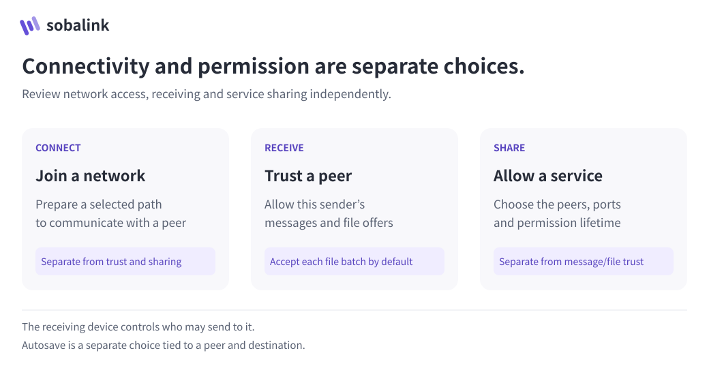

# Nearby connection setup

[日本語](CONNECTION_SETUP.ja.md) · [Security boundaries](../SECURITY.md)

Nearby setup offers an explicitly scoped request-and-accept flow and an optional complete-fingerprint verification flow. Discovery names and addresses are hints, never identity proof. First-use key acceptance (TOFU) remembers the exact accepted key but does not prevent an active impersonator during the initial exchange. Application permissions remain separate.

The request-and-accept flow is included in [0.5.0-alpha.1](https://github.com/webkaz-labs/sobalink/releases/tag/v0.5.0-alpha.1). [Verification](VERIFICATION.en.md) records exact-source CI and signed distribution. Same-host discovery and controlled browser/loopback results do not establish physical-device discovery, enrollment or application compatibility.

<picture>
  <source media="(prefers-color-scheme: dark) and (max-width: 839px)" srcset="assets/visuals/permissions-en-dark-narrow.svg">
  <source media="(prefers-color-scheme: dark)" srcset="assets/visuals/permissions-en-dark-wide.svg">
  <source media="(max-width: 839px)" srcset="assets/visuals/permissions-en-light-narrow.svg">
  
</picture>

Pairing identifies a transport peer. Review message/file trust, autosave destination and service scope separately. For first-use acceptance, understand the TOFU limitation before approving.

## Request and accept (v2)

1. On the receiving device, choose **Receive requests**, one network scope, and explicit permission for the bootstrap and relay endpoints. Before starting, choose a review lifetime of 120–1200 seconds.
2. On the requesting device, choose **Select and request** or **Start connections only**. The latter opens neither LAN listeners nor discovery sockets. Select the receiver, or enter the numeric private IP:port shown on its receiving screen.
3. Review the exact recipient key, recipient scope, relay address/certificate, and effective deadline. Send the request explicitly. Both devices must use the same verification method.
4. On the receiving device, review the immutable request and explicitly approve or decline. For independent full-fingerprint verification, both sides must compare the complete value before approval. TOFU does not require copying a code or PNG.
5. Keep pairing persistence, confirmed connectivity, and application permissions separate. An uncertain result requires status inspection of the original session, not a replacement request.

The earlier peer deadline wins. Discovery stops after 120 seconds even when review time is longer; an already pinned request continues until its effective deadline. Manual address inspection remains available while the session is live. Expiry requires a fresh request and new consent. Previously verified keys cannot silently downgrade to TOFU, and revoked keys cannot be restored by delayed requests.

Run `soba nearby` for the guided flow. Explicit commands are listed in `soba nearby --help`; headless use requires exact session/request/revision identifiers and explicit consent. `--json` never prompts or auto-approves. `x` leaves the session running; `q` requests cancellation and checks cleanup. Closing a display is not a revocation.

Manual addresses are limited to numeric private IPv4 or IPv6 ULA endpoints within the selected scope. DNS, redirects, link-local/zone addresses, public addresses and subnet scans are not fallback mechanisms. A discovered device may still be unreachable. If both devices cannot accept new inbound connections, direct LAN bootstrap cannot succeed; this flow does not create a relay account or alter firewall settings. Even outbound-only mode still needs the application's local control IPC; prohibiting all loopback listeners is a separate, unqualified environment.

## Re-enrolling a removed key

Removed keys do not become eligible merely by receiving another request. In the advanced **Removed devices** view, or CLI `nearby revoked`, review the exact key, generation, and previous verification basis. Explicit reenrollment requires an offline profile, no active network node or unfinished setup, and no remaining saved transport pair for that key. Stop and restart the same profile offline when instructed; this ends active transfers and connections.

`nearby reenroll --peer-key KEY --generation N --consent` authorizes only a fresh pairing attempt for that exact removal generation. It does not restore the old pair, application trust, autosave, or services. Start a new request with new consent afterward. A previously independently verified key still requires full verification. Old sessions and old persistence callbacks cannot become valid again after reenrollment.

If the response is lost, reread removed-key status before proceeding. Disappearance from that list alone is not proof of which operation completed. Never repeat blindly or edit private state to clear a removal fence. A duplicate display name does not identify the same device; a changed key in an already reviewed target invalidates that review.

## Explicit legacy full-fingerprint flow (v1)

The subsections below describe v1, including its fixed 120-second session limit. For v2, use the request-and-accept flow above: choose 120–1200 seconds before starting, with the earlier peer deadline taking precedence.

1. Open connection setup on both devices. Choose an explicit display name and one current local network scope. Approve the short-lived advertisement and exact bootstrap listener. Choose explicitly whether this device may relay the connection or the other device must relay it; neither role is preselected. For a new connection, allow at least one device to relay, using a distinct high port. Host eligibility and reachability are checked afterward, not assumed from this choice. A device already connected through another host must keep that approved host.
2. Select the other device on both sides. If multicast discovery is unavailable, copy or scan each device's current setup contact. Reading a contact does not approve it or start an arbitrary scan.
3. Review the connection plan. It shows both identities, the selected host, exact relay address and certificate pin, and each device's chosen scope. The LAN backend uses the strict allowed-LAN-destinations policy for the local selected prefix. This permits the backend's UDP/TCP traffic within that prefix; it is not physical-interface confinement or a whole-process egress sandbox.
4. Scan or copy the other device's complete comparison text and check that it exactly matches. If necessary, compare all 64 hexadecimal fingerprint characters. Do not compare only a prefix, a few digits, a color, or a display name. Approve locally on both devices.
5. Wait for mutual authenticated protocol confirmation. Configured, paired and connected are separate states. Approve application trust separately when message/file offers are wanted.

A QR shown by an untrusted third party, or a comparison value merely echoed through the same unverified network exchange, does not authenticate the intended device. Use the other device's screen or a separately authenticated exchange.

### Short CLI path and corrections

For a fresh profile, run on both devices:

```sh
soba init
soba start --offline --background
soba nearby --legacy-interactive
```

If using another profile, keep the same `--state-dir DIR` on every command. If the profile is already running and requires an offline restart, explicitly stop it first; active transfers and connections will stop. Do not replace or clear the profile.

Enter an alias, review the network scope, choose `y` to permit this device to relay or `n` to use the other device, then separately approve the displayed listeners. Empty or invalid role input asks again and grants nothing. At the final review, `p` edits setup/relay ports, `b` edits the inputs, and `q` cancels. Port edits are local-only and show the new exact endpoints before new consent. Ports must be distinct, 1024–65535, excluding 54543–54545 and the management port. Port availability is checked at start; there is no silent port remapping.

In the active CLI wizard, `r` or Enter refreshes the original session, `m` accepts the other device's contact text, `v` compares and approves a displayed plan, and `x` exits while setup keeps running until its original deadline. `q` or end-of-input at the active action prompt requests cancellation and waits for cleanup; `q` inside contact or fingerprint entry returns to the action prompt. Interrupting the process or losing a reply does not prove cleanup. Check `soba nearby status` (with `--session ID` when known) in the same profile; never blindly repeat `start`.

If no permitted, reachable relay is found, the cause is not inferred. If both devices declined, wait for confirmed cleanup and choose “Review relay permission and try again” in the Web UI, or accept the fresh-review question in the CLI. On both devices, start new sessions with new alias/scope/role consent and let one permitted device relay. No prior verification or approval carries over. Only an uncommitted, clean no-host failure exposes this retry after all temporary owners have joined; recovery, saved-network and anchor conflicts retain their separate review requirements. Existing connections keep their approved host.

Web setup displays QR codes and reads QR text from a local PNG upload; it has no camera scanner or QR download button. Copying complete contact/fingerprint text always remains available. The CLI wizard uses text. Optional terminal QR output is available through `nearby status --qr`, `nearby contact --session ID --qr`, and `nearby verification --session ID --qr`; the CLI imports and exports text, not PNGs.

After both approvals, the saved LAN connection and chosen relay can continue beyond the 120-second setup. Use the Web network control “Stop sobalink” or `soba stop` for the same profile to stop current connections and listeners. This also stops active transfers and does not revoke saved pairs. Cancel setup only closes temporary setup resources.

### Exact permission and lifecycle

- One session lasts at most 120 seconds. Linux and Windows hints can refresh while matching packets remain current. macOS uses selected-interface system DNS-SD queries and may show cached hints while those exact queries remain active; they do not prove recent traffic or reachability. Removal, query failure, scope change, cancellation and expiry invalidate the original selection. No hint extends the setup deadline or revives an expired ID. After both approvals, only the exact verified transcript remains pinned until its original deadline. If the other device is no longer available, cancel the old setup, wait for confirmed cleanup and start again on both devices with fresh consent and comparison. See the [macOS API boundary](../internal/nearby/DNSSD.en.md) for the distinct observation guarantees.
- Discovery advertises only the chosen alias, random session ID, protocol/capability and bootstrap endpoint. No permanent identity, invitation, filename, service list or OS hostname is advertised.
- Bootstrap accepts only the locally selected peer session and exact selected source/address scope. Receiving a request cannot auto-select a peer or trigger a callback to an unselected endpoint.
- Both keys and session IDs, aliases, public scopes, fresh random per-session local consent revisions, allowed roles, endpoints, exact relay pin, plan revision and expiry are bound into the complete transcript. Local interface name/hardware bindings stay private.
- Before out-of-band comparison, encrypted proofs establish possession of self-asserted selected keys. They do not authenticate a human display name. The full SHA-256 comparison avoids introducing an unreviewed short-code protocol susceptible to attacker-controlled key grinding.
- A fixed session-order coordinator makes one bounded host decision from authenticated directional observations. An existing compatible host is preferred; otherwise session order breaks ties. A failed direction stays unavailable or unknown. It does not prove a firewall, sleep state or network cause.
- Repeated approvals and protocol messages use the same plan and invitation. Changing the peer, scope, role, endpoint or certificate requires cancellation and a fresh session with new approvals.
- After mutual connection evidence, discovery stops promptly. The exact-session bootstrap listener can remain until the original 120-second deadline for final receipt exchange; it cannot issue another invitation or extend the deadline. Cancelling explicitly ends that remaining listener too.
- A cancelled or expired setup closes its discovery and bootstrap resources. An unused invitation is cancelled. If pairing may already have committed, the result requires recovery; cancellation does not claim rollback. Failure to confirm resource closure retains a recovery fence.
- Successful approval saves the LAN network and pair for later use. The promoted backend and any selected host listener continue beyond the short setup session until stopped; stopping does not revoke the saved pair.
- Connecting another device is a deliberate fresh action. Close any remaining setup receipt listener and wait for joined cleanup before `nextAction: start_new_setup`. The previous result and active LAN backend remain; the new form/session requires fresh scope, role and verification approvals.
- A newly started LAN backend is owned by setup until mutual success. Cancelling it never closes an independently running backend that setup borrowed.

### Existing connections and process restart

Existing authenticated peer connections remain available through ordinary peer actions; opening setup is not required to use them. The wizard can borrow an already-running LAN host or relay client only when its strict single-prefix destination policy and exact existing relay anchor match the reviewed plan. A relay client must not request a new host role, and its selected peer must offer that same already-anchored local host. Two clients pointing to an external relay do not invent a new host.

Incompatible saved peers, prepared routes or unreviewed startup/application authority require existing-network review. They are not reset or reactivated under discovery consent. A different process-scoped backend, failed-close owner or changed network identity produces a stop/restart or recovery state before new setup networking. Stop and reopen the same profile offline, then create a new setup session. Old fingerprints and approvals never survive restart. No seamless TCP/backend migration is promised.

The product does not change OS firewall rules, routes, network security, router settings or privileged services. QR contact exchange does not bypass a network restriction. If a fresh host-role review still cannot establish a permitted, reachable relay, use an already-approved working connection or review advanced network setup without broadening permissions silently.

### Local command contract

Local Web and CLI commands share the Core contract:

- `setup.scopes {}`: read-only current local choices with opaque `scopeId`
- `setup.start`: explicit alias, `scopeId`, bootstrap port, host choice/relay port and consent
- `setup.status`: current public state, contact text/QR and exact plan comparison; never an invitation
- `setup.select`: select one current candidate ID
- `setup.manual`: select bounded canonical contact text for the same confirmation flow
- `setup.approve`: exact session ID, plan revision, complete fingerprint and explicit local verification
- `setup.cancel`: stop the exact session and report cancellation versus recovery

Contact text uses `sobalink-setup-contact-v1:` followed by canonical base64url JSON. Comparison text uses `sobalink-setup-verify-v1:` followed by the full SHA-256 digest. Neither format is an application-trust grant or a reusable capability.

After an ambiguous start response, `setup.status {}` only reports the current process session. It does not prove that a particular client created or exclusively owns that session. Reconciliation must reject the previous session ID, check the exact requested public contact/scope, clear old approvals, and require review of the current full plan before approval. Another authenticated local client may also manage the same Core.
