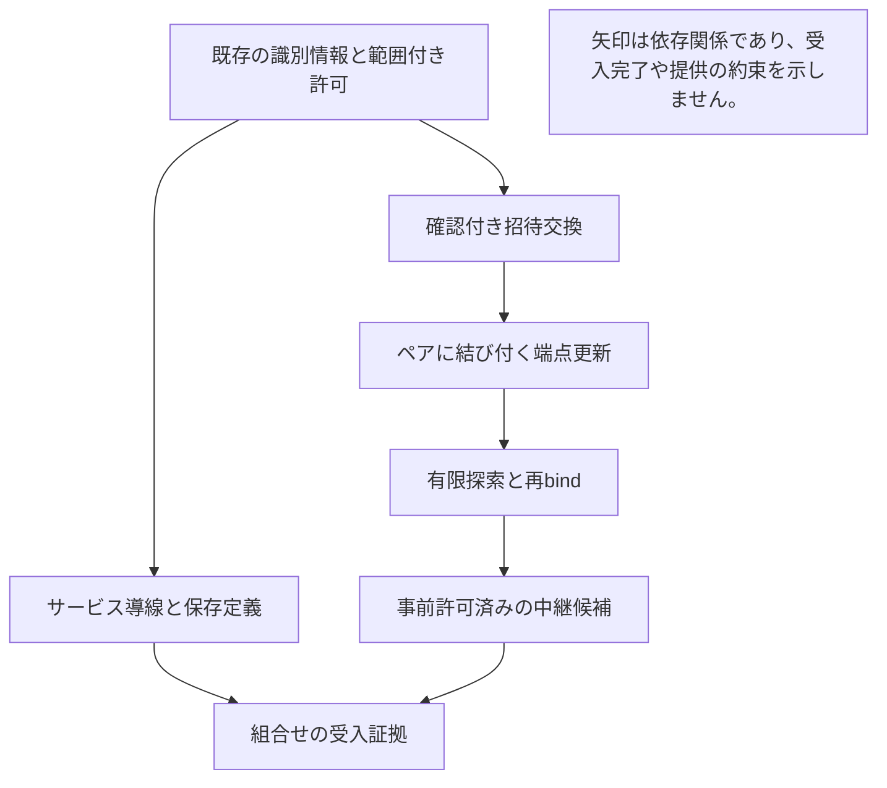

# 0.3.0-alpha.6 利便性パッチの計画・受入履歴

[English](CONVENIENCE_PLAN.en.md) · [開発原則](DEVELOPMENT_PRINCIPLES.ja.md) · [ロードマップ](ROADMAP.ja.md)

**これは 0.3 系列の計画とソース別検証を保存した履歴です。** 以下の予定・未公開・未完了という記述は各記録時点を指し、現在の公開状況ではありません。現在の状態は[検証記録](VERIFICATION.md)、残る作業は[ロードマップ](ROADMAP.ja.md)、使い方は[利用ガイド](GENERIC.ja.md)を参照してください。サービス・グループ・許可・復旧の既存契約は引き続き各専用文書を正本とします。

[統合済みPR #13](https://github.com/webkaz-labs/sobalink/pull/13)の基盤には、保存画面修正、起動を伴わないお気に入りとグループ操作、通信を発生させない診断、読取り専用端末カードのAPI／CLI／Web操作、保存済み共有ひな形の再利用、Core／CLI／Webでの明示的な代替ポート確認を含みます。設定済みの中継でも、LAN招待の内容確認を終えてからペアにします。参加端末を中継にする操作にはプライベートアドレスの手動指定と、保存済みホストをそのまま起動する確認を加えました。

過去のmain `7d505315` の時点では、[統合済みPR #17](https://github.com/webkaz-labs/sobalink/pull/17)の上限付きローカル端末カードPNG読取りも含まれていました。読取りはテキスト欄への入力までで、内容確認と適用は別の操作です。[最終ソースのCI](https://github.com/webkaz-labs/sobalink/actions/runs/37585215258)と[正式なmain `721662a1` のCI](https://github.com/webkaz-labs/sobalink/actions/runs/37587774557)は、PNGの8件を含む実Chromiumの121件と、全8ジョブに成功しています。

[統合済みPR #18](https://github.com/webkaz-labs/sobalink/pull/18)では、通信動作を伴わない接続先メタデータの符号化・復号処理とデータモデルを追加しました。Windowsで動くよう一時保存テストを修正した後、[最終ソースのCI](https://github.com/webkaz-labs/sobalink/actions/runs/37588890808)の全8ジョブに成功しています。そのPR時点では製品からこのパッケージの呼出しはありませんでした。その後のCore統合と[PR #25](https://github.com/webkaz-labs/sobalink/pull/25)で管理対象の有効化を追加し、[PR #26](https://github.com/webkaz-labs/sobalink/pull/26)で署名付き接続先追従とWeb／CLI操作を追加しています。最終統合版の受入とalpha.6配布は未完了で、先行ソース検証を実機受入とはしません。

通常利用はユーザー権限のプロセスで動かし、管理者権限、TUN、OSの経路／FW変更、ルーター設定を前提にしません。LAN外は通常Tailscaleを使います。既存の明示的に有効化する WAN 機能は従来の条件で保持し、公開中継の新規配置と単独常駐プロセスは今回の対象外です。転送の途中バイトからの再開、永続送信待ち、対話型端末画面（TUI）、ネイティブUIも含めません。

## 目的別の読み方

| 目的 | 参照先 |
| --- | --- |
| 現在の製品を操作する | [使い方](GENERIC.ja.md)と機能別ガイド |
| 残る受入を判断する | [現在の計画](ROADMAP.ja.md)と[検証](VERIFICATION.md) |
| 0.3 系列の設計判断をたどる | 以下の証拠、実装順、境界 |

過去の記録では、元のソース ID・失敗・当時未完了だった条件を保持します。完了済みの公開を繰り返す指示でも、後の実装を実機受入済みと扱う根拠でもありません。

## 既存の土台と今回の受入条件

| 領域 | 既存の土台 | 今回の受入条件 | 現在の証拠と配布までの状態 |
| --- | --- | --- | --- |
| 1 初回ペアリングと接続先交換 | 正確な宛先鍵、一回限りの期限付き招待、認証付きペアリング、内容確認、direct LAN招待QR、上限付きローカル端末カードPNG読取り | 鍵を手で書き写さず、短い連絡先／招待をQRまたはテキスト／ファイルで交換できる。適用前に方式・相手・接続先・期限を示す。読取りだけでは許可しない。カメラなし・狭い端末でも使え、取消・期限切れ・再利用・別宛先を安全に扱う | PR #13／#17／#19にカード・PNG確認と固定ホストのペアリング。`43bdc817` の回帰は成功、配布ソースの再確認は未完了 |
| 2 アドレス変更と許可済み経路 | 永続端末鍵、固定direct LAN接続先、ペアに結び付く暗号化中継情報、承認済み経路の復旧、通信動作を伴わない接続先メタデータ契約 | 認証と再利用防止を確認した更新だけで、承認範囲内の新しい接続先を追跡する。ローカルIP変更でも端末 IDを保つ。古い更新、取消済み、別ペア、範囲外を拒否し、影響する通信世代を終了する。両端が移動して明示交換が必要な場合を示す | 署名付き追従と限定ネイティブ観測は下記。`719d6bfa` でWeb／CLI製品2/2成功、最終配布ソース受入は未完了 |
| 3 LAN中継の初期設定と運用 | ローカルアドレス一覧、確認付きのユーザープロセス中継、同じ固定済み証明書での再起動、証明書状態、準備済み候補 | 中継の選択・開始・停止・復旧を分かりやすくする。任意の探索と候補選択の実現性を明示する。発見だけでは承認しない。すでに動作し、中継になることを明示許可したホストで、接続受付と送信先範囲を確認した候補だけを扱う。他端末への自動インストールを実装済みとしない | PR #19に保存ホスト確認・開始とネイティブペアリング。`43bdc817` の回帰は成功、配布ソースの再確認は未完了 |
| 4 次の操作につながる診断 | 固定エラーコード、サービスの直近失敗、明示TCP確認 | 設定不足・到達状態・認証・pin・期限・容量・待受競合を、分かっている原因と具体的な次の操作で短く示す。原因不明を断定しない。通常診断は到達確認を送らず、明示的な到達確認も承認した対象だけを確認し、通信とアプリ正常動作を分ける | 通信を発生させない案内と明示した範囲のTCP試験あり。`43bdc817` の回帰は成功、配布ソースの再確認は未完了 |
| 5 共有サービスを見つけて使う | 許可された広告、鮮度・応答観測、内容確認付きの広告選択、接続先の案内 | 相手とサービスの発見から確認・正確なローカル接続先の利用までを一つの導線にする。古い情報を更新し、広告なしと応答未確認を分ける。開始時にID・範囲・期限を再確認する。遠隔コンテンツを自動起動せず、待受準備をアプリ成功としない | PR #17に広告サービスの確認付き開始と範囲変更拒否。`43bdc817` の回帰は成功、配布ソースの再確認は未完了 |
| 6 お気に入りと複数サービスセット | 保存定義、名前付きグループ、版を確認した一括開始／停止、クライアント設定 | グループと許可台帳を重複実装せず、短いお気に入り／セット操作を加える。お気に入りは設定上の印だけで許可ではない。各メンバーと部分結果を示し、選択変更で確認を無効化する。保存・読込み・お気に入り登録で起動や起動時承認を作らない | PR #13／#17に起動を伴わないお気に入り・グループ確認・対象別観測表示。`43bdc817` の回帰は成功、配布ソースの再確認は未完了 |
| 7 オフライン保持と再接続 | オフライン定義編集、永続設定、停止状態の保存定義、同一プロセスの復旧 | 切断・再読込後も定義と明示選択した意図が分かる。保存・待機・稼働・期限切れ・再確認を区別する。有効な既存許可だけで再接続し、期限更新、メッセージ／ジョブ再送、取消済み許可の復活、本体再起動時の通常定義の無断起動をしない | オフライン定義と期限を変えない復旧の試験あり。`43bdc817` の回帰は成功、配布ソースの再確認は未完了 |
| 8 ポート競合 | 明示ポート／範囲、予約ポート除外、失敗時の待受の巻戻し | 待受競合を示し、確認した高位ポートの候補を有限件提示する。選択は明示操作で行い、固定指定ポートは維持する。プロトコル・IP アドレスの種類・範囲対応付け・除外を保つ。候補は予約ではないことを示し、待受開始時に再確認する。容量不足と競合を分ける | PR #13に実際の待受開始・候補確認と明示した停止状態での保存。`43bdc817` の回帰は成功、配布ソースの再確認は未完了 |
| 9 案内付き共有と許可設定候補 | CLI／Web共有案内、用途別の設定候補、正確な相手・ポート範囲・期限 | 確認済みの共有設定を、未起動の許可ひな形として再利用する。適用ごとに現在の相手・プロトコル・対象／範囲・期限を示す。相手追加・ポート拡張・期限延長・広告／受信有効化を無断で行わない。既存のコピー・編集・保存定義をできるだけ使う | PR #13に確認付きの未起動ひな形。`43bdc817` の回帰は成功、配布ソースの再確認は未完了 |
| 10 簡潔な状態と詳細 | 相手の存在情報、探索結果、サービス状態、接続図、時刻付き経路観測 | 現在の短い状態と次の操作を示し、技術詳細は必要時に開く。保存設定・待受準備・現在の経路証拠・明示TCP確認・アプリ結果を分ける。古い／不足／矛盾する観測は不明とし、直接通信／中継の成功を推測しない | PR #17で古い・不一致の観測を不明表示。接続先状態の回帰は `43bdc817` で成功、配布ソースの再確認は未完了 |

### 最初に直すalpha.5の確認済み不足

alpha.5のSaved ServicesのWeb側読取り処理は `tailnet` と `lan`（および旧形式の空欄）だけを受理しますが、Coreと保存編集画面は `direct-lan` と `mixed` も対応しています。どちらかの新方式を含む保存プロフィールでは一覧とグループ確認が読み込めず、同じ読取り処理を使う読込みも拒否されます。統合済みの修正は対応方式の検証だけを揃え、解析処理・実際に描画するグループ画面・読込み確認の回帰テストを追加しています。方式の選択や許可、公開済みalpha.5のタグは変更しません。

## alpha.6の現在の証拠

[PR #25](https://github.com/webkaz-labs/sobalink/pull/25)は統合済みです。先行する[PR #26](https://github.com/webkaz-labs/sobalink/pull/26)の候補はhead `43bdc817`、ツリー `e4172a15`でした。[全体CI 37752566702](https://github.com/webkaz-labs/sobalink/actions/runs/37752566702)では4対象すべてのネイティブ、既存ブラウザー、模擬所有者を使うWeb／補助処理の全7ケース、マニフェストの基本動作検査、`ci-required` が成功しました。別の製品有効化2ケースのジョブは失敗したため、ワークフロー全体は不合格です。通常の必須検証の成功はこの正確なソースに限り、後続修正や配布版の合格ではありません。

過去の失敗は失敗のまま保持します。`d5412926` の[CI 37734409976](https://github.com/webkaz-labs/sobalink/actions/runs/37734409976)はWeb／補助処理実行と後続のネイティブ試験用環境で失敗し、秘密を除いたWeb結果から個別ケースの成否や原因は確認できませんでした。[CI 37732701867](https://github.com/webkaz-labs/sobalink/actions/runs/37732701867)はWeb 1,296試験とビルドの成功にもかかわらず、依存準備と保存試験の設定で失敗しました。

先行候補では `TestIntegratedEndpointMoveDelivery`、`TestIntegratedEndpointStillValidReopen`、`TestIntegratedEndpointIPMoveRejectsStaleTCP`、`TestIntegratedFiniteFollowExpiryDeniesTraffic`、`TestIntegratedDisableFollowDeniesResumption` が成功しました。最初の試験のみの統合版ではIP移動・旧TCPと有限の追従期限切れは成功しましたが、追従無効化のケースは無効化前の共通準備で失敗しました。1回だけの手動再配信に確認応答を必須としており、実際の結果は記録されていませんでした。レビュー済みの試験用環境修正は1回だけの操作契約を保ち、応答確認の有無と受信側の許可が不変であることを別々に確認します。修正した試験用環境ではIP移動・旧TCP、有限の追従期限切れ、追従無効化の3件を個別に実行して成功し、各回で再配信の確認応答を観測しました。元の失敗を成功には変更しません。これらの記録された実行だけで、その後の組合せheadのCIを確認したことにはしません。記録されたソースでの限定した模擬相手とのループバック観測であり、同一OSプロセス内のCore終了・再Open、新接続先公開後の旧ハンドル拒否、期限満了・追従無効化後のローカル許可失効と有限時間内の追加バイトなしを確認したものです。OSプロセス再起動、すでにOSへ受理されたバイトの遡及的な除去、将来すべての再開拒否を証明しません。

初回有効化はWeb・CLIをそれぞれ選択した実Core製品ケースで確認しました。ソース `719d6bfa`／ツリー `b0f0fcc0` の[診断run 37758251193](https://github.com/webkaz-labs/sobalink/actions/runs/37758251193)で、[製品2ケース](https://github.com/webkaz-labs/sobalink/actions/runs/37758251193/job/113248160792)と[模擬所有者を使うWeb／補助処理の全7ケース](https://github.com/webkaz-labs/sobalink/actions/runs/37758251193/job/113248160924)が成功しました。製品ケースは元の確認内容を保持し、通常の準備完了、双方のネイティブ network-started確認、子孫プロセスの後始末とプロファイル削除を確認しています。全9ケースで遮断された要求は0でした。製品所有者は実Coreプロセス、相手はループバック上の模擬端末で、OSのブラウザー起動部分は模擬処理です。これは正確なソースでの限定したLinux結果であり、最終ソース全体CI、実配布導入や実端末の受入ではありません。

先行する[製品診断run 37756358198](https://github.com/webkaz-labs/sobalink/actions/runs/37756358198)、ソース `72f34faf`／ツリー `fc0b17fa` は失敗のままです。WebケースとCLI機能部分は成功しましたが、CLI後始末で `origin-write` を記録し、プロファイル削除を確認できませんでした。修正試験用環境の後続成功で、その結果を成功には変更しません。

独立した診断ワークフローのcreate-ref経路は限定した確認用で、今回の[製品診断ジョブ](https://github.com/webkaz-labs/sobalink/actions/runs/37756358198/job/113241835410)は約3〜4分でした。これはジョブの所要時間であり、全体検証ワークフローの時間や今後の実行時間の保証ではありません。これは配布検証ではなく、正確なソースの全体CIを代替しません。最終配布ソースの受入、10領域の配布前照合、配布用生成資材、署名・来歴、4対象の実配布導入検査は未完了です。実端末・実LAN／VPN・複数ネットワークインターフェース（NIC）・休止復帰・長期運用は引き続き公開後の確認です。[Web／CLI有効化](WEB_ACTIVATION_HANDOFF.ja.md)と[検証記録](VERIFICATION.md)を参照してください。

## 依存関係と実装順

1. **基準版の回帰修正と表示契約。** 保存方式の読取り処理を直し、10領域の回帰項目と既存エラー／経路情報を整理します。公開後文書の記録時点と別作業のCI効率化を保ちます。
2. **サービスの使いやすさ。** 短い状態／診断と広告から使う導線を改善し、お気に入り／セット、保持したオフライン状態、明示的な代替ポート、再利用できる共有ひな形へ進みます。既存のプロフィール／グループの版、確認→適用、容量方針を再利用します。
3. **ペアリングの簡略化。** 既存認証付き招待の周囲に、版とサイズ制限のある連絡先交換を加えます。QRは表現方法であり、連絡先情報は信頼や許可ではありません。秘密はURL・ログ・シェル引数・通常の書出しに含めません。
4. **接続先の継続性：当初の設計順。** ソケット変更前に、ペア世代、送受信者、増加し続ける連番、正確な接続先／範囲、期限、永続保存した最後の連番、保存失敗時の閉鎖を定義・レビューする順序です。当初のdirect LANにはペア世代の関連付けがありませんでしたが、現在の候補は独自の管理対象PairContextを使い、中継の経路の関連付けを流用してはいません。取消後の再ペアで古い更新を復活させてはいけません。候補には安全な待受の設定し直しと通信世代の終了を実装しており、最終統合版の受入はこの設計順の記録と区別します。
5. **任意のLAN探索と中継選択。** 明示有効化した有限のローカル探索を、認証付きの接続先確認に結び付けます。次に、事前許可した中継資格・接続受付・優先選択／復旧を既存の経路調整処理で評価します。発見した端末の無断信頼、未認証の選挙、遠隔インストールを意味しません。
6. **組合せ受入。** 10領域の組合せ、生成Web、来歴、最終ソースのネイティブ・ブラウザー・配布の必須検証を再確認します。実端末の結果は別に記録します。

## リスクと境界

### 端点追跡に残る製品契約

以下は統合中の接続先追従候補にも適用する設計と受入条件です。既存の準備済み中継の復旧だけでは、固定されたdirect LAN接続先を更新しません。ソース実装と限定したネイティブ観測は、最終ソースの配布受入とは区別します。

- 上限と版のある更新を、現在のペア世代、発行者、宛先、トンネル鍵、正規化した変更前後の接続先、増加し続ける連番、明示した有効期間に結び付けます。端末鍵だけでは取消後の再ペアを区別できません。すでに確認した送信先範囲内だけを受け入れ、新しい範囲には別の確認を必要とします。
- 書き出したデータを返す前に発行連番を保存し、新接続先を有効化する前に認証済みの受信証拠と最後に受け入れた連番を保存します。応答喪失時は状態を確認し、未保存と決め付けません。期限切れ・撤回後も再利用防止の証拠を残し、未知の版やカウンターの後退を拒否します。
- 接続先変更を取消と現在のアプリ許可に対して直列化します。レビュー済みの初期方針では、移動時にdirect LANの全接続を一時中断することを許容し、候補ソースはこの境界で旧世代の終了と新世代の生成を実装しています。影響する旧通信世代を閉じ、処理担当の終了を待ってから新しい世代を準備完了とします。既存TCPは切断される場合があり、すでにOSへ渡ったバイトは取り消せません。要求を再送したり、停止・期限切れ・取消済みサービスを復活させたりしません。元の許可が有効な同一プロセスのローカル入口は可能な範囲で維持します。
- 更新を有効化する前に、移行・再起動・保存結果不明時の復旧を定義します。プロセス内の復旧待ちフラグだけでは、再起動後の永続取消を証明できません。ローカル連番も古いプロフィール全体の復元を検出できません。この限界を明示し、巻戻し耐性を主張せず状態の照合を必要とします。
- IPv4／IPv6、複数NIC、同時更新、片側／両側の移動、中継の休止／喪失、資源上限を確認します。旧接続先も承認済みの連絡経路も届かない場合は、内容確認付きの手動交換を案内します。探索や再試行だけで存在しない通信経路を作ることはできません。

[独立したメタデータパッケージ（オンラインのソース）](https://github.com/webkaz-labs/sobalink/blob/main/internal/endpointmeta/README.md)には、厳密で上限付きの交換形式、固定の試験データ、符号化・復号処理の検証テスト、変更候補と保存結果のデータモデルが入りました。残る製品証拠には、現在のアプリ許可、ライフサイクルの排他的な管理、実プロフィールの移行と永続保存結果、Core／通信処理統合、中断・繰返し操作、同一ソースのネイティブ／ブラウザー受入を含みます。合成データの保存試験は、実通信や異常終了後の復旧保証ではありません。模擬の許可や通信エンジン全交換によるループバック試作だけでは、この契約の成立を確認したことにしません。

### LAN中継の最小運用と実現性

まず、明示選択した到達可能な参加端末をホストにします。広告する正確なプライベートアドレス、ポート、証明書の状態、現在の待受状態を示し、開始前に確認します。保存ホストの起動は、保存したIDと確認済み設定を再利用します。相手から到達できる状態で、ホストを動かしておく必要があります。

双方が互いの着信を受けられなくても、別ホストへ接続できる場合には、そのホストが役立ちます。一方の参加端末でホストでき、他方から届くなら第三端末は不要です。許可された経路がすべて閉じていたり、唯一届くホストが休止していたりすれば、自動選出だけでは接続できません。ルーター変更や遠隔への自動インストールを代替手順にはしません。

任意のローカル探索は有限の手掛かり収集として実現可能ですが、自動探索とホストの自動選出は未実装です。将来の候補はすでに動作し、中継を明示許可し、IDと接続受付の役割を証明して、確認済みの送信先・資源方針を満たす必要があります。その後に既存の準備済み経路復旧による優先選択を再利用できます。発見だけでは許可しません。この実現性整理から、新たな公開中継・単独常駐プロセス・無制限の第三ホスト接続受付の通信方式を今回の範囲へ追加しません。

- **探索は手掛かりです。** 名前・プライベート IP・IP 範囲・マルチキャスト受信は、端末 ID や同じ物理LANの証明ではありません。探索結果だけで送信先範囲を広げたり、別NICを選んだり、VPN境界を越えたりしません。
- **移動後に再会できる経路が必要です。** 両端の移動、AP隔離、UDP／TCP拒否、唯一の中継の休止では、更新経路がなくなる場合があります。適切な手動交換・起動・Tailscale利用を案内し、接続成功を保証しません。
- **中継IDの継続を守ります。** 現在のホスト証明書は固定した証明書情報と IPに結び付きます。IP／証明書変更で承認した証明書を無断交換しません。新候補にはポート到達だけでなく、適切な中継の接続受付 IDも必要です。
- **保存失敗を軽視しません。** 新しい許可は保存確定後に有効化します。縮小や不正な更新は該当通信を止め、永続取消が不確かな状態を復旧後も明示します。鮮度・連番だけで非公開プロフィール全体の巻戻しを解決したことにはしません。
- **利便性と資源上限を分けます。** 連絡先・キャッシュ・探索・到達確認には、設定可能で有限のバイト・候補・同時処理・再試行予算が必要です。論理上の無制限でもメモリー／ソケットの上限と認可を外しません。
- **旧相手と旧状態の扱いを定義します。** 交換形式と非公開状態の移行に版を付け、未知の版は安全側に失敗させます。未対応時は明確な代替手順を示し、無制限に交渉を繰り返しません。

## 必要な証拠

各変更で負例、日英一致、安定JSON、連続クリック／同じ操作を繰り返しても結果が変わらないこと、取消／戻る／閉じる、古い確認の扱いを確認します。フロントエンド変更には型検査・ビルド・デスクトップ／狭い画面での描画確認、Go変更には整形・race・vetが必要です。Linux x64／ARM64・macOS ARM64・Windows x64のネイティブ検査と、既存の署名・来歴検査を維持します。

通信方式の受入には偽装・再利用、取消と再ペア、時計／期限境界、応答喪失、保存中断、同時更新、資源不足、片側／両側の移動、中継休止／喪失、再起動を含めます。アプリ・複数端末／NIC・休止復帰は模擬やループバック試験だけで完了にしません。個別変更の対象テスト成功は、10領域全体やリリースの完了ではありません。
