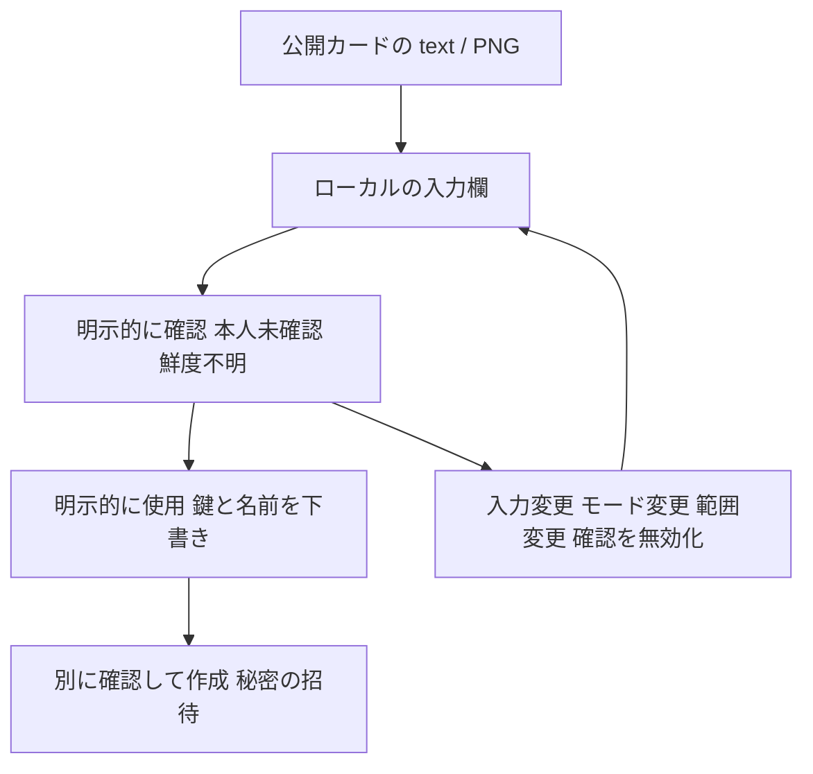

# 公開鍵の端末カード

[English](DEVICE_CARDS.en.md) · [0.3 系列の計画履歴](CONVENIENCE_PLAN.ja.md) · [v0.5.4-alpha.1](https://github.com/webkaz-labs/sobalink/releases/tag/v0.5.4-alpha.1)

**読取り専用のWeb／CLI操作で、公開鍵を交換できます。** 公開鍵、明示して選んだ
表示名、任意のアドレス情報を含みます。カードだけではペアリング、接続開始、
接続先更新、アプリへの許可を行いません。Web画面では確認した公開鍵と表示名を相手の
未適用下書きへコピーできます。招待の作成は別操作です。画面とは別に処理するワーカー内での画像展開に対応した
ブラウザーでは、静止PNGのQRをローカルで読み取れます。

公開鍵は秘密ではありませんが、同じ端末を識別する手掛かりになります。
アドレス情報はネットワークの情報を示す場合があります。表示名を明示して選び、
不要なアドレス情報は含めず、適切な非公開の方法で交換してください。
設定済みの端末名を自動で書き出しません。

## アクセスを許可せず公開鍵を交換する



読み取りや内容の検査では、相手の本人確認・ペアリング・アクセス許可は成立しません。PNGはローカルで文字に戻すだけです。独立した鍵の照合と、秘密の招待作成は別に行います。


1. 表示名を意図して選んで書き出します。任意のアドレス情報は必要な場合だけ含めます。
2. 受け取ったテキストや PNG を確認し、信頼できる方法で公開鍵を照合します。「未確認」「不明」は実際の状態を示し、成功を示す印ではありません。
3. 確認済みの鍵と表示名だけを相手の下書きへ移します。非公開の招待は別途作成・確認します。

通常の交換には以下の Web または CLI 手順を使います。API 項目・リーダーの出所・版付き形式は後半の参照情報です。カードは再利用できる公開連絡先情報で、一回限りの権限を持つ非公開の招待とは別物です。

## Webでの書出しと相手の確認

**ネットワークを設定**を開き、**LAN**または**直接LAN**を選んで、
**端末カードを交換**を押します。

1. 書き出すには**共有する表示名**を明示して入力します。初期値は空欄で、設定済みの
   端末名は使いません。書出しには既存のIDが必要です。カードの操作でIDを作成・修復
   しません。Webの書出しにはアドレス情報を含めません。必要なら**ローカル生成の
   QRコードを付ける**を選び、**公開カードを書き出す**を押します。文字列のコピーや
   `.txt`ファイルの保存は別ボタンです。クリップボードを使えない場合も、表示された
   文字列全体を手動で選択してコピーできます
2. 相手の`soba-card1.`テキストを貼り付けるか、小さなUTF-8テキストファイルを
   開きます。どちらも入力の上限は1,040 バイトです。ファイルを選ぶだけではカード欄に
   入るだけで、**公開カードの内容を確認**を押してからCoreへ確認を要求します。
   方式違い、不正な形式、上限超過、非公開の招待は拒否し、エラーへ入力を再掲しません。
   別方式のカードは、該当する方式の設定で確認してください。
   **端末カードのPNGを開く**では、QRコードを1つ含む静止画像をローカルで読み取り、
   同じ文字列の欄へ入力します。自動で内容確認、ペアリング、相手の使用を行いません。
   **PNGの読取りを取り消す**で停止できます。別の画像を選ぶと前の処理を取り消します
3. **本人確認：未確認**と**アドレスの鮮度：不明**の表示を確認します。公開鍵と表示名は
   別の信頼できる方法で相手と照合してください。アドレスや証明書が表示されても
   未確認の参考情報で、リンクや自動接続にはなりません。取り消すと相手の下書きは
   変更しません
4. 内容を確認してから**相手を下書きに入力**を押します。既存の相手の下書きへ
   公開鍵と表示名だけをコピーします。招待欄で下書きを確認し、ネットワークの準備が
   できたら既存の招待操作を別途行います。既存の招待やアプリへの信頼は別の操作です

入力の編集、カード欄や設定の終了、方式・ID・ネットワーク範囲の変更、確認時からの状態変更や
認証切れで確認結果を破棄します。遅れて届いた応答で復元しません。これらの変更とPNGの
容量設定の変更は読取りも取り消します。PNGを読み取れない場合も、文字列とテキスト
ファイルを使えます。下書きをブラウザーの保存領域へ保存せず、カメラAPIも使いません。

PNGのファイル容量・画素数・見積作業メモリー・制限時間は「容量と履歴」で有限値に
設定できます。[PNGの容量](CAPACITY.ja.md#ローカルでのpng端末カード読取り)を参照してください。
アニメーションPNGと、複数のQRが返った画像（同じ内容の重複を含む）は拒否します。
元の解像度で白背景へ描画し、EXIF・色・テキストの付加情報は使いません。読取りに失敗
したら、カードが1つ写った鮮明な画像か文字列を使ってください。この受付上限は
ブラウザーの最大メモリー量を保証しません。

コンポーネント試験では両言語、入力上限、QR の画像と周囲の余白の厳密な検査、取消し、
古い応答、公開鍵と表示名だけの下書き反映を確認します。専用のブラウザー試験は、
実際のローカルCoreと隔離した架空データを使い、LANの書出し・QR・テキストファイル保存・
相手の確認、およびID設定前の直接LANの確認を対象にします。既存の直接LAN IDは
模擬していないため、直接LANの書出し、ネイティブのクリップボード、実端末でのQR読取り、
実端末のペアリングは確認しません。試験一覧への表示は成功した実行を意味しません。
実行結果は受入試験のレポートで確認してください。
PNG用ブラウザー試験は、ハッシュ固定した架空画像12個、保存した画面の画像、不正・
過大・アニメーション・付加情報・QR重複の入力、資産読込みの遅延中の取消し、および
同梱リーダーの応答ハッシュと、ブラウザーの読み込み・実行制限（CSP）を対象にします。これとは別に、サーバーから取得した
文書・リーダーのCSP値をそのまま使う通常実行の架空スクリプトで、制約の適用を確認します。
架空スクリプトは同梱リーダーを置き換えず、その読取り動作を実証するものでもありません。
拒否の確認には、操作の失敗と、その操作に一致するCSP強制適用イベントの両方を必要とします。
別のNode比較の227例はブラウザーの結果ではありません。
試験を記載しただけでは、対応ブラウザーのネイティブ画像展開や実際の配布物の確認が
通ったことにはなりません。

## CLIでの書出しと内容確認

```sh
soba card export --mode lan --name 'Example device'
soba card export --mode direct-lan --name 'Example device' --include-endpoint --qr
soba card inspect --mode lan --file ./device-card.txt
soba card inspect --mode lan --stdin --json < ./device-card.txt
soba --offline card inspect --mode lan --file ./device-card.txt --json
```

書出しと通常の内容確認にはローカル本体の起動が必要です。起動時と同じ
`--state-dir`を指定してください。書出しは既存の正常なIDだけを読み、IDの作成・
修復、接続設定、招待の発行、信頼の付与を行いません。IDがない場合や、明示要求した
アドレス情報がない場合はエラーにします。`--offline card export`には対応していません。

`--offline card inspect`を明示すると通信しない符号化・復号処理で入力を検証します。本体への接続、
既定プロファイルの解決、ローカル状態の読取り・書込みは行いません。どちらの確認経路も
方式を明示し、通常ファイルまたはパイプの標準入力からカード文字列を1つ読みます。
解析前に1,040 バイトの読取り上限を適用し、不正な入力をエラーへ再掲しません。
カード文字列のコマンド引数、機密の招待、書出し結果のJSON全体は受け付けません。
人向け書出し結果の`soba-card1.`で始まる1行だけを入力ファイルへコピーしてください。
スクリプトでは`card export --json`の`card`項目を取り出せます。

人向け出力は日本語・英語を自動選択し、`--locale`で変更できます。`--json`は全言語で
同じ公開API項目を返し、`--json-errors`は入力を再掲しない安定したエラーを返します。
`--qr`はローカル生成した端末用QRを追加し、`--json`ではAPIのビットマップ画像を返します。
端末の幅や表示機能が足りない場合もカード文字列全体を残し、代替方法を案内します。
`--dry-run`はローカル入力を検証し、本体へ接続せず読取り要求を表示します。

CLIの自動試験では、読取り専用APIの模擬実装、符号化・復号処理、入力上限、取消し、言語、JSON、
端末ビットマップ画像を確認します。実端末でのQR読取りや一連のペアリング操作の確認では
ありません。既存の招待コマンドと指定項目は変更していません。

## 書出しと内容確認

認証済みのローカルコマンド APIで次を利用できます。

- `device-card.export`：`{mode,name,includeEndpointHint?,qr?}`。方式は`lan`または
  `direct-lan`を明示し、表示名は必須です。任意の真偽値は既定でfalseです
- `device-card.inspect`：`{card,expectedMode}`。ローカルIDの設定前でも内容を確認
  できます。想定する方式を明示する必要があります

書出しは既に作成されたIDを読むだけで、初期化や修復をしません。IDがない場合や
復旧が必要な場合はエラーにします。アドレス情報を明示要求したのに保存されていない
場合は`device_card_hint_unavailable`を返します。

結果は定義した公開項目だけを含み、`verification:"unverified"`、
`freshness:"unknown"`を明示します。書出しは符号化した`card`と、任意でローカル生成
したQRのビットマップ画像を返します。内容確認は`contentDigest`も返します。これは許可された
外側の空白を除いたカード文字列全体のSHA-256で、内容の一致を調べる値です。
本人、端末の所有者、秘密鍵の保持の証明ではありません。読取り結果をコマンドの
再試行キャッシュへ保持しないため、再試行では現在の保存IDを読みます。

複数方式の併用（mixed）設定では構成要素の`lan`または`direct-lan`を選んでください。mixed の論理IDを
構成要素のカードにしません。Tailnetは既存のログインを使い、この形式のカードは
用意しません。

## 読取り資産とライセンス表記

オフラインで使う本体に、公式zxing-wasm 3.1.5の無改変WASMを埋め込み、固定したESMの
JavaScriptを使い捨てのワーカーにまとめています。WASMのSHA-256は
`aecc1876de036c62c8419f67a5e1a16b1698a325bcd190aa84810d516e263931`です。
確認できたラッパー・C++・生成コード・ランタイム・文字変換表の表記は、ローカル本体の
`/assets/png-reader-notices.txt`と、インストールした共有ファイル内の
`licenses/npm/zxing-wasm@3.1.5/`へ同梱します。

公式アーカイブの発行者・ビルドとの関連確認は、ソースからの再現ビルドとは別です。
取得されたstbの正確なリビジョン、ネイティブ関数のリンク一覧、過去の文字変換表入力の
完全な出所は確定しておらず、バイト一致する再現ビルドも実証していません。同梱一覧に
これらの限界を記し、ランタイム表記を保守的に含めています。関数単位の完全なソフトウェア構成部品表（SBOM）を
主張するものではありません。

## 版1の形式

テキストと QR は同じ内容です。`soba-card1.` の後に、正規形式の UTF-8 JSON を
base64url で変換した文字列を続けます。末尾の補完文字（=）は省きます。必須項目の順序は`version:1`、`mode`、`publicKey`、`name`です。
任意の`endpoint`はdirect LANだけ、`relay`はLANだけで、内部は`address`、
`certificateSHA256`の順です。両方のアドレス情報を同時に含められません。
表示名は1〜80 UTF-8 バイトで、前後の空白・制御文字・文字の表示方向を変える制御文字・改行区切りを除きます。
鍵と証明書の照合値（pin）は全桁ゼロ以外の小文字16進64文字です。

直接接続先は正規表記の数値形式のプライベート／ループバックアドレスと1024〜65535のポートを使い、
54543〜54545を除外します。中継情報の検証は数値接続先と証明書の照合値の形式だけを確認します。
外部／ループバックアドレスを表す場合もありますが、そこへ接続したり、証明書の照合値を信頼したり、
中継として選んだりする許可ではありません。

版付きの交換上限は、復号後768 バイト、カード文字列1,035 バイト、入力1,040 バイトです。
入力の上限は外側のASCII space／tab／CR／LFを除く前に確認します。未知・重複・大小文字
違いの項目名、任意項目のnull／空値、方式違い、非正規base64／JSON／接続先、不正Unicode、
後続データを拒否します。JSONは固定順の通信データ構造に対する`encoding/json`の正確な出力
を使い、エスケープ規則は期待出力を固定したテストで検証します。この通信形式の上限は、設定可能で有限の
ローカルコマンド／リソースの上限とは別です。

招待トークン、事前共有鍵（PSK）、秘密鍵、トンネル鍵、経路許可、許可するアドレス範囲、インターフェース名、グループの構成は
含めません。カードは期限付きの認可ではなく、再利用できる連絡先情報です。
招待の期限と認証付きの証明は既存の招待の通信方式が扱います。

## 安全性と確認範囲

内容確認でDNS 解決・接続確認・URL 表示・証明書の照合値の変更・ID作成・取消済みペアの復活を行いません。
読取りに成功してもアドレスの鮮度や到達可否は不明です。カードのアドレス変更を、
認証付き接続先更新として扱いません。Webの操作では内容を確認し、相手の公開鍵と
表示名だけを未適用の下書きへ移します。その後、既存の招待を別操作で作成します。

符号化・復号処理／Coreの自動試験では、入力上限・正規形式・秘密除外・IDなし／復旧状態・方式分離・
最新状態の読取り・副作用がないことを確認します。受理できる最大形式でQR生成も
検査します。実端末での読取り、カメラの後始末、一連のペアリング操作、ほかの利便性
領域全体の完了を意味しません。
