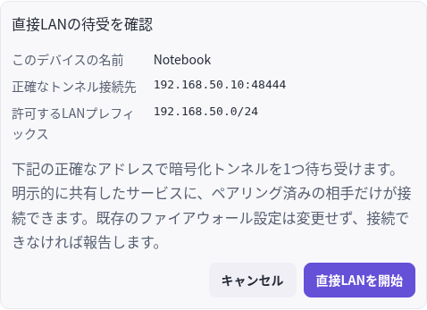
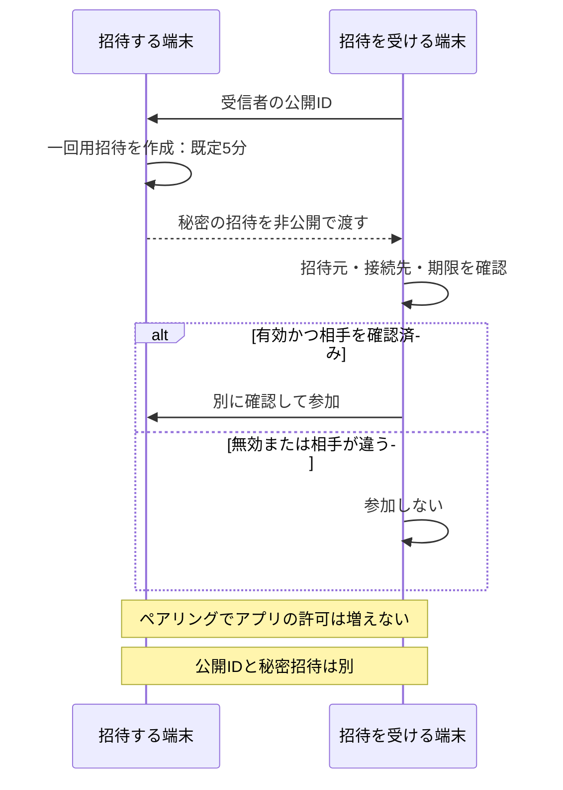
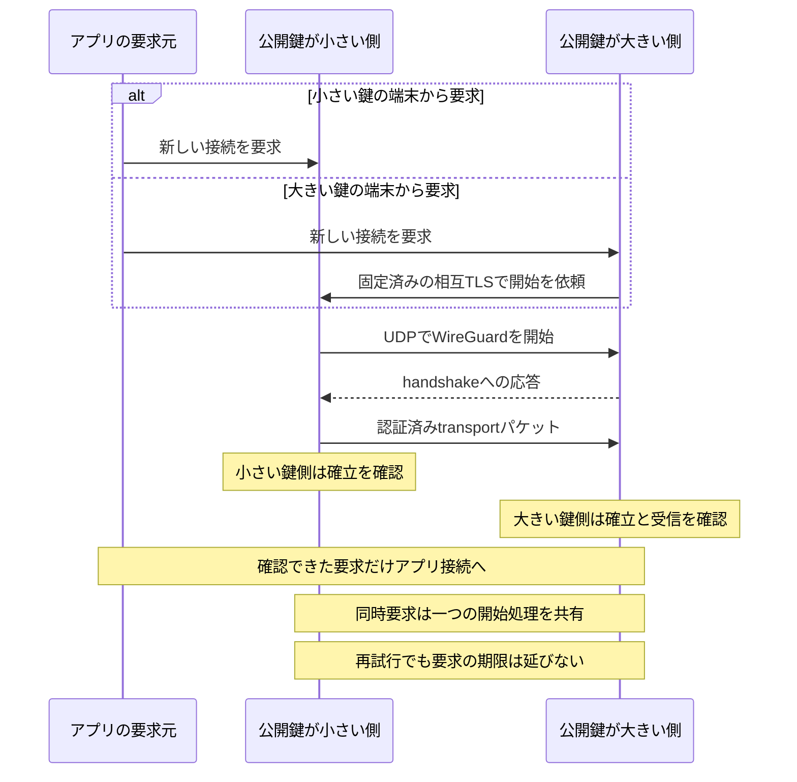
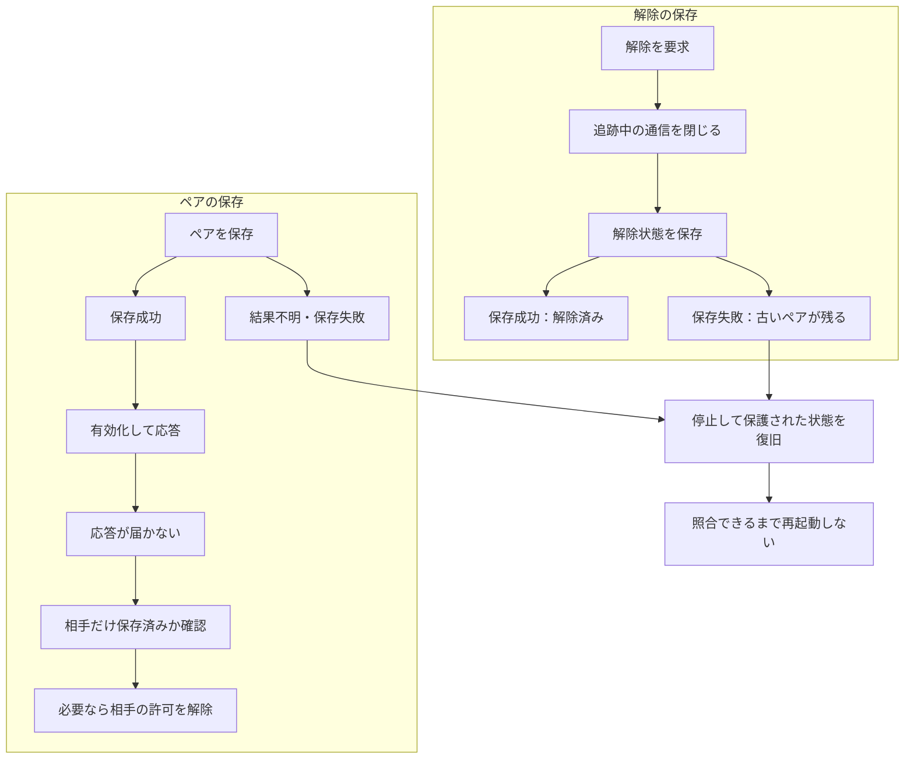

# リレーを使わない直接LAN

[English](DIRECT_LAN.en.md) · [開発原則](DEVELOPMENT_PRINCIPLES.ja.md) · [v0.5.1-alpha.1](https://github.com/webkaz-labs/sobalink/releases/tag/v0.5.1-alpha.1)

通常の初回設定は[依頼して相手が承認する手順](CONNECTION_SETUP.ja.md)から始めます。以下の公開 ID・招待を明示する手順も、その方式を選ぶ場合に利用できます。通常の初回設定は TOFU で、名前や探索は本人確認ではなく、初回の中間者攻撃を防ぐ保証はありません。必要に応じ、信頼できる方法で完全な指紋を照合してください。

`direct-lan` は、正確な数値プライベートIPで相手を認証してペアリングし、
WireGuardで暗号化したTCPとネイティブUDPを組み込みgVisorユーザー空間スタックで
運びます。この方式はリレー・DNS検索・STUN・外部探索・カーネルTUN・管理者権限・
ルーター変更・ファイアウォール変更を使いません。既存のネットワーク規則で通信が
遮断される場合は、規則を変更せず失敗を報告します。

**更新時:** profile 3 は v0.4.0-alpha.4 以前と非互換です。旧状態を保管し、別の空の `--state-dir` で開始してください。自動移行・自動消去はありません。以下の機能別の保存形式の履歴は、このプロファイル境界を変更しません。

## ペアリング前に用意するもの

- 両端末で sobalink を起動し、それぞれに割り当てられた正確なプライベートアドレス、未使用の TCP／UDP ポート、意図した prefix を選びます。
- 信頼できる非公開の方法で公開 ID を交換・照合します。表示名やアドレスは本人確認の証拠ではありません。
- 一回用の招待は非公開で扱い、ペアリング後に必要なメッセージ・ファイル・サービスの範囲だけを許可します。

**期待する結果:** ペアを保存し、到達可能なら暗号化した通信路を使えます。ローカルの準備完了だけでは相手・アプリの成功を証明しません。中継を使う構成が目的なら、[中継方式の LAN](LAN.ja.md)を選んでください。

## ローカルWeb UIでの最短手順

1. 両端末をオフライン起動し、各端末のローカル管理画面から「接続設定 → 直接LAN」を選びます
2. 「この端末のLANアドレスを表示」から割り当て済みアドレスと範囲を選ぶか、
   数値プライベートIPと範囲を手動入力します。未使用の1024〜65535番ポートを選び、
   明示的に許可するサブネットを確認して開始します。同じ番号をTCPの
   ペアリング・セッション制御の待受とUDPトンネルに使います
3. 招待される端末の「公開ID」を招待元に渡します。招待元はそのIDと表示名を入力し、
   5分間有効な招待を作成します。任意の非公開QRは端末内で生成し、テキストコピーも使えます
4. 意図した相手にだけ招待を非公開で渡します。招待全文を貼り付け、招待元の固定された
   公開ID・正確な接続先・期限を確認してペアリングします。QR読み取り結果のテキストも
   同じ確認に使えます
5. メッセージとファイルの許可は両端末で別途設定します。サービス共有には、正確な相手、
   ループバック先、ポート、有効期間を個別に指定します

画面は保存設定、ローカル待受、相手・アプリからの応答確認を区別します。公開IDは
秘密ではありません。招待は1回限りの秘密情報です。ログ、公開スクリーンショット、
コマンド引数、共有文書に残さないでください。使用済み・期限切れの招待は表示中の
コピー・QR欄から消えます。ペアリングだけではアプリ利用を許可しません。


デモデータでの画面例。実機での接続・配送・アプリ動作を検証した結果ではありません。



[原寸で開く](assets/screenshots/direct-review-ja-focused.png)

ローカルの正確なIP・ポート → 許可prefixを確認します。同じ番号のTCPとUDPへの到達が必要です。これは開始前の確認で、招待や秘密情報は表示していません。

### 明示的な招待で渡すもの

CLIの前に、公開IDと秘密の一回用招待の渡す向きを分けます。



受信側が先に公開IDを渡し、招待側が受信者を限定した一回用の秘密招待を返します。既定の期限は5分です。内容を確認してから別に参加し、アプリの許可は個別に行います。

## CLIでの操作

まず `soba start --offline` で起動します。以下は架空のプライベートネットワーク例です。
実際に割り当てられた目的のアドレスと、意図したサブネットを選んでください。

招待元：

```sh
soba direct-lan configure --listen 192.168.50.10:48444 --prefix 192.168.50.0/24
soba direct-lan identity
soba direct-lan status
```

受信側は自分のアドレス（例：`--listen 192.168.50.11:48444`）で設定し、identityが返す
公開IDを招待元へ渡します。招待元では、その正確なIDを指定します。

```sh
# POSIXでは、出力前に所有者だけが読めるファイル作成権限にします。
umask 077
soba direct-lan invite --to RECIPIENT_PUBLIC_ID --name device --ttl 5m > invitation.json
```

`umask` のないOSでは、所有者専用の保存場所・権限を使ってください。ファイルを選択した
非公開の手段で相手に渡し、受信側で確認・参加します。

```sh
soba direct-lan inspect --json-file invitation.json
soba direct-lan join --json-file invitation.json
```

`--stdin` は同じJSONをパイプから受け取ります。招待自体を位置引数に貼り付けません。
日本語・英語でJSONフィールドとコマンド名は変わりません。`status --json` は機械可読です。

未使用の招待は発行元で `soba direct-lan cancel --json-file invitation.json` により取消、
ペアは `soba direct-lan revoke PEER_ID` で解除します。解除は追跡中の通信を閉じ、相手の
アプリ許可を無効化します。保存済み内容の撤回や、相手のアプリ内で開始済みの処理停止は
行いません。

## 識別情報・保存・通信の境界

- 相互Ed25519 TLSでペアリング両者を認証します。招待は受信者と招待元を固定し、その
  認証済み交換内で独立したWireGuard公開鍵と正確なトンネル接続先を双方が確認します
- WireGuard秘密鍵は保護されたEd25519シードから用途を分離して導出します。名前や
  未認証のIPアドレスだけで相手を識別しません
- アプリ通信はすべてユーザー空間スタックと固定したWireGuard鍵を使います。
  WireGuardの鍵別ルーティングと復号後の検査により、相手の正確な`/128`送信元と
  この端末の正確なオーバーレイ宛先だけを許可します
- UDP待受は、選択したプライベート・ループバック範囲内の、現在許可された正確な接続先の
  集合を使います。別の許可済み接続先から受けた暗号文も、WireGuard鍵に対応するIDと
  `/128`送信元の許可のままです。物理的な送信元IPによって別の相手のIDにはなりません。
  各相手への送信先は固定します。名前解決、ワイルドカード、IPv4-mapped別表記、非ゼロの
  ソケットmarkは拒否します。IP範囲と受動的なインターフェース確認は、物理NICの利用や
  OSのVPN経路からの隔離を証明しません。このアプリはその経路を変更しません
- 新しいアプリ接続の前に、Ed25519公開鍵の小さい側がWireGuardを開始します。
  反対側は固定済みの相互TLS制御接続で開始を依頼し、認証済みWireGuardパケットによる
  確認を待ちます。同時の接続要求は開始処理を共有します。応答側が直後に再起動した場合、
  WireGuard既存の5秒の送信間隔を待つことがあります。制御の再試行は元の要求期限内に
  限定されます。両端末で選択したTCP制御とUDPトンネルの到達性が必要です
- この待機は初回・新規接続の確立を対象にします。既存の接続ではWireGuard独自の再鍵交換・
  再送タイマーが動作するため、ネットワーク切断・長いアイドル・スリープ復帰をまたぐ
  TCPの無停止継続を保証しません
- TLSはペアリング・セッション制御用です。アプリ用プロキシにはなりません。明示した仮想待受と既存の
  範囲限定TCPディスパッチャーだけにストリームを渡し、既存のサービス許可が
  ループバック転送先を制御します
- 有効化前にCoreの保護された状態を永続化します。WireGuardの保護状態はversion 2です。
  比較用試作のversion 1は、ペアがない状態も含めて拒否します。不確かな保存は通信を止め、復旧確認を
  必要とします。応答欠落で相手側だけがペアリング済みになることがあります。
  再試行前に相手側の許可を確認・解除してください。解除を書き込めなかった場合、現在の
  通信を閉じても、再起動後に以前の保存ペアを読み込めることがあります。停止したまま
  保存状態を確認・修正してから再起動してください
- ローカルインターフェースの受動的な確認で、選択したIPが稼働中のインターフェースから
  消えたことを報告します。相手探索、通信試験、範囲変更、別アドレスへの再bindはしません。
  確認自体の失敗は「不明」であり、他方式へ切り替えてよい根拠にはしません

同一設定の繰り返しは識別情報を維持します。接続先・範囲の変更は停止、オフライン再起動、
対象ペアの明示的な解除、再ペアリングを必要とします。招待によって許可範囲を自動拡大しません。


### 新しい接続はどちらから始まるか

固定端点ペアの模式図です。managed context の追加認可・終端tombstoneは別の実装契約です。

アプリの要求元とWireGuardを開始する側は別の役割です。



WireGuardの開始役はEd25519識別用公開鍵の順で決まり、アプリの要求元とは別です。大きい鍵の端末は必要に応じて相互TLSで依頼します。同時要求は開始処理を共有し、元の期限内で、小さい鍵側は確立、大きい鍵側は確立に加えて認証済みパケットの受信を待ちます。既存通信のrekeyや継続性を示す図ではありません。


### ペア保存と解除で結果が不明なとき

固定端点ペアの模式図です。managed context の追加認可・終端tombstoneは別の実装契約です。

現在の接続を閉じても、保存済みペアの解除を証明することにはなりません。



ペアは永続保存の後に有効化します。保存結果が不明なら閉じ、応答消失では相手だけ保存済みの場合があります。解除時に現在の通信を閉じても、保存に失敗すれば古いペアが残ります。再起動前に保護された状態を復旧し、再ペアリング前に相手の許可を確認します。

## 容量と検証

論理的なペア登録数は `trustedPeers` の選択（明示した無制限を含む）に従います。
引き下げても保存済みペアを削除しません。保護状態には `lanStateBytes` の別予算があります。
固定版WireGuardエンジン自体には65,536件のピアテーブル資源境界があります。

接続、待受、保留招待・制御、パケットキューの有限な予算は、既存の変更可能なCoreリソース設定を
使います。TLS制御には保留招待予算から得た独立した有限の枠を使い、待機中のアプリ接続が
制御用の枠を消費しないようにします。実行時の割り当て変更は再起動後に適用し、`resourceRestartRequired` を表示します。
論理登録数と保存容量はポリシー保存成功時に更新します。小さい制御メッセージ、招待期限、
データグラムのプロトコル境界は、ファイルやTCPストリームを切り詰める制限ではありません。

```sh
go test -race -tags directlan_integration ./internal/directlan -count=2 -timeout 150s
go test -race -tags directlan_integration,directlan_lifecycle ./internal/directlan -run '^TestNativeSessionLifecycle$' -count=1 -timeout 8m
go test -race -tags ts_omit_portmapper,ts_omit_captiveportal,ts_omit_useproxy,directlan_integration ./internal/core -run '^TestDirectLAN' -count=10 -timeout 180s
```

[転送実装の由来（オンラインのソース）](https://github.com/webkaz-labs/sobalink/blob/main/internal/directlan/UPSTREAM.md)。初期のTLSストリーム・フレーム化UDP試作の
検証結果を、最終WireGuard・ネイティブUDP実装の検証済み根拠にはしません。通常の`lan`方式と
[複合接続](MIXED_CONNECTIONS.ja.md)は、外部通信の許可範囲が異なります。

## 過去の通信試験

ネイティブのループバック自動テストでは、コールドスタートのペアリング、相互の
識別情報の証明、TCPストリームと半閉鎖、ネイティブUDP、再起動、メッセージ、
範囲指定したアプリ転送、解除を確認しました。実機LAN到達性、アプリ互換性、
スリープ復帰、インストール、公開を単独で証明するものではありません。
過去の 0.3.0-alpha.5 では同一ソースのnative／browserと署名付き公開のゲートを別途完了しています。
[検証記録](VERIFICATION.md)を参照してください。以前のローカルブラウザー実行は
Chromiumのprocess-singletonソケット権限によりページ表示前に停止し、
その実行では画面の受入を確認できませんでした。以前の並列race実行では初期WireGuardハンドシェイクの同時開始が重なり、
既存の8秒のアプリ期限内に初回メッセージが9/10、初回HTTP確認が7/10成功しました。
現在は初回の開始役を固定したセッション待機を追加し、広いCoreテスト順序の10回反復と
アダプター全体の2回反復を並列実行して成功しました。応答側の直後の再起動も、製品の
期限を延ばさず確認しました。別のネイティブ確認では、TCP・UDPの双方向通信を125秒続け、
両側で新たなハンドシェイクの完了時刻を確認しました。185秒のアイドル後の新規TCP・UDP接続、
人工的な鍵期限切れ・消去・再鍵交換も成功しています。限定したループバックの結果であり、
実機やインストール済みリリースの受入確認を意味しません。
