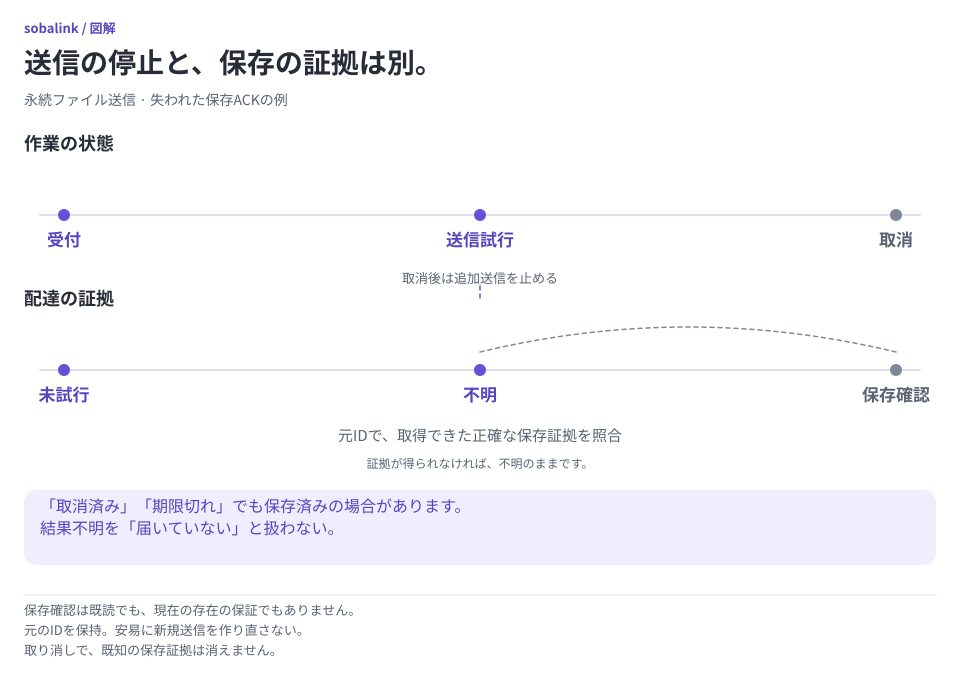

# 永続的なファイル送信待ち

[English](DURABLE_OUTBOX.en.md) · [CLI](CLI_GUIDE.ja.md) · [Web 操作](WEB_CONTROLS.ja.md)

公開版の 0.5.0-alpha.1 では、ファイル・フォルダーの永続送信待ちを明示的に選べます。予約成功は **送信側の端末での受付** であり、配達完了ではありません。保存済みと確認するのは、相手の永続的な到着記録がある場合だけです。ソースのテストや合成環境での確認は、配布物・実機・電源断・実登録・OS ログイン時の受入確認を意味しません。

**開始前に:** 0.5.0-alpha.1 には新しい形式 3 のプロフィールを使います。旧プロフィールは移行・削除せず保管します。形式と復旧の条件は下で説明します。

<picture>
  <source media="(prefers-color-scheme: dark) and (max-width: 839px)" srcset="assets/visuals/delivery-evidence-ja-dark-narrow.svg">
  <source media="(prefers-color-scheme: dark)" srcset="assets/visuals/delivery-evidence-ja-dark-wide.svg">
  <source media="(max-width: 839px)" srcset="assets/visuals/delivery-evidence-ja-light-narrow.svg">
  
</picture>

[図を元の大きさで開く（横長）](assets/visuals/delivery-evidence-ja-light-wide.svg) · [縦長版](assets/visuals/delivery-evidence-ja-light-narrow.svg)

送信待ちの記録は期限内の試行を許可するもので、到着証明ではありません。応答が失われたら、元の ID と相手の到着記録を確認して次の操作を決めます。停止しても保存済みの内容は回収できません。

## 最短の操作

1. 相手の会話で、従来の即時送信には **今すぐ送る** を使い、予約するときは **後で送るために予約** を明示的に選びます。即時テキスト送信が使えないオフライン端末にも、信頼済みならファイルを予約できる場合があります。現在の公開版の[テキスト予約](DURABLE_TEXT.ja.md)は別に明示選択します。
2. 既存のファイル・フォルダー選択を使い、正確な相手を一人ずつ選びます。期限を選んで **送信予約の確認を準備** を押し、返されたファイル・識別情報・ローカルコピーの保持・タイムゾーン付き絶対日時の期限を確認します。準備だけでは送信を承認しません。
3. **{時刻} まで送信を予約** を選びます。正確な内容と宛先に限り、アプリ再起動後も、その期限まで自動で試行できます。両端末で Sobalink が起動し、接続可能になる必要があります。受付確認後は、送信側の本体が動作中ならブラウザーを閉じられます。
4. 常設ナビゲーションや会話から **送信待ち** を開き、相手ごとの結果を確認します。開き直し・再接続時には、サーバー上の記録を取得します。

既定の期限は24時間、最長は7日間です。Web では1時間も選べます。CLI は1分から168時間まで指定できます。確認した絶対日時を保存し、再起動で延長しません。内容・相手・期限の変更には、新しい明示確認が必要です。テキスト予約は別の[機能](DURABLE_TEXT.ja.md)です。送信開始時刻の指定はいずれの予約にも含みません。

## CLI

```sh
soba send --queue --peer PEER_A --peer PEER_B --expires-in 24h --json ./sample.txt
# 準備結果の正確な値を使用:
soba outbox commit OUTBOX_ID --process PROCESS_ID --revision REVIEW_REVISION --confirm --json
soba outbox list --json
soba outbox show OUTBOX_ID --json
soba outbox show --request REQUEST_ID --json
soba outbox cancel OUTBOX_ID --json
soba outbox discard OUTBOX_ID --process PROCESS_ID --json
```

`--confirm` のない `--json` は準備だけで、質問も送信承認も行いません。通常表示は準備した内容を示して承認を確認します。`--confirm` は選択した正確な相手・内容・表示された絶対日時の期限への明示承認です。別のプロファイルを選んだ場合、後続コマンドでも同じ `--state-dir` を使います。表示される継続コマンドにも保持します。

`--dry-run` はローカル入力検査のみで、IPC・コピー準備・対応確認・送信は行いません。終了コード0はコマンド結果を確認できたことです。ローカル予約、ブロック・期限切れの照会、停止も含み、それ自体は配達の証明ではありません。検証・制御の失敗、変更結果が未確認の場合は非0です。JSON の未確認結果には安定したエラーコードと元の要求 ID を含めます。初期実装では長時間待機コマンドや、新しい送信としての再実行を省略しています。

## 新しいプロフィール形式

公開済み 0.4.0-alpha.4 は形式 2、公開済み 0.5.0-alpha.1 は形式 3 のプロファイルを使います。形式 3 は[テキスト送信待ち](DURABLE_TEXT.ja.md)のメッセージストアも必須とします。いずれも必要なストアは本体のライフサイクルロックの下で初期化します。形式 3 は alpha.4 と旧形式を拒否するため、既存の状態を保管して別の空のディレクトリを選びます。移行や機能有効化のウィザードは設けません。以前のプロフィールは書き換え・削除せずに拒否するため、保存したまま新しいディレクトリを選んでください。通常の受信承認は維持し、送信待ちへの登録ごとに明示的な確認が必要です。

初回初期化が中断され、空の状態の所有権を確認できない場合は停止します。準備完了後のプロフィールで失われた配達台帳を自動再作成しません。プロセス再起動からの回復保証には、私有状態のバックアップ巻き戻し、手動の置換・削除、同じファイルアクセス権を持つ別主体による私有名前空間の同時変更は含みません。検出した置換や不明なファイルは安全側に停止しますが、確認と削除の間の敵対的な同時リネームまで防ぐものではありません。回復警告を消すために私有の証拠を削除しないでください。

## 処理状態と到着記録を分けて読む

- **送信待ち / 相手の接続待ち:** ローカルで永続受付済みですが、相手の保存は未確認です。
- **対応状況の確認待ち:** 認証済みの相手が永続到着記録への対応を確認するまで、内容を送りません。非対応と分かっている相手には更新が必要です。従来の送信へ自動では切り替えません。
- **到着状況を確認中 / 到着状況の確認が必要:** すでに届いている可能性があります。代わりの要求を作らず、元の要求を照会してください。
- **権限の確認が必要:** 正確な相手の識別情報と現在の範囲を確認します。再ペアリング・同名の別端末・無関係な新しい権限で、以前の承認は復活しません。
- **一時停止中:** 既存の一時停止を解除した後も、元の範囲と期限内でのみ再開できます。
- **追加の送信を停止済み / 送信期限切れ:** 保存済みや到着不明の結果は消えません。
- **相手の端末に保存済み:** 永続記録で保存を確認しました。既読や、現在もファイルが残っている保証ではありません。

記録は `status` と `deliveryOutcome`（`not_attempted`・`unknown`・`partial`・`confirmed`）、正確な子送信 ID、ファイルごとの保存記録を分けます。一部だけ届いた結果を全員への配達完了にはしません。可能な自動再試行でも元の識別情報を使い、代わりの送信を作りません。準備コピーの欠落・破損、相手の記録の消失は復旧確認待ちとなり、無確認の再送を承認しません。

## 未確認結果・再起動・停止

応答を失ったら `outbox show --request REQUEST_ID` または **元の要求を確認** を使います。ブラウザーに保存するのは、復旧の手掛かりになる未解決の要求 ID だけです。内容と結果の正本はサーバーから取得します。再読み込みしても、未確認結果を新規送信に置き換えません。準備の確認は起動世代に属し、本体の再起動で送信権限にはなりません。受付済みの照会・停止には、以前の起動 ID は不要です。

**追加の送信を停止** は、その後の送信を永続的に止めます。動作中の処理が止まるまで **追加の送信を停止中** になることがあります。相手の保存処理が先に確定した場合、その結果は残ります。停止しても、相手のファイルの回収・元の入力の削除・到着記録の消去は行いません。期限も追加の送信を止めますが、範囲を限定した到着記録の照会は続く場合があります。期限切れも停止も、不達の証明ではありません。

永続要求 ID の形式は `ob1_<13桁の Unix ミリ秒>_<暗号学的乱数による32桁の小文字16進数>` です。クライアントは、新しい準備を明示的に始める時だけ採番します。未知のキーを新規受付できるのは作成時刻の前後5分以内で、送信期限はキー作成から7日以内です。作成から8日と5分を過ぎた未知のキーは、永続的に `outbox_retired` となります。このため、生涯の受付数カウンターや無制限の削除済みキー一覧を持たずに、安全な終了済み履歴を整理できます。不明・一部保存の結果は、動作中の有限ストレージ容量の範囲で照会可能なまま保持します。応答消失や整理済みエラーでも元のキーを保持し、代わりのキーを自動作成・承認しません。

正しさに必要な到着記録の保持を回避する「忘れる」操作は用意していません。準備コピーの整理は、再実行できない状態を永続記録し、すべての所有者・読み取り処理が解放した後に限ります。容量不足で動作中の要求を勝手に追い出しません。再起動や要求の置き換えを繰り返すのではなく、元の記録を調べ、ストレージや権限の問題を解決してください。

## ローカル API

認証・CSRF 保護付きの `POST /api/outbox/prepare` を追加します。multipart フィールドの順序は `peerIds`（JSON 配列）、`processId`、`expiresAt`（RFC3339）、`requestId`、`manifest`（既存の選択項目 JSON）、`files` です。アップロード応答はローカル準備の結果で、配達結果ではありません。

コマンド群:

- `outbox.prepare`: `{processId, peerIds, paths, expiresAt}`。呼び出し側の元のコマンド `requestId` を使用
- `outbox.commit`: `{processId, outboxId, reviewRevision, confirm:true}`
- `outbox.status`: `{outboxId}` または `{requestId}`。受付済みの照会は起動世代に依存しない
- `outbox.list`: `{}`。version/kind、status/reasonCode、`items` を返す
- `outbox.cancel`: `{outboxId, deliveryId?}`。子指定を省略すると確認済みの全宛先を停止
- `outbox.discard`: `{processId, outboxId}`。未確定の準備のみ

記録には `version:1`、`kind:"outbox"`、安定した `outboxId`/`requestId`、`reviewRevision`、`admission`、`status`、`deliveryOutcome`、`reasonCode`、`peerIds`、不変の `entries`、数値の `totalBytes`、RFC3339 の `createdAt`/`expiresAt`/`updatedAt`、`children` を含めます。`outboxId` は正規形式の元の `requestId` と同じです。後続コマンドのエンベロープ ID や通常の即時送信 ID の形式は変えません。子には `peerId`、`deliveryId`、状態・到着記録・理由、および正確な `files` 保存記録（`batchId`、`fileId`、`size`、`sha256`）を含めます。準備・破棄の記録だけが準備時の `processId` を持ちます。機械向けの名前・値は言語で変わりません。

即時 dispatch v1 の形式・起動世代チェック・オンライン送信の動作は変えません。別の outbox API を用い、既存の転送を永続要求として読み替えません。[開発原則](DEVELOPMENT_PRINCIPLES.ja.md) と既存の検証記録に従い、実装・合成試験・未実施の受入確認を区別します。

## 範囲を限定した受入試験

`TestOutboxThreeProcessBrowser` は、既存の3プロセス Direct-LAN と認証済みブラウザーの試験環境を再利用します。実際に停止した2台を選び、実データの確認・予約を行い、成功した受付応答だけを失わせます。元の要求を照会し、ブラウザーを再読み込みした後、両受信プロセスを再起動して元のオファーを承認します。永続的な保存記録と、各受信側に正確な出力が1つだけあることを確認します。同じ試験で英語375px・日本語320px、横方向のはみ出し、Escape とフォーカスを確認します。

最終統合済みの Web アセットと Core、`SOBALINK_RUN_DIRECT_INTEGRATION=1`、`SOBALINK_RUN_TRANSFER_BROWSER_NATIVE=1`、既存の準備済みブラウザー実行環境が必要です。明示実行する独立した確認段階であり、コンポーネントのモック試験では代替しません。この試験のためにブラウザーのサンドボックス・再試行回数・既存タイムアウトは変更しません。実機・サスペンドやログイン・電源断での受入確認は別に必要です。

`TestOutboxProcessRestart` はブラウザーを使わない別の試験です。ファイルと空フォルダーのみの要求を確定し、配達前に実際の送信プロセスを正常終了して開き直し、送信側を停止した状態で元のオファーを承認してから、保存確認後に受信プロセスを開き直します。空フォルダーのみの要求も含め、承認だけでは認証済みの開始要求より前に出力が作られないことを確認します。元の照会と確定操作を繰り返し、識別情報・正確な保存記録・準備した元のデータ・要求ごとに出力が1つだけあることを確認します。対象は送受信プロセスの正常終了後の再起動で、異常終了や保存応答の消失ではありません。再利用した試験環境の3つ目のプロセスは待機状態で、2宛先への送信はブラウザー試験で別に扱います。どちらも最終統合ソースでの実行が必要です。

`TestDurableAbruptDeathPublicationBoundaries` は既存の非公開テスト用の仕組みを使い、最終リンク前、リンク後、最終ディレクトリ同期後、永続的な保存記録の確定後かつファイル呼出しが戻る前の4箇所で実際の子プロセスを終了します。親は専用終了コードと正確な停止位置の印を必須とし、元のリースと台帳を開き直して、同じネイティブファイル識別、元のバイト列、出力が1つであること、さらに開き直しても保存記録が変わらないことを確認します。実行したプラットフォームでのプロセス終了試験であり、停電耐性やネットワーク応答喪失のエンドツーエンド試験ではありません。

`TestOutboxCLIProtectedIPC` は実際の CLI 要求を保護されたローカル制御ソケットまたはパイプ経由で Core に送ります。架空のオフライン相手と相手への通信がない状態で、固定した準備コピー、確認後の受付、繰り返した要求の識別、照会・一覧・停止を確認します。別名の `TestOutboxCLIInProcessCoreContract` はローカル IPC 境界を通らず、保護された試験の代わりにはしません。どちらも相手への配達や無権限の呼出し元の拒否を証明しません。

保存済み出力の一覧では、通常の整理処理を待つ受信側の正確な予約名の空ディレクトリだけを追加で許容します。任意の隠しファイル、追加出力、シンボリックリンク、空でない準備ディレクトリは失敗にします。このプロセス試験は、準備ディレクトリの最終的な解放を証明するものではありません。

## 保存処理の競合と保持記録

`outbox_storage_busy` は結果未確認です。まず元の要求を照会し、まだ準備済みで元の確認が有効なら、元の起動 ID・リビジョン・期限を保って同じ commit を再試行してください。代わりの要求を作ったり、何も送られていないと決めつけたりしないでください。

受信時の `transfer_accept_busy` は、今回の操作で新たな受入承認が保存されなかったことを示します。以前の承認が残り、保存先の確認処理が既に行われている可能性はあります。少し待ち、同じ転送・確定した保存先・プロファイルで明示的に承認し直してください。Web は再試行する保存先を保持し、CLI では同じ保存先を明示してください。元の競合応答は記録されるため、新しい明示操作には新しいコマンド ID を使います。`transfer_accept_unconfirmed`、応答消失、未知のエラーでは、次の操作の前に元の転送と受信側の保存状態を確認してください。未承認と決めつけたり、無条件に再試行したりしないでください。既存のディスク容量エラーでは個別の案内を維持します。

`outbox_evidence_capacity` は送信側、`durable_evidence_capacity` は受信側の保持記録の容量不足です。保持記録の予算は、進行中の枠や実際の準備済みコピー／ファイル容量とは別です。既存の状態照会・正確な結果照合・停止は引き続き可能です。表示履歴の整理で記録容量が空くとは限りません。新規受付のために結果不明の記録を消さずに保管してください。
