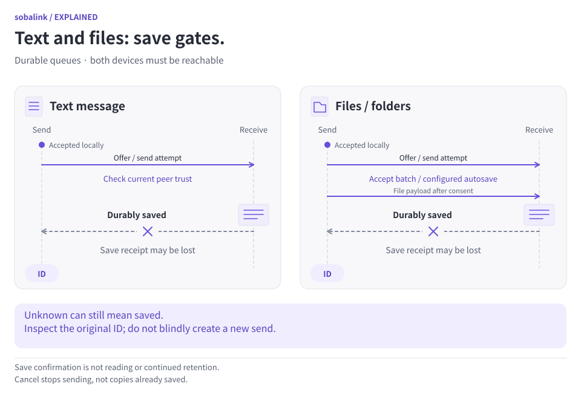

# Durable text queue

[日本語](DURABLE_TEXT.ja.md) · [File queue](DURABLE_OUTBOX.en.md) · [Development principles](DEVELOPMENT_PRINCIPLES.en.md)

Explicitly queue one immutable text message for one exact recipient, including an offline recipient. Acceptance is local; completion means the receiving device durably saved the text. It never means a person read it.

Available in the experimental [0.5.0-alpha.1 release](https://github.com/webkaz-labs/sobalink/releases/tag/v0.5.0-alpha.1). It uses **profile format 3**, incompatible with 0.4.0-alpha.4 and older formats. Preserve existing state and select a separate empty `--state-dir`; there is no migration, automatic deletion or same-profile downgrade. [Published verification](VERIFICATION.en.md) does not establish physical-device, power-loss, OS-login or suspend qualification.

<picture>
  <source media="(prefers-color-scheme: dark) and (max-width: 839px)" srcset="assets/visuals/durable-save-gates-en-dark-narrow.svg">
  <source media="(max-width: 839px)" srcset="assets/visuals/durable-save-gates-en-light-narrow.svg">
  <source media="(prefers-color-scheme: dark)" srcset="assets/visuals/durable-save-gates-en-dark-wide.svg">
  
</picture>

[Open full-size diagram (wide)](assets/visuals/durable-save-gates-en-light-wide.svg) · [Narrow version](assets/visuals/durable-save-gates-en-light-narrow.svg)

A queue record authorizes bounded attempts; it is not a delivery receipt. If the reply is lost, inspect the original ID and receiver evidence before deciding what to do next. Cancellation cannot recall saved content.

## Shortest CLI path

```sh
soba message --queue --peer-name 'Example device' 'Review https://example.invalid/note'
```

The name must resolve to one verified device. An exact ID also works:

```sh
soba message --queue --peer peer-a --expires-in 24h 'A synthetic reminder'
```

The CLI shows the exact recipient ID, quoted text, byte count, SHA-256 and absolute deadline. Review those details and local text retention, then answer `y` or `yes` to queue. Declining discards the process-local preparation. The example name, ID and URL are fictional; choose your intended device from `soba peers`.

The default lifetime is 24 hours. Accepted durations are 1 minute through 168 hours (seven days). The deadline is resolved once from the original request's timestamp. There is no scheduled start time. Put options before the text, quote text for your shell, and use `--` before text beginning with a dash. Command-line text may be retained in shell history; treat command output and saved JSON as private whenever the body is private.

Immediate text remains a separate explicit action:

```sh
soba message peer-a 'Send this now'
```

It never silently turns into queued text. Text queueing has no files, folder paths, receive-folder selection, file acceptance or automatic execution.

## Running local backend, offline recipient

The local agent and selected network backend must run with a known local identity before preparation. A recipient may be offline. A stopped local backend, including settings-only startup, cannot safely prepare a queued text message. A mixed-network backend without a known `SelfID` also fails closed. Starting the backend does not itself grant new recipient trust.

After acceptance, automatic attempts can resume after sender restart until the original deadline. Delivery still requires both devices running Sobalink, connectivity, current identities and trust, no applicable pause or revocation, and authenticated `durable_text_v1` support. Offline compatibility may be unverified until connection. There is no downgrade to legacy immediate messaging when durable support is missing.

A format-3 profile can have a separately reviewed startup/proxy scope for a peer before that peer's first app-trust approval. If that saved scope captured an empty peer epoch, the first app approval creates a nonempty persisted epoch and the same-peer saved scope becomes stale. Review and explicitly save that separate scope again if still wanted. Existing nonempty epochs and unrelated peers are not rewritten; app trust never silently renews startup/proxy approval.

## JSON and explicit approval

```sh
soba message --queue --peer peer-a --json 'A synthetic reminder'
```

This prepares only. It never prompts or authorizes sending. Save the returned `outboxId`, `requestId`, `messageId`, `processId`, `reviewRevision`, recipient, exact text and resolved `expiresAt` privately. All three message/request/outbox IDs are the same canonical `mt1_` key.

After reviewing that result, use its exact returned values:

```sh
soba message queue commit OUTBOX_ID --process PROCESS_ID --revision REVIEW_REVISION --confirm --json
```

`OUTBOX_ID`, `PROCESS_ID` and `REVIEW_REVISION` are placeholders, not literal working values. `--confirm` explicitly authorizes the reviewed recipient, text and deadline. It can also be supplied to the initial queue command when those inputs are already approved. The stable JSON schema and command/flag names do not change with `--locale en` or `--locale ja`.

Preparation and discard are tied to the current agent process. They are not durable acceptance. If the agent restarts before commit, the old preparation may be absent. Check the original ID first; any fresh preparation needs explicit review. Do not assume the former review or default expiry survived. Enqueued records omit `processId`, and status/cancel do not require the old process token.

## Status, list and cancellation

```sh
soba message queue show OUTBOX_ID --json
soba message queue show --request REQUEST_ID --json
soba message queue list --json
soba message queue cancel OUTBOX_ID --json
soba message queue discard OUTBOX_ID --process PROCESS_ID --json
```

`show` and `status` are equivalent. Discard applies only to a preparation; use cancel for an enqueued message. Cancellation stops additional sending and joins active work. `cancel_requested` means stopping is still in progress. Cancellation cannot recall text already saved by the recipient, and never changes known saved evidence into a non-delivery claim.

Detail commands return a version-1 `text_outbox` record directly. It includes original IDs, exact peer, immutable content byte count/hash, original creation/expiry, review revision, admission, work status, delivery outcome and reason code. Retained detail/review includes the text. An optional receipt carries exact receiver-save evidence. After authorized history cleanup, retained detail may omit the body while preserving the exact identity/hash/receipt.

A list returns one bounded page: `version`, `kind`, `status`, `reasonCode`, `items`, `revision`, `total`, and optional `nextCursor`. List status is `ready` or `blocked`. Each item has `id` equal to its original `outboxId`; lists omit the body. Open an original record to review its text before committing. Continue with the returned cursor and same page revision:

```sh
soba message queue list --cursor NEXT_CURSOR --revision PAGE_REVISION --json
```

If the list changes, reload its first page rather than combining mismatched snapshots. Human output prints the next-page command. Follow-up examples retain the selected `--state-dir`.

### Work status and delivery evidence are separate

| Work status | Meaning |
| --- | --- |
| `prepared` / `discarded` | Process-local preparation awaiting approval / discarded without enqueue |
| `queued` / `waiting_peer` | Accepted locally / waiting for recipient or evidence |
| `delivering` | Sending; receipt may still be missing |
| `completed` | Exact receiver-save evidence obtained |
| `cancel_requested` / `cancelled` | Stopping additional sends / stopped |
| `expired` | Original sending deadline passed |
| `paused` / `blocked` / `needs_review` | Sending paused or prevented; inspect the reason |

Delivery outcome is `not_attempted`, `unknown`, or `confirmed`. `unknown` means the text may already have arrived. `confirmed` means receiver-save evidence, never read status. Terminal work status alone does not prove non-delivery; check the outcome and exact receipt.

## Lost replies, busy storage and recovery

If a prepare, commit, cancel or status response is lost or invalid, keep the **original ID, recipient, text and absolute deadline**. The CLI prints an unconfirmed result and the original status command. JSON recovery output preserves the original input when available, plus the process/review token needed for a commit retry. It never generates a replacement send after an ambiguous result.

For `message_storage_busy` or another busy code:

1. Show the original `mt1_` ID in the same profile.
2. If it is already enqueued, follow that record.
3. If it is still prepared and its original review remains valid, retry the exact same commit with its original process and revision.
4. If storage is uncertain, the identity changed, the review expired or the preparation is absent after restart, follow the reported recovery guidance. Do not erase state, switch identities, change the body or extend the deadline to get past the error.

A busy or missing reply is not proof that nothing was sent. `not_found` or a retired key is not proof of non-delivery either. Check the original ID, selected profile and retained evidence before deciding whether to create any newly reviewed message. New requests use the device clock; fix clock problems rather than replacing or extending a request automatically.

## History and bounded retention

The receiver atomically saves text and its receipt before acknowledging it. Retrying the same original ID reconciles that evidence; it cannot create a second received entry or restore a message hidden by visible-history cleanup. The body, identity, digest and deadline cannot be replaced under an existing ID. This correctness evidence is separate from visible conversation history.

Default decoded text allowance is 16 KiB; configured limits can be smaller. Admission has bounded active work (32 outgoing preparations/requests, eight per peer; separately 32 incoming offers and eight per peer) and at most 1,024 retained durable rows across both directions. The snapshot reservation budget is the smaller of configured message storage and the 16 MiB hard cap; default message storage is 4 MiB. The current configuration and other retained history can cause refusal before a row-count limit is reached.

Active slots, retained evidence and physical body bytes are accounted separately. Lowering limits prevents new admission when necessary; it does not erase existing evidence. Evidence exhaustion has a distinct `message_evidence_capacity` refusal. Existing status, exact reconciliation and cancellation remain available. Visible history cleanup does not promise evidence-capacity recovery. Never remove unknown evidence just to admit a new message.

## Local preview and validation scope

```sh
soba --dry-run message --queue --peer peer-a --expires-in 24h 'A synthetic reminder'
soba --dry-run message queue cancel OUTBOX_ID
```

Dry run validates local syntax only and makes zero agent calls. It does not resolve names, check backend identity/trust/capability/capacity, prepare or send. It is not evidence that enqueue or delivery will succeed.

Deterministic CLI tests cover locale/JSON behavior, strict DTOs, original-identity recovery, lost replies, busy retry guidance, cancellation, pagination and zero-IPC dry run. Transport, restart, real ACK loss and installed-binary acceptance require their separate Core/process/distribution evidence; mocked CLI tests do not establish those outcomes.
