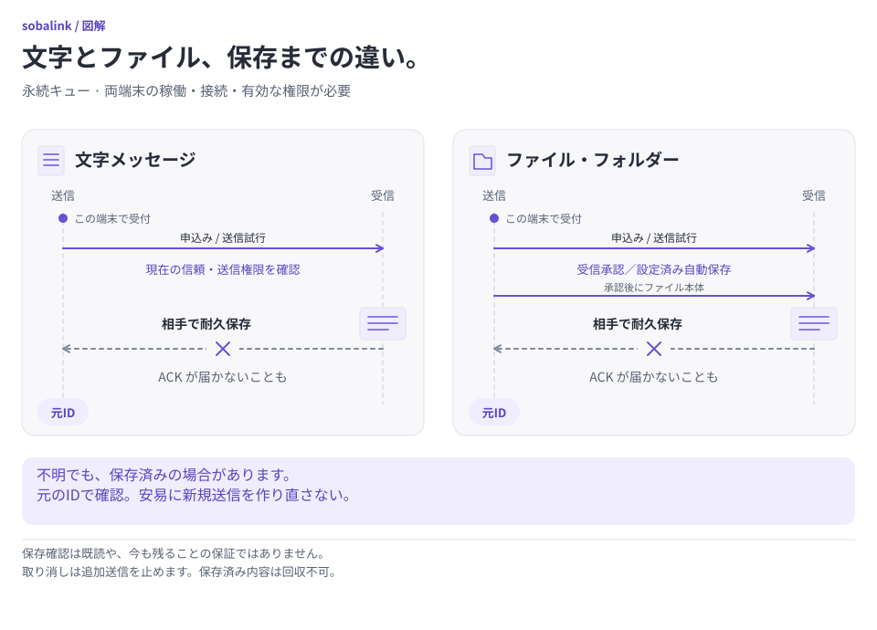

# テキストの永続送信待ち

[English](DURABLE_TEXT.en.md) · [ファイル送信待ち](DURABLE_OUTBOX.ja.md) · [開発原則](DEVELOPMENT_PRINCIPLES.ja.md)

正確な相手1台に、変更しない本文を明示的に送信予約できます。相手がオフラインでも予約できます。受付はローカルでの受付、完了は受信側での本文の永続保存を表します。人が読んだことは表しません。

実験的な [0.5.0-alpha.1 公開版](https://github.com/webkaz-labs/sobalink/releases/tag/v0.5.0-alpha.1)で利用できます。**profile 形式 3** は 0.4.0-alpha.4 と旧形式に非互換です。既存の状態を保管し、別の空の `--state-dir` を選びます。移行・自動消去・同じプロフィールでのダウングレードは行いません。[公開版の検証](VERIFICATION.md)は実機・電源断・OS ログイン・休止復帰の合格を意味しません。

<picture>
  <source media="(prefers-color-scheme: dark) and (max-width: 839px)" srcset="assets/visuals/durable-save-gates-ja-dark-narrow.svg">
  <source media="(max-width: 839px)" srcset="assets/visuals/durable-save-gates-ja-light-narrow.svg">
  <source media="(prefers-color-scheme: dark)" srcset="assets/visuals/durable-save-gates-ja-dark-wide.svg">
  
</picture>

[図を元の大きさで開く（横長）](assets/visuals/durable-save-gates-ja-light-wide.svg) · [縦長版](assets/visuals/durable-save-gates-ja-light-narrow.svg)

送信待ちの記録は期限内の試行を許可するもので、到着証明ではありません。応答が失われたら、元の ID と相手の到着記録を確認して次の操作を決めます。停止しても保存済みの内容は回収できません。

## 最短の CLI 操作

```sh
soba message --queue --peer-name 'Example device' 'Review https://example.invalid/note'
```

名前は確認済みの端末1台に一意に一致する必要があります。正確な ID でも指定できます。

```sh
soba message --queue --peer peer-a --expires-in 24h 'A synthetic reminder'
```

CLI に正確な宛先 ID、引用表記の本文、バイト数、SHA-256、絶対期限が表示されます。内容と本文のローカル保持を確認し、`y`・`yes`・`はい` で予約します。断ると現在の起動中だけ有効な準備を破棄します。例の名前・ID・URL は架空です。`soba peers` で意図した端末を選んでください。

期限の既定は24時間、指定範囲は1分～168時間（7日）です。絶対期限は元の要求の時刻から一度だけ確定します。送信開始日時の指定はありません。オプションは本文より前に置き、シェルに合わせて本文を引用し、ハイフンで始まる本文の前には `--` を置いてください。コマンドラインの本文はシェル履歴に残る場合があります。本文が非公開なら、出力や保存した JSON も非公開で扱ってください。

即時送信は別の明示操作として残ります。

```sh
soba message peer-a 'Send this now'
```

即時送信が暗黙に予約へ変わることはありません。テキスト予約にはファイル・フォルダーパス・受信フォルダー選択・ファイル受信承認・自動実行はありません。

## ローカル接続は起動が必要、相手はオフラインでも可

準備するにはローカルの本体と選択した接続機能が、既知のローカル識別情報で起動している必要があります。相手はオフラインでも構いません。設定画面だけの起動を含め、ローカル接続の停止中には安全なテキスト予約を準備できません。混在ネットワークで `SelfID` が不明な場合も許可しません。接続機能の起動だけで相手への新たな信頼が付与されることはありません。

受付後は送信側の再起動後も、元の期限まで自動で送信を試みられます。送信には両端末の Sobalink 起動、接続可能な経路、現在の識別情報と信頼、適用される一時停止や取消がないこと、認証済みの `durable_text_v1` 対応が必要です。オフライン時には接続するまで対応状況が未確認の場合があります。永続送信に未対応でも旧方式の即時送信へ切り替えません。

形式 3 のプロファイルでも、相手への最初のアプリ信頼承認より先に、その相手の起動時接続／プロキシの範囲を別途確認・保存している場合があります。その保存済み範囲が空の相手 epoch を記録していた場合、最初のアプリ承認で空でない epoch を永続化すると、同じ相手の保存済み範囲は古い状態になります。引き続き必要なら、その別の範囲を再確認して明示的に保存してください。既存の空でない epoch や無関係な相手の範囲を書き換えず、アプリの信頼だけで起動／プロキシの許可を暗黙に更新しません。

## JSON と明示承認

```sh
soba message --queue --peer peer-a --json 'A synthetic reminder'
```

この操作は準備だけです。質問も送信承認も行いません。返された `outboxId`・`requestId`・`messageId`・`processId`・`reviewRevision`・宛先・正確な本文・確定済み `expiresAt` を非公開で保管してください。3種類のメッセージ／要求／送信待ち ID はすべて同じ正規の `mt1_` キーです。

結果を確認した後、返された値を正確に使います。

```sh
soba message queue commit OUTBOX_ID --process PROCESS_ID --revision REVIEW_REVISION --confirm --json
```

`OUTBOX_ID`・`PROCESS_ID`・`REVIEW_REVISION` は置き換え用の表記で、そのまま実行できる値ではありません。`--confirm` は確認済みの宛先・本文・期限への明示承認です。内容をすでに承認済みなら最初の予約コマンドにも指定できます。安定 JSON の形式とコマンド・オプション名は `--locale en` と `--locale ja` で変わりません。

準備と破棄は本体の現在の起動に紐づき、永続的な受付ではありません。確定前に本体を再起動すると、古い準備が存在しない場合があります。まず元の ID を照会してください。新たに準備する場合は明示確認が必要で、以前の確認や既定の期限が残ったとは扱いません。受付済みの記録は `processId` を省略し、照会・停止に古い起動トークンは不要です。

## 状態照会・一覧・停止

```sh
soba message queue show OUTBOX_ID --json
soba message queue show --request REQUEST_ID --json
soba message queue list --json
soba message queue cancel OUTBOX_ID --json
soba message queue discard OUTBOX_ID --process PROCESS_ID --json
```

`show` と `status` は同じ操作です。discard は準備にだけ適用し、受付済みのメッセージには cancel を使います。停止は追加送信を止め、実行中の処理の終了を待ちます。`cancel_requested` は停止処理の途中です。停止しても相手に保存済みの本文を回収せず、判明した保存の記録を未到着の主張に変えません。

詳細コマンドは version 1 の `text_outbox` 記録を直接返します。元の各 ID、正確な相手、変更しない本文のバイト数とハッシュ、元の作成日時と期限、確認リビジョン、受付状態、処理状態、到着結果、理由コードを含みます。保持されている詳細・確認には本文も含みます。任意の receipt が正確な受信保存の記録を示します。承認された履歴整理の後は、元の識別情報・ハッシュ・receipt を残して本文を省略する場合があります。

一覧は上限付きの1ページです。`version`・`kind`・`status`・`reasonCode`・`items`・`revision`・`total` と、続きがあれば `nextCursor` を返します。一覧の status は `ready` または `blocked` です。各項目の `id` は元の `outboxId` と同じで、一覧に本文は含みません。確定前に元の記録を開き、本文を確認してください。返されたカーソルと同じページリビジョンで続けます。

```sh
soba message queue list --cursor NEXT_CURSOR --revision PAGE_REVISION --json
```

一覧が変わった場合は異なる時点の情報を混ぜず、最初のページを取り直してください。通常表示は次のページのコマンドを示します。次の操作例にも選択中の `--state-dir` を引き継ぎます。

### 処理状態と到着の記録は別

| 処理状態 | 意味 |
| --- | --- |
| `prepared` / `discarded` | 現在の起動中だけの準備・承認待ち／受付せず破棄済み |
| `queued` / `waiting_peer` | ローカル受付済み／相手への接続や記録を待機中 |
| `delivering` | 送信中。保存の応答は未確認の場合あり |
| `completed` | 正確な受信保存の記録を取得済み |
| `cancel_requested` / `cancelled` | 追加送信を停止中／停止済み |
| `expired` | 元の送信期限切れ |
| `paused` / `blocked` / `needs_review` | 一時停止・送信不可・要確認。理由を確認 |

到着結果は `not_attempted`・`unknown`・`confirmed` です。`unknown` はすでに届いている可能性を表します。`confirmed` は受信保存の記録で、既読状態ではありません。処理の終端状態だけでは未到着を証明できません。到着結果と正確な receipt を確認してください。

## 応答消失・保存処理の競合・復旧

準備・確定・停止・照会の応答を失った、または応答が不正だった場合は、**元の ID・宛先・本文・絶対期限**を保ってください。CLI は結果未確認の表示と、元の要求を照会するコマンドを返します。JSON の復旧出力には、取得できていれば元の入力と、確定再試行に必要な起動・確認トークンを残します。結果が曖昧なために代わりの送信を生成することはありません。

`message_storage_busy` などの busy コードが返ったら：

1. 同じプロファイルで元の `mt1_` ID を照会します。
2. 受付済みなら、その記録を確認します。
3. まだ準備済みで元の確認内容が有効なら、元の起動 ID とリビジョンで同じ確定操作を再試行します。
4. 保存結果不明・識別情報変更・確認期限切れ・再起動後の準備消失なら、表示された復旧案内に従います。エラーを避けるための状態消去・識別情報の切替・本文変更・期限延長はしません。

busy や応答がないことは「何も送られていない」証明ではありません。`not_found` やキーの有効期間終了も未到着の証明ではありません。新たに確認したメッセージを作るか判断する前に、元の ID、選択したプロファイル、保持されている記録を確認してください。新しい要求には端末の時計を使います。自動で要求を置換・延長せず、時計の問題を確認してください。

## 履歴と上限付き保持

受信側は本文と receipt を一体として保存してから応答します。同じ元の ID の再試行はその記録と照合し、2件目の受信記録を作ったり、表示履歴の整理で隠した本文を再表示したりしません。既存の ID の本文・識別情報・ダイジェスト・期限は置換できません。この正確性のための記録は表示される会話履歴とは別です。

復号後の本文量の既定は 16 KiB で、設定でさらに小さくできる場合があります。進行中の受付には上限があり、送信側の準備／要求は32件・相手ごと8件、受信側の申込みは別に32件・相手ごと8件です。両方向を合計した永続記録は最大1,024行です。保存スナップショットの予約容量は設定したメッセージ保存容量と 16 MiB のハード上限の小さい方で、既定のメッセージ保存容量は 4 MiB です。現在の設定や他の保持履歴により、行数上限より先に拒否される場合もあります。

進行中の枠・保持記録・実際の本文容量は別々に数えます。上限を下げると必要に応じて新規受付を止めますが、既存の記録は消しません。記録容量が満杯の場合は専用の `message_evidence_capacity` で拒否します。既存の状態照会・正確な結果照合・停止は引き続き可能です。表示履歴の整理で記録容量が回復するとは限りません。新しいメッセージのために結果不明の記録を消さないでください。

## ローカルプレビューと検証範囲

```sh
soba --dry-run message --queue --peer peer-a --expires-in 24h 'A synthetic reminder'
soba --dry-run message queue cancel OUTBOX_ID
```

dry run はローカル構文の検査だけで、本体への呼出しはゼロです。名前の解決、接続機能の識別情報・信頼・対応状況・容量の確認、準備、送信は行いません。受付や到着が成功する証明ではありません。

決定的な CLI 試験の対象は言語／JSON の挙動、厳密な DTO、元の識別情報による復旧、応答消失、busy の再試行案内、停止、ページ継続、本体呼出しゼロの dry run です。通信、再起動、実際の ACK 消失、インストール済みバイナリの受入には Core／プロセス／配布の別の証拠が必要です。モック CLI 試験でそれらの結果を証明したとは扱いません。
