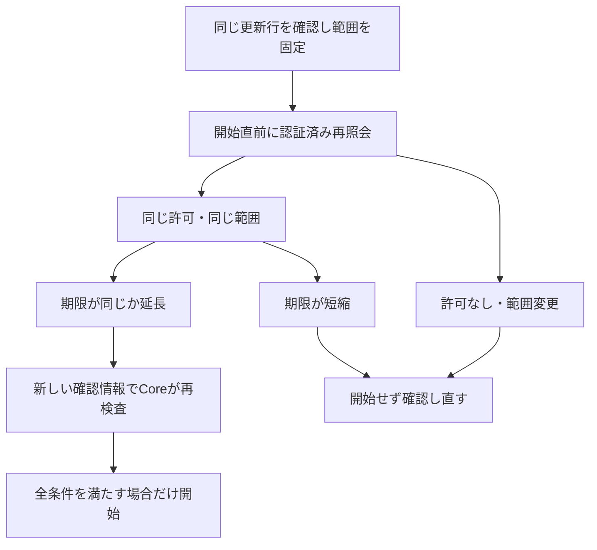

# sobalink の使い方

[English](GENERIC.en.md) · [概要](../README.md) · [安全性](SECURITY.ja.md) · [確認範囲](VERIFICATION.md)

**端末同士をつなぎ、範囲を明示したアプリのサービスを使えます。** このガイドは実験的な [0.5.1-alpha.1 公開版](https://github.com/webkaz-labs/sobalink/releases/tag/v0.5.1-alpha.1)を対象とし、ファイル・テキストの永続送信待ちを含みます。[検証記録](VERIFICATION.md#現在の統合と公開済みの基準)で、同一ソースの CI・署名付き配布と、未完了の実機・アプリ受入を区別します。

**旧データはそのまま保管してください。** profile 形式 3 は 0.4.0-alpha.4 以前と非互換です。別の空の `--state-dir` を選びます。移行・消去は行わず、旧形式のバイナリでは同じプロフィールを使えません。

普段のサービス操作はローカル画面や案内付き CLI で行い、繰り返す操作や自動処理には明示した CLI コマンドを使えます。どちらも Go の共通処理で許可と保存先を検査します。中心となる操作は端末同士の接続とアプリのサービス利用です。[共有](#この端末のサービスを共有する)・[接続](#相手のサービスを使う)から始め、必要に応じて文字・ファイルを送れます。旧 `tsnet-bridge` 公開版とはコマンドと設定形式が異なります。

[案内付き CLI](CLI_GUIDE.ja.md) · [アプリ設定・RustDesk](CLIENT_HELPERS.ja.md) · [ローカル画面の操作](WEB_CONTROLS.ja.md) · [0.3 系列の機能対応履歴](FEATURE_PARITY.ja.md) · [文書一覧](README.md)

<picture>
  <source media="(prefers-color-scheme: dark) and (max-width: 959px)" srcset="assets/visuals/connection-ja-dark-narrow.svg">
  <source media="(prefers-color-scheme: dark)" srcset="assets/visuals/connection-ja-dark-wide.svg">
  <source media="(max-width: 959px)" srcset="assets/visuals/connection-ja-light-narrow.svg">
  
</picture>

[図を元の大きさで開く（横長）](assets/visuals/connection-ja-light-wide.svg) · [縦長版](assets/visuals/connection-ja-light-narrow.svg)

この図は両端末で sobalink を使う例です。通常の Tailnet 上のアプリを使う場合、相手側に sobalink は不要です。まずネットワークを設定し、サービスの範囲を確認して、表示されたローカル入口をアプリに指定します.

## 目的から選ぶ

| 目的 | 最初の操作 | 結果の確認 |
| --- | --- | --- |
| 初めて使う | 下の起動手順からネットワークを選ぶ | 現在の識別情報とネットワーク状態 |
| 相手のアプリを使う | [接続](#相手のサービスを使う) | 実際のローカル入口、その後にアプリでの操作 |
| 相手にアプリを使ってもらう | [共有](#この端末のサービスを共有する) | 正確な相手・ポート・期限 |
| 前の設定を再利用する | [保存済みサービス](SAVED_SERVICES.ja.md) | 保存済みと起動中の区別 |
| 文字やファイルを渡す | 下の送信手順 | ローカル受付ではなく相手の到着記録 |

## 起動して画面を開く

mise **2026.9.18** で公開済み 0.5.1-alpha.1 を選び、版を確認して起動します。署名の検査を有効のまま使います:

```sh
mise use -g "packslip:github.com/webkaz-labs/sobalink[prerelease=true]@0.5.1-alpha.1"
mise exec -- soba version
mise exec -- soba
```

`mise use -g` は全体で使う版を変更します。署名と識別情報の検証は有効のまま使います。以下の例は mise を有効にした環境で `soba` を直接使います。有効にしていない場合は各コマンドの前に `mise exec --` を付けてください。[ソースからビルド](DISTRIBUTION.md#build-this-checkout)する場合は `./bin/soba`（Windows は `./bin/soba.exe`）を使います。

`soba start` でも同じです。手前で動き続けるので、起動した端末は開いたまま使います。Ctrl+C で稼働中の接続と共有を閉じます。別の端末ウィンドウで次を実行できます。

```sh
soba ui
soba status
```

`soba ui` は同じ端末のブラウザーを開き、5分間有効な一回用コードを自動で引き継ぎます。コードのコピーは不要です。有効な既存セッションは8時間の有効期限を延ばさず再利用します。新しく開くと前の未使用コードは置き換わるため、複数回起動した場合は最新の画面を使ってください。

画面のない環境や SSH、ブラウザーを開けない場合は、非公開の端末で明示的に `soba ui --no-browser` を実行してください。表示された正確な数値ループバック URL を開き、5分以内にコードを入力します。非公開のスクリプト向けには `soba ui --json` を指定すると、ブラウザーを開かず従来の `{url,code}` 形式を取得できます。通常のリダイレクト出力にはコードを出しません。手動・JSON 出力は非公開のログイン情報として扱い、共有・撮影・記録しないでください。リモート利用のためのトンネルやネットワーク向け管理画面を自動作成することはありません。利用者が設定するトンネルでも、正確なループバックのホストとポートを維持する必要があります。

自動起動では一時的に URL のフラグメントにコードを含め、画面が同一 Origin の POST で交換する前に除去します。コードは HTTP リクエスト URL に含めず、Web ストレージにも保存しません。起動 URL を共有・ブックマークしないでください。ブラウザー拡張、OS の起動引数、ブラウザーの履歴機構に対する完全な秘匿を保証するものではありません。再読込・戻る操作は通常のセッションを使い、コード交換を繰り返しません。中断・期限切れ時は `soba ui` を再実行してください。タブを閉じたり起動を取り消したりするだけでは、未使用コードは失効しません。5分以内の期限切れ、新しいコードの発行、アプリの停止で失効します。

起動時のコードは対話型端末にだけ表示します。通常の状態応答にはコードを含めません。ローカルセッション・Origin・Host・CSRF の検査は維持されます。

保存先の既定は OS のユーザー設定ディレクトリ内の `sobalink` です。別の保存先を使う場合は、すべてのコマンドで同じ指定を使います。

```sh
soba --state-dir ./sample-state
soba --state-dir ./sample-state status
```

新しいプロフィールはネットワーク未選択で始まります。画面設定・信頼・サービスの定義は保存しますが、通常の定義は再起動後も停止のままです。即時転送の進捗は再開しません。明示的なファイル送信待ちと、テキスト送信待ちは、元の ID・期限・保存の記録を保つ別の復旧契約です。別に確認した[外向き起動時接続・非公開プロキシ設定](STARTUP.ja.md)だけを次回オンライン起動の対象にできます。受信共有は手動のままです。

### 未リリース：停止後に画面を開き直す

このソース変更は **公開済みの 0.5.1-alpha.1 には含まれません**。その公開版では `soba start --offline --background` でローカル管理を明示的に起動してから、`soba ui` を実行してください。保存したネットワークには再接続しません。

このソースでは、`soba stop` の後も既存プロフィールに対して対話型の `soba ui` / `soba ui --no-browser` を実行できます。ローカル制御の入口がないと判定でき、既存プロフィールの検査を通過した場合に、オフラインのバックグラウンド起動を試みてローカル管理の準備を待ちます。新しくオフライン起動した場合は、その起動モードを表示します。入口がないことだけでは停止完了を示さず、起動・終了処理の途中の場合もあります。既に本体が動いている場合は、その起動モードを変更しません。

この復旧では保存ネットワーク設定を維持し、保存ネットワーク・共有・外向き起動設定・送信待ちの配送を開始しません。通常の起動時検査と整合処理は行うため、無効になった信頼の整理などで保存記録を更新する場合があります。

`ui --json` は本体を起動しない問い合わせのままです。非対話出力には引き続き明示的な `--json`、画面のない環境や SSH には明示的な `--no-browser` が必要です。既に別の保存先を使っている場合は、新しいプロフィールを作らず同じ保存先を指定してください。初めて使う場合は `soba init`、続いて `soba ui`（手動で開く場合は `soba ui --no-browser`）を実行します。初期化は自動では行いません。権限エラー・状態の破損・制御結果が不確かな場合には自動起動せず、表示された次の操作を確認します。プロフィールの削除や、本体を繰り返し起動してエラーを隠す操作はしないでください。

別のプロフィールを使う場合は、すべてのコマンドで同じ `--state-dir` を指定します。保存したネットワークへ意図して戻すときは `soba stop` でオフラインの本体を止め、`soba start --background` を実行します。オンライン起動で保存済みの起動許可や受信許可が有効になる場合があるため、先に内容を確認してください。起動の中断・タイムアウト後は、再試行前に `soba status` で状態を確認します。[起動と復旧の境界](LIFECYCLE.ja.md)

## 接続方式を選ぶ

| 選択 | 設定 | 境界 |
| --- | --- | --- |
| 既存 Tailnet | 組込みノードを有効化し、公式の Tailscale 認証へ進む | 選択した Tailnet 内の独立ノード。OS の Tailscale アプリの認証状態を取り込まない |
| Tailcat／明示した信頼できる中継先 | 数値アドレス・ポートと証明書ピンを指定し、特定の相手とペアリング | 画面・CLIと同一ソースの公開結果は検証記録を参照。実構成は未確認。任意の公開中継や外部通信ゼロの保証はない |
| [中継なし LAN](DIRECT_LAN.ja.md) | 正確なプライベートアドレスで明示的にペアリングする | 両端末に許可された到達可能な経路が必要。ネットワーク制限を回避しない |
| [接続方式の併用](MIXED_CONNECTIONS.ja.md) | 選んだ方式を設定し、それぞれが同じ相手につながることを認証する | 新しい接続だけが別の許可済み経路を選べる。既存 TCP は移行しない |
| ネットワークなし | ローカルのまま使う | 相手への転送・サービス接続は行わない |

Tailnet では次の順に進みます。

```sh
soba setup --network tailnet
soba login --browser
soba peers
```

`--browser` は公式認証ページを開いて待機します。`--qr` は非公開の端末にローカル生成した QR、`--link` は非公開リンクを明示的に表示します。`soba login` だけなら機械向け JSON です。参加・端末承認を完了し、待機や取消は[認証手順](SIGN_IN.ja.md)を参照してください。認証 URL は秘密として扱ってください。認証キーをコマンド引数で受け取らず、OS の経路や DNS を変更しません。Tailnet のアクセス許可とアプリ自身の認証は別途必要です。

方式は明示して選びます。変更や保存済み LAN 状態の修復には本体を止め、`soba start --offline` で保存済みネットワークを開始せず管理を開きます。既存 TCP を Tailnet と Tailcat の間で引き継ぎません。ローカル画面と CLI は明示した中継先とペアリングに対応しています。[LAN 手順](LAN.ja.md)を参照してください。[確認範囲](VERIFICATION.md)に、公開済み CI と後続のローカル検証を区別して記録しています。

フォアグラウンド・バックグラウンド起動、確認付きの任意のサインイン時起動、保存済み自動受信、Tailnet ログアウトは[起動とログアウト](LIFECYCLE.ja.md)を参照してください。

Tailcat は相手への直接通信と、明示して設定・許可した中継先への暗号化ペイロード・HTTPS/ICMP 診断を許します。通常の direct 有効バイナリは相手への公開経路を使う場合もあり、`local` は中継の区分で通信隔離ではありません。[経路準備](LAN.ja.md#別の経路を準備する)は、両側で有限期間または取り消すまでを明示して確認したローカル許可で、確認済み候補を同じペアのまま使います。0.3.0-alpha.4 から含まれています。過去の版の結果は[検証記録](VERIFICATION.md)を参照してください。[通信の境界](ARCHITECTURE.md#network-boundaries)

## 文字・ファイルを受け取る相手を信頼する

その相手から文字やファイルの申込みを受け取りたい場合に行います。別途明示された許可でサービスを使うだけなら、この受信の信頼は前提ではありません。画面で現在の相手を選び、識別情報を確認してから信頼します。名前は表示用です。同じ名前やアドレスになった別の相手へ、許可を引き継ぎません。

```sh
soba peers
soba trust PEER_ID
```

信頼すると、その正確な識別情報の相手から文字・転送申込みを受け入れます。相手アプリ内部の操作権限を追加する意味ではありません。受信側でも送信者を信頼する必要があり、自分の操作だけで相手側の受信を許可できません。サービスの共有は相手とポートを指定する別の許可です。

信頼を取り消すと、その相手の転送許可と自動保存の世代を無効にし、追跡中の処理と関連する共有を止めます。信頼し直しても、以前の自動保存は復活しません。変更後には稼働中サービスも確認してください。

```sh
soba revoke PEER_ID
```

Tailcat のペアリングでは、明示した招待を通じて鍵の対応を確立します。招待トークンと Tailcat の capability アドレスは秘密です。ペアリング、文字・ファイルの信頼、自動保存、サービス共有は別々の選択です。

## この端末のサービスを共有する

最初にアプリ自身を起動し、必要な認証を設定します。共有で現在の相手、TCP/UDP、ポートと除外、有効期間を選び、有効になる範囲を確認して開始します。

```sh
soba share --ports 3000-3003 --peers PEER_ID
```

名前は省略すると未使用のものを選び、`--name preview` で明示もできます。既存名は上書きせず、重複で失敗したら別名か下の保存済みサービス操作を使います。TCP と1時間の期限が既定です。

SSH や Web の候補を使う場合は、ポートの代わりにプリセットを選べます。

```sh
soba --dry-run share --preset ssh --peers PEER_ID
soba share --preset ssh --peers PEER_ID
```

`ssh` は TCP 22（SSH/SFTP）、`web` は TCP 8080の初期値です。`postgres` と `local-ai` も変更可能な入力例で、実際のポートは `soba connect --help` で確認できます。local-ai は API の例で、すべての AI アプリ共通のポートではありません。`--ports` や `--network` の明示値が優先します。プリセットはアプリの検出や設定、動作確認を行いません。

選んだ組込みノードのポートを、選んだ相手に提供し、既定では同じ番号の数値 loopback ポートへ対応させます。インターネットの公開 URL を作ったり、アプリを設定したりしません。通常の Tailscale で接続できる相手なら、提供側の組込みノードのアドレスと許可されたポートを使えます。受信側の sobalink は不要です。

- 現在の相手を明示します。`sharePeers` の初期値は32件で、調整または明示的な無制限を選べます。「全員」の暗黙の許可はありません
- 共有の既定は有限の1時間です。`--ttl 72h` など24時間を超える正の整数秒も選べます。期限をなくす場合は `--lifetime until-revoked` を明示します
- TCP は1〜65535番の範囲をコンパクトに保持し、除外・内部予約入口を取り除きます。範囲内の全ポートに OS 待受を作りません
- 許可期間中に範囲内のポートで新しく起動したアプリも対象です。必要な範囲まで狭めてください
- `--ports 3000-3010 --exclude 3005-3007` のように除外できます
- 探索 `54543`、ピア API `54544`、ペアリング `54545` とバックエンド内部の入口はサービス共有へ含めません
- UDP は個別ソケットが必要で、ローカル接続と任意のプロキシ待受とで有限の `materializedListeners` 予算を共有します。既定は64件で調整可能です。不足時は範囲を狭める・不要な処理を止める・予算を見直す操作を選びます

希望する場合だけ `--discoverable` で、最小限の稼働中サービス情報を許可した相手へ表示できます。CLI では既定で無効です。探索は利用できる許可の情報であり、アプリの動作確認ではありません。画面で探索結果から接続するときは、選んだ共有を再確認して開始します。

ポート競合では操作を失敗させ、別のポートや広い範囲へ無言で切り替えません。範囲共有は同じ番号へ対応します。1ポートだけなら `soba share --ports 8080 --local-port 3000 --peers PEER_ID` のようにアプリ側の番号を明示できます。`--loopback-host` は正確な `127.0.0.1` または `::1` です。利用側のローカル入口とは別に確認してください。

## 相手のサービスを使う

画面で利用可能な共有を選ぶか、現在の Tailnet ピアとサービスを手動で指定します。通常の Tailscale 接続先に sobalink は不要です。相手アプリが対象のアドレスとポートで待ち受け、Tailnet とアプリ双方でアクセスを許可している必要があります。

```sh
soba connect --ports 3000 --peer PEER_ID
```

状態に表示された実際のローカル接続先を、利用するアプリへコピーします。入口は既定で接続先と同じ番号です。1024未満の接続先には非特権の入口を明示するか、プリセットを選びます。`ssh` は TCP 22／ローカル2222、`web` は TCP 8080／ローカル8080を候補にします。使用中なら `--local-port` で別の入口を選びます。次は別々の利用例です。

```sh
soba connect --preset ssh --peer PEER_ID
soba connect --preset web --ports 3000 --local-port 8081 --peer PEER_ID
```

接続の既定は `until-stopped`（停止まで）で、`--ttl` で有限期間も指定できます。待受は数値 loopback の1024〜65535番を使い、既定64件の調整可能な有限予算を消費します。`--local-port` を指定すると、除外後の昇順の相手ポートを、連続するローカル番号へ対応させます。表示された対応を確認してください。共有元のアプリ側ポートへの対応は変更しません。

待受の準備完了は通信の準備だけです。実アプリで認証し、操作を確認します。TLS 証明書名、SSH ホスト鍵、origin、アプリの認可を維持してください。トンネルだけでは stdio を HTTP に変換せず、遠隔ジョブを実行しません。

### 公開情報が確認中に変わったら

確認に時間をかけても、そのまま開始できるでしょうか。通常の公開サービスでは、更新結果の同じ行から相手ID・許可ID・用途・プロトコル・全ポート範囲・有効期間の方式を固定します。



図の要約：案内付きCLIとWebは、新しい接続の開始直前に認証済みの相手へ再照会します。同じ許可と範囲で期限が同じか延長されている場合だけ、新しい確認情報を使います。許可の消失・作り直し、範囲変更、期限短縮では開始せず再確認します。Coreも鮮度と現在の許可を開始前に再検査します。

自動化では新しいrevisionを採用する前に確認した全項目を比較してください。保存済みの過去の参照で再開する場合は、元の確認内容を厳密に再検証します。これは通常のサービス探索であり、[リソースカタログの確認](CATALOG_VIEW_CONTRACT.ja.md)は別の許可・消費契約です。[CLIの入力例](CLI_GUIDE.ja.md)

## 保存済みのサービスを再利用する

待受を開始せず、オフラインでも停止状態の定義を保存できます。グループ化・書き出し・内容確認を経て、選んだサービスだけを明示して開始します。`soba --offline service save ...` と `soba --offline profile ...` は本体停止中の設定操作で、`soba start --offline` はローカル管理の起動です。グループ開始の失敗時はその操作で新たに開始したものを戻します。`soba task` は更新式30秒リースで一時サービスを所有し、ローカルコマンド終了後に片付けます。入力例・非公開書き出し・版の検査・取消の境界は[保存サービス・グループ・タスク](SAVED_SERVICES.ja.md)を参照してください。

現在の ID を `soba status` で確認し、保存済みの全設定を表示します。この詳細はローカルの認証済み管理だけで読み取れ、相手への探索情報には含めません。

```sh
soba service show SERVICE_ID
soba --dry-run service copy SERVICE_ID
soba service copy SERVICE_ID
```

`copy` は既定で未使用の名前を選び、新しいサービスを開始します。ポート、除外、相手、ローカル入口、探索表示、許可期間を引き継ぎ、`--name`・`--ports`・`--ttl` などで必要な項目だけ変更できます。保存するだけの操作ではなく、適用時から新しい期間の許可が始まります。

元のサービスを再開始する場合は、稼働中なら先に明示して停止します。

```sh
soba stop-service SERVICE_ID
soba --dry-run service restart SERVICE_ID
soba service restart SERVICE_ID
```

`restart` は停止中の保存済み ID を使い、その時点で読み取った全設定の版とバックエンドを検査して置き換え・開始します。競合時は保存済み設定を変更せず、最新を再表示して再検討します。既知のバックエンドの変更、稼働中サービスの自動停止、別名の上書きはしません。バックエンドが不明な設定だけは確認して `--backend tailnet|lan` を明示します。探索済みサービスに対応する接続は、その相手・プロトコル・ポート全体を維持します。別の対象には新しい `soba connect` を使います。

`copy`・`restart` の後に `--help` を付けると変更できる指定を表示します。適用時にも相手・ネットワーク・ポートを検査します。`--dry-run` の結果が後のコマンドを固定するわけではなく、再実行時は保存済み設定を読み直します。

## 任意のプロキシと診断

通常は `soba connect` で対象サービスの入口を作ります。複数の確認済み TCP 接続先を SOCKS5 対応アプリから使う場合は、認証付きの任意プロキシを選べます。範囲と有効期間を確認し、認証情報は非公開の経路で入力します。通常の開始は起動中だけ有効で、明示した[非公開保存設定](STARTUP.ja.md)では生成・確認付き表示・任意の次回起動に対応します。OS の DNS・接続への代替はありません。`soba doctor` は観測を表示し、`soba doctor --service SERVICE_ID --tcp` は明示的に1回だけ TCP を確認します。アプリの認証・動作は別に検査します。[プロキシと診断の手順](PROXY_DIAGNOSTICS.ja.md)

## 状態を読む

| 状態・表示 | 意味 |
| --- | --- |
| Saved／保存済み | 定義があるだけで、待受の起動を意味しない |
| Ready／稼働中 | 許可範囲内で通信の準備ができている |
| Direct | バックエンドが直接経路を確認した |
| Relay | バックエンドが暗号化された中継経路を確認した |
| Unknown／不明 | 現在の経路を未確認。遅延から推測しない |
| Reconnecting／再接続中 | 接触が失われた、または作り直している。アプリ側も再接続が必要な場合がある |
| Application unverified | 実アプリの動作は未確認 |

信頼できる経路の観測が得られるまでは不明のままです。同じバックエンド内での direct/relay の変化と、ネットワーク方式の選択変更は別です。経路変更、スリープ復帰、再接続で既存 TCP が残るとは限りません。中断後は現在の相手と許可を確認し、アプリを再接続するか、未完了ファイルを再試行します。

```sh
soba reconnect PEER_ID
soba status
```

`reconnect` は現在の相手への接触を再確認します。信頼・自動保存・サービス許可の期限を更新せず、取消済み転送やアプリのセッションを再開しません。

## 文字・画像・ファイルを送る

### 文字と画像

文字を入力または貼り付け、内容を確認して送信します。コピーも操作したときだけ行います。クリップボードを裏で読み取ったり同期したりしません。

```sh
soba message PEER_ID "Hello from sample-node"
```

即時テキスト送信でメッセージ履歴を保存できなかった場合も、相手には届いている可能性があります。Web 画面は編集できる下書きを残し、相手の履歴と保存先を確認するよう案内します。同じ相手・同じ文面は、状態の再取得や別メッセージの成功後も、このページを開いている間は再送を止めます。ページの再読み込みやアプリの再起動を越える保護ではありません。送信結果を確認してから再送してください。[結果が不確かな送信とメモリー上限](CAPACITY.ja.md#webでの送信結果が不確かなとき)

貼り付けた画像は、選択した画像ファイルと同じ一括確認へ入ります。貼り付けただけでは送りません。画像はファイルとして転送し、受信した内容を自動で開いたり実行したりしません。

### テキストを送信待ちに登録

既存の入力欄で「テキストを送信待ちに登録」を明示選択し、相手1台・本文・絶対期限・ローカル保持を確認して承認します。即時送信から暗黙に切り替えません。CLI では次を使います。

```sh
soba message --queue --peer PEER_ID --expires-in 24h 'A synthetic reminder'
soba message queue list --json
soba message queue show OUTBOX_ID --json
soba message queue cancel OUTBOX_ID --json
```

期限の既定は24時間、CLI の指定範囲は1分～7日です。`--json` だけなら準備に留まり、質問も送信も行いません。`--confirm` または通常表示の承認が送信許可です。相手はオフラインでも構いませんが、ローカル接続は既知の識別情報で起動している必要があります。ローカル受付は受信保存の完了ではなく、停止しても相手に保存済みの本文は回収しません。テキストにはファイル・受信フォルダーはありません。応答を失ったら元の ID を照会し、代わりの ID・本文・期限を作りません。会話履歴の整理後も重複防止の記録を保持します。[テキスト送信待ち](DURABLE_TEXT.ja.md)で準備の起動境界、busy、安定 JSON、上限と復旧を説明しています。

### 複数ファイル・フォルダー

画面でファイルやフォルダーを選択・ドロップし、相手、相対名、件数、合計容量を確認します。不要な項目を除いてから一括送信します。空フォルダーはブラウザー API で取得できない場合があるため、必要なら CLI を使って結果を確認してください。

```sh
soba send PEER_ID ./image.png ./notes.txt ./sample-folder
```

CLI の相対パスは、コマンドを実行した場所を基準に解決します。リンク、安全でない項目、未対応の項目はたどらずに拒否します。フォルダーは相対パスで転送し、無関係な送信元の絶対パスを相手へ渡しません。

論理制限の初期値は、ディレクトリを含め一括256項目、1ファイル・一括それぞれ1 GiBです。正の有限値または明示的な無制限へ変更できますが、別に調整する有限のメタデータ・一時保存調査・未処理申込み・ストリーム・容量予算は残ります。ローカル一時保存の期限は既定600秒で、別の期間や全体期限なしも選べます。ブラウザーのアップロード要求には、実際のバイト受信時だけ更新する30秒の無進捗期限もあります。全体期限は予約後に始まり、通常の進捗では延長されません。無制限でも無進捗期限は残ります。[容量と履歴](CAPACITY.ja.md)で区別を説明しています。大きなファイルはバッファー容量を制限して順に送ります。ブラウザーのアップロードは、まずローカル本体への一時保存です。**アップロード100%は相手への到着ではありません。** 相手の承認と、保存済み・完了の状態を確認してください。

### ファイルを明示的に送信予約する

再接続や送信側の再起動後の配送には、公開済みの[ファイルの永続送信待ち](DURABLE_OUTBOX.ja.md)を明示選択します。正確な宛先・準備した内容・絶対期限を確認して承認してください。

```sh
soba send --queue --peer PEER_ID --expires-in 24h ./notes.txt
soba outbox show OUTBOX_ID --json
```

応答が曖昧でも元の要求・配達 ID と期限を保ちます。ローカル受付は受信保存の完了ではなく、停止しても保存済みのファイルは回収しません。

### 一括受信を承認する

既定では一括ごとに内容を見て、保存先を選んで承認します。承認するのはその一括のファイルとフォルダーで、送信者への継続的な許可ではありません。

```sh
soba accept TRANSFER_ID ./received
```

CLI は相対パスを実行場所からの絶対パスに変換します。受信側の端末にある適切な保存先を選びます。Windows では `C:\Downloads\sobalink` などを必要に応じて引用符で囲みます。同名ファイルは別の一意な名前で保存し、既存ファイルを置き換えません。宣言されたサイズと SHA-256 を確認してから確定します。マニフェストにある空フォルダーは保持します。ファイルの権限を制限し、実行属性やリンクは取り込みません。

受信を断るときは画面で辞退し、進行中の処理は取消できます。送信側が相手の辞退・取消を確認すると、その一括は終了し、送信用の一時コピーを削除して容量を解放します。その一括は再試行できないため、改めて送りたい場合はファイルを選び直します。一時的な通信障害では、一時コピーを残して再試行できます。削除に失敗した場合は、削除が成功するまで容量の予約を残します。取消・信頼解除をしても、既に保存したファイルの削除や、送ったデータの回収はしません。

### 選んだ複数端末へ同じファイルを送る（ソースビルド）

既存のファイル確認画面で追加の送信先をチェックし、選択した全端末とファイル一覧を確認して「まとめて送信」を押します。現在の相手以外は未選択です。オンライン表示は到着の保証ではなく、各端末の受信承認と保存結果は独立しています。

```sh
soba send --peer PEER_A --peer PEER_B ./sample.txt ./sample-folder
```

CLI は1つのローカルコピーを準備してから、正確な送信先と内容を確認します。`--confirm` は指定した送信への明示確認、`--json` 単独は準備結果だけを返し、送信しません。従来の `soba send PEER_ID PATH...` は維持します。

送信先・信頼・内容を確定前に再確認し、変更があれば相手へ送信せず拒否します。確定後は宛先別の既存転送として進み、一部成功・失敗・進行中を区別します。成功した宛先には再送せず、現在の起動中で再試行できる失敗だけを選びます。受信拒否や取消は自動で再開しません。

準備はローカル保存で、準備100%や要求受付は配送完了ではありません。応答が不明なら「この要求を確認」で元の要求を照会し、新しい送信を作らないでください。CLI の `send --help` に元の準備 ID・起動 ID による照会・確定・破棄の手順があります。確定前の失敗には子転送がありません。結果不明の下書きを閉じる場合も、先に元の転送状況を確認してください。

共有する送信用コピーは一度だけ計上し、宛先ごとの記録と同時送信数は別の有限予算で制限します。ある宛先の完了で、別の宛先の再試行用コピーを削除しません。この即時一括送信は、自動的な宛先追加・メッセージ一斉送信・同期・再起動後の配送再開を含みません。永続的なファイル送信待ちは `soba send --queue` で別に明示選択します。ソース実装の説明であり、配布や実機の受入結果ではありません。

[再現可能な送信検査と受入確認の範囲](BATCH_SEND_ACCEPTANCE.ja.md)も参照してください。

### 選んだ失敗対象だけを再試行する（ソースビルド）

相手の会話画面で、成功・失敗・進行中の転送を確認し、再試行したい失敗対象だけを選びます。既存の再試行処理を使い、成功したファイルを保持して失敗したファイルだけを再試行します。要求の受付は転送完了を意味しないため、完了状態を確認してください。

```sh
soba transfers --peer PEER_ID
soba transfers --peer PEER_ID --json
soba retry TRANSFER_ID --peer PEER_ID --process PROCESS_ID --direction outgoing
```

現在の一覧にある起動識別子・相手・方向を使い、3つの選択オプションをまとめて指定します。完了済み・取消済み・処理中・再試行できない対象や、以前の起動で選んだ対象は拒否します。従来の `soba retry TRANSFER_ID` も利用できます。

### 相手を限定して自動保存を使う

画面で保存先を選ぶか、CLI で既定の受信先を設定し、信頼済みの相手だけに許可します。

```sh
soba receive-dir ./received
soba autosave PEER_ID --on
```

`receive-dir` だけなら現在の設定を表示し、`receive-dir --clear` なら既定の受信先を消します。これは自動保存の許可ではなく、既存の相手別保存先も変更しません。`autosave --on` は保存済みの相手別保存先、なければ既定の受信先を使います。`soba autosave PEER_ID --on --directory ./received-from-peer` で別の保存先を明示できます。

この許可は選択したバックエンド、現在の正確な相手、その信頼の世代、その保存先に固定します。同名の相手には適用しません。保存済みの許可は一致する信頼済み識別情報だけに読み込み、有効な間は今後の一括を個別承認なしに保存できます。

自動保存を無効にすると一括ごとの承認へ戻ります。相手の一時停止は文字とファイルを遮断し、送信中の一括も取消します。再開後はファイルを選び直して新しく送ります。別に許可したサービスは止めません。保存先の変更も明示的に行います。信頼解除や識別情報の変更で以前の許可は無効になるため、必要なら確認して有効にし直します。自動保存でも上書き、自動で開く・実行する操作、クリップボード同期は有効になりません。

```sh
soba autosave PEER_ID --off
soba pause PEER_ID
soba resume PEER_ID
```

自動保存の切替で一時停止を変えず、一時停止／再開で自動保存や保存先を変えません。有効化・保存先変更・再開がファイル置換前に失敗した場合は、以前の設定を保持します。置換後に耐久性を確認できない場合は、エラーでも保存済み設定と実行時の相手設定に置換結果を反映します。再試行する前に、現在の自動保存・保存先・一時停止の状態を確認してください。無効化の保存が失敗したときも、稼働中の自動承認は止めますが、永続化は未確認です。保存先を修復し、本体の再起動前に無効化を再試行してください。無効化に成功した後、再び使うときは明示的に有効にします。

### 再試行と片付け

```sh
soba retry TRANSFER_ID
soba cancel TRANSFER_ID
soba forget TRANSFER_ID
```

再試行は、両側が同じ一括の状態を保持している間に、未完了のファイルを先頭から送り直します。保存確認済みのファイルは書き直しません。応答だけが失われた場合は、同じファイルの再要求に以前の保存確認を返します。これはファイル単位の再試行で、途中バイトからの再開ではありません。

即時一括送信の進捗と保存確認は起動中だけ保持します。どちらかを再起動したら、既に保存したものを確認してから新しい一括を判断してください。[永続ファイル送信待ち](DURABLE_OUTBOX.ja.md)は別で、再起動後も元の要求・配達 ID・期限を保ち、元の記録を照会します。新しい一括では別名のコピーができる場合があります。Forget は終了済みの履歴と、残っている送信用の一時コピーを消すため、その一括を再試行できなくなります。元の送信ファイルと受信側で保存済みのファイルは残ります。

**即時ファイル送信の異常終了後の復旧に関する既知の制限:** 非公開の状態ディレクトリ内の `outgoing` に残った送信用コピーは、再起動時に調査し、有限の一時保存予算へ引き続き計上します。これらの残留コピーは自動削除せず、CLI・Web の履歴削除では前のプロセスの一括を消せません。使用量が無制限に増えることは防ぎますが、異常終了が続くと予算に達して新規送信が止まる場合があります。対象の本体を停止し、この `outgoing` 内で不要と確認できた残留コピーだけを手動で整理してから、再起動して使用量を再調査してください。判断できないコピーは非公開のまま保管し、識別・設定ファイル、元の送信ファイル、受信済みファイルは削除しないでください。稼働中の本体が再試行のために保持する一括とは別です。使用量を表示し、確認して残留分を整理できる操作画面は今後の改善点です。

受信側の所有と確認できる未完了の一時保存は、非公開の索引と有限の起動時調査を通じて受信容量へ復元します。旧記録が未作成なら明示的な確認が必要で、破損記録・対応関係の変更・保存結果の不確かさがある場合も受信を止めます。送信とローカル管理は使えます。[容量と復旧](CAPACITY.ja.md#受信容量の復元)を参照してください。復旧は曖昧なルートを所有扱いせず、任意の保存先を走査せず、保存済み出力を削除せず、転送を再開しません。[転送時に残す空き容量](CAPACITY.ja.md#転送時に残す空き容量)は実際の空き容量を確認する別の防御で、受信容量の復元を置き換えません。

## 停止・信頼取消・更新

```sh
soba status
soba stop-service SERVICE_ID
soba stop-shares
soba revoke PEER_ID
soba stop
```

状態にある現在の ID を使います。`soba stop-shares` はタスク所有分を含め受信共有を一括停止し、ネットワークのノードと外向き接続は残します。`soba revoke PEER_ID` はアプリの信頼と参照許可を解除し、[LAN ペア解除](LAN.ja.md#解除復旧停止)では通信上のペアリングも解除します。個別停止はそのサービスの接続を閉じます。Stop または Ctrl+C は本体・ネットワーク・稼働中の処理を終了し、非公開の設定と識別情報を残します。期限で許可と追跡中の通信は終了しますが、渡したデータを回収したり遠隔アプリのジョブを取り消したりしません。

更新は明示して行います。まず対象の本体を停止し、必要なら状態を非公開の場所にバックアップします。バックアップには識別情報と相手の情報が含まれます。次の指定を使う前に、0.5.1-alpha.1 公開版の署名付き資材と検証成功を確認してください。profile 形式 2 から形式 3 へ移る場合は別の空の保存先が必要で、既存プロファイルの移行・消去は行いません。プレリリース間の更新・ダウングレードで、設定形式が常に互換とは限りません。

```sh
mise use -g "packslip:github.com/webkaz-labs/sobalink[prerelease=true]@0.5.1-alpha.1"
mise exec -- soba version
mise exec -- soba start --offline
```

ローカル画面で保存済み設定と起動許可を点検します。旧形式のプロファイルが拒否された場合は、新しい版に引き継げたと扱わず保管してください。`receive recovery confirm` は受信記録の限定した確認操作で、profile 形式の移行・破損記録の修復・保存済みファイルの消去・送信待ちの置換には使いません。[受信復旧の境界](CAPACITY.ja.md#受信容量の復元)も確認してください。

このオフラインの本体を止めてから通常起動します。許可済みの外向き起動設定は再開する場合があります。受信共有は別途開始してください。独自の状態ディレクトリを使う場合は、すべてのコマンドで同じ `--state-dir` を指定します。ソースビルドを使う場合は、確認したソースから画面と本体を再ビルドできます。短い案内は `soba help upgrade`、公開プレリリースの導入には上の署名付き手順を使ってください。

旧 `tsnet-bridge` 0.2.x のコマンド・設定形式は sobalink と非互換で、旧形式の自動移行はありません。旧状態を別に保管し、sobalink 用の状態ディレクトリを使います。新しいディレクトリでは別途認証と信頼の確認が必要です。

保存済みネットワークの起動に失敗したら、`soba start --offline` でローカル管理を開けます。保存済みの相手は未確認・オフラインとし、そのネットワークを始めずにペア解除や中継先の再設定を行えます。

## 言語・自動処理・困ったとき

共通オプションはコマンドより前に置きます。

```sh
soba --locale ja help
soba --locale en share --help
soba --state-dir ./sample-state status
soba --json-errors service show SERVICE_ID
```

言語は `LC_ALL`、`LC_MESSAGES`、`LANG`、OS の選択の順に確認します。日本語には日本語を、それ以外には英語を使います。画面にも言語・テーマの操作があります。コマンド名、ID、接続先、機械向け JSON は言語で変わりません。`status`・`peers`・グループ・サービス操作、案内付き `connect`・`share`、`rules`・`settings` は日英の人向け表示を用意します。機械向けには `--json` を使い、詳細な型付き操作は構造化結果を返します。認証の表示方式を明示した場合は、非公開の人向け案内を返します。

型付きの通常操作には JSON 編集が不要です。`soba help examples`、`soba lan --help`、`soba service --help` に短い手順があります。

`--dry-run` は操作を適用せず、`applied: false`・操作名・payload・`validation: "local-input-only"` の JSON を返します。名前の選択や保存済み設定の再利用には、起動中の本体を読み取る場合があります。本体なしの入力確認には、例えば `soba --dry-run share --name review-ssh --preset ssh --peers PEER_ID` と名前を明示します。本人確認、ネットワーク到達、ポートの空き、後の実行成功は保証しません。招待内容は伏せられます。`start`・`ui`・`stop` には使えません。

`--json-errors` を指定すると失敗時に安定した `code` と説明の `error` を標準エラーへ返し、失敗の終了コードを維持します。成功時の標準出力は変わりません。自動処理では翻訳され得る説明文ではなく `code` を扱います。

詳細操作の `soba command NAME JSON_PAYLOAD` は秘密でない JSON 向けです。招待などの秘密は `soba command NAME --json-file PATH`、または JSON オブジェクトをパイプで `soba command NAME --stdin` へ渡します。招待の入力枠は別途48 KiBで、その他のローカルコマンド枠は選んだ有限の資源予算に従います。秘密を文字列引数へ置かず、どの入力でも同じローカル処理を使います。信頼、セッションや CSRF、ファイルシステムの境界を回避する機能ではありません。[API の契約](../web/API.md)

| 困ったこと | 次の操作 |
| --- | --- |
| ローカルログインが失敗する | `soba ui` を再実行してログインし直す。手入力する場合は明示的に `soba ui --no-browser` を実行し、表示された正確な URL を使う |
| 相手がいない | 選んだネットワークと認証・ペアリングの状態を確認する |
| 転送が待機する | 受信側で一括承認または自動保存の許可を確認する |
| 一部だけ転送できた | 即時送信は両側を起動したまま未完了を再試行し、再起動後は以前の保存結果を確認して新しい一括を判断する。永続送信待ちは元の要求を照会し、ID と期限を保つ |
| サービスが探索にない | 共有相手・稼働中の有効期間・現在の相手との接触を確認する。既知のサービスは手動接続も使える |
| `response_too_large` | ローカル画面で現在のデータと有限のページ・保存予算を調べる。予算の拡大または終了済み履歴の明示的な整理を確認してから再試行する。履歴整理は受信ファイルを消さない |
| ポート競合・待受予算 | 不要な処理を止め、範囲・有限予算を見直すかローカル先頭ポートを明示して変える |
| 文字・履歴の容量 | [容量と確認付き削除](CAPACITY.ja.md)を調べる。件数の変更だけでは別の保存容量は増えない |
| ソケット操作が許可されない | 必要な待受を許可する実行環境で試す。模擬試験だけでは通信を確認できない |
| 経路不明・再接続中 | 現在の状態を調べてアプリを再接続する。中継や TCP 維持を推測しない |

自分で切り分けのメモを残す場合は、ログインコード、識別状態、ペアリング情報、非公開の接続先を除いてください。[安全な確認メモ](TROUBLESHOOTING.ja.md#自分の確認用に安全なメモを残す)を参照できます。[受入条件](VERIFICATION.md)ではソースの確認と実機の結果を区別しています。

### Direct LAN の端点更新の配信

確認済みのローカル端点変更では、ローカルの保存・有効化と、選択した相手への署名付き更新の配信を別々に扱います。同じ操作の中で、保存済みの同一の証明と確認済みの宛先に限り、最大8回まで順番に配信を試みます。待機時間は250ミリ秒、500ミリ秒、1秒、2秒、4秒、4秒、4秒です。既存の30秒の操作上限や、証明・承認の元の期限が先に来た場合はそこで終了します。再試行で期限や承認を更新することはありません。毎回現在の権限を確認し、保存の証跡や宛先が変わった場合は配信を止めます。

相手が別の操作を実行中の場合、更新を一時的に受け付けられないことがあります。一時的な拒否や応答の消失では、前の接続の後始末が完了してから再試行する場合があります。「確認が必要」を含む有効な応答を受け取った場合は、自動再試行を止めます。接続拒否とタイムアウトでは自動再試行しません。相手がまだ待受を再開中の場合があるため、先の試行が受け付けられていても、配信結果が「未確認」で終わることがあります。配信回数が表示される場合、接続を開く前に終了したローカルの受付確認も含みます。

「保存済み」「有効」はローカル側の結果です。「未確認」は、相手が更新を受け付けたことも拒否したことも証明しません。回数や期限の上限に達した場合は、別の配信プレビュー・適用操作で既存の証明と現在の宛先を確認してから再試行してください。この明示的な再試行でも、証明の連番や有効期限は変わりません。新しいアドレスを自動で探すことはありません。

## ローカル転送設定の操作（ソースビルド）

[ローカル転送設定リソース](RESOURCE_SETTINGS.ja.md)はローカルの内容確認・変更案の確認・確認内容に結び付いた適用・操作結果の照会に対応します。遠隔管理や相手への許可は追加しません。[ローカル操作の手順](#ローカル転送設定の操作ソースビルド)を参照してください。既存の認証付きローカル IPC とローカル Web のコマンド接続口を使います。

先にローカルの本体を起動します。`list` が返す不透明なリソース ID を使い、両方の設定をまとめて確認してください。

```sh
soba resource list --json
soba resource inspect --id RESOURCE_ID --json
soba resource preview --id RESOURCE_ID --concurrent-files default --concurrent-per-peer 2 --json
```

変更案を確認し、正確な `operationId`・`baseRevision`・`revision` と両項目を保持します。次の例では、それぞれを返された値に置き換えてください。`apply` は暗黙に変更案を作り直しません。

```sh
soba resource apply --id RESOURCE_ID --operation-id OPERATION_ID --base-revision BASE_REVISION --revision REVIEW_REVISION --concurrent-files default --concurrent-per-peer 2 --json
soba resource status --id RESOURCE_ID --operation-id OPERATION_ID --json
```

値は `default` または正の有限整数で、両項目が必須です。片方でも変える場合は新しい preview が必要です。確認内容が古くなると `resource_revision_conflict` を返します。新しい変更案を確認してから適用してください。出力キー・ID・状態の列挙値は言語によらず安定した JSON です。共通オプション `--dry-run` は入力を検査して要求を表示するだけで、本体への接続・操作枠の予約・現在の状態に対する確認内容の検証・適用は行いません。`--offline` は使えません。

操作の `outcome` は過去の記録です。別に返す `current` は現在の設定の観測値で、過去に成功した操作の設定が現在も有効とは限りません。`evidenceDurable` は確実に保存した結果と不確かな記録を区別します。`saved_not_applied` は設定を保存したものの実行時の段階で失敗したことを、`unknown` は成功も巻き戻しも断定できないことを示します。次の行動を決める前に、現在の設定と各段階の結果を確認してください。

同じ操作 ID と同一の確認済み要求で再試行すると、保持中の記録を返し、設定処理を再実行しません。同じ ID に異なる内容を指定すると拒否します。上限付きの操作記録は未完了・結果不明の操作を保持し続け、自動削除も再実行もしません。削除済みの古い記録は `resource_operation_not_retained` として返し、再実行しません。記録が見つからないことは成功・失敗の証拠になりません。記録が不確かな場合、新しい適用を停止します。後の所有者による起動で記録を検証し、確実に再保存する必要がありますが、起動時に設定操作を再実行することはありません。保持必須の記録で上限に達した場合は新しい操作を拒否します。厳密に1回の実行を保証するものではなく、ローカルの番号ではプロファイル全体の巻き戻しを防げません。

操作記録が入った状態で以前の PR1 読み取り専用リソース実装へ戻すと、リソースの操作口は利用できなくなります。従来の設定コマンドは継続します。リソース機能を復旧するために非公開の保存状態を削除しないでください。ここで述べるのはソース実装とモック試験の範囲であり、実際の電源断に対する耐久性や公開版の受入確認の証拠ではありません。
