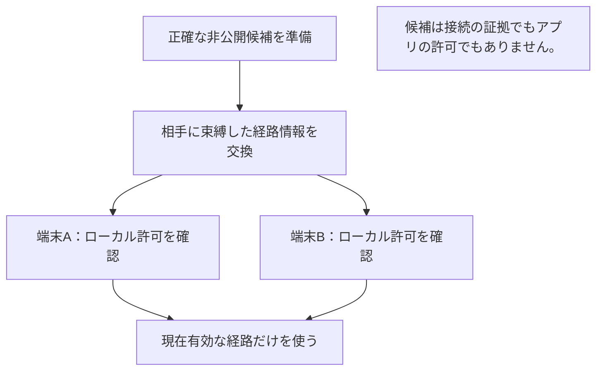
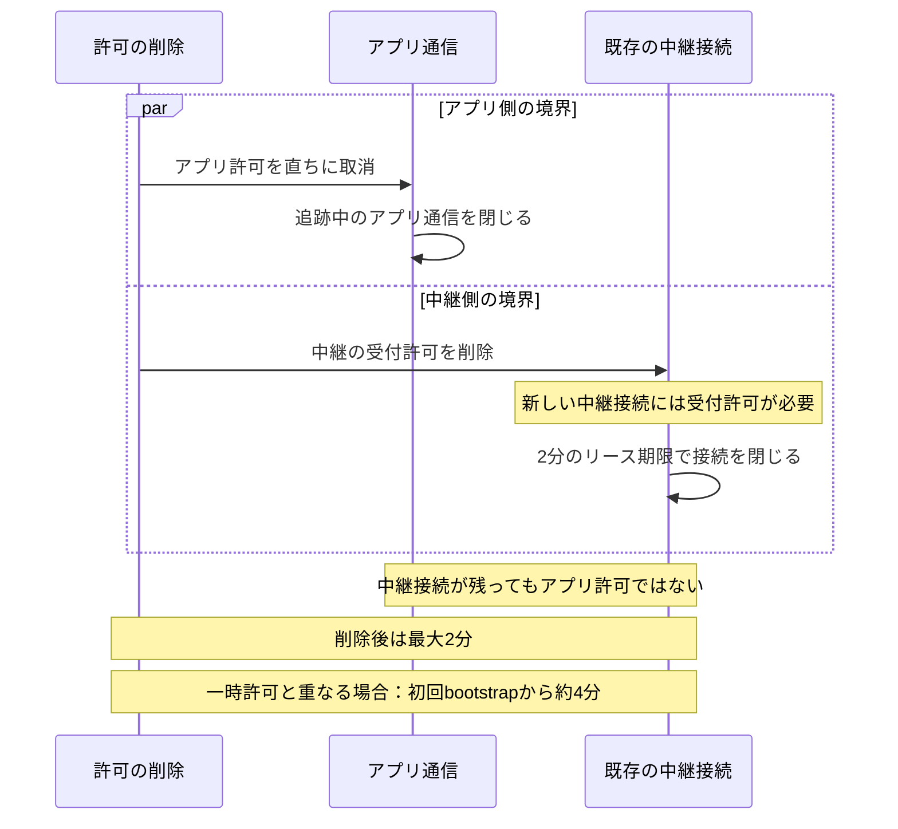

# Tailcat LAN の設定と復旧

[English](LAN.en.md) · [基本手順](GENERIC.ja.md) · [安全性](SECURITY.ja.md) · [確認範囲](VERIFICATION.md#tailcat-の条件) · [v0.5.0-alpha.1](https://github.com/webkaz-labs/sobalink/releases/tag/v0.5.0-alpha.1)

通常の初回設定は[依頼して相手が承認する手順](CONNECTION_SETUP.ja.md)から始めます。以下の公開 ID・招待を明示する手順も、その方式を選ぶ場合に利用できます。通常の初回設定は TOFU で、名前や探索は本人確認ではなく、初回の中間者攻撃を防ぐ保証はありません。必要に応じ、信頼できる方法で完全な指紋を照合してください。

現在の公開版は明示したpin付き中継によるペアリング、準備済み経路の復旧、[LAN送信先ポリシー](LAN_DESTINATIONS.ja.md)、[中継証明書・資源予算の操作](RELAY_OPERATIONS.ja.md)を含みます。同一ソースの自動試験と配布結果は[検証記録](VERIFICATION.md)に示します。実端末、LAN／WAN／NATの構成、休止復帰、ネイティブIMEの受入は別の未実施項目です。

[接続方式の構造と到達条件](MIXED_CONNECTIONS.ja.md)を確認し、受信・共有の許可は[安全性](SECURITY.ja.md)で別に確認してください。


**更新時:** profile 3 は v0.4.0-alpha.4 以前と非互換です。旧状態を保管し、別の空の `--state-dir` で開始してください。自動移行・自動消去はありません。以下の機能別の保存形式の履歴は、このプロファイル境界を変更しません。

## 目的から手順を選ぶ

| 目的 | 最初の操作 | 続ける前の確認 |
| --- | --- | --- |
| 中継を使って2台をペアにする | 以下のローカル UI の手順 | 両端末で同じ確認済み中継と pin を使えること |
| 中継なしで接続する | [直接LAN](DIRECT_LAN.ja.md) | 正確な TCP と UDP の両接続先へ到達できること |
| 別のネットワークに備える | このページの経路準備の手順 | 各端末で正確な候補と有効期間を独立して承認すること |
| 停止・許可を解除する | このページの解除・停止の手順 | アプリへの信頼と transport のペアが別であること |

招待は非公開で扱います。ペアリングは通信上の関係を作りますが、メッセージ・ファイル・サービスを許可しません。それぞれの許可を設定した後、実際のアプリ操作を確認してください。

## ローカル画面で設定する

現在のローカル画面は、LANが設定済みでも、受け取った招待を先に検査し、別の明示操作でペアにします。宛先のID・正確な中継／pin・期限を確認してください。招待・ID・ネットワーク・送信先ポリシーが変わると確認を無効にします。初回設定では、応答された設定が確認済みの範囲と一致する場合だけペア処理へ進みます。画面を閉じても、送信済みの操作は取り消しません。過去の 0.3.0-alpha.5 の画面には、この確認手順のすべては含まれていませんでした。

2台で使う場合は、ペアリング前に相手から到達できる方をホストに選びます。利用中はホストの sobalink を起動したままにしてください。もう一方への自動引継ぎはありません。「ネットワークを設定」→ LAN を開き、招待に必要な公開識別情報を作成・表示してから進みます。

1. ホスト側は「このデバイスでリレーを起動」→ プライベートアドレス・インターフェースと未使用TCPポートを選択 →「起動内容を確認」→「リレーを起動」と進みます。ポートの既定は48443です。一覧を使えない場合は「LANアドレスを手入力する」で、この端末の正確なプライベートIPv4またはULA IPv6を入力できます。同じIPv6を表す表記は確認画面で正規化します。インターフェースは自動選択しません。ファイアウォールは変更せず、待受の開始だけでは他の端末からの到達性を保証しません
2. 新しいプロフィールで参加する側は、この端末の公開 ID を招待側へ渡し、受け取った非公開の招待を貼り付けます。ホストの識別情報、正確な中継先・ピン、期限を確認して「接続してペアリング」を選ぶと、確認した中継を設定して参加します。別のネットワークや中継が設定済みなら、先に明示的に停止し offline で復旧します
3. 確認済みの数値中継先と証明書ピンを手動設定する詳細操作も使えます。接続後は正確な相手公開鍵へ招待するか、受け取った招待へ参加します。ペアリング後も、明示して許可するまでアプリの信頼は無効です

オフライン起動中に変更のない保存済みホストを再開する場合は、「保存済みホストを確認」→ 正確な公開ID・名前・待受・指紋・送信先ポリシーと既存の範囲を確認 →「保存済みリレーを起動」と進みます。アドレス一覧の取得は不要で、保存済みペアと有効な証明書を維持します。設定や許可が変わった場合は再確認が必要です。稼働中または障害後のエンジンが残っている場合は、本体を停止し `soba start --offline` で開き直してから操作します。アドレス・証明書の置換には、既存の明示的な復旧手順が引き続き必要です。この確認付き簡易操作だけで実端末でのホスト運用・ペアリングの受入を証明できず、それらは未完了です。

「sobalink を停止」では稼働中の転送とサービスを確認してから、本体・組込み中継・接続を停止します。ローカル画面も切断されます。続けるときは本体を開き直します。通常の定義は停止したままで、別に確認した[外向き起動時接続](STARTUP.ja.md)だけが新しい接続を開始できます。以前の転送進捗は再開しません。

招待のコピーは操作したときだけ行います。設定を閉じても未使用招待は取消できるようメモリー内だけに保持し、使用済み招待のコピー・取消は消します。一時停止と解除は対象と影響を確認してから実行します。稼働中の方式を変えるには停止して `soba start --offline` で起動し、設定へ戻ります。

ローカル SVG 図と読み上げに対応した一覧は、この端末から相手への状態だけを示します。狭い画面でも両方を選べ、明示した表示を維持します。端末や線を選ぶと詳細・許可操作を開きます。最新ソースの実フォント・寸法・操作の受入は、[確認範囲](VERIFICATION.md)と分けて記録します。

## 中継先を明示して選ぶ

LAN モードはアカウント認証なしで Tailcat を使います。この本体が正確なプライベート IP・非特権ポートで中継を提供するか、既存の信頼できる中継の数値 IP・ポートと TLS 証明書 SHA-256 ピンを選びます。最初のペアリングでは両端で同じ bootstrap 接続先とピンを選びます。新しい追加候補は、この元のペアリング中継とは別に準備します。公開中継一覧、DNS bootstrap、任意の代替先を自動選択しません。

組込み中継は選んだアドレスだけで待ち受けます。ワイルドカードは使いません。loopback は同じホストでの試験用で、別端末からは到達できません。中継ポートは1024以上とし、管理・探索・ピア・ペアリング・内部入口と競合させません。

バックエンドや中継先を変える前に本体を止めます。保存済みのネットワークを開始せずに管理を開きます。

```sh
soba start --offline
```

そのプロセスを起動したまま、別の端末ウィンドウから操作します。`--offline` は起動時の指定で、後から明示的にネットワークを開始できなくする設定ではありません。

中継を提供する側では `soba lan addresses` で候補を表示し、使うプライベートアドレスを選びます。以下の IP は架空の例で、実際の候補に置き換えてください。候補の表示だけでは通信の到達性を保証しません。

```sh
soba lan addresses
soba setup --network lan --host 192.168.50.10:54546
soba status
```

ホストは非公開の中継識別情報と証明書を作ります。状態には公開の接続先・ピン・ノード公開鍵だけを示します。参加側と信頼できる連絡経路で確認し、非公開の状態ファイルはコピーしません。

参加側は同じ中継を選びます。`RELAY_CERT_SHA256` は、確認した64文字の小文字の証明書ハッシュへ置き換えます。

```sh
soba setup --network lan --relay 192.168.50.10:54546 --certificate RELAY_CERT_SHA256
```

`--relay` 自体は中継を起動しません。待受と入場許可はその運用者が用意します。設定は検証後にバックエンドを開始しますが、待受準備は相手への到達を保証しません。`--host` と `--relay` は同時に使えません。保存済みの選択を再利用するときは `soba setup --network lan`、端末名を変えるときは `--name sample-node` を明示します。

## 意図した識別情報とペアリングする

両側で本体を起動し、公開識別情報を取得します。ネットワーク未選択や `start --offline` でも取得できます。

```sh
soba lan identity
```

未作成なら LAN の識別情報を作って保存し、`publicKey` に公開鍵だけを返します。参加側の64文字の公開鍵を、信頼できる連絡経路で招待側へ渡して照合します。名前は表示用で、本人確認ではありません。

中継の設定が済んだ招待側で、その正確な鍵へ一回用招待を発行します。`PUBLIC_ID` を参加側の公開鍵に置き換えます。

```sh
soba lan invite --to PUBLIC_ID
```

既定の有効期間は5分です。`--ttl` は1秒〜10分の整数秒で変更でき、`--name sample-peer` で表示名も指定できます。結果には秘密の `invitation` 文字列、有効期限、相手公開鍵を含みます。出力を非公開の `private-invitation.json` として保存し、意図した相手にだけ適切な非公開経路で渡します。URL、画像、共有ログ、シェル履歴、コマンド引数へ秘密を含めないでください。

参加側は、受け取ったファイルを使って参加前に確認します。

```sh
soba lan inspect --json-file ./private-invitation.json
```

`inspect` は受取人がこの端末と一致すること、有効期限、ホストの公開鍵と名前、中継先と証明書ピンを確認し、参加しません。相手を照合し、表示された正確な中継を上の `setup --network lan --relay ... --certificate ...` で設定してから参加します。`join` が中継を自動変更することはありません。

```sh
soba lan join --json-file ./private-invitation.json
```

`inspect`・`join`・`cancel` は `lan invite` の応答全体と、生の招待 JSON の両方を受け取ります。wrapper の手書きや JSON 文字列の手動エスケープは不要です。ファイルの代わりにパイプ／リダイレクトも使えます。

```sh
soba lan inspect --stdin < ./private-invitation.json
```

入力上限は48 KiBで、対話型端末からの stdin は拒否します。ファイルと招待発行の出力を非公開にし、不要な一時コピーを片付けます。CLI が読み取るだけでファイルの権限が変わるわけではありません。`--dry-run` の招待内容は伏せられますが、本人・有効期限・中継の検証には実際の `inspect` を使います。

参加成功は `paired: true` と `trusted: false` を返します。秘密状態を保存してから成功を応答し、通信上の対応だけを確立します。各受信側は、送信者のアプリの信頼を別に許可します。

```sh
soba peers
soba trust PEER_ID
```

その後、[基本手順](GENERIC.ja.md)の文字、一括転送、範囲サービスを使います。自動保存はさらに別の希望制で、バックエンド・正確な相手・信頼の世代・保存先に固定します。

## 別の経路を準備する

**ネットワークを移る前に両端を準備します。** 元のペアは維持し、運用者と証明書ピンを確認した中継先だけを追加します。追加中継は既に稼働し、ペアのロールを受け入れる必要があります。`routes add` は中継の起動や入場制限の変更をしません。



1. 本体を停止して `soba start --offline` で起動します。そのまま別の端末で `soba lan routes list` を実行し、正確な接続先・ピン・`local` または `external` の区分を指定して追加します。元の中継は必須です。追加の正確な候補は保存状態・交換形式の容量内で設定し、実行時には別の調整可能な予算を使います。[中継のリソース予算](RELAY_OPERATIONS.ja.md)を参照してください
2. 両端を停止し、通常起動して保存した中継の組合せを反映します。ペアの識別情報と鍵は維持します。通常の保存サービスには既存の明示的な開始・起動許可が必要です
3. 正確なペア相手へ経路情報を作成して非公開で渡します。受信側で検査し、発行者・受信者・接続先・証明書ピン・期限を比較します
4. 検査で表示された候補 ID だけを、有限期間または取り消すまでを明示して許可します。逆方向も同じ操作を行います。認証だけでは許可にならず、未許可の情報を受けても経路を探索しません
5. 既存のローカルサービス入口へアプリを再接続します。通信不能を確認した世代は停止中の通信も含めて閉じ、新しい接続で現在の許可済み候補を試せます。健全な通信は LAN を優先するだけでは切断しません。アプリの実操作は別に確認します

以下は架空の値・置換用の記号であり、到達可能な中継の推奨ではありません:

```sh
soba lan routes add --relay 192.168.50.20:54546 --certificate RELAY_CERT_SHA256 --scope local
soba lan routes list
soba lan routes offer PEER_ID --until-revoked
soba lan routes inspect PEER_ID --json-file ./private-route-update.json
soba lan routes approve PEER_ID --json-file ./private-route-update.json --candidates CANDIDATE_ID --until-revoked
soba lan routes list PEER_ID
```

追加と一覧はオフラインで行い、新しい組合せを使う前に再起動します。offer は送信側、inspect/approve は受信側で行い、それぞれの正確なペア相手を `PEER_ID` に指定します。offer の完全な出力を上記のファイルへ非公開で保存して渡します。パイプ入力は `--stdin` を使えます。秘密の経路情報を引数・URL・画像・ログへ貼り付けないでください。CLI は offer の出力全体と、その中の更新情報のどちらも読めます。[正式なコマンド定義](../cmd/soba/lan_routes.go): `soba lan routes --help`。

経路情報とローカル許可は、それぞれ有効期間を選びます。`--until-revoked` は予定の期限なし、`--ttl 168h` は明示した有限期間です。CLI の offer/withdraw と候補ありの approve ではどちらか一つが必須で、期間の既定値はありません。version 2 に30日という任意の上限はありません。有限許可は有限情報の期限までに制限し、取り消すまでの許可には情報も取り消すまでであることが必要です。既存v1の有限記録は元の正確な期限を保ちます。受信・再接続・再読込で自動更新しません。取り消すまでの許可は同じ保存済み許可として再起動後も保持し、期限切れの有限許可は期限切れのままです。新しい情報の適用は許可候補を置き換えるため、元の中継を含めて引き続き使う経路をすべて確認します。期限切れ・全取消でも旧単一中継を黙って復活させません。

```sh
soba lan routes approve PEER_ID --current --candidates CANDIDATE_ID --ttl 168h
soba lan routes revoke PEER_ID --candidates CANDIDATE_ID
soba lan routes revoke PEER_ID
```

`--current` は、まだ有効な保存済み情報から選んだ候補を明示して再許可します。revoke の `--candidates` を省くと、その相手の管理中の経路許可をすべて取り消して対象の外向き通信を止めます。ペアとアプリの許可は保持します。関係全体を終了するには下記のペア解除を使います。準備した追加候補の削除はオフラインで `soba lan routes remove CANDIDATE_ID` を実行して再起動します。交換済みの相手の情報は取り消さないため、必要に応じて該当端末の許可も解除します。元の中継はこの操作では削除できません。

画面では LAN 設定 →「詳細: 準備済みリレー候補」で追加・削除を確認します。ペアの詳細 →「接続経路の復旧」から、非公開の情報作成、検査・許可、期限、取消を操作できます。新しい提供情報と対応する許可は「取り消すまで」を初期表示しますが、有限・v1情報では有限許可だけです。期間と影響を確認して確定し、正確な候補はすべて未選択から明示して選びます。保存成功は設定の保存であり、到達確認ではありません。

`local` は中継アドレスの区分です。相手への直接通信は LAN 外を通る場合があります。宛先を制限するには別の[明示的な送信先ポリシー](LAN_DESTINATIONS.ja.md)を使います。それでも NIC／VPN の隔離やプロセス全体の外部送信ゼロを証明するものではありません。外部サービス不通時の保存済み LAN からの起動、サービス入口の維持、経路移行は、設定成功だけでなく[ネイティブ統合条件](VERIFICATION.md#経路復旧の条件)の確認が必要です。この経路操作は、既存 TCP の維持、アプリの自動再実行、ファイルの途中バイト・再起動後の再開を提供しません。別途許可する永続的な送信待ちの動作は[ファイル送信待ちのガイド](DURABLE_OUTBOX.ja.md)を参照してください。

### 提供した候補を撤回する

撤回はペアの受信者向けに、候補が空の認証済み情報を作ります。非公開で保存・交換し、受信側で検査してから明示して適用します:

```sh
soba lan routes withdraw PEER_ID --until-revoked
soba lan routes inspect PEER_ID --json-file ./private-route-withdrawal.json
soba lan routes approve PEER_ID --json-file ./private-route-withdrawal.json --withdrawal
```

withdraw は発行側、inspect/approve は受信側で、それぞれの相手 ID を指定して実行します。情報の作成だけでは、この端末の候補・ローカル許可も受信側の状態も変更しません。検査した空の情報を適用すると、順序番号を記録して受信側のローカル経路許可を削除し、経路・アプリ権限は与えません。通常の候補ありの許可には `--candidates` と明示的な期間が必要です。`--withdrawal` は権限を削除するため、候補IDや期間オプションを併用しません。相手向け情報を作らず手元の許可を直接削除する `revoke` とは別です。

### 更新と復旧

0.3.0-alpha.2 の非公開 LAN 状態 version 1 は元の識別情報・鍵・中継と単一経路を保ちます。以前の準備済み経路 version 2 ファイルはv1の有限期限を保持します。明示期間の protocol/state version 2 は非公開 LAN ファイル version 3 を使い、二つの版番号は別です。旧バイナリは未対応状態を拒否します。版を下げたり古いバックアップで検査を回避したりせず、非公開でバックアップし、対応版の `--offline` で確認します。取り消すまでの許可でも証明書の有効性は必要です。生成したローカル中継証明書は365日で失効し、期限切れ・ピン変更は別に確認して復旧します。

`lan_routes_invalid` では新しい有効な情報を取得して検査し、`lan_routes_unavailable` では現在のローカル経路許可を確認します。`lan_routes_recovery` は保存の耐久性が不確かです。本体を停止し、非公開保存領域を点検・修復してから再起動します。結果が不確かな操作は再試行前に状態を更新します。取込み成功だけで相手の許可や到達性を証明しません。

## 招待の取消と復旧

招待側は発行した招待の非公開ファイルを使い、自分の未使用招待を取り消せます。

```sh
soba lan cancel --json-file ./private-invitation.json
```

| 結果 | 次の操作 |
| --- | --- |
| `lan_environment_proxy` | このプロセスの未対応プロキシ変数を外して LAN を起動し直す |
| `lan_environment_override` | このプロセスの未対応 Tailscale 上書きを外して LAN を起動し直す |
| `lan_relay_mismatch` | 選択した数値アドレスと正確な証明書ピンを招待と比較する |
| `lan_certificate_expired` | 時計を確認する。必要なら offline 管理で古いペアを解除し中継を再設定する |
| `network_restart_required` | 停止して `soba start --offline` で起動し、方式・名前・中継を変更する |
| `lan_cancel_invite_first` | 自分が同じ相手に出した招待を先に取り消してから、相手の招待へ参加する |
| `lan_pair_reply_uncertain` | 無条件に再試行しない。相手で保存済みか確認し、完了したペアを解除してから新しい招待を作る |
| `lan_remote_paired_local_save` | 相手では保存済みだが、この側では未保存。相手側の許可を解除してから再試行する |
| `lan_revoke_not_persisted` | 解除の永続化を確認できず LAN が停止した。非公開状態の保存を修復してから起動する |
| 期限切れ・取消済み・不正な招待 | 意図した相手と中継先を確認し、まだ必要なら新しい招待を発行する |

CLI に `--json-errors` をコマンドより前に付けると、失敗時の `{code,error}` を標準エラーへ返します。ネットワークの失敗は状態の安定した `self.errorCode` にも現れます。画面は既知の復旧コードを翻訳し、変更していない技術的な説明を別に表示します。

応答不明は成功でも、両側が変わっていない証拠でもありません。両側を確認する代わりに同じ操作を繰り返さないでください。

## 解除・復旧・停止

アプリの信頼と、通信上のペアリングは別です。

```sh
soba revoke PEER_ID
soba lan revoke PEER_ID
soba stop
```

最初の操作はアプリの信頼を解除します。`soba lan revoke` は通信のペア、アプリの信頼・自動保存、関連するサービスも解除して保存します。関係を完全に終了するときは両側で行います。保存に失敗した場合は永続的な成功を報告せず、LAN を停止します。

保存済みネットワークが起動しない場合は本体を止め、`soba start --offline` で起動します。保存済みの相手は未確認・オフラインとして表示されるので、明示的に解除できます。元の bootstrap 中継の交換は、現在の LAN ペアをすべて解除し、バックエンドが停止してから行います。追加候補の追加・削除は上記のオフライン編集と再起動で行い、ペアを維持します。ローカル中継証明書の期限切れにもこの復旧経路を使い、証明書検査を回避したり古い許可を無言で再利用したりしません。

相手の一時停止は文字・ファイルを遮断し、進行中の送信を取り消します。再開後はファイルを選び直し、取消した送信を自動再開しません。自動保存だけを無効にした場合は一括ごとの承認へ戻ります。どちらも別に許可したサービスを止めないので、必要ならサービス停止またはペア解除を行います。

## 通信範囲と残る制約

既定の trusted-relay モードは、相手への直接通信、選んだ中継を通る暗号化ペイロード、その中継先への HTTPS/ICMP 診断を許します。LAN 内だけ・外部通信ゼロの保証ではありません。必須タグでポートマッピング、captive portal 検査、システムプロキシを除き、未対応のプロキシ・上書き環境を拒否します。

組込み中継は sealed HTTPS bootstrap で認証してから、招待された通信ロールを受け入れます。不明な鍵の一律許可はありません。中継接続は2分のリース満了で閉じ、再接続時に許可を確認します。既存セッションが削除後最大2分、bootstrap の一時許可と重なる場合は初回から約4分まで残ることがあります。アプリの許可と追跡中のアプリ通信は直ちに解除します。


### アプリの取消と中継の期限は別

アプリ許可の取消は、中継リースの期限を待ちません。



アプリ許可と追跡中のアプリ通信は直ちに取り消します。既存の中継接続は削除後最大2分残る場合があります。約4分は一時許可がリースと重なったときの初回bootstrapからの時間で、取消後にアプリを4分使えるという意味ではありません。

経路は測定できるまで不明です。ペア保存だけでは相手への接触を証明しません。図はこの端末と観測した相手だけを示し、全員同士の線、帯域、直接・中継経路を作りません。経路変更、スリープ復帰、再接続で既存 TCP を維持する保証はありません。合格したネイティブ試験は loopback 中継の一つのリース境界の確認で、実 LAN/WAN/NAT の移動や本番の外部通信ゼロを証明するものではありません。
