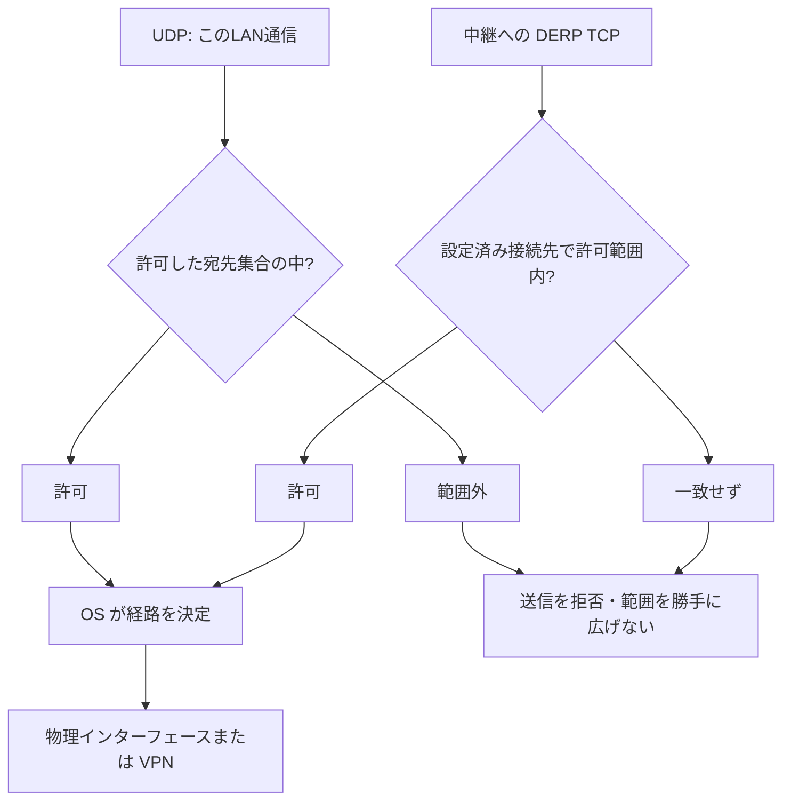

# LAN の送信先を明示して制限する

[English](LAN_DESTINATIONS.en.md) · [LAN 設定](LAN.ja.md) · [中継の運用](RELAY_OPERATIONS.ja.md) · [v0.5.4-alpha.1](https://github.com/webkaz-labs/sobalink/releases/tag/v0.5.4-alpha.1)

**現在の公開版で利用できます。同一ソースの自動試験・配布結果は[検証記録](VERIFICATION.md)を参照してください。実端末ネットワークでの受入は未完了です。** `allowed-lan-destinations` を選ぶと、LAN の UDP 送信先を指定したアドレス範囲に制限できます。指定できるのは、プライベート IPv4、ULA（IPv6 のプライベートアドレス）、ループバック（同じ端末内）の範囲です。範囲は `192.168.50.0/24` のような CIDR 形式で表します。DERP（暗号化通信の中継方式）の TCP 接続先も、その範囲内で設定した IP アドレスとポートに限ります。物理 NIC への固定、同一リンク、VPN 隔離、ホスト／プロセス全体の外部送信ゼロを保証しません。許可した宛先でも別の NIC や VPN へルーティングされる場合があります。

管理者権限と LAN ルーターの変更は不要で、実施しません。通常のアプリ用ソケットを使います。仮想ネットワーク機器の TUN ドライバーは導入せず、経路・ファイアウォールの変更や UPnP／NAT によるルーターのポート開放も行いません。ネットワークの制限を迂回する機能ではありません。選択したネットワークで必要な通信が禁止されている場合は失敗を示し、別の明示的に許可された設定を選びます。

## この設定で制限するもの



許可するのは宛先です。許可済みの宛先でも、OSがVPNへ送る場合があります。この制約を端末全体やプロセス全体の通信隔離と解釈しないでください。


| 選ぶもの | 制限する対象 | 証明しないこと |
| --- | --- | --- |
| プライベート／ULA／ループバックのアドレス範囲 | UDP の送信先アドレス | 物理インターフェースや VPN の経路 |
| 正確な中継先と証明書の指紋 | DERP TCP の設定済み宛先と識別情報 | 到達性や相手側の許可 |
| 確認済みポリシー変更 | 次に設定する通信基盤の範囲 | 端末全体の外部送信ゼロ |

接続前に意図した最小限の送信先範囲を選びます。必要な中継が範囲外なら、自動で許可を広げず設定を確認し直してください。

## 最初の接続前に選ぶ

ローカル Web 設定で、中継先と証明書の指紋に合わせて送信先ポリシーを確認します。使うネットワークアドレス範囲だけを明示選択してください。インターフェースから得た候補は自動では有効にしません。中継とポリシーは一緒に保存し、その後に通信基盤を起動します。招待を受け取っても、ローカルの送信先許可は自動で広がりません。

架空の確認済みネットワークを使う例：

```sh
soba setup --network lan --host 192.168.50.10:48443 --policy-mode allowed-lan-destinations --prefix 192.168.50.0/24
```

現在の CLI で使えるホスト・中継の指定方法は `soba setup --help` を確認してください。アドレス範囲は宛先の範囲であり、送信元 NIC の指定ではありません。IPv6 ULA に対応し、インターフェース名などのゾーン識別子を伴うリンクローカルアドレスと、IPv4 を埋め込んだ IPv6 表記は拒否します。ループバックは同一端末内の確認専用です。

稼働中の本体を停止してから、保存済みネットワークを開始せずにローカル管理を起動します。

```sh
soba start --offline
```

起動したまま、別の端末ウィンドウで保存済みポリシーを確認・編集します。

```sh
soba lan policy show
soba lan policy set --mode allowed-lan-destinations --prefix 192.168.50.0/24 --prefix fd50::/64
```

確認したポリシーを保存したら通常起動で再開します。選択中とローカルで準備済みの全中継先が範囲内に必要です。相手から認証済みの経路候補もポリシーとの共通部分だけを使い、範囲外の経路へ切り替えません。明示して `trusted-relay` に戻すと、通常の相手への直接送信と、選択した中継の診断通信を許可します。公開中継の自動選択は行いません。

## 適用範囲と停止

- UDP は単発送信、一括送信、代替経路、再試行、探索、cookie 応答のすべてに同じ送信制限を適用します
- DERP TCP は数値 IP とポートの完全一致で許可し、DNS による別宛先の検索、環境変数のプロキシ設定、独自の接続処理による迂回は認めません
- 制限を適用したエンジンでは、netcheck（接続状況の診断）の HTTP／HTTPS／ICMP、単独の接続検査、生パケットによる探索、別経路の WireGuard ICMP 応答確認を、ソケット生成前に無効にします
- ポートの自動開放、認証ページへの誘導検査、プロキシ機能は、既存の製品ビルドタグで除外します
- ポリシーはエンジン世代ごとに固定します。エンジンの使用終了時に新しい送信・接続を禁止し、登録した UDP／TCP ソケットを閉じます。新世代には新しいポリシーを渡します。すでに届いたパケットは取り消せません
- 既存 Tailnet と通常の trusted-relay の動作を維持します。方式間の自動切替はありません

初期接続と探索には、証明書の指紋を固定した元の中継が必要です。中継なしのペアリング、公開サーバーによる相手との接続仲介、一般的な NAT 越えを追加する機能ではありません。ペアの信頼、サービス許可、ファイル受信許可は別々です。

保存失敗は永続的な変更ではありません。同じプロセスでは不確かな許可で再開せず復旧が必要になります。新しいプロセスは実際の保存ファイルを読み、以前のポリシーが残っている可能性があります。保存エラー後の再開前に内容を確認してください。このポリシーを含む LAN ファイルは版 4 となり、以前のバイナリでは開けません。

## ビルドと確認範囲

版を固定した Tailscale モジュールを生成用ディレクトリへコピーし、レビュー済みの変更差分をハッシュ値で照合して適用します。`go run ./cmd/prepare-engine` が準備し、mise と CI にも組み込まれます。モジュールキャッシュは書き換えません。準備なし／未変更のモジュールではコンパイルが失敗します。配布構成一覧に適用後のソース識別情報、元の検証用ハッシュ値、変更差分／ソースハッシュ値とライセンスを残します。

正確なソースの結果は[確認範囲](VERIFICATION.md)へ記録します。自動ループバック試験や架空宛先の拒否試験は、実 LAN／VPN 境界の証明ではありません。実端末、複数 NIC、VPN の重複、経路変更、休止復帰、IP 更新はリリース後の受入で、端末・ネットワークの選定と必要な操作許可を別途確認します。
