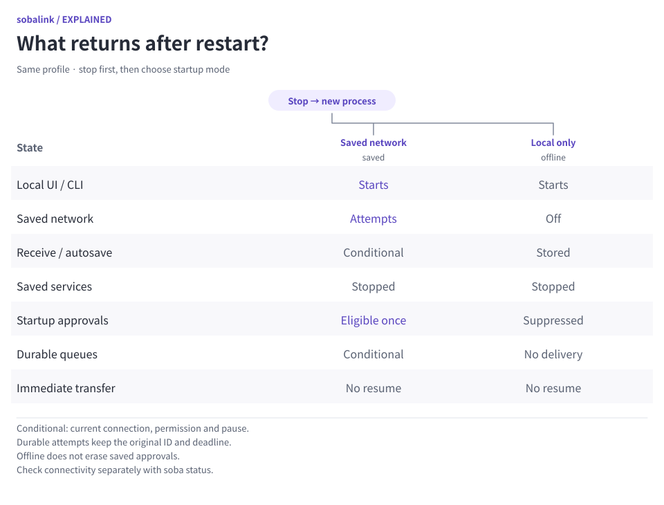
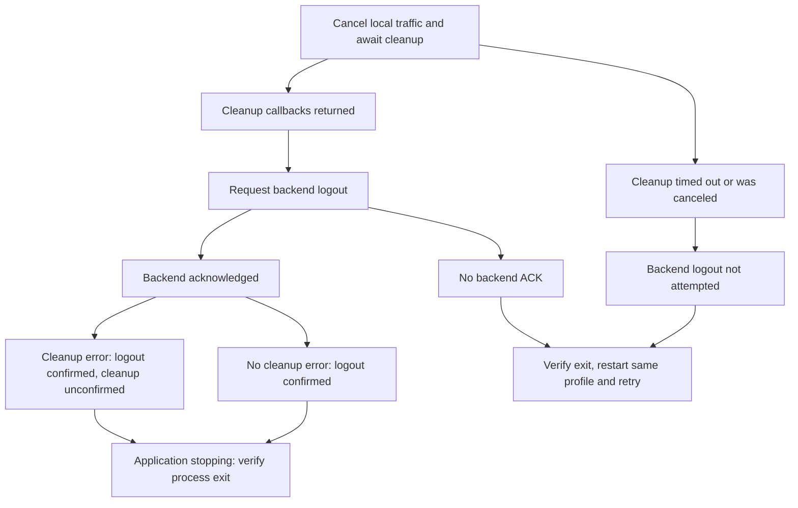

# Startup and Tailnet logout

[日本語](LIFECYCLE.ja.md) · [User guide](GENERIC.en.md)

`soba` and `soba run` run in the foreground. `soba start --background` starts a detached application and waits for its local management interface. Startup success confirms local readiness, not network connectivity or success in another application. Use `soba status` to inspect the network and `soba ui` to open the local browser with automatic one-time-code handoff.

<picture>
  <source media="(prefers-color-scheme: dark) and (max-width: 839px)" srcset="assets/visuals/restart-state-en-dark-narrow.svg">
  <source media="(max-width: 839px)" srcset="assets/visuals/restart-state-en-light-narrow.svg">
  <source media="(prefers-color-scheme: dark)" srcset="assets/visuals/restart-state-en-dark-wide.svg">
  
</picture>

[Open full-size diagram (wide)](assets/visuals/restart-state-en-light-wide.svg) · [Narrow version](assets/visuals/restart-state-en-light-narrow.svg)

## Start, inspect, stop

```sh
soba start --background
soba status
soba ui
# When finished:
soba stop
```

Use `soba start --offline --background` instead when you want local management without reconnecting the saved network. Choose one startup mode; a second start does not change a running process. `soba ui` opens the local UI on this device without manual code entry. For explicit manual access use `soba ui --no-browser`; private machine output uses `soba ui --json`. Both fallback modes return secret sign-in information for this device only. Retain the same `--state-dir` on every command when using a custom profile.

**Published 0.5.1-alpha.1:** `soba ui` requires a running application. After stopping, use `soba start --offline --background` to reopen local management without the saved network, then run `soba ui`. **This checkout (0.5.2-alpha.1 candidate):** interactive `ui` / `ui --no-browser` can attempt this offline start for a validated existing profile when the local control endpoint is known to be absent. `ui --json` never starts it, and failures other than a known absent control endpoint do not trigger recovery. See [the version-specific UI recovery steps](GENERIC.en.md#candidate-reopen-the-ui-after-stopping).

**Stop display in the 0.5.2-alpha.1 candidate:** a successful Stop reply acknowledges the request, not completed cleanup or process exit. The UI preserves that acknowledgement if local HTTP disconnects, disables further commands, and distinguishes a lost or invalid reply from an accepted request. Disconnection alone is not a shutdown receipt. Check the application before restarting and keep the same profile when reopening local management. Human CLI output makes the same distinction; the existing machine JSON fields are unchanged.

## What comes back after startup

| State | Normal startup / `--startup saved` | `--offline` / `--startup offline` |
| --- | --- | --- |
| Local management UI and CLI | Starts | Starts |
| Explicitly saved Tailnet or LAN network | Starts; authentication or pairing may still be needed | Does not start |
| Saved peer approvals | Restored for the selected network | Saved; no network reception |
| Saved per-peer automatic file saving | Effective again for the selected network when enabled and not paused | No reception |
| Ordinary saved shares and forwarding rules | Remain stopped | Remain stopped |
| Separately approved outbound startup/proxy selections | One launch attempt after network readiness, within the exact reviewed scope | Suppressed for the entire process |
| Immediate file-transfer progress | Does not resume | Does not resume |
| Explicitly accepted durable file/text queues | Eligible attempts recover under original IDs and deadlines | No delivery while the backend is offline |

Automatic saving uses the exact previously approved peer and destination; a default receive folder alone does not approve automatic saving. Files are never automatically opened or executed. Starting offline does not clear saved approvals. Explicit network activation can make the saved receive approvals effective later.

Ctrl+C, `soba stop`, and the local UI's Stop action stop the application and active traffic while preserving the saved login. A repeated background start reports `already-running` with `startupApplied: false`; it does not change the running application's startup mode. Stop the current process before choosing another startup mode.

Background application output and command errors go to private `startup.log` inside the selected state directory. The application keeps that single file at or below 1 MiB for its entire lifetime, retaining recent output when older bytes roll off. Rollover keeps up to the most recent half-file before appending; an oversized write keeps only its final 1 MiB. The first retained line may be incomplete. No backup log files accumulate. Raw process stdout/stderr, including runtime panic output, are discarded for detached launches; foreground `soba run` retains its normal terminal diagnostics. Service-manager logs for sign-in startup are managed separately by the OS.

A readiness timeout or cancellation can leave the launched process running; check `soba status` before retrying and use `soba stop` if needed. For a direct startup error or runtime panic, run `soba run` with the same `--state-dir`.

[Explicit outbound startup and private SOCKS profiles](STARTUP.en.md) describe the separate opt-in. Saving a definition or importing a profile does not create that permission. Changes to reviewed scope, network/hostname or peer revocation invalidate approval. A finite lifetime begins anew on a new online process launch; reconnecting an existing session does not renew it. Inbound shares and immediate file-transfer progress never auto-start. Explicitly accepted [durable file](DURABLE_OUTBOX.en.md) and [text](DURABLE_TEXT.en.md) queues recover only under their original authority and deadlines.

## Optional startup at user sign-in

Preview first:

```sh
soba autostart enable --startup saved
# Or choose local management without the saved network:
soba autostart enable --startup offline
```

The preview shows the registration file, exact service-manager commands, saved network, and every currently enabled, unpaused autosave peer and destination that would receive files. `saved` also permits separately approved outbound startup selections and saved proxies to attempt launch. Review `soba startup list` and `soba proxy saved` before enabling OS sign-in startup. Registration does not create either approval; service shares remain manual. The review applies to current saved settings. Future deliberate changes to those settings also affect later startup.

After reviewing, repeat the same action and startup mode with `--apply --review TOKEN`, replacing `TOKEN` with the displayed `reviewToken`. `--json` provides a stable structured preview/result. The token covers the exact OS plan and complete saved profile; changing either requires another preview. Neither preview nor registration immediately starts the application or enrolls a node.

Registration is per-user: systemd user units on Linux, LaunchAgents on macOS, and a least-privilege interactive-user scheduled task on Windows. There is no elevation or machine-wide service. Registration is intended for a future sign-in; an already running application remains running after disabling it.

To disable, preview `soba autostart disable --startup saved` (or the original `offline` mode), then apply that preview's token. Keep the original executable location until disabling its registration. A changed registration file is refused. Changing modes or executable paths requires removing the matching old registration first. An existing Windows task is not forcibly replaced; review the existing task before retrying an unsuccessful enable.

## Tailnet logout

```sh
soba logout
```

The saved Tailnet network must be active. Does a disconnected control page prove logout? No: local traffic cleanup, backend acknowledgement and process exit are separate results.



Text equivalent: cleanup timeout or cancellation skips backend logout. Otherwise the backend is asked even if a listener reported a cleanup error. Missing acknowledgement means unconfirmed logout; acknowledgement with a cleanup error means confirmed logout but unconfirmed cleanup. The process starts exiting on all these paths; check exit separately. Read the result code before deciding whether to retry:

- Success returns `state: logged-out` and `logoutConfirmed: true`, meaning the local backend acknowledged logout
- `tailnet_logout_unconfirmed` means backend logout was not confirmed. The error states whether local traffic stopped or its cleanup is also unconfirmed; if a transfer cannot finish stopping, backend logout is not attempted. Wait for the application to exit, then start with the saved Tailnet network and retry
- `logout_cleanup_unconfirmed` means the backend acknowledged logout but listener cleanup reported an error; check that the application exits before restarting

Logout does not delete saved peer approvals, service definitions, or files. Removing a node from the Tailnet administration console is a separate administrator action. LAN pairing is managed with explicit LAN revocation commands, not Tailnet logout.

## Verification boundary

Automated coverage uses injected backends, in-memory peer connections, temporary paths and mocked service-manager runners. It checks traffic-stop ordering, confirmed/unconfirmed logout, repeated startup, early exit/cancellation, reviewed-plan changes, escaping and per-user registration content on all three platforms. This does not establish actual OS sign-in/suspend behavior, installed-binary startup, real enrollment, or application compatibility; those remain separate native acceptance checks.
