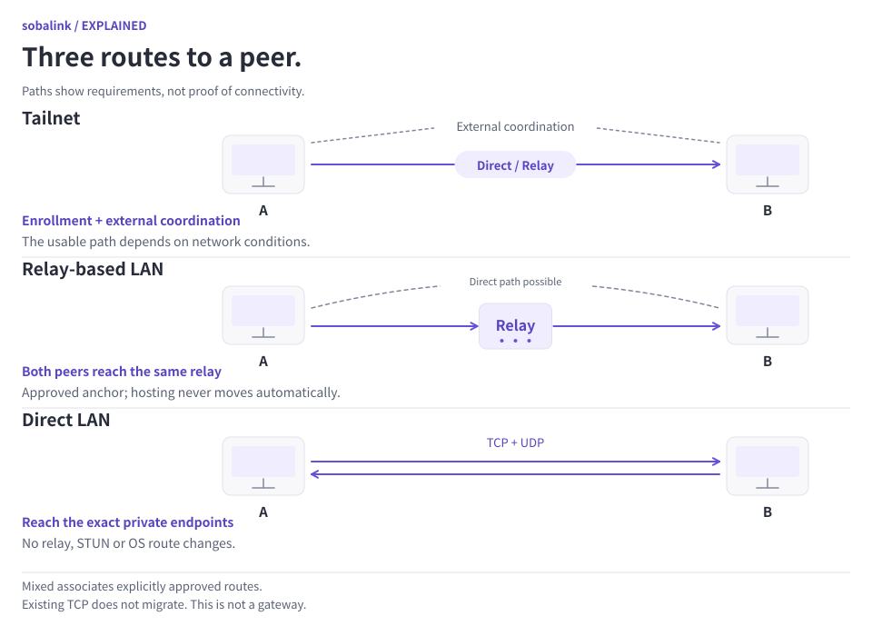
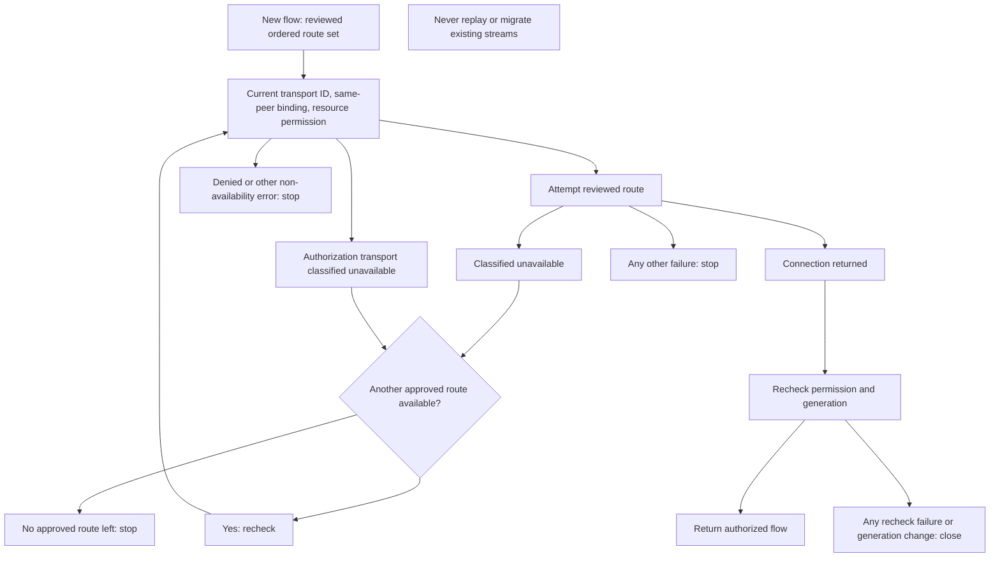

# Mixed connections

[日本語](MIXED_CONNECTIONS.ja.md) · [Direct LAN](DIRECT_LAN.en.md) · [Capacity](CAPACITY.en.md) · [v0.5.1-alpha.1](https://github.com/webkaz-labs/sobalink/releases/tag/v0.5.1-alpha.1)

Mixed mode explicitly runs selected connection backends together. A new profile still selects no network. This is a userspace application transport, not a gateway between unrelated single-backend devices. It changes no OS routes, firewall rules or router settings and needs no administrator privileges.

<picture>
  <source media="(prefers-color-scheme: dark) and (max-width: 839px)" srcset="assets/visuals/network-topologies-en-dark-narrow.svg">
  <source media="(max-width: 839px)" srcset="assets/visuals/network-topologies-en-light-narrow.svg">
  <source media="(prefers-color-scheme: dark)" srcset="assets/visuals/network-topologies-en-dark-wide.svg">
  
</picture>

[Open full-size diagram (wide)](assets/visuals/network-topologies-en-light-wide.svg) · [Narrow version](assets/visuals/network-topologies-en-light-narrow.svg)

## Three separate choices

| Choice | What you review | What remains separate |
| --- | --- | --- |
| Enable backends | Exact modes and preference order | Enrollment/pairing for each mode |
| Bind routes | Authenticated identities for the same application | Application and service permissions |
| Use another route | Positively classified availability and current grants | Reconnecting the application; existing TCP is not migrated |

Start with the normal setup below. If availability is unknown or authorization fails, resolve that condition instead of assuming another route is safe.

## Normal setup

1. Configure, pair or enroll each backend separately using its normal setup. Verify the intended peers. Stop the application before changing network modes.
2. Start locally with `soba start --offline`, then choose the exact backends in preferred order:

   ```sh
   soba mixed setup --backends direct-lan,tailnet
   soba mixed show --json
   soba peers
   ```

3. Review the same selection in the local Web connection dialog. Selecting Tailnet explicitly permits its external coordination traffic. Strict guarded LAN policy cannot silently acquire this wider application boundary.
4. Initially, each authenticated transport peer remains separate. To associate two routes to the same application, select their exact peer IDs in the Web review or use:

   ```sh
   soba mixed bind --peer FIRST_ROUTE_ID --peer SECOND_ROUTE_ID
   ```

   The application verifies a fresh signed challenge through both authenticated connections. A matching display name or IP is never sufficient. Repeat the review independently on the other device when it should use the same association in the reverse direction.
5. Review a new application/service approval for the resulting logical peer. Older approvals are paused and saved-startup epochs retired; they are never copied onto the new identity. Pairing, binding and application approval remain separate operations.

## Switching and limits

The parent owns local service entrances and selected backends run independently. Tailnet and the relay-based engine are isolated in child processes to prevent process-global network settings from interfering. The direct LAN engine uses its own userspace WireGuard/netstack.

New connections can choose another explicitly approved route when a backend is positively unavailable. For direct LAN, the disappearance of its exact configured local address is observable without probing or rebinding. Unknown state, authorization denial, revoked/expired identity and failed persistence are terminal; an arbitrary TCP timeout is not reclassified as permission to try another backend. This is deliberately narrower than a promise that every path failure switches automatically.

Existing TCP streams are never migrated, replayed or resumed. An application may need to reconnect. UDP sessions retain their route and identity; queued datagrams are not replayed onto another route. Backend readiness does not prove application success or NAT reachability.

The local entry can remain stable for new connections in the same application process. Process restart is a separate lifecycle; previous transfer progress and arbitrary remote jobs do not resume. Two devices that support only incompatible single backends cannot communicate through this feature without a separately designed gateway.


### Only an availability failure may try another route

Every new route attempt rechecks its current identity and exact permission.



Only a positively classified availability failure permits the next approved route. Identity, same-peer binding and exact resource permission are checked on every attempt and again after dialing. Denial, revocation, a generation change or exhausted routes stop the attempt. Existing streams are not replayed.

## Removing authority

```sh
soba mixed unbind --peer LOGICAL_PEER_ID
```

Unbinding closes affected work and retires saved startup authority before publishing a new mapping. It does not revive older route approvals. Revoking a participating standalone LAN pair also retires its mixed binding, preventing same-key re-pairing from reviving old approvals.

On failed or uncertain persistence, the runtime closes authority and requires recovery. An error is not proof that saved files were changed. A fresh process reads actual durable state, which may still contain the earlier approval; inspect it before reconnecting.

## Resources and evidence

Worker frame bytes, concurrent requests and handles are adjustable finite resource budgets. Streams span multiple frames; frame size is not a file-size cap. Reserved control slots prevent data work from starving closure and permission updates. Workers snapshot their budgets at startup; status shows when a restart is needed for a changed allocation. UDP aliases use bounded admission and idle retirement, with application permission checked before allocation.

Automated evidence includes signed cross-transport binding, overlapping-address isolation, known-denial refusal, failed-save retirement, child-process separation and byte-preserving owner-pipe traffic. Native direct LAN fixtures separately exercise IPv4/IPv6 pairing and application TCP/UDP. Historical 0.3.0-alpha.5 completed its separate exact-source CI and signed-distribution gates; see [verification](VERIFICATION.en.md). Real enrollment and physical-device/network compatibility remain pending; synthetic tests do not establish those results.

Startup may continue with a healthy selected backend when another backend has positively confirmed absence (for example, its saved direct LAN address is not on an up local interface). A backend that never started requires a soba restart after that address is restored or explicitly reconfigured. A previously running direct LAN backend can report address availability again without changing its listener address.

Starting, NoState, unknown readiness and authorization-required states are not confirmed absence. Every backend identity in a bound peer must be classified before a new route is selected. If a chosen backend disappears during an unopened dial, the next attempt rechecks identities, expiry and permissions before trying another approved route. Cancellation, arbitrary timeouts, service refusal, pin failures and saved-state errors do not permit a retry. Status distinguishes confirmed unavailability, unconfirmed readiness, authorization review and restart requirements.

A companion backend becoming unconfirmed blocks new incoming bound TCP sessions and new UDP admission. Already admitted TCP sources continue to use their exact authenticated transport identity; this status change alone does not revoke them. Authorization revocation still closes affected work. UDP readiness failure closes the affected listener and requires a new service attempt after readiness is confirmed; datagrams are never replayed. A worker exiting before acknowledging startup is an unclassified startup failure, not evidence of safe absence.
