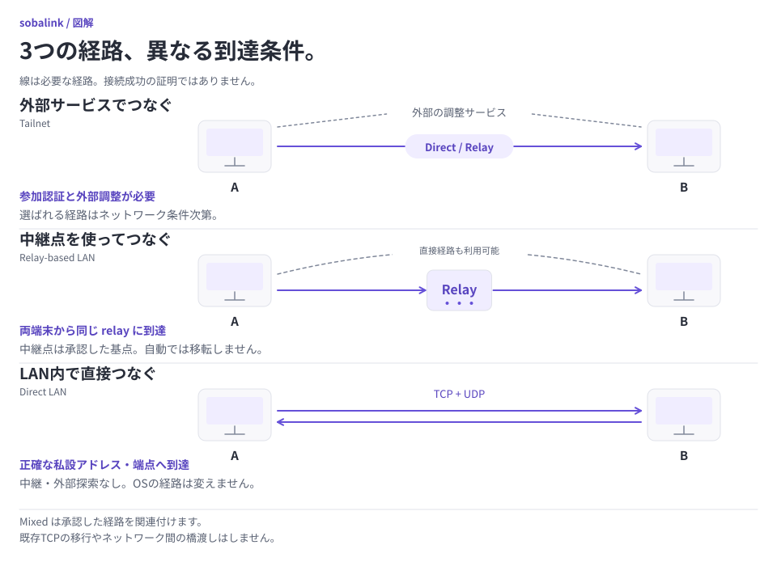
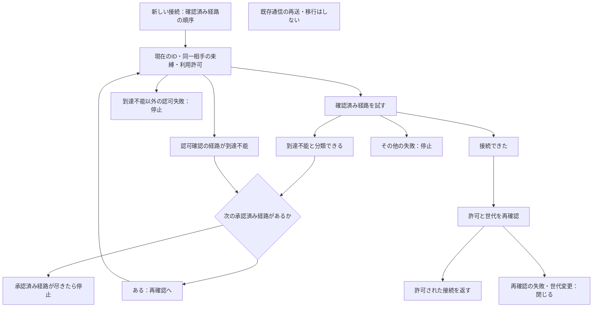

# 複数方式の接続

[English](MIXED_CONNECTIONS.en.md) · [直接LAN](DIRECT_LAN.ja.md) · [容量設定](CAPACITY.ja.md) · [v0.5.0-alpha.1](https://github.com/webkaz-labs/sobalink/releases/tag/v0.5.0-alpha.1)

mixed は、明示的に選んだ接続方式を同時に使うモードです。新規プロファイルは従来どおり未接続で始まります。OSの経路・ファイアウォール・ルーター設定を変えず、管理者権限も不要です。方式の異なる端末間を中継するゲートウェイ機能ではありません。

<picture>
  <source media="(prefers-color-scheme: dark) and (max-width: 839px)" srcset="assets/visuals/network-topologies-ja-dark-narrow.svg">
  <source media="(max-width: 839px)" srcset="assets/visuals/network-topologies-ja-light-narrow.svg">
  <source media="(prefers-color-scheme: dark)" srcset="assets/visuals/network-topologies-ja-dark-wide.svg">
  
</picture>

[図を元の大きさで開く（横長）](assets/visuals/network-topologies-ja-light-wide.svg) · [縦長版](assets/visuals/network-topologies-ja-light-narrow.svg)

## 3つの選択を分ける

| 選択 | 確認するもの | 別途必要なもの |
| --- | --- | --- |
| 接続方式を有効にする | 正確な方式と優先順 | 各方式でのサインイン・ペアリング |
| 経路を関連付ける | 同じアプリについて認証した ID | アプリ・サービスへの許可 |
| 別経路を使う | 明確に分類した利用可否と現在の許可 | アプリの再接続。既存 TCP は移行しません |

以下の通常手順から始めてください。利用可否が不明な場合や認可が失敗した場合は、別経路を安全とみなさず、その状態を解決します。

## 最短の設定手順

1. 各方式を通常の手順で個別に設定し、ペアリングまたはサインインを済ませます。意図した相手を確認してください。方式の変更前にはアプリを停止します。
2. `soba start --offline` でローカル起動し、利用する方式を優先順に明示します。

   ```sh
   soba mixed setup --backends direct-lan,tailnet
   soba mixed show --json
   soba peers
   ```

3. ローカルWeb画面の接続設定でも同じ選択を確認できます。Tailnetを選ぶと、外部の制御通信を許可します。LAN限定ポリシーから、この広い通信範囲へ自動移行することはありません。
4. 初めは、各方式の認証済み相手を別々に表示します。同じアプリへの複数経路として関連付けるには、Webの確認画面で正確な相手IDを選ぶか、次を実行します。

   ```sh
   soba mixed bind --peer FIRST_ROUTE_ID --peer SECOND_ROUTE_ID
   ```

   各接続で実際に認証された相手と、新しいチャレンジへの署名を確認します。名前やIPが同じだけでは関連付けません。相手側でも逆方向の関連付けを使う場合は、相手側で独立して確認します。
5. 新しい論理的な相手に、アプリ・サービスへの許可を改めて与えます。以前の許可は一時停止し、自動起動の承認世代を失効させます。新しい識別子へ許可を移し替えません。ペアリング・関連付け・アプリへの許可は別の操作です。

## 切り替えの範囲

アプリ本体がローカルのサービス入口を保持し、各接続方式を独立させます。Tailnetとリレー方式は別プロセスで動かし、プロセス全体に作用するネットワーク設定の干渉を防ぎます。直接LANは独自のユーザー空間WireGuard・netstackを使います。

接続方式が確実に利用不能と分かる場合、新しい接続は別の許可済み経路を選べます。直接LANでは、指定したローカルIPがインターフェースからなくなったことを、通信プローブや自動再バインドなしで観測できます。状態不明、認可拒否、識別子の失効・解除、永続化失敗では停止します。単なるTCPタイムアウトを、別方式へ切り替える許可とはみなしません。あらゆる経路障害で自動切り替えできるという保証ではありません。

既存のTCP接続の移行・再送・再開は行いません。利用アプリからの再接続が必要になる場合があります。UDPセッションも元の経路と識別子に結び付き、待機中のデータを別経路へ再送しません。接続方式の準備完了は、利用アプリの成功やNAT越えの証明ではありません。

同一プロセス内では、新しい接続に使うローカル入口を維持できます。アプリ再起動は別の処理で、転送途中の進捗や任意のリモートジョブを再開しません。互換性のない単一方式だけを持つ2端末を、この機能で相互接続することはできません。


### 別経路を試せるのは到達性の失敗だけ

新しい経路を試すたびに、現在の識別情報と正確な許可を再確認します。



到達性の失敗と明確に分類できた場合だけ、次の承認済み経路を試せます。識別情報・同一相手の束縛・正確な利用許可を各試行と接続後に確認します。拒否・取消・世代変更・候補の枯渇では停止し、既存通信を再送しません。

## 許可を外す

```sh
soba mixed unbind --peer LOGICAL_PEER_ID
```

関連付けの解除では、影響する処理を止め、自動起動の承認を失効させてから保存します。以前の経路の許可を復活させません。構成するLANペアを単独モードで解除した場合も、mixedの関連付けを失効させ、同じ鍵で再ペアリングしたときに古い許可が戻ることを防ぎます。

保存に失敗した場合や耐久性が不確かな場合は、実行中の許可を閉じて復旧を要求します。エラーだけでは保存済みファイルの変更を証明できません。再起動後は実際の保存内容を読み、以前の許可が残っている場合もあるため、再接続前に確認してください。

## リソースと検証範囲

ワーカーのフレーム容量・同時要求数・ハンドル数は、調整可能な有限のリソース予算です。ストリームは複数フレームに分けるため、フレーム容量がファイルサイズ上限になることはありません。制御用の枠を確保し、データ通信で切断や許可変更が妨げられるのを防ぎます。起動時に予算を確定するため、変更後に再起動が必要なら状態に表示します。UDPの識別用対応表は、アプリへの許可を確認してから割り当て、有限予算とアイドル期限で管理します。

自動テストでは、署名による複数方式の関連付け、同一IPの分離、既知の拒否を迂回しないこと、保存失敗時の停止、別プロセス化、パイプ内のデータ保持を確認します。直接LANのネイティブテストはIPv4/IPv6のペアリングとTCP/UDP通信を別途確認します。過去の 0.3.0-alpha.5 は同一ソースCIと署名付き配布のゲートを別途完了しており、[検証記録](VERIFICATION.md)に示します。実際のサインイン・実機やネットワークとの互換性は未確認で、模擬テストをその証拠にしません。

選択した方式の1つで利用不可を明確に確認できた場合（保存済みの直接LANアドレスが稼働中のローカルインターフェースに存在しない場合など）、正常な別の方式で起動を続けられます。一度も起動できなかった方式は、設定アドレスを復旧するか明示的に再設定した後、sobaの再起動が必要です。すでに起動していた直接LAN方式は、待受アドレスを変更せずにアドレスの復旧を確認できます。

Starting、NoState、不明な準備状態、認証・許可の確認待ちは、確認済みの利用不可ではありません。関連付けた相手の各方式の状態を分類してから新規経路を選びます。接続確立前に方式が停止した場合は、識別情報・有効期限・許可を再確認してから別の許可済み経路を試します。キャンセル、一般的なタイムアウト、サービスの接続拒否、鍵の不一致、保存状態のエラーでは再試行しません。状態表示では、確認済みの利用不可、準備未確認、認証・許可の確認待ち、再起動の必要性を区別します。

関連付けた別方式の準備状態が不明になった場合、新しい受信TCP接続とUDPの受け入れを停止します。受け入れ済みTCPは実際の方式で認証した識別情報を引き続き確認し、この状態変化だけで許可を取り消しません。認可の取り消しは引き続き対象の処理を閉じます。UDPの準備状態エラーでは対象の待受を閉じるため、準備完了を確認してからサービスを再試行してください。データグラムは再送しません。ワーカーが起動応答の前に終了した場合、原因未確認の起動エラーとして停止し、安全に回避できる利用不可とは判断しません。
