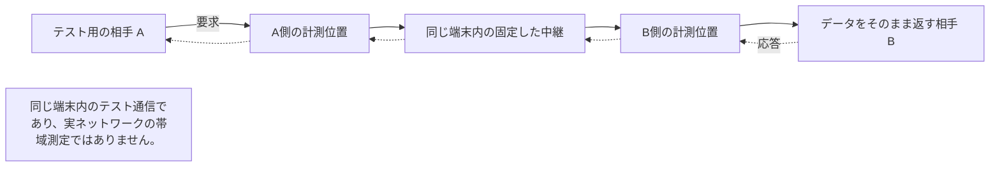

# ソースからビルドした中継の通信量を測る

[English](RELAY_TRAFFIC_MEASUREMENT.en.md) · [公開バイナリのオフライン観測](RESOURCE_MEASUREMENT.ja.md)

この手順は、テスト用データを TCP で送り、そのまま返すエコー通信で Tailcat/DERP の通信量を測ります。
ソース `8e6cbb00d60757f701d7d453adb92590cc5d2544` にテスト専用の計測処理を加え、OS の UDP 通信を除外してビルドします。
公開済み実行ファイル、sobalink のファイル・メッセージ処理、相手の探索、Web UI の定期的な状態取得は対象外です。
測定値を報告する前に、ホスト型 CI の実行完了と集計結果を確認してください。

## 測定する境界を確認する

図の説明：テスト用の相手 A と B は、同じ端末内のループバック中継を経由します。プロキシは両側の中継接続について、双方向の暗号化バイト数を数えます。外側のパケットヘッダーは数えません。

ソースとテスト環境の識別情報、対象区間、転送の成功とハッシュ値の一致を確認してから、通信量を読みます。N バイトの送信とエコー応答では、転送データ量 P は 2N です。中継接続が2本あるため、暗号化通信量の比較基準は 2P です。待機区間ではデータ量の比率を使わず、毎秒のバイト数を確認します。

## Fixture と区間

ここでいう fixture は、計測用に用意する端末・中継・データの組み合わせです。CI ジョブは指定ソースを別に取得し、テスト用ファイル3個だけを追加します。追跡対象の本体ソースが変わっていないことも確認します。既存のペアリング、接続受付時の認可、WireGuard/Tailcat の通信、証明書を固定した TLS はそのまま使います。

すべての待受と計測プロキシの唯一の転送先は、数値指定のループバックアドレスです。外部中継、永続的な端末登録、アカウントへのログイン、OS のネットワーク変更、配布物の変更はありません。テスト用の鍵はメモリー内だけに保持します。

TCP プロキシは TLS を復号・変更せずに転送します。プロキシで成功した書き込みを1回だけ数え、各相手と中継の間の2区間について、中継への送信と中継からの受信を集計します。同じ転送の読み取りと書き込みを両方数えると、二重計上になります。

次の区間を制限時間付きで観測します。

1. ペアリング、中継起動、認証済みの仮想ネットワーク上での TCP エコー接続1本の開始
2. 通信基盤が待機する60秒間
3. 同じ接続で各 1 MiB、16 MiB、64 MiB のテスト用データを送り、エコーを受信
4. 256バイトの TCP 要求とエコー応答を1,000回
5. 同じアプリ接続で最低130秒間のエコー通信。中継接続の2分の有効期間をまたぎ、実際の再接続と接続受付時の認可を確認
6. 有効期間をまたぐ試験後の待機30秒間

毎回、エコーのバイト数と、受信しながら計算した SHA-256 ハッシュ値が一致する必要があります。アプリの再接続・再試行で TCP 接続の切断を隠しません。大容量転送の期限は各60秒で、小さい要求・応答と有効期間中のエコーにも期限があります。

データ転送区間は、終了後の200ミリ秒の待機も観測時間に含めます。データ自体の転送時間は別記します。テスト全体の処理期限は9分、プロセスの実行期限は10分で、終了処理にも期限があります。キャンセル時は、すべての中継・相手・エコー用ソケットを管理するテスト用プロセス1個を停止します。

## カウンターの意味

P は正常に届き、ハッシュ値が一致した転送データの双方向合計です。N バイトの送信とエコー応答なら P は 2N です。R は同じ観測時間内に、中継の2区間を双方向に通る暗号化ストリームの実測バイト合計です。転送データは通常2区間を通るため、基準値は 2P です。

P、R、R/P、R/(2P)、R−2P を報告します。R/P には2区間を通る経路構成の分も含みます。R−2P は、この計測範囲で転送データ以外に使った暗号化通信量です。負数なら計測失敗または計測範囲の不一致として扱い、ゼロに丸めません。待機中の比率は null とし、毎秒のバイト数を示します。起動、待機、データ転送、有効期間をまたぐ再接続は分けて記録し、推定した待機通信量を差し引きません。

含むものは TLS の接続確立・レコード、DERP の転送形式、WireGuard による仮想ネットワークの通信、テスト用データです。外側の TCP/IP/Ethernet ヘッダー、確認応答だけのパケット、カーネルの再送、ICMP 診断、直接 UDP 通信、中継の別接続によるローカル認可用 HTTP は含みません。パケットキャプチャーや WAN の課金対象通信量ではありません。時間にはループバックプロキシとテスト環境の負荷を含み、実際の WAN/NAT 性能は示しません。

sobalink のファイル転送形式、メッセージ保存・確認応答、相手・サービスの探索、ブラウザーの定期的な状態取得は試験しません。送信から受信までのファイル転送全体や、アプリ全体の追加通信量と表現しないでください。

## 証拠とプライバシー

成果物 `source-built-relay-only-linux-amd64-traffic` は JSON 1ファイルです。ソース SHA、テスト環境とテストバイナリの SHA-256、ビルドタグ、対象 OS のツールチェーン、区間ごとの通信量・時間、再接続、終了処理の結果を含みます。証拠区分は `source_built_relay_only`、測定する処理は `tailcat_tcp_echo`、パケット単位のバイト数は null です。

実行プログラムは許可した集計形式だけを受け取り、他の出力を破棄します。接続先、パス、鍵、招待、転送データの本文、生のログはアップロードしません。不完全・不正な結果は成功と判定しません。

既存のクロスプラットフォーム CI、通常の中継の受入検証、リリース手順、公開配布物は変更しません。このジョブは既存の検証を置き換えず、リポジトリや信頼済みの main キャッシュにも書き込みません。
