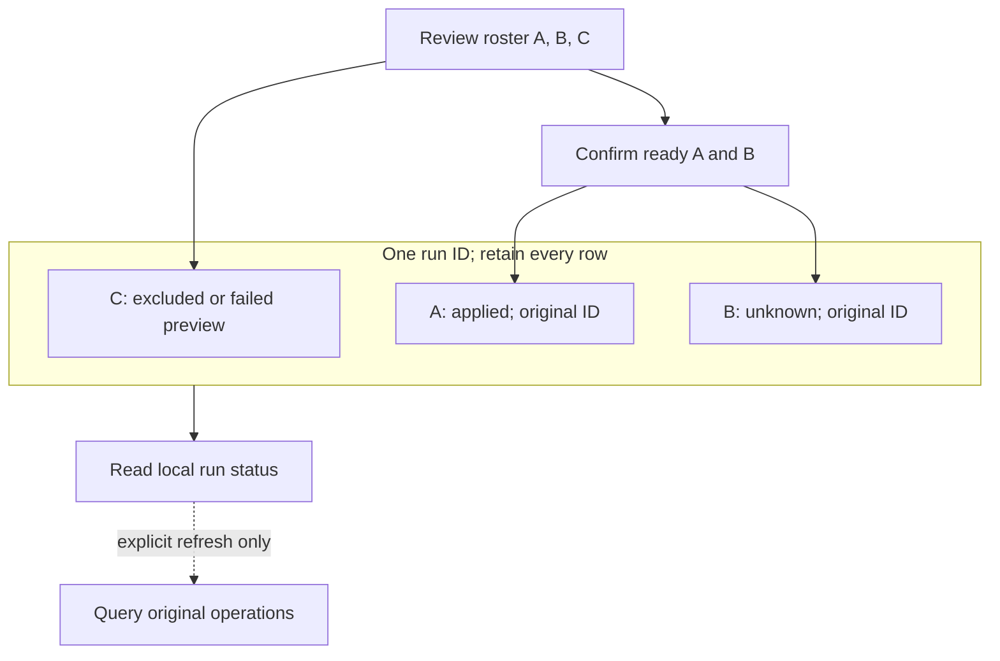

# Fixed resource groups

[日本語](RESOURCE_GROUP.ja.md) · [Development principles](DEVELOPMENT_PRINCIPLES.en.md) · [v0.5.0-alpha.1](https://github.com/webkaz-labs/sobalink/releases/tag/v0.5.0-alpha.1)

This workflow reviews a fixed selection of at most 16 explicitly permitted peers. One local coordinator owns the prepared review, acceptance and independent results. It does not promise an atomic multi-peer transaction or exactly-once execution. Source implementation alone does not establish tested, installed-binary or real-device acceptance.

## Review every row, keep every result

This illustrative partial result shows independent records, not parallel or atomic execution. Each target needs its own management grant. Review all rows and the exact ready subset before confirming; C remains visible without submission. Keep the run ID and read local status first. Explicit refresh queries selected original operations without resending them. “All applied” can describe only the execution subset with durable matching evidence. Cancel stops further admission, not admitted work or already applied settings.

## Short normal path

Start the owning local agent. Each target must already have explicitly granted management permission to this device. Obtain exact peer, resource, grant and current grant-revision values through the existing pairing/grant workflow.

1. Run `soba resource group preview --member PEER_KEY,RESOURCE_ID,GRANT_ID,GRANT_REVISION --concurrent-files default --concurrent-per-peer 2`. Repeat `--member` for each exact peer. No labels, wildcard, saved dynamic group or discovery search determines membership.
2. Review every row, including failures, requested and effective settings, explicit overrides, and the proposed execution subset. Human output gives the exact subsequent apply command with the selected profile preserved.
3. If needed, use `soba resource group select --review-id REVIEW_ID --revision REVIEW_REVISION --execute-peer PEER_KEY`, repeating `--execute-peer` for every chosen ready peer. This replaces the execution subset, not the resource selection or settings. Failed rows remain visible. `--exclude-all` makes an explicit empty, non-executable review. A changed subset rotates the opaque review ID and content revision; an unchanged subset retains both after the owning coordinator checks its context.
4. Apply only the exact returned review and complete execution subset: `soba resource group apply --review-id REVIEW_ID --revision REVIEW_REVISION --execute-peer PEER_KEY --confirm`. Repeat every reviewed execution peer. Apply does not create a preview or silently drop another peer.
5. Use `soba resource group status --run-id RUN_ID` to read local historical evidence without contacting peers.

Pass global `--state-dir DIR` before `resource` to keep the entire workflow in one selected profile. `--locale auto|en|ja` selects human language; `--json` preserves the same machine schema in either language. Human examples use safe argument lists when shell quoting would be ambiguous. Never substitute display labels into executable commands.

## Review, consent and storage

A prepared review exists only in the current owning agent process. Its JSON representation, digest or opaque ID cannot restore it after restart or create execution permission. A previous review can be replaced only by explicit preview `--replace-review-id REVIEW_ID`. Changing members, grants, settings or overrides requires a fresh preview.

Flags-only `select` displays the full new review, which must be checked before later apply. The CLI does not independently claim that previously unseen rows were preserved. For additional comparison, save the exact `preview --json` response in a regular file and supply `select --review-file REVIEW.json` instead of both review identity flags. This also checks the preserved selection and preview rows against the saved response. The file itself supplies no authority.

`--confirm` covers the exact selected settings and peers, creation of private local group evidence when first needed, and a possible target operation-journal upgrade to v2. A preview cannot tell which targets need migration. Older v1-only agents cannot read an upgraded journal; do not delete state to downgrade. Group commands do not create management grants, listeners or trust.

## Historical results and uncertain outcomes

Run output keeps all selected rows, including excluded or failed-preview peers. It separates:

- Whether local dispatch was attempted, observed or remains unknown
- The target's matching historical outcome and its `evidenceDurable` value
- Local run-record durability
- The latest explicit status-query observation and local admission-stop reason

“All applied” refers only to the explicit execution subset with durable matching terminal evidence. It does not mean every originally selected peer was executed, current settings still match, or file transfers completed. Local and target durability are independent.

An unavailable query does not clear a possibly executed unknown operation. Do not create a replacement operation ID or blindly apply again. New work against the affected peer/resource remains blocked until the owning coordinator can reconcile the evidence. Retained runs are historical records, never runnable jobs; restarting does not dispatch unsent rows.

Use `soba resource group refresh --run-id RUN_ID --peer PEER_KEY` with every explicitly chosen peer to query a known run. Refresh retains the original selectors and operation IDs and does not start an operation. There is no automatic refresh, retry, protocol fallback or fan-out outside the reviewed selection.

Use `soba resource group cancel --review-id REVIEW_OR_RUN_ID` to clear a prepared review or stop further admission for a known active run. Already admitted work may finish. Cancellation does not roll back target settings or erase uncertain evidence.

## Advanced selection and dry run

`preview --selection-file FILE` replaces every `--member`, `--concurrent-files` and `--concurrent-per-peer` flag. The file is a strict, bounded `resourcegroup.Selection` object with a content-bound template and optional data-only per-peer overrides. It is capped at 32 KiB and 16 distinct peers. Symlinks, special files, oversized or changed files, unknown fields and arbitrary executable commands are rejected. Use ordinary flags for the normal workflow; no JSON editing is needed.

Global `--dry-run` validates and prints local input with zero agent calls and no profile/sidecar writes. Reading an explicitly supplied selection/review file is still required. Dry run cannot establish that a target, grant or current-process review is available and never produces an authoritative preview.

## Local Web workflow and recovery

Open **Group transfer settings** in the authenticated local Web UI. Choose a fixed list of saved managed DirectLAN devices, set the shared template and optional per-device overrides, and complete every device's exact v2 resource/grant selector. You can explicitly add the selector already chosen in single-device settings. A saved device name or catalog row does not provide permission; an incomplete selector remains visible and prevents preview.

Preview explicitly, inspect all rows, update the ready execution subset if needed, and keep the displayed run ID before confirming once. Opening a dialog, polling, navigation and reconnection do not dispatch group commands. Closing or stopping waiting does not undo a request that may already have been sent.

If a preview or changed-subset response is lost, use its explicit exact-input recovery control. This retrieves only the same still-unused current review; it cannot extend its lifetime or restore consumed admission. After a page reload, **Find current unused review**, or `soba resource group review current`, reads the agent's one unused review, including one created by another authenticated local client. The read can discard canceled or stale unused in-memory admission; returned data always requires the owning-state checks. It does not clear saved uncertain outcomes, list historical runs or apply anything. No unused review is not evidence that earlier work never ran. Check every row again before a fresh confirmation, or cancel the exact returned ID.

After apply, use the known run ID for explicit local status; query original target statuses only when selected. There is no automatic apply retry. Within the running Web app, single-device and group flows share a bounded uncertainty guard for each affected peer/resource. Changing dialogs, grants or authentication does not erase a possibly sent attempt. This browser guard is not persistent across a full reload or a global cross-client policy. Keep the run ID: current-review recovery does not discover accepted runs.

## Verified scope and remaining acceptance

Earlier focused Go recovery/CLI tests and mounted synthetic Web tests passed on their reviewed sources, with initial failures and their corrections retained. The original bounded Linux CGO-disabled native test passed using three owned Cores, real pairing, two target providers, durable controller evidence and local catalog observations. Its controller Close/Open was a setup step before grants and group work; that result does not prove group restart recovery.

Later bounded results establish separate claims:

- **Core reopen (N4):** `TestResourceGroupNativePostGroupCoreReopenNoReplay` passed once on Linux amd64 with CGO disabled. After a completed group, joined controller Core.Close/Open preserved original history and grant expiry, rejected the unused review and did not replay operations. This stayed within one OS process.
- **Graceful process replacement (P1):** [run 38059289220](https://github.com/webkaz-labs/sobalink/actions/runs/38059289220) passed actual source-built controller-process replacement on Linux amd64 with CGO disabled, preserving original history/expiry without replay. It did not exercise abrupt process death.
- **Pre-acceptance refusal (F-S1):** [run 38064320241](https://github.com/webkaz-labs/sobalink/actions/runs/38064320241) passed refusal before the new group's acceptance/intents. The separate browser case failed in that run; this is not an all-pass receipt. The later local-browser B1 pass is described in the [catalog guide](RESOURCE_CATALOG.en.md#local-web-navigation).
- **Post-intent provider refusal (F-S2):** [run 38073401977](https://github.com/webkaz-labs/sobalink/actions/runs/38073401977) passed once after real controller/target durable intents: target A applied, target B's provider refused before configuration publication, B's settings stayed unchanged with a durable `failed`/`not_published` result, and history/repeated requests caused no replay.
- **Real-browser two-target apply (B2):** the same run passed once for authenticated retrieval of a Core-prepared review, explicit confirmation, two-provider apply and local status. It verified two applied targets, 17 native events and successful browser/Core/outer-process joins. The browser did not author the draft or preview.

F-S2/B2 ran at source `168a7fff4036f3aa89be7f118872ee15617dacd8`, tree `f03e0b427cb5a4c2ef990f9fc77810d357c9bc66`, using managed Chromium headless-shell revision 1243 with the CI SDK's default sandbox-disabled route. Earlier cases were not rerun in that invocation; their receipts remain historical evidence for their own sources.

Real-browser draft/preview authoring, changed subsets, partial/uncertain outcomes and resource-specific Japanese pixel/layout acceptance remain unproved by these results. So do abrupt crash/power loss, post-intent cancellation, lost replies, terminal-save failure and post-rename uncertainty. Final-candidate full/race/cross-platform checks, actual devices, installed binaries and signed distribution retain their own gates. Remote catalog viewing and retained advertised-service provenance are now described by the separate [view contract](CATALOG_VIEW_CONTRACT.en.md). These group results do not establish that capability, durable file-sharing semantics or a cross-backend authority policy. Current exact-source CI and signed distribution are recorded in [verification](VERIFICATION.en.md). These narrow passes do not establish full-candidate, merge, release or original-proposal completion.
