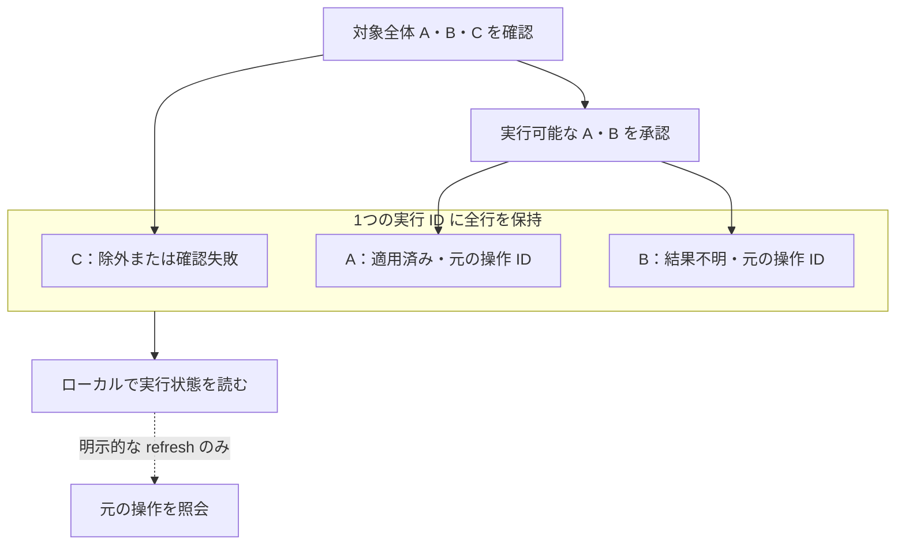

# 固定リソースグループ

[English](RESOURCE_GROUP.en.md) · [開発原則](DEVELOPMENT_PRINCIPLES.ja.md) · [v0.5.0-alpha.1](https://github.com/webkaz-labs/sobalink/releases/tag/v0.5.0-alpha.1)

この操作は、明示的な許可のある最大16台の固定選択を確認します。1つのローカル調整処理が確認内容・受付・相手ごとの結果を管理します。全相手の一括トランザクションや厳密に1回の実行を保証しません。ソース実装だけでは、テスト・インストール済みバイナリ・実機での受入完了にはなりません。

## 全行を確認し、各結果を残す

図は一部成功の例で、独立した記録を示します。同時実行や全相手の一括成功を表しません。各対象の管理許可を事前に取得し、全行と正確な実行可能対象を確認してから承認します。C は未送信のまま表示に残ります。実行 ID を保持し、まずローカル状態を読みます。明示的な refresh は選択した元の操作を照会するだけで再送しません。「すべて適用済み」は、一致する永続的な記録のある実行対象だけを指します。中止は新規受付を止めますが、受付済み処理や適用済み設定を取り消しません。

## 通常の短い手順

選択したローカル本体を起動します。各対象では、この端末に対する管理許可をあらかじめ明示的に確定してください。既存のペアリング・許可の手順で、正確な相手鍵・リソース ID・許可 ID・現在の許可変更番号を取得します。

1. `soba resource group preview --member PEER_KEY,RESOURCE_ID,GRANT_ID,GRANT_REVISION --concurrent-files default --concurrent-per-peer 2` を実行します。相手ごとに `--member` を繰り返します。表示名・ワイルドカード・保存済みの動的グループ・探索結果で対象を決めません。
2. 失敗した行も含め、指定値・実効値・明示的な上書き・実行対象の一覧を確認します。人向け表示は、選択したプロファイルを維持した正確な適用コマンドを案内します。
3. 必要なら `soba resource group select --review-id REVIEW_ID --revision REVIEW_REVISION --execute-peer PEER_KEY` で、実行可能な相手から選びます。選ぶ相手すべてに `--execute-peer` を繰り返します。変更するのは実行対象だけで、リソース選択や設定ではありません。確認失敗の行も残ります。`--exclude-all` は実行不能な空の確認を明示します。選択が変わると不透明な確認 ID と内容の変更番号が変わります。同じ選択では、所有する調整処理が環境を検査したうえで両方を維持します。
4. 返された確認と実行対象の全一覧をそのまま使い、`soba resource group apply --review-id REVIEW_ID --revision REVIEW_REVISION --execute-peer PEER_KEY --confirm` で適用します。確認した実行対象を省略せず繰り返します。apply は新しい確認を作ったり、別の相手を黙って除外したりしません。
5. `soba resource group status --run-id RUN_ID` で、相手に通信せずローカルの過去の記録を読みます。

共通オプション `--state-dir DIR` を `resource` より前に指定し、同じプロファイルで続けてください。`--locale auto|en|ja` は人向け表示の言語を選びます。`--json` の機械向け形式は言語によらず同じです。シェルでの引用が曖昧になる場合、案内は安全な引数一覧で表示します。表示名を実行コマンドに代入しないでください。

## 確認・承認・保存

確認内容は現在の本体プロセス内でのみ有効です。JSON・ダイジェスト・不透明な ID から、再起動後に復元したり実行許可を作ったりできません。既存の確認を置き換えるには preview の `--replace-review-id REVIEW_ID` を明示します。相手・許可・設定・上書きの変更には新しい preview が必要です。

フラグだけで行う `select` は、返された新しい確認の全体を表示します。その内容を後の適用前に確認してください。CLI は、以前の応答を保持していない場合に行の不変性を独自に証明したとは主張しません。追加比較が必要なら、正確な `preview --json` 応答を通常ファイルに保存し、両確認識別フラグの代わりに `select --review-file REVIEW.json` を使います。保持された選択と確認行が保存応答と一致することも検査します。ファイル自体は許可になりません。

`--confirm` は正確な設定と相手、初回に必要となるローカルの非公開グループ記録の作成、および対象の操作記録が v2 に更新される可能性を承認します。preview では、どの対象が形式更新を必要とするかを判定できません。v1 専用の旧版は更新後の操作記録を読めません。旧版へ戻すために記録を削除しないでください。グループ操作は管理許可・接続口・信頼関係を作りません。

## 過去の結果と結果不明

実行結果には、除外した相手や確認に失敗した相手も残ります。以下を分けて表示します。

- ローカルで送信を試みたか、観測できたか、結果不明か
- 相手の一致する過去の結果と `evidenceDurable`
- ローカルの実行記録の永続性
- 最後の明示的な状態照会と、ローカルで受付を停止した理由

「すべて適用済み」は、明示した実行対象に一致する永続的な終端記録があることだけを意味します。元の選択全台を実行したこと、現在も同じ設定であること、ファイル転送の完了を意味しません。ローカルと相手側の永続性は独立しています。

取得不能な照会で、実行された可能性のある結果不明の操作は解消しません。代わりの操作 ID を作ったり、確認せず適用し直したりしないでください。所有する調整処理が記録を照合できるまで、該当する相手とリソースへの新規操作を遮断します。保存済みの実行は過去の記録であり、再実行可能なジョブではありません。再起動で未送信の行を実行しません。

既知の実行を照会するには `soba resource group refresh --run-id RUN_ID --peer PEER_KEY` を使い、選ぶ相手ごとに明示します。元の対象と操作 ID を維持し、操作を開始しません。自動更新・再試行・通信方式の自動切替・確認範囲外への展開はありません。

確認や実行の取り消しには `soba resource group cancel --review-id REVIEW_OR_RUN_ID` を使います。確認内容を消すか、既知の実行の新たな受付を止めます。受理済みの処理は完了する場合があります。対象の設定を元に戻したり、結果不明の記録を消したりしません。

## 高度な選択と dry run

`preview --selection-file FILE` は、すべての `--member`・`--concurrent-files`・`--concurrent-per-peer` を置き換えます。ファイルは内容に結び付いた共通設定と、必要なら相手ごとのデータのみの上書きを含む厳密な `resourcegroup.Selection` です。上限は32 KiB・異なる相手16台です。シンボリックリンク・特殊ファイル・上限超過や変更されたファイル・未知の項目・任意の実行コマンドは拒否します。通常の操作にはフラグを使い、JSON 編集は不要です。

共通の `--dry-run` は、本体への接続を一度も行わず、プロファイルや補助記録を書かずにローカル入力を検査・表示します。明示した選択・確認ファイルは読みます。対象・許可・現在のプロセスの確認が利用可能かは確認できず、正式な preview を作りません。

## ローカル Web の操作と確認結果の復元

認証済みのローカル Web UI で **グループの転送設定** を開きます。保存済みの管理対象 DirectLAN デバイスを固定の一覧として選び、共通設定と必要な相手ごとの上書きを指定し、全デバイスの正確な v2 リソース・許可の識別情報を入力します。単一デバイスの設定で選択済みの対象を明示的に追加することもできます。保存名やカタログの行は許可になりません。識別情報が不足した相手は省略せず表示し、事前確認を止めます。

事前確認を明示的に実行し、全行を確認して、必要なら実行可能な相手の一覧を変更します。表示された実行 ID を控えてから、一度だけ承認してください。画面を開く操作・定期表示更新・画面移動・再接続ではグループコマンドを送りません。画面を閉じたり待機を止めたりしても、送信済みの可能性がある要求は取り消せません。

事前確認や実行対象変更の応答を失った場合は、同一入力の確認結果を復元する操作を明示的に選びます。現在も未使用の同じ確認だけを取得し、有効期間を延長したり消費済みの受付を復活させたりしません。ページ再読み込み後は **現在の未使用の確認結果を探す**、または `soba resource group review current` で本体内の未使用の確認1件を取得できます。別の認証済みローカルクライアントの確認も対象です。取消済み・古い未使用のメモリ内受付を破棄する場合があります。データを返すには、常に所有状態の確認が必要です。保存された結果不明の状態は解消せず、過去の実行一覧も取得せず、適用もしません。未使用の確認がないことは、過去に何も実行されなかった証拠ではありません。全行を再確認して改めて承認するか、返された正確な ID を取り消してください。

適用後は控えた実行 ID でローカル状態を明示的に読み、選択した元の操作だけを対象側へ照会します。適用は自動再試行しません。動作中の Web アプリ内では、単一デバイスとグループが相手・リソースごとの結果不明状態を共有します。画面・許可・認証が変わっても、送信された可能性のある操作は消しません。このブラウザー内の遮断はページ全体の再読み込みを越えて永続化されず、全クライアント共通の方針でもありません。実行 ID を保管してください。未使用の確認の復元では受理済みの実行を探せません。

## 確認済みの範囲と残る受入確認

以前の Go の復元・CLI の限定テストと、画面を組み立てた模擬 Web テストは、それぞれのレビュー済みソースで通っています。最初の失敗と修正の記録も保持しています。最初の Linux・CGO 無効の限定ネイティブ試験1件では、所有する3つの Core、実際のペア確立、2つの対象プロバイダー、永続化した調整側記録、ローカルカタログ観測を確認しました。調整側の Close/Open は許可・グループ操作より前の準備であり、その結果はグループの再起動復旧を実証するものではありません。

その後の限定試験では、次の異なる範囲を確認しました。

- **Core の再オープン（N4）:** `TestResourceGroupNativePostGroupCoreReopenNoReplay` が Linux amd64・CGO 無効で1回成功しました。グループ完了後に調整側 Core を閉じ、終了処理の完了を待って再オープンし、元の履歴・許可期限の保持、未使用の確認の拒否、操作の再実行がないことを確認しました。同じ OS プロセス内の試験です。
- **正常終了後のプロセス置換（P1）:** [実行 38059289220](https://github.com/webkaz-labs/sobalink/actions/runs/38059289220) は Linux amd64・CGO 無効のソースビルドで調整側の実プロセスを置き換え、元の履歴・期限を保持し再実行しないことを確認しました。プロセスの異常終了は対象外です。
- **受付前の拒否（F-S1）:** [実行 38064320241](https://github.com/webkaz-labs/sobalink/actions/runs/38064320241) は新しいグループの受付・操作予定より前の拒否を確認しました。同じ実行の別のブラウザー試験は失敗しており、全件成功の記録ではありません。その後のローカルブラウザー B1 の成功は[カタログガイド](RESOURCE_CATALOG.ja.md#ローカル-web-からの画面移動)に記載しています。
- **操作予定保存後のプロバイダー拒否（F-S2）:** [実行 38073401977](https://github.com/webkaz-labs/sobalink/actions/runs/38073401977) が1回成功しました。調整側・対象側の実際の操作予定を永続化した後、対象 A は適用し、対象 B のプロバイダーは設定ファイルの公開前に拒否しました。B の設定は変わらず、`failed`/`not_published` の結果を永続化し、履歴の参照・同一要求の繰り返しでも再実行しませんでした。
- **実ブラウザーでの2対象適用（B2）:** 同じ実行で、認証後に Core で準備済みの確認を取得し、明示的な承認、2つのプロバイダーへの適用、ローカル状態の参照が1回成功しました。2対象の適用、17件のネイティブイベント、ブラウザー・Core・外側プロセスの終了待機成功を確認しました。ブラウザーでの入力作成・事前確認は行っていません。

F-S2/B2 の実行ソースは `168a7fff4036f3aa89be7f118872ee15617dacd8`、tree は `f03e0b427cb5a4c2ef990f9fc77810d357c9bc66` です。管理済み Chromium headless-shell revision 1243 と、CI SDK 既定の sandbox 無効の経路を使いました。その実行で以前のケースは再実行しておらず、各記録はそれぞれのソースでの過去の証拠として保持します。

これらの結果は、実ブラウザーでの入力作成・事前確認・実行対象変更・一部成功や結果不明、日本語リソース画面の画像・配置の受入を実証しません。異常終了・電源断、操作予定保存後の取消、応答喪失、完了記録の保存失敗、rename 後の不確実性も未確認です。最終候補の全体・競合検出・各 OS の検査、実機、インストール済みバイナリ、署名付き配布には、それぞれ受入確認が必要です。遠隔カタログ閲覧と保持したサービス広告の出所は、現在は別の[閲覧契約](CATALOG_VIEW_CONTRACT.ja.md)に記載しています。これらのグループ試験は、その機能、永続的なファイル共有、異なるバックエンド間の権限主体の方針を実証しません。現在の正確なソースの CI・署名付き配布は[検証記録](VERIFICATION.md)に示します。限定試験の成功は、最終候補全体・マージ・リリース・元の提案全体の完了を意味しません。
