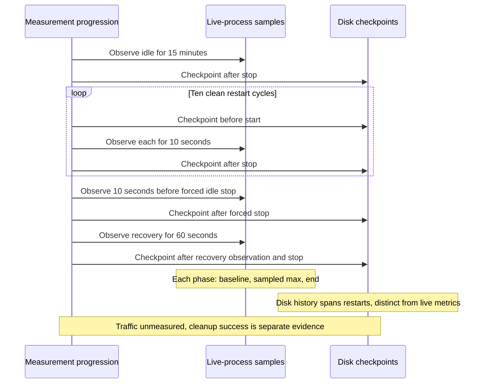

# Published-binary resource observation

[日本語](RESOURCE_MEASUREMENT.ja.md) · [Verification](VERIFICATION.en.md)

The dedicated `Published binary resource observation` workflow measures the
published `0.3.0-alpha.2` Linux amd64 executable from source
`00cc6a99809df77bf1754936ea7bf5ca4c5d0741`. Adding the workflow is not a measurement
result: inspect its completed run and aggregate artifact before making a claim.
The existing cross-platform CI and release gates are unchanged.

## Read a measurement in three steps

1. Match the release, source and installed-binary digest to the historical baseline above.
2. Compare baseline, maximum and end values within the same phase. Keep idle, normal restart and forced idle recovery separate.
3. Check completion and cleanup before quoting results. Keep network traffic as `not_measured`; do not translate offline status into zero bytes.

For [relay traffic](RELAY_TRAFFIC_MEASUREMENT.en.md), use the separate source-built fixture. Its byte counters cannot be combined with these installed-binary resource observations.

## Procedure and identity

A same-repository pull request changing the measurement files starts the isolated
GitHub-hosted job. It checks public release ID `402850401`, the tag/source,
checksums, Packslip signature, and GitHub provenance. It installs the exact
published package with mise `2026.9.18`, keeping normal signature verification,
then matches installed metadata byte-for-byte against the independently verified
public metadata and checks the executable SHA-256 and native version.

The application creates a fresh temporary state directory and runs in background
offline mode. The job observes 15 minutes of idle operation, ten clean restarts
with ten seconds of observation each, and one forced idle stop followed by a
restart and 60 seconds of recovery observation. Startup and stop deadlines are
bounded. Cancellation attempts ordinary stop and then, if necessary, signals
only the verified owned process through a Linux pidfd. A separate always-run step
retries fixture cleanup; runner teardown is the final containment if the job is
forcibly terminated before cleanup can finish.

The job has read-only repository permissions. It does not change main, tags,
releases, assets, OS startup settings, network settings, or an existing profile.
It does not enroll a node or select an external relay.

### Read values within their measurement window

This is the historical measurement procedure, not new performance evidence.

Read baseline, sampled maximum and end inside each live phase. The source also observes ten seconds immediately before the forced idle stop. Disk checkpoints span process restarts; network traffic remains unmeasured and cleanup has a separate result. These are historical fixture windows, not new benchmark results.

## Report and limits

The uploaded JSON includes release/source/binary identity and aggregate counters:
RSS, kernel RSS high-water mark, descriptor/thread count, liveness, regular-file
count, logical bytes, allocated file blocks, and background log size. Each live
phase records baseline, sampled maximum, end, and elapsed time. Disk checkpoints
remain available across restarts until the fixture ends. The `outgoing` counters
are a subset of `state`; do not add them together.

Only the selected aggregate JSON is uploaded. Private state, command output,
filenames, fixture paths, logs, access codes, keys, and environment variables are
not included. Incomplete measurements fail and retain their available aggregate
evidence. Cleanup success is recorded separately.

- RSS measures one application process, not Go live heap. One-second samples may
  miss brief peaks; 15 minutes cannot establish the absence of a long-term leak
- Allocated regular-file bytes exclude filesystem journals, directory metadata,
  and unlinked files still held open by a process
- Background `startup.log` has a source-defined 1 MiB cap and no backup log files.
  Quiet observation does not exercise rollover; foreground and OS-managed logs
  are outside this scenario
- Outgoing payloads left after a crash are intentionally retained and inventoried
  against staging capacity. An idle crash does not test active transfer cleanup
- Network bytes are explicitly `null`/`not_measured`. Offline mode is checked
  through application status; this is not packet capture or proof of zero traffic
- Results apply to the published Linux amd64 executable and this bounded fixture.
  Other native targets retain their separate installed-binary acceptance results

Any later relay traffic measurement must identify itself as source-built
relay-only testing. The isolated integration build omits OS UDP transport and
hosts synthetic peers and a pinned loopback relay; it is not the released
production executable or a real-device/WAN test.
