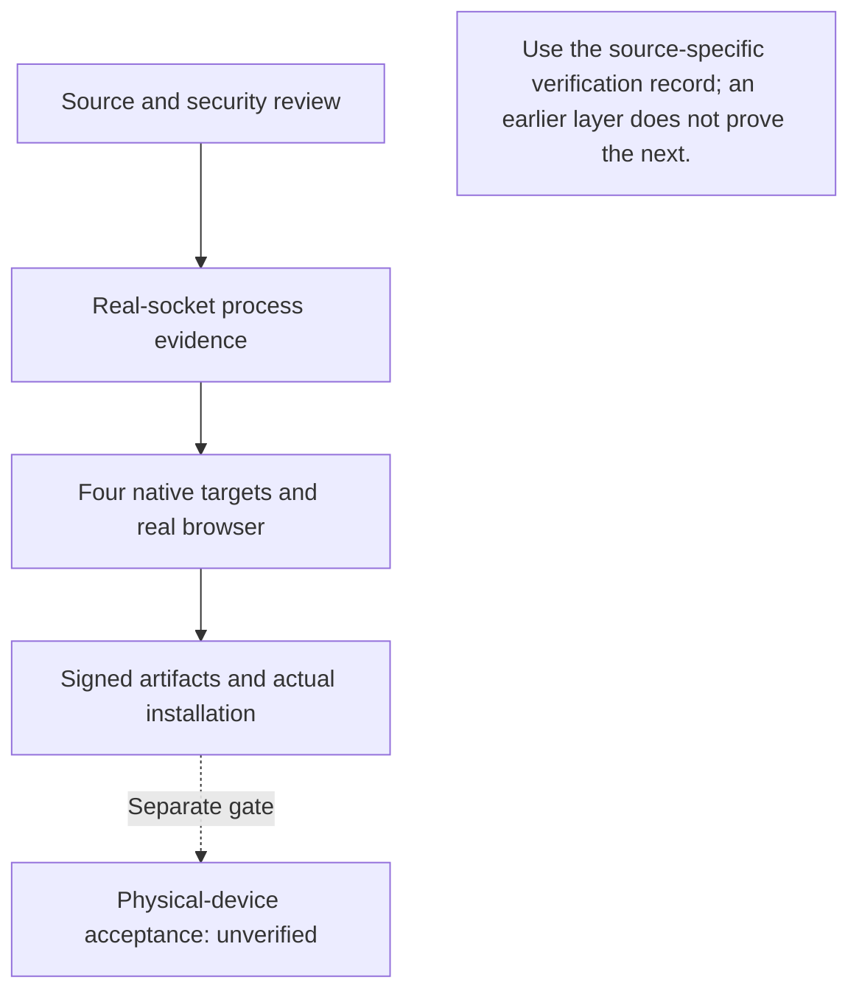

# Implementation and remaining acceptance

[日本語](ROADMAP.ja.md) · [Overview](../README.en.md) · [Verification](VERIFICATION.en.md) · [Development principles](DEVELOPMENT_PRINCIPLES.en.md)

The published baseline is [0.5.0-alpha.1](https://github.com/webkaz-labs/sobalink/releases/tag/v0.5.0-alpha.1), exact source `46dcd363b3eafc8ed9b92c7403937cf4d11d65af`. It includes [durable file queueing](DURABLE_OUTBOX.en.md), [durable text queueing](DURABLE_TEXT.en.md) and [request-and-accept connection setup](CONNECTION_SETUP.en.md). Profile format 3 is incompatible with 0.4.0-alpha.4 and older profiles: preserve existing state and use a separate empty `--state-dir`. There is no automatic migration or deletion, and the same state directory cannot be rolled back to an older binary.

[Exact-source full CI 38666924688](https://github.com/webkaz-labs/sobalink/actions/runs/38666924688) and [release verification 38671902508](https://github.com/webkaz-labs/sobalink/actions/runs/38671902508) passed. The release was published on 2026-10-15 at 03:19 UTC with 19 public assets; all 15 release gates passed, including public signature/provenance verification and actual mise-installed product starts on all four native targets. Full CI's repeated-build check covers macOS; the separate release run repeats identical-input builds and bilingual archive smoke tests on all four targets. Physical two-device discovery, actual networks, OS login/suspend and power-loss acceptance remain separate and unverified. These results apply to this exact source, not later edits.

## Find the next acceptance step

1. Pick the implemented area in the table below and identify its remaining evidence.
2. Match any automated result to its exact source; follow [verification](VERIFICATION.en.md) for published proof.
3. Record a physical scenario separately, including the target systems and observed result. Mark unperformed checks as unperformed.

Feature work outside the current scope is listed later. A missing physical test does not mean an implemented feature is absent.

## Current work

| Area | Implemented scope | Remaining evidence |
| --- | --- | --- |
| Devices and services | Tailnet, explicitly paired Tailcat, scoped TCP/UDP, stable local service listeners, presets | Physical enrollment, app authentication/TLS/host keys and actual LAN/WAN/NAT behavior |
| Prepared routes and relay operations | Alpha.4 recovery, encrypted pair-bound offers, explicit lifetimes, chosen-host setup and certificate operations | Physical network movement, sleep/wake and operator recovery remain unverified; candidate metadata has no fixed four-item permission ceiling |
| LAN destination admission | Explicit private prefixes, exact pinned relay TCP, UDP guard and auxiliary-diagnostic restrictions | Physical multi-NIC/VPN behavior remains unverified; destination admission is not physical-interface or host-wide isolation |
| Relayless LAN | Mutually authenticated pairing/control plus userspace WireGuard TCP/UDP | Same-family numeric endpoints need TCP and UDP reachability. Authenticated endpoint updates use the [explicit endpoint controls](GENERIC.en.md); nearby discovery belongs to a separate LAN-backend setup flow. Physical networks remain unverified |
| WAN candidates | Explicit numeric STUN and/or IPv6 discovery through the trusted-relay backend | Pinned relay still required for bootstrap; physical NAT/IPv6 reachability remains unverified; no universal NAT or relayless WAN promise |
| Mixed connections | Separate selected engines, signed same-peer binding and separately approved application access | Physical network transitions and application reconnect remain unverified; no byte replay or existing-stream migration |
| Files and stored state | Explicit send, batch consent, optional exact-peer autosave, no overwrite, bounded staging/accounting, uncertain-save recovery | Active-transfer interruption, real filesystems, ordinary-user Windows process behavior and physical power-loss durability |
| Durable queues | Released explicit file queue and single-recipient text prepare/review/commit, original IDs/deadlines and exact save evidence | Final-source results for ACK loss, restart, history cleanup and cancellation are recorded separately from physical power-loss/OS-lifecycle acceptance |
| Nearby connection setup | [Scoped request-and-accept pairing](CONNECTION_SETUP.en.md), receiving and outbound-only modes, explicit first-use key acceptance (TOFU) or independent full-fingerprint verification, and exact-key re-enrollment | TOFU does not independently verify first-use identity. Exact-source native/browser results remain separate from physical two-device/two-OS discovery and discovery-to-browser acceptance |
| Shared-service access | [Separate catalog-view consent, peer list exchange and fresh connection review](CATALOG_VIEW_CONTRACT.en.md), alongside local catalog observations | Exact-source process/browser results and physical-device acceptance are distinct; historical cached observations remain stale |
| Human interfaces | Japanese/English guided CLI, local UI, services, graph, route review, private sign-in | Physical phone QR, actual native IME/fonts and terminal input remain unverified |
| Lifecycle | Explicit startup approvals, offline suppression, saved settings and per-user OS startup | Actual OS sign-in and suspend/wake, real proxy/application reconnect |
| Distribution | Existing reproducible packages, signing/provenance, public retrieval and four-target mise checks | Published results are source-specific; later source changes need their own final native/browser/distribution gates |

[PR #8](https://github.com/webkaz-labs/sobalink/pull/8) was integrated before alpha.4, including independent Core-process restart/recovery evidence. That evidence does not automatically cover new connection modes. The [verification record](VERIFICATION.en.md#route-recovery-gate) preserves historical failures and exact-source outcomes.

## Acceptance order

Text equivalent: review the final source, exercise real sockets in separate processes, run all four native targets and the real browser, verify signed installation, then record physical-device acceptance separately.

A clearly labeled prerelease can be published for physical-device testing after its automated hard gates pass. Prepared-LAN cold start with the external relay unavailable, authentication/permission/privacy and stable entrance proof are required before that publication. An unperformed physical test stays unperformed; simulated or loopback success never turns it into a pass.

## Fixed boundaries and later work

Initial backend selection and cross-transport peer binding stay explicit. Automatic choice is limited to already configured, authenticated and approved routes for new flows, with positively classified unavailability; authorization, pin, unknown-state and unclassified failures stay terminal. Outward application traffic remains in the selected userspace stack. Route recovery cannot renew service lifetimes, widen peers/ports, restore revoked trust or restart canceled files. Immediate files retain in-process whole-item retry. Explicit durable file requests recover after restart with original IDs and deadlines; explicit durable text has its own save/deduplication contract. None adds byte-offset resume. Existing TCP preservation, arbitrary transaction replay and remote-job completion are not promised.

The normal direct-enabled single executable remains. `local` classifies a relay, and direct peer paths may be public. The implemented optional LAN policy admits specified destinations; it does not promise physical-NIC/VPN binding or whole-process/host zero egress. Administrator privileges, OS route/firewall or LAN-router changes are not prerequisites. Scoped [remote settings management](RESOURCE_MANAGEMENT.en.md), [shared-service listing and connection review](CATALOG_VIEW_CONTRACT.en.md), and selected-recipient [file delivery](GENERIC.en.md) already exist. Broader administration and synchronization remain separate work. Explicit durable file queueing already exists; durable text queueing is included in the published baseline.

The earlier 0.3-series CI optimization plan is historical. Any further CI changes need their own review and checks; queue implementation does not waive the existing native/browser/distribution gates.

### Remaining feature scope and historical plans

The [0.3-series convenience plan](CONVENIENCE_PLAN.en.md) is historical; its then-unimplemented items are not a current backlog. In particular, [nearby setup](CONNECTION_SETUP.en.md) provides request, receive and outbound-only roles, with explicit permission for the receiver to relay. Legacy full-fingerprint setup retains QR/text exchange and selection of a permitted reachable relay role. Neither workflow deploys software to another host or provides general unattended relay election/operation.

The following remain outside the current implementation scope, without a promised release date:

- Persistent shared folders and synchronization, automatic clipboard synchronization, and remote filesystem browsing. Explicit file/text delivery is separate from continuous access or synchronization.
- Remote management across connection backends. The implemented [management contract](RESOURCE_MANAGEMENT.en.md) is limited to a managed DirectLAN peer and exact settings; it is not general remote execution.
- Byte-offset transfer resume and additional TUI/native interfaces. Durable queue restart recovery already exists and must not be listed as an entirely deferred feature.
- Public-relay deployment and a dedicated public-relay daemon. Tailscale remains the normal outside-LAN recommendation; optional WAN controls require an already reachable compatible pinned relay.
- MCP and agent-tool execution, discussed below. Their architecture and acceptance are separate from this release's connection and queue work.

Physical-device discovery, network transitions, suspend/wake and power-loss acceptance remain verification work for implemented behavior, not evidence that the corresponding features were removed. Profile-format incompatibility and the absence of migration are explicit current boundaries, not a promise to add migration later.

Keep examples and published evidence generic. See [capacity](CAPACITY.en.md), [security](../SECURITY.md) and the [route contract](ROUTE_RECOVERY_DESIGN.en.md) for authoritative boundaries.

## CI latency and conditional real-time tests

Classify the complete change using the [current CI scope and evidence contract](CI_EFFICIENCY.en.md). Ordinary prose, frontend and reviewed scoped-Go changes have distinct limited checks; reviewed CLI presentation and supported combinations use native-short. Unknown, security-sensitive, shared, policy or provenance changes retain full validation. Native-short omits the named real-time and native resource gates and cannot qualify a release. Every prerelease requires independent exact-source full validation and all distribution gates. A documentation-only result must say that application tests, builds and packages were not run.

## Later direction: selected tools for approved agents

The current product supplies scoped TCP/UDP connections, explicit sharing permissions, and a local CLI/API. It does not yet provide an MCP server or an end-to-end agent-tool execution layer. A later direction is to let an approved peer’s AI use selected remote tools through a simple sharing/review flow, while keeping connection identity, transport permission and application execution authorization distinct.

Tailscale can already provide device connectivity and remains the normal outside-LAN path. If ordinary Tailscale and an existing application already meet the need, using them alone can be simpler; sobalink is optional. The proposed value is the combination of ordinary-user operation without router port-forwarding setup, easy service sharing, and exact peer/scope/lifetime review, rather than connectivity alone. Network reachability and each tool’s own authentication still apply. A small working tool-sharing demonstration and its security review must precede implementation claims; this direction does not add requirements to the current connection-setup and durable-queue scope.
