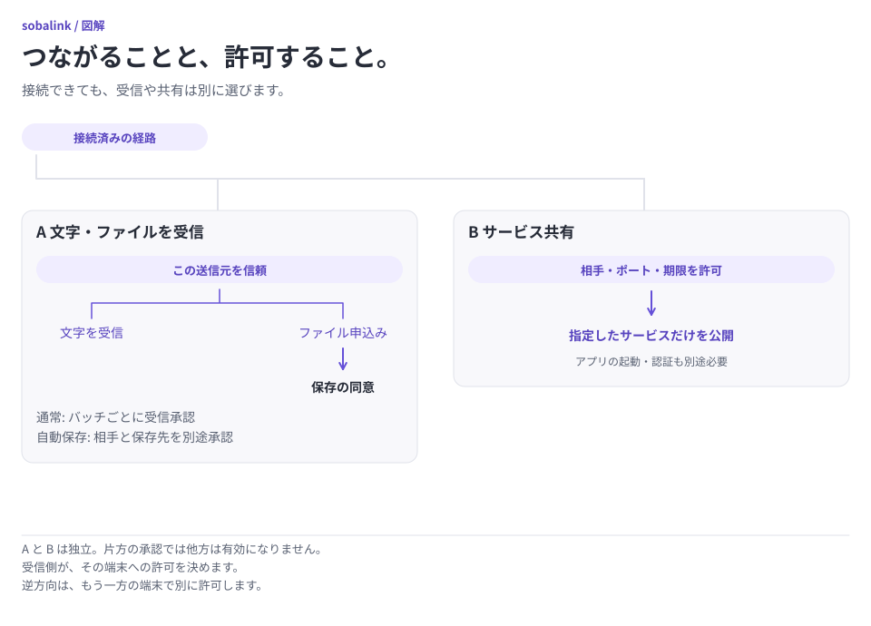

# セキュリティ上の境界

[English](../SECURITY.md) · [設計](ARCHITECTURE.md) · [確認範囲](VERIFICATION.md)

sobalink は実験的なソフトウェアです。この端末の管理、端末間の転送、共有サービスへのアクセスを制限します。OS のサンドボックス（アプリの隔離環境）、汎用 VPN、遠隔管理サービスではなく、相手アプリの安全性も保証しません。

現在のプレリリースは [v0.5.4-alpha.1](https://github.com/webkaz-labs/sobalink/releases/tag/v0.5.4-alpha.1)、ソースは `b35463ce` です。配布物の署名やインストールの確認だけでは、実端末間の動作を保証できません。アプリとの互換性、OS ログイン、スリープ、電源断からの復旧は別の検証が必要です。確認済みの範囲と残る課題は[ソースごとの検証記録](VERIFICATION.md)を参照してください。

管理者権限や LAN ルーターの設定変更は不要です。LAN の設定で仮想ネットワーク用の TUN ドライバーを入れたり、OS の経路・ファイアウォールやルーターの UPnP・NAT を変更したりしません。ネットワークの規則で通信が拒否された場合は、その結果を表示し、制限を回避しません。

<picture>
  <source media="(prefers-color-scheme: dark) and (max-width: 839px)" srcset="assets/visuals/permissions-ja-dark-narrow.svg">
  <source media="(max-width: 839px)" srcset="assets/visuals/permissions-ja-light-narrow.svg">
  <source media="(prefers-color-scheme: dark)" srcset="assets/visuals/permissions-ja-dark-wide.svg">
  
</picture>

[図を元の大きさで開く（横長）](assets/visuals/permissions-ja-light-wide.svg) · [縦長版](assets/visuals/permissions-ja-light-narrow.svg)

相手の端末（ピア）と接続しても、メッセージ・ファイルの受信やサービスの利用を自動で許可しません。ファイル受信は通常、まとめて送るファイルの組（バッチ）ごとに承認が必要です。自動保存は別に有効にします。相手の識別情報と各許可を個別に確認してください。

## 明示的な接続設定と永続キュー

[近くの端末との接続設定](CONNECTION_SETUP.ja.md)は、明示して選んだ短時間のネットワーク範囲を使います。探索の名前や接続先は未検証の手掛かりです。依頼して承認する方式は、明示的に初回の鍵を受け入れて記憶します（TOFU）。最初の交換で能動的な攻撃者が介入した場合、意図した実物の端末を認証できません。任意のSHA-256全文照合方式では、識別情報と計画の指紋全体を独立した方法で照合し、両端末で承認します。全文照合からTOFUへ自動で切り替えません。正確な役割・範囲・中継先と証明書・期限を依頼に結び付け、解除済みの鍵を遅延した処理で復元しません。接続だけで文字・ファイルの信頼やサービス利用を許可しません。実際の探索、ブラウザーの確認操作、署名付き配布、物理 LAN の受入は別の検証です。

明示的に選ぶ[ファイルの送信待ち](DURABLE_OUTBOX.ja.md)と[テキストの送信待ち](DURABLE_TEXT.ja.md)は、再起動後も未完了の処理を保持します。内容、相手の識別情報、元の期限、受信側の重複確認記録を保存し、即時送信の方式へは切り替えません。再起動後の再開には、有効な権限と確認済みの保存状態が必要です。不確かな場合は、危険な送信や削除を止めます。

取り消しや期限切れでも、相手が保存した内容は回収しません。表示履歴を削除しても、重複確認に必要な記録は残します。実行中の処理、保持する記録、内容の容量には、それぞれ上限があります。この版はプロフィール形式 3 が必要です。旧形式を自動で移行・削除せず、読み込みを拒否します。旧プロフィールを保全し、別の空の保存先を使ってください。

## 管理はローカルに限定する

- React の画面と管理 API は **正確な `127.0.0.1`** の OS が選ぶ一時 TCP ポートだけで待ち受けます。ワイルドカード、LAN、Tailnet、ホスト名への変更は用意しません
- Host ヘッダーの接続先と、ループバック（同じ端末内の通信）からの要求であることを確認します。Origin・Fetch Metadata ヘッダーを検査し、別サイトからの管理要求を拒否します。変更操作には一致する Origin が必要です
- ローカル IPC（同じ端末内のプロセス間通信）で推測しにくい乱数の一回用コードを発行し、有効期間は5分です。`soba ui` は一時的な URL フラグメント（`#` 以降の部分）で同じ端末のブラウザーへ渡し、画面が同一 Origin の POST で交換する前に除去します。HTTP リクエスト URL、通常の CLI 出力、Web ストレージには含めません。明示的な `ui --no-browser` / `ui --json` の出力は非公開のログイン情報です。ブラウザー拡張、OS の起動引数、ブラウザーの履歴機構には見える可能性があり、侵害されたローカルアカウントに対する保護ではありません。成功時にコードを消費し、再発行で前の未使用コードを無効にします。有効な既存セッションは期限を延ばさず再利用し、セッションを増やしません
- ブラウザーは HttpOnly・SameSite=Strict の Cookie を受け取り、変更にセッション固有の CSRF トークンを使います。画面は同じ Origin（接続方式・ホスト・ポート）の API だけを使います
- ローカル待受ポートごとに Cookie 名を分け、同時に開いたプロフィール同士の上書きやログアウトの競合を防ぎます。Cookie 自体はポートごとに隔離されません。Host・Origin・CSRF と各所有プロセス内のセッションを厳密に検査してアクセスを制限します。旧共有 Cookie は引き継がず、更新・再起動後は対象プロフィールの `soba ui` で開き直します
- ループバックの URL は HTTP です。他端末向けの HTTPS ではなく、プロキシやサービス共有で公開してはいけません
- 応答のキャッシュとフレーム埋込みを禁止し、コンテンツセキュリティポリシー（CSP）で読み込める内容を制限します。コード・スタイル・フォントは本体に含め、実行時に外部の配信サーバー（CDN）から取得しません
- 要求、ヘッダー、ストリーム、同時処理数に上限を設けます。ソケット作成に失敗しても待受範囲を広げません
- ローカルのセッション・コマンド JSON 要求本文には OS の通信機能による 5 秒の読み取り期限を設けます。ネイティブのブラウザーアップロード本文には最後の受信から 30 秒の読み取り期限を設け、実際にバイトを受信した場合だけ更新します。既存の一時保存全体の期限は予約後に開始し、進捗では延長しません。明示的な無制限は全体期限だけを外し、無進捗期限は残ります
- IPC は同じ OS ユーザーへ限定し、共通処理へ渡します。ただし、そのユーザー権限で動く別プロセスや侵害済みアカウントを隔離するものではありません

通常のピア API は別の処理です。相手からネットワーク・信頼・保存先・共有・セッション・設定・任意のローカルファイルを管理できません。

専用の[リソース管理](RESOURCE_MANAGEMENT.ja.md)は、転送設定2項目だけについて、有限の期限と相手1台のペア関係を明示的に確認した管理許可を必要とします。任意のローカルコマンドを転送せず、ローカル管理 API を公開しません。統合と受入の確認は別の検証項目です。

## 明示したネットワークと識別情報

新しいプロフィールはネットワーク未選択です。Tailnet では独立した tsnet ノードを公式の対話型認証で参加させます。OS の Tailscale 認証状態を流用せず、OS 経路・DNS の変更、カーネルトンネル、特権サービスの導入をしません。

外向きサービス接続は組込みのユーザー空間ネットワーク処理（OS の経路を変更せず、アプリ内で TCP／UDP を扱う処理） と現在の相手識別情報を使います。許可した相手へ到達できなくても、OS の通常接続や名前解決へ代替しません。Tailnet の grants/ACL とアプリの認証は別です。

Tailcat の設定は、初回接続に使う中継先の IP アドレス・ポートと、固定した TLS 証明書の SHA-256 値を使います。ペアリングでは別の初回中継先を指定する接続用の秘密情報（capability） を拒否します。準備済み経路の実装は、この元の中継とペアの識別情報・ロール鍵を保持し、保存状態と交換形式の容量内で、明示して準備した候補を追加します。候補の許可数を4件に固定する上限はなく、実行時の中継接続数・試行数には別の調整可能な上限があります。[中継の使用量・処理数の上限](RELAY_OPERATIONS.ja.md)を参照してください。経路情報は既存ペアの受信者向けに暗号化・認証し、方向別のロール鍵との対応、順序番号、有効期間・期限に結び付けます。受信した情報だけでは経路を許可しません。正確な候補のローカル許可は別に必要で、有限期間または `until-revoked`（取り消すまで）を明示して確認し、自動更新しません。version 2 は以前の30日という方針上の上限を外しますが、旧 version 1 の有限な情報は元の正確な期限と検証制限を保持します。[プロトコルと保存](ROUTE_RECOVERY_DESIGN.ja.md)

通常の Tailcat trusted-relay（指定した中継先を信頼する方式） は相手への直接通信、明示して設定・許可した中継候補への暗号化した通信内容、その正確な中継先への HTTPS/ICMP 診断を許します。通常の単一実行ファイルは直接 UDP 通信を維持し、相手への公開経路を使う場合もあります。`local` は中継アドレスの区分であり、**厳密な LAN 限定、外部通信ゼロ、完全な通信隔離ではありません**。任意の[LAN 送信先ポリシー](LAN_DESTINATIONS.ja.md)ではエンジン作成時に設定する UDP／TCP の送信先を制限し補助診断を停止します。物理ネットワーク機器（NIC）の隔離やホスト／プロセス全体の外部送信ゼロは保証しません。補助バイナリは追加しません。既定の公開中継一覧、DNS による初回接続先の解決、任意の代替先は許可しません。必須ビルドタグでポートマッピング、公衆 Wi-Fi などのログイン画面の検査、システムプロキシを除き、未対応の環境変数によるプロキシ・バックエンドの上書きを拒否します。[統合の受入条件](VERIFICATION.md#経路復旧の条件)

方式の選択は明示的かつプロセス単位です。障害時に別方式へ自動交換しません。直接・中継・再接続は別の観測であり、分からない経路は不明とします。経路変更やバックエンド再起動で、既存 TCP が保たれるとは限りません。

名前とアドレスは永続的な本人確認ではありません。受信元は認証済み通信から識別して現在の状態と照合します。相手の削除、アドレス変更、期限切れ、信頼解除で関連する許可を無効にします。Tailcat capability、共有鍵、招待トークン、非公開状態を、状態表示・ログ・探索・配布例へ含めません。

### LAN ペアリングと中継の許可

招待は一つの相手公開鍵に限定し、有効期間は1〜600秒です。組込み中継では受信者向けに暗号化した HTTPS の初回交換で招待先のサーバー識別情報と一回用トークンを確認してから、必要な通信ロールだけを一時許可します。不明な鍵を一律に受け入れる例外はありません。サーバー・クライアントの通信鍵を分け、ペアの識別情報へ結び付けます。秘密状態は、途中の状態を見せないファイル置換で保存します。保存後に成功を応答します。ペアリングだけではアプリの信頼・自動保存を許可しません。

アプリの解除は許可と追跡中の通信を直ちに閉じます。組込み中継は別に2分の接続リースで再確認するため、許可済み中継セッションが削除後最大2分、初回交換から一時ロール許可と接続リースが重なる場合は約4分まで残る可能性があります。残った中継セッションでもアプリ通信を再開する権限はありません。外部中継の入場制限はその運用者の責任です。

秘密情報を含むコマンド入力は、文字列引数ではなく容量を制限した `--json-file` または非端末の `--stdin` から渡します。入力ファイルと明示的な招待発行の応答を非公開にし、構文エラーに入力内容を出しません。

ペアリング応答が不確かなときは自動再試行しません。相手で保存済みの可能性があるため、確認して解除してから新しい招待を作ります。相手で成功しローカル保存に失敗した場合も先に相手側の許可を解除します。解除の永続化に失敗したら成功扱いにせず LAN を停止します。`soba start --offline` で保存済みバックエンドを開始せず修復用の管理を開けます。

### 準備した経路の状態

追加中継の設定はバックエンド停止中（`soba start --offline`）だけ編集し、再起動後に使います。ペアは解除せず、元の初回中継先も交換しません。準備した候補には LAN 非公開状態の version 2 以上が必要で、新しい明示期間の経路状態は version 3、送信先ポリシーは version 4 を使います。旧バイナリは未対応の状態版を拒否します。認証済み経路情報とその保存記録はプロトコルと経路記録の version 2 で、外側の LAN ファイルの版とは別です。経路情報を適用していない旧ペアは元の単一中継を維持します。情報の作成だけでは送信側の経路許可を移行しません。

ローカル確認は受信した正確な情報と選んだ候補 ID に結び付けます。大きい順序番号でも、許可の延長・アプリ権限変更・取消済み経路の再許可はできません。書出し・取込みはローカル管理 API と非公開ファイルまたはコピーした文字列を使い、外部メッセージ送信、コマンド実行、受信内容の実行を自動で行いません。この端末の候補削除は、相手がすでに受け取った情報を取り消しません。必要なら相手の経路許可も明示して取り消します。

永続化した順序番号と認証の証拠は、期限切れや取消後も保持します。保存の耐久性が不確かな場合は、元に戻った・成功したと扱わず、次の経路変更と外向き再接続を止めます。経路取消の保存に失敗した場合も、オフライン管理を含めて Core を復旧待ちに固定し、別のノードによる保存済み権限の復活を止めます。旧版へ戻すために古いプロフィールのバックアップを復元しないでください。ローカルのカウンターだけではプロフィール全体の巻戻しをすべて検知できません。期限・経路取消は対象の外向き接続の組を閉じ、関係全体を終了するときはペアを解除します。既存 TCP や任意のアプリのデータを自動再送しません。[復旧手順](LAN.ja.md#別の経路を準備する)

取り消すまでの経路権限は、永久の到達性を保証しません。生成するローカル中継証明書は現在365日で失効し、更新・ピン変更には明示的な確認が必要で、経路許可とは別です。発行・受信の版とカウンターは後戻りせず、旧有限期限は移行だけで無期限になりません。撤回情報の書出しは配送待ちであり、意図した受信者が検証して適用するまで相手の許可を変更しません。適用した撤回もローカル取消と同じく、永続的な削除に失敗したら対象通信を止めて復旧待ちにします。

## 信頼と受信

文字・ファイル申込みの信頼は選択したバックエンドの正確な相手に固定し、サービス共有は別に許可します。相手の受信許可を、自分の信頼操作で追加することはできません。

- 一括ごとの受信承認が既定です
- 明示的に有効にした自動保存は、バックエンド・信頼した正確な相手・信頼の世代・絶対パスの保存先に固定します。確認済みの受信設定は非公開プロフィールの置換後に反映し、置換後の耐久性が不確かな場合も設定と実行時状態へ反映して不確実性を報告します
- 有効な間は今後の一括を自動承認できます。無効にすると一括承認へ戻ります。相手の一時停止は文字・ファイルを遮断し、進行中の送信は取消して再開後の選び直しを必要とします。別のサービス許可は止めません。信頼し直しても古い世代の許可を復活させません
- 承認・自動保存とも、上書き、自動で開く・実行する操作、シェル評価、クリップボード同期は許可しません
- 保存先はローカルに残します。相手のパスは移植可能な相対パスとして検査し、絶対パスとして信用しません
- パストラバーサル、絶対・ドライブ・デバイスパス、曖昧な名前、リンク、reparse point、未対応の種類を拒否します。実行属性を保持しません
- サイズと SHA-256 が承認済みマニフェストに一致してから保存を確定します。排他的作成と一意な最終名で既存ファイルを置き換えません。一時ファイルや送信元パスをピア API で公開しません
- 論理制限の初期値は一括256項目、1ファイル・一括それぞれ1 GiBです。変更や明示的な無制限を選べますが、メタデータ、一時保存の調査、未処理の申込み、保存容量、同時処理の上限は残ります。一時保存の期限は既定600秒で、明示的な無制限にも対応します。[容量ポリシー](CAPACITY.ja.md)で変更可能な設定と安全性の条件を分けています
- ブラウザーのアップロードはローカルへの一時保存であり、相手の承認や保存完了とは別です

即時転送の再試行は、同じ起動中の未完了ファイルを先頭から送る操作です。同じ一括の保存確認は再要求しても同じ結果にします。即時転送には再起動後の進捗を保持する保存済みの進捗記録がなく、新しい申込みで別名コピーができる場合があるため、保存済みの結果を確認します。明示的な永続キューには、上記リンク先の識別情報・リース・受領証の規則を使います。どちらも途中バイトからの再開は行いません。

受信側は、自分が作成したと確認できる一時保存領域と、その準備記録を非公開の索引で管理します。索引は旧形式の version 1 を読み取れますが、書き込みには version 2 を使います。一時ファイルの安全な削除に必要な情報は、別の保護記録（ガード）で保持します。ガードは索引の変更前に保存し、変更後の識別確認が済むまで残します。ガードがないこと自体は正常です。既存プロフィールに索引がない場合は、次の手順で確認してください。

保存結果や記録とファイルの対応が不確かな場合は、再起動後も受信だけを停止します。ガードは所有権の証明や削除許可ではありません。不明な保存先の所有者を推測したり、無関係な保存先を走査したり、保存済みの受信ファイルを削除したりしません。内容が空の一時保存領域も、安全に削除するか、使用量に含めます。管理用の記録が転送のたびに増え続けることはありません。準備の記録と既存の 3 回の索引保存は互換性と処理順序を保ちますが、安全な削除は別のガードで保護します。

プロフィールと保存先が別のファイルシステムにある場合、同じアカウントの別プロセスによる変更を受けずに確認と削除を一体で実行することは保証できません。索引の破損、保存先の変更、危険な項目、確認不能なガード、調査の未完了や上限超過があると受信を停止します。索引とガードは内部用で、ピア API や書き出し形式には含みません。手動で編集しないでください。

旧版で作成したプロフィールなどに索引がない場合は、以前の既定・相手別・手動指定の保存先、未完了の一時ファイル、保存済みファイルを確認します。未追跡の一時ファイルが残らないように、未完了の受信を整理してください。保存済みファイルは残します。過去の保存先が不明、または確認できない間は受信を再開しません。

`soba receive recovery confirm` は確認内容のプレビューです。確認と整理を終えた後に `soba receive recovery confirm --reviewed` を実行すると、確認済みの記録と新しい索引を保存します。このコマンドはファイルを削除せず、記録のない古い一時ファイルも探索しません。手動で削除する場合も、未完了と確認できた一時ファイルだけを対象にしてください。[容量と復旧](CAPACITY.ja.md#受信容量の復元)

非公開状態の保存に使う所有権確認、復旧処理の上限、不明な旧一時ファイルの保全は[設計](ARCHITECTURE.md#bounded-private-state-persistence)を参照してください。非公開状態をファイルごと置き換えて保存する処理では、ファイルの置換後に耐久性を確認できないことがあります。保存状態の所有者は置換されたファイルにメモリーを合わせ、不確実性を報告します。エラーは元に戻ったことを意味しません。保存の耐久性が不確かな新しいサービス開始は、稼働前に停止します。保存済みの起動許可は現在の取消世代と一致する必要があり、取消後には明示的な再承認が必要です。受信メッセージは同じ ID で再試行し、不確かな履歴を照合してから保存完了の応答を返します。通常の重複では履歴を書き直しません。エラーは機械判定用の型を保ち、非公開パスを隠します。

取消・期限・信頼解除で追跡中の処理を閉じます。保存済みファイルの削除、送信済み内容の回収、遠隔アプリのジョブ取消はしません。履歴削除は受信ファイルを消しません。

## サービス共有と探索

共有には現在の組込みノードアドレス、IP アドレスで指定したループバック、通信方式、ポート範囲、明示した現在の相手 ID、確認した有効期間が必要です。既定は有限の1時間で、別の正の整数秒や明示的な `until-revoked` に対応します。共有相手の初期値32件は調整・無制限を選べますが、別の保存容量・資源使用量の上限は残ります。全員、サブネット、任意の LAN 中継、インターネット転送を暗黙に許可しません。

TCP は内部予約入口を除く1〜65535番をポートごとに待受を作らない共通処理で扱います。範囲共有はN番ポートを同じループバックのN番へ対応させ、1ポートの共有だけは別のアプリ側ポートも明示できます。範囲内の全ポートに OS 待受を作りません。UDP・ローカル接続・任意のプロキシ待受は個別資源を使い、既定64件の調整可能な使用量や処理数の上限を共有します。ローカル入口は1024〜65535番です。競合や容量不足で番号・範囲を無言で変えません。

**許可期間中に有効な範囲で新しく起動したアプリも共有対象になります。** 最小限の範囲と除外を選んでください。探索 `54543`、ピア API `54544`、ペアリング `54545`、現在のローカル管理・制御入口、バックエンド内部の入口は汎用共有の対象にしません。大きな範囲を選んでも予約入口を共有できません。

ストリームを受けるたびに、現在の識別情報、範囲、期限を検査してからループバックへ接続します。停止・期限・解除で追跡中の接続も無効にします。保存済み定義だけでは再起動を許可しません。別に確認した起動許可は、オンライン起動後に正確な外向き定義だけを開始し、受信共有は手動のままです。オフライン起動ではそのプロセスの起動許可を抑止します。範囲変更・相手の許可取消しには再確認が必要です。[明示的な起動時接続](STARTUP.ja.md)を参照してください。

探索は明示的に有効にします。公開するのは、許可済みで稼働中の共有についての最小限の情報だけです。期限なしを明示して選んだ共有も含みます。有限の相手数ずつ順に巡回し、応答・ページごとの上限を使います。初回の巡回だけを全相手の一覧とは扱いません。未許可の相手、ローカル保存先、パス、資格情報を公開しません。接続前に再確認し、アプリ正常性は常に未確認と区別します。通常の Tailnet サービスへ手動接続する場合、相手側に sobalink は不要です。

アプリの認証、TLS/SNI、SSH ホスト鍵、origin の検査を維持します。ローカル入口は別のローカルプロセスにも使えるため、プロセス単位の認証ではありません。相手アプリにはループバックからの接続に見える場合があるため、それだけを認可に使わないでください。

## 容量と任意のローカル機能

論理設定の既定・有限・無制限を選んでも、現在の本人確認、予約ポート除外、受信の非上書き、ループバックだけの管理、外向きサービス通信の netstack 限定は変わりません。プロフィール・LAN 状態・文字・一時保存・メタデータ・待受・通信・キューの使用量や処理数の上限は別に調整します。件数を下げても保存済み記録は消さず、既存データより小さい保存容量には変更できません。文字履歴は別の版付き確認・適用で削除し、受信や設定変更では自動削除しません。

任意で有効にする認証付き SOCKS5 は TCP CONNECT だけを扱い、確認した現在の相手とポートへ選択中のユーザー空間の通信処理で接続します。BIND・UDP ASSOCIATE・OS の DNS・OS 接続への代替はありません。通常のプロキシ開始は認証情報と範囲を起動中だけ保持します。明示した保存・生成では、確認済み範囲と認証情報を別の保護された非公開領域へ保存でき、他の環境へ移すための書き出し・通常の状態・ログ・実行前の確認出力（dry-run）には含めません。非公開ファイルへの表示は明示的な確認付き操作です。次回起動は別に選び、範囲・識別情報の変更や許可取消しで古い許可を無効にします。状態変化で追跡中の通信を閉じます。プロキシ待受や管理入口を共有対象にはできません。`soba doctor --service ID --tcp` は許可した接続先へ1回だけ接続し、アプリのデータは送りません。アプリ・TLS・ホスト鍵の検査ではありません。[プロキシと診断](PROXY_DIAGNOSTICS.ja.md)を参照してください。

## 状態・診断・配布

保存ディレクトリは識別情報、信頼、設定を含みます。公開・共有・配布へ含めず、バックアップも非公開にします。新しい状態ディレクトリは別の識別情報で、認証・信頼も別です。

ログ、報告、画像、設定例、README、配布メタデータは一般的な例を使います。コード、認証 URL、capability、秘密鍵、ローカルパス、非公開接続先、無関係な個人の事情を除きます。パッケージに実行時状態を含めず、依存関係とその出所・ライセンスを記録します。

未要求のアプリ起動、遠隔管理・コマンド API、遠隔ファイル一覧、ブロードキャスト送信、OS 全体の通信捕捉、クリップボード監視はありません。明示した `soba task` は所有するサービスのリースとともに正確なローカルコマンド・引数を実行し、遠隔シェル API は追加しません。別途許可したアプリがジョブを実行する場合、その認可・取消はアプリ自身の責任です。

Linux x64/ARM64・macOS ARM64・Windows x64 の race/vet、画面試験、配布バイナリの実行確認を維持します。署名、ビルドの出所を示す記録（provenance）、同じ入力での再ビルドは、OS コード署名・公証や実機受入とは別です。署名・識別・ダイジェスト・OS 警告の検査を無効にして成功扱いにしません。

セキュリティ問題はリポジトリの非公開報告手段を利用し、秘密情報や実際の非公開接続先への攻撃手順を公開 issue に載せないでください。非公開の報告手段がない場合も、機密の詳細を公開しないでください。この実験的プロジェクトは利用者向けサポートを提供しません。利用可能な非公開のセキュリティ報告手段は、サポート窓口や回答・修正の約束ではありません。外部監査の完了も主張しません。

### 経路の許可を保存できなかった場合

経路の許可を縮小・取り消すと、対象の外向き通信を保存前に停止します。保存に失敗した場合、そのプロセス内では復旧を止めます。新しい許可は、保存を確認するまで有効にしません。

**保存に失敗すると、再起動後も取り消しが維持されるとは保証できません。** 経路の復旧エラーが出た場合は `soba` を停止し、保存済みの許可を確認・修正してから再起動してください。[保存と取り消しの失敗時の動作](ROUTE_RECOVERY_DESIGN.ja.md)も参照してください。
