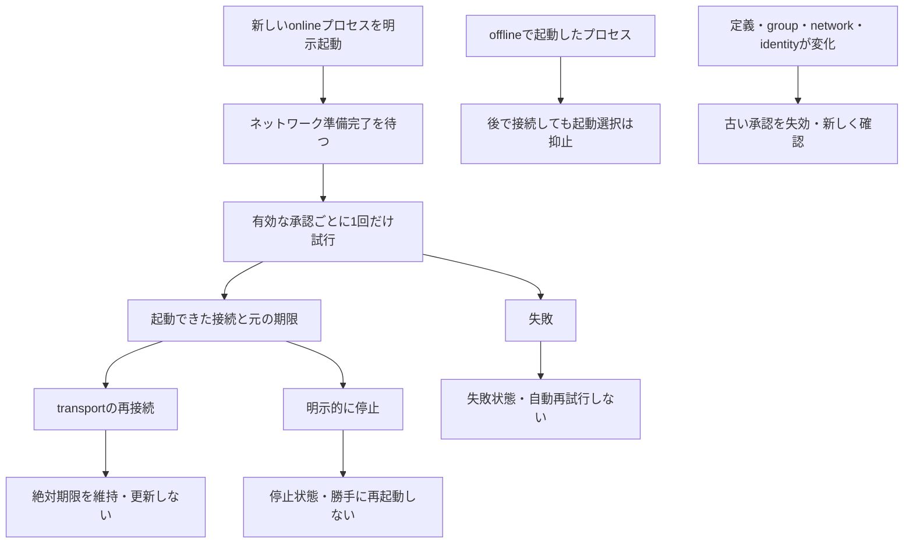
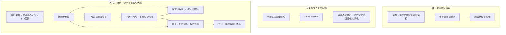

# 明示的な起動時接続と非公開 SOCKS 設定

[English](STARTUP.en.md) · [利用ガイド](GENERIC.ja.md)

保存した定義だけでは自動開始しません。任意の起動時設定により、確認済みの正確な
送信接続だけを次回以降のオンライン起動で開始できます。この起動時許可で受信共有や新しいファイル転送は
開始しません。受付済みの永続送信待ちには、元の ID と期限を保つ別の復旧契約があります。実装と模擬テストは完了していますが、インストール済みの実機、
登録、アプリの動作確認には別途実機検証が必要です。

## 必要な許可を選ぶ

| 目的 | 操作 | 有効になる時点 |
| --- | --- | --- |
| 再利用する設定だけ残す | [サービスを保存](SAVED_SERVICES.ja.md) | 定義は停止のまま |
| 次回起動時に確認済みの外向き接続を開始 | 下の `startup preview` / `startup save` | オンライン起動でネットワーク準備後に1回 |
| OS サインイン時に本体を起動 | [ユーザー単位の自動起動](LIFECYCLE.ja.md) | 登録を別に確認し、次回サインイン時 |
| 範囲を限定した SOCKS 認証情報を保持 | 下の非公開プロキシ設定 | 保存のみ。起動時の開始は明示選択が必要 |

まず下の外向き接続の手順を使います。本体そのものの自動起動も必要な場合だけ、OS サインイン時の登録を行います。

## 保存済みの接続

有限の寿命は新しいonlineプロセス起動の承認に従って始まり、同じプロセスの再接続では更新されません。offline起動は、そのプロセス全体で自動起動を抑止します。OSログイン時にアプリを立ち上げる設定は別です。

1. 接続サービスやグループを保存し、範囲を確認します。
   `soba startup preview --name example --group example`
2. 返されたサービス範囲と有効期間をすべて確認し、結果の `revision` と
   `storeRevision` を指定して許可します。
   `soba startup save --name example --group example --review REVISION --store-review STORE_REVISION`
3. `soba startup list` で許可を確認します。以降の自動開始を無効にするには:
   `soba startup disable --name example --store-review STORE_REVISION`

個別のサービスは `--group` の代わりに `--ids ID,ID` で指定できます。保存操作自体は
接続を開始しません。定義の編集・取込み、グループの構成変更、ネットワーク・端末名の
変更、相手の許可取消しにより古い許可は無効になります。変更後の範囲は明示的に
再確認してください。プロファイルの取込みから起動許可を追加することはできません。

オンライン起動時に有効な許可を読み込み、ネットワークが準備できた後で各対象を
一度だけ開始します。明示的なグループ開始と同じ範囲確認、入口の準備確認、失敗時の
取消しを使います。失敗した開始は、明示的な操作または次の本体起動まで再試行しません。
明示的に停止した接続をすぐに自動開始することもありません。`soba start --offline`
では、その後同じ本体内でネットワークを設定しても起動時接続を抑止します。

明示的な本体起動では、有限の有効期間を新たに開始します。通信の復旧では既存の
絶対期限を維持し、期限切れや明示的に停止した許可を更新しません。OS ログイン時の
本体起動は独立した任意設定です。`soba autostart --help` を参照してください。

## 非公開 SOCKS 設定

保存・停止・自動開始の無効化・削除では、何が変わるでしょうか。非公開の認証情報、今後の起動許可、現在の接続は分けて確認します。

| 確認して行う操作 | 非公開の認証情報 | 今後の起動 | 現在の待受・復旧 |
| --- | --- | --- | --- |
| 保存・生成 | 保存する | `startOnLaunch` を明示選択 | 待受は開始しない |
| 保存設定の開始 | 保持 | 変更しない | 現在の条件を検査し、新しい接続を明示開始 |
| 停止・期限切れ | 保持 | 変更しない | 接続を終了し、暗黙に復旧しない |
| 保存設定の無効化 | 保持 | 無効 | 稼働中の待受は維持し、元の許可での復旧を無効化 |
| 保存設定の削除 | 削除 | 削除 | 紐づく接続も停止 |

図の要約：保存だけでは待受を開始しません。保存設定の明示開始、または別途許可した次回オンライン起動で接続を作ります。一時的な通信障害からの復旧では、許可が有効な間だけ元のIDと期限を維持します。停止・期限切れ・許可無効化では暗黙に許可を更新しません。初回の `startOnLaunch: false` でも、明示開始した保存接続は復旧可能です。`saved-disable` は以前の保存revisionでの復旧を無効にします。オフライン起動では自動開始を抑制します。保存結果が不明なら、保存済み一覧と現在の接続を再読込してから再試行してください。

通常の `soba proxy start` は実行時だけの設定です。任意の保存には非公開ファイルまたは
パイプを使います。

- `soba proxy preview --name example --peer PEER_ID --ports 443,8443`
- `soba proxy saved`
- `soba proxy save --json-file PRIVATE_FILE` または `soba proxy save --stdin`
- 強力な認証情報の明示的な生成: `soba proxy generate --json-file PRIVATE_FILE`

save の入力は確認済みの `scope`、preview の `expectedRevision`、`proxy saved` の
`expectedStoreRevision`、`username`、`password`、明示的な `startOnLaunch: true`
または `false` です。generate は認証情報を入力せず、同じ確認項目を指定します。
144 ビットのランダムなユーザー名と 256 ビットのランダムなパスワードを生成し、
この明示的な操作でのみ保存します。通常の応答には認証情報を含めません。保存・生成
操作はプロキシを開始しません。

`proxy saved` に表示される各設定の `revision` で操作します。

- `soba proxy saved-start NAME --review REVISION`
- `soba proxy saved-disable NAME --review REVISION`
- `soba proxy saved-delete NAME --review REVISION`
- `soba proxy reveal NAME --review REVISION --private-file PATH`

reveal は指定した非公開ファイルに認証情報を直接保存します。汎用コマンドで通常の
出力先へ認証情報を表示することはできません。確認したファイルも非公開にしてください。
稼働中の入口を別途止めるには `soba proxy stop ID` を使います。

保存する範囲は正確な端末 ID、TCP ポート、ループバックの入口、ネットワーク、
端末名、有効期間です。現在の端末 ID の検証、netstack、ループバックの制約を維持します。
許可取消しは再起動後も古い許可を無効にし、相手を再承認しても復活しません。
取消しの永続保存を確認できない場合は関連する接続を停止し、現在の本体内では
起動時接続を抑止します。エラーの案内に従い、再起動前に非公開保存領域を修復してください。
保存に失敗した状態を、永続的な取消し完了とは表示しません。

起動許可、取消し記録、認証情報はプロファイルの書き出しと別の非公開保存領域に
置きます。各ファイルの容量には有限の `profileBytes` を使い、原子的に非公開保存します
（Windows は現在のユーザーだけの ACL）。通常の状態表示、履歴、ログ、エラー、
dry-run に認証情報は含まれません。引数、共有設定、ソースコード、書き出した
プロファイルに認証情報を含めないでください。

## 検証範囲

Core/CLI の模擬テストは、固定した範囲、古い確認結果、グループ変更、受信共有の拒否、
オフライン時の抑止、一度だけの開始、無効化、停止、永続的な相手の取消し、失敗処理、
認証情報の生成、非公開確認、秘匿、既存の期限を維持したプロキシ復旧を対象にします。
実際の登録、OS ログイン・復帰、インストール後の ACL、アプリ互換性の証明ではありません。
ACL の検証にはネイティブ Windows CI も必要です。
