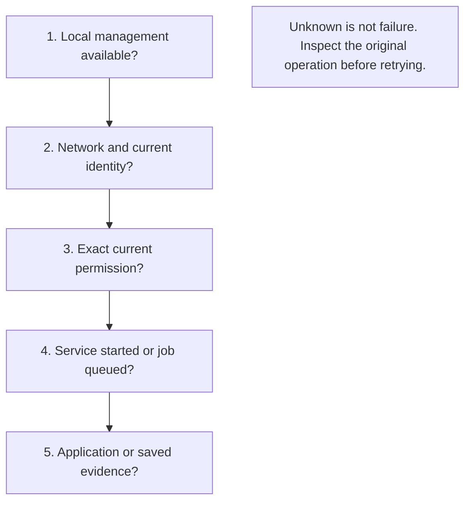

# Things to check yourself: find the first failing stage

[日本語](TROUBLESHOOTING.ja.md) · [User guide](GENERIC.en.md) · [Common questions](FAQ.en.md)

This is an experimental open-source project; no user support is provided. These self-service notes do not promise responses, fixes or compatibility.

Use this order for v0.5.0-alpha.1. Stop at the first failed stage; a successful earlier stage does not prove the next one.

## Check the symptom

| What you see | Check next | Avoid |
| --- | --- | --- |
| Local page will not open | Keep the process running; use its exact printed `127.0.0.1` URL on the same device. Use `soba ui` for a fresh local code | Binding management to a LAN address or sharing its port |
| Setup finds no peer | Receiver must explicitly open acceptance; check selected scope and reachability. Use the guide's manual contact path when discovery is unavailable | Treating a discovery name as verified identity |
| Peer appears but access is denied | Check current identity and the relevant trust/share grant on the correct device | Widening ports, changing networks or retrying another route to evade denial |
| Saved service is stopped | Review the saved definition and start it. Check the displayed actual endpoint | Assuming a saved definition restores expired authority |
| Start reports a port conflict | Inspect the existing local listener; use a reviewed alternate port where supported | Silent remapping or assuming a proposed port remains free |
| Started, but application fails | Use the actual endpoint and check the application's process, authentication, TLS/host keys and result | Calling listener readiness application success |
| File batch waits | Receiver chooses a destination and accepts, unless exact per-peer autosave was explicitly enabled | Assuming sender trust implies autosave |
| Durable job accepted or result unknown | Inspect the original job's deadline, current identity, state and save evidence. Both agents and a reachable route are needed for progress | Creating a new job merely because the reply was lost |
| Receiving is blocked after restart | Follow the bounded receiver-recovery workflow; verify the configured destination | Deleting private state or scanning arbitrary destination trees to force recovery |
| Permission reduction/revocation could not be saved | Stop `soba`; reconcile saved state before restart, because older permissions may remain on disk | Assuming stopped connections prove durable revocation |

The stages in the diagram mean: open local management, establish a reachable authenticated network, verify the relevant permission, inspect the operation's state, then verify its real result. They are diagnostic checkpoints, not a guaranteed successful sequence.

## Use the focused guide

- Setup and key checks: [connection setup](CONNECTION_SETUP.en.md), [sign-in](SIGN_IN.en.md)
- Ports, saved state and routes: [saved services](SAVED_SERVICES.en.md), [port proposals](PORT_PROPOSALS.en.md), [mixed connections](MIXED_CONNECTIONS.en.md)
- Storage and evidence: [capacity and receiver recovery](CAPACITY.en.md), [durable files](DURABLE_OUTBOX.en.md), [durable text](DURABLE_TEXT.en.md)
- Restricted diagnostic requests: [proxy and diagnostics](PROXY_DIAGNOSTICS.en.md)

## Keep safe notes for your own checks

For your own investigation, note the exact version/source, OS family, selected backend, attempted action, first failing stage and stable error code. These notes are not a request to submit a support report. Distinguish an automated fixture from a physical-device test. Use fictional peer labels and minimal redacted excerpts; exclude login codes, auth URLs, keys, capabilities, credentials, private paths, real addresses, organization/device names and personal usage details. Do not attach the whole profile or raw logs. [Verification boundaries](VERIFICATION.en.md) · [Security](../SECURITY.md)
