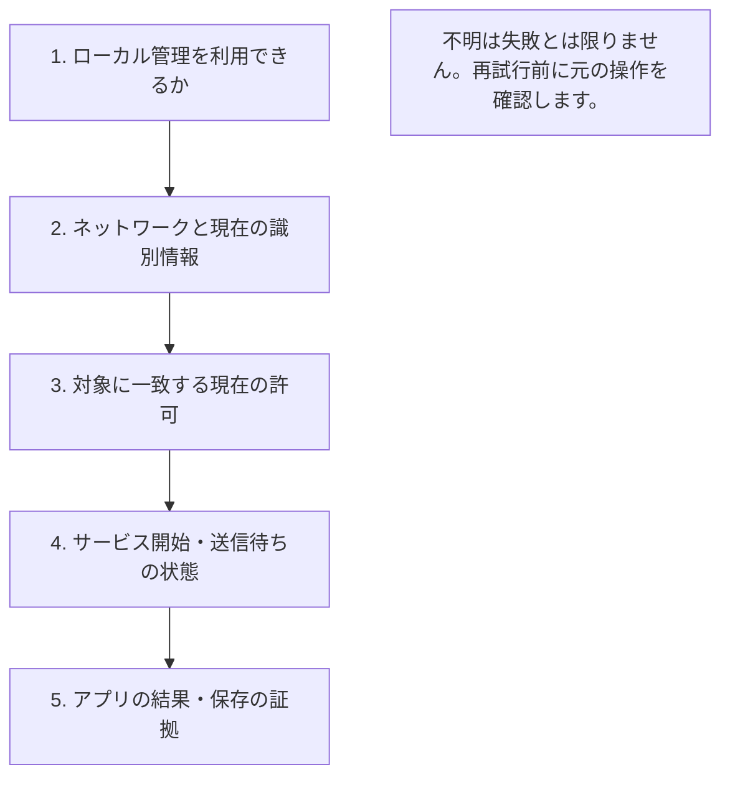

# 自分で確認できること：最初に止まった段階を確認する

[English](TROUBLESHOOTING.en.md) · [利用ガイド](GENERIC.ja.md) · [よくある疑問](FAQ.ja.md)

実験的な OSS プロジェクトであり、利用者向けサポートは提供しません。文書は自分で確認するための資料で、回答・修正・互換性を約束するものではありません。

v0.5.1-alpha.1 では次の順に確認します。最初に失敗した段階で原因を切り分け、前の段階の成功を次の成功と扱わないでください。

## 症状から確認する

| 見えている状態 | 次に確認すること | 避けること |
| --- | --- | --- |
| ローカル画面が開かない | 本体を起動したまま、同じ端末で `soba ui` を再実行する。手動で開く場合は非公開の端末で `soba ui --no-browser` を実行し、表示された正確な `127.0.0.1` の URL でコードを入力する | 管理画面を LAN アドレスで待受・共有する |
| セットアップで相手が見つからない | 受信側が受付を明示的に開いているか、範囲と到達性を確認。探索できない場合はガイドの手動入力を使う | 探索名を本人確認と扱う |
| 相手は見えるが許可されない | 現在の識別情報と、その操作に必要な信頼・共有許可を該当端末で確認 | 許可拒否を回避するためポートや経路を広げる |
| 保存サービスが停止している | 保存内容を確認して開始し、実際の接続先を見る | 保存で期限切れの権限も戻ると思う |
| 開始時にポートが競合する | 既存の待受を確認し、対応する操作では代替ポートを確認して選ぶ | 無断の再割当や、候補ポートの空きを保証と扱う |
| 開始済みなのにアプリが動かない | 実際の接続先、アプリの起動、認証、TLS・ホスト鍵、操作結果を確認 | 開始済みをアプリ成功と扱う |
| ファイルが受信待ちのまま | 明示的な相手別自動保存がなければ、受信側で保存先を選び承認する | 送信者の信頼だけで自動保存されると思う |
| 永続送信が受付済み・結果不明 | 元のジョブの期限、現在の相手、状態、保存記録を確認。進行には両本体の起動と到達可能な経路が必要 | 応答が失われたという理由だけで別ジョブを作る |
| 再起動後に受信が止まる | 受信復旧の手順に従い、設定した保存先を確認する | 私有状態の削除や、任意の保存先全体の探索で強制復旧する |
| 許可縮小・取消を保存できない | `soba` を停止し、保存状態を修復してから再起動。古い許可がディスクに残り得る | 通信の停止を取消の永続化と扱う |

図は、ローカル管理を開く、到達可能で認証されたネットワークを確かめる、必要な許可を見る、処理状態を見る、実際の結果を確認する、という切り分けの順序です。この順で必ず成功する保証ではありません。

## 停止後にローカル画面を開く

公開済み 0.5.1-alpha.1 では、`soba stop` でローカル制御の入口がなくなります。その後の `soba ui` で名前付きパイプやソケットが見つからないことだけでは、プロフィールが失われたとは判断できません。同じプロフィールの `soba status` を確認し、停止中なら `soba start --offline --background`、続いて `soba ui` を実行します。権限や保存状態のエラーがある場合は内容を確認し、状態を削除して回避しないでください。別の保存先を選んでいる場合は、すべてで同じ `--state-dir` を使います。

[候補版のオフライン画面復旧](GENERIC.ja.md#候補版停止後に画面を開き直す)は、既存プロフィールの対話操作でこの手順を短くします。公開済み 0.5.1-alpha.1 には含まれず、保存ネットワークは開始せず、`ui --json` が問い合わせだけを行う動作も維持します。

## 詳しい手順へ進む

- 接続と鍵の確認：[接続セットアップ](CONNECTION_SETUP.ja.md)、[サインイン](SIGN_IN.ja.md)
- ポート・保存状態・経路：[保存サービス](SAVED_SERVICES.ja.md)、[代替ポート](PORT_PROPOSALS.ja.md)、[接続方式の併用](MIXED_CONNECTIONS.ja.md)
- 保存先と結果の証拠：[容量・受信復旧](CAPACITY.ja.md)、[永続ファイル](DURABLE_OUTBOX.ja.md)、[永続テキスト](DURABLE_TEXT.ja.md)
- 範囲を限定した確認：[プロキシと診断](PROXY_DIAGNOSTICS.ja.md)

## 自分の確認用に安全なメモを残す

自分で切り分けるために、正確な版・ソース、OS の種類、選択した方式、操作、最初に止まった段階、安定したエラーコードを記録します。サポートへの報告を求めるものではありません。自動試験と物理端末の確認を区別してください。相手は架空の呼び名とし、必要最小限の伏せ字済み抜粋を使います。ログインコード、認証 URL、鍵、招待権限、資格情報、私有パス、実アドレス、組織・端末名、個人の利用状況は含めません。プロフィール全体や未加工ログは添付しないでください。[検証の境界](VERIFICATION.md) · [安全性](SECURITY.ja.md)
