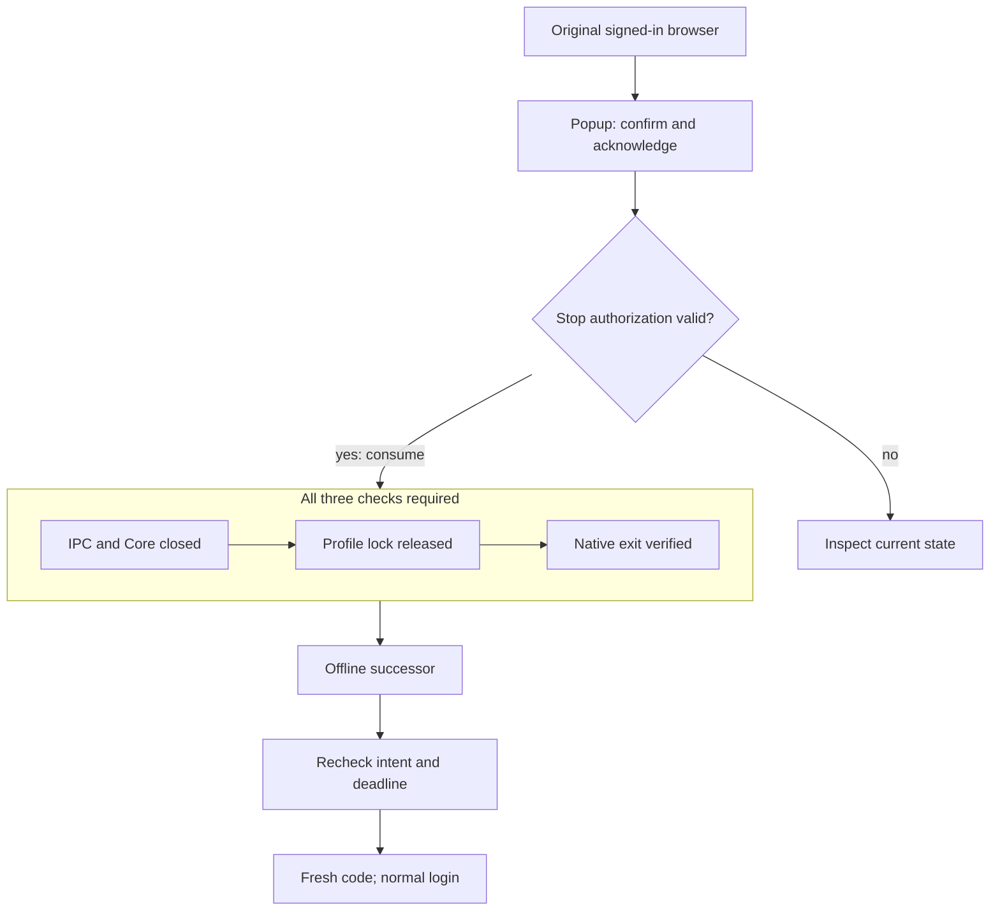

# Web and CLI initial activation

[日本語](WEB_ACTIVATION_HANDOFF.ja.md) · [v0.5.1-alpha.1](https://github.com/webkaz-labs/sobalink/releases/tag/v0.5.1-alpha.1)

The current release includes Web-requested restart in the reviewed Direct LAN activation controller. Both Web and CLI initial activation passed the real-Core product cases at `719d6bfa`, with original review, ordinary readiness, bilateral native confirmation and complete cleanup preserved. The seven synthetic-owner helper cases also passed on that source. These bounded historical Linux loopback results do not establish later-source or physical-device acceptance. Current native/browser and distribution results are recorded separately in [verification](VERIFICATION.en.md). See the historical [exact-source evidence and limits](CONVENIENCE_PLAN.en.md#current-alpha6-evidence-snapshot).

## What to expect

Keep the temporary restart window open until it finishes. The original session must still authorize stop admission; logging out or invalidating it beforehand denies restart. After admission, the same intent and deadline continue through the shutdown checks, without transferring the old browser session. Open the normal login screen with the separate Open button or bare URL, then use the fresh one-time code. If continuation fails or is uncertain, inspect state before a new explicit review. Canceling does not undo a saved confirmation.

## Web flow

1. In local management, select the saved peer and review its exact endpoints, scope and deadline.
2. Apply the review. If a fresh process is required, a temporary private restart window opens. Confirm the same review there. A blocked popup does not request a helper.
3. Keep the restart window open. It waits for successful IPC/Core close, profile-lock release and native old-process exit before starting a fresh offline successor. The successor rechecks the original review, without refreshing its deadline.
4. Use the separate Open button in that window to request the device’s normal browser launcher, then enter the fresh one-time code in the ordinary login screen. If opening is unavailable or uncertain, copy the displayed bare URL into the browser address bar. A direct cross-origin navigation link is deliberately not used. The old browser session is not transferred. Check activation progress and independent network, listener and application readiness there.

The original deadline bounds the helper. Cancellation, page dismissal, loss of the temporary page's short lease or expiry stops further work where it has not already been admitted. A pagehide cancellation request is best effort; lease expiry is the fallback. Already saved confirmation is not undone. Browser throttling or an interrupted response can therefore stop continuation. Reopen current local management and inspect state before reviewing again; a new explicit review is required to try again, and an uncertain private code is not redelivered. The original page recovers after a blocked popup, declined or closed continuation, or expiry; recovery does not automatically restart anything.

## CLI alternative

The existing `direct-lan upgrade` review/apply/status/cancel commands remain available independently. Apply uses a private terminal for the normal fresh login code. Both paths use the same exact-intent controller and native restart gates.

## Security boundaries

- Only the authenticated local management session, exact origin and CSRF check can request the bounded handoff. A separate one-use authorization remains bound to that originating session and complete canonical request. Logout, session expiry or invalidation before stop admission denies the restart. The old owner consumes authorization at stop admission; only then can the same bounded intent continue through acknowledged shutdown, verified exit and the verified successor. Peer protocols cannot request it or restart another device.
- The helper is the same executable, launched with an internal mode flag only. Bootstrap data crosses anonymous pipes. No capability or login code enters arguments, URLs, logs, browser storage or a continuation file.
- The browser transfers a one-use capability only to the exact popup window and numeric-loopback origin. Claim consumes it and returns a separate short-lived in-memory control token.
- Explicit confirmation and receipt acknowledgement precede shutdown. The helper does not migrate sessions or implement an alternate login.
- The fresh normal login code is delivered once through the authenticated helper response. Retained references and page presentation are cleared on delivery, cancellation or expiry as applicable; this is not a promise of cryptographic memory erasure by Go or the browser.
- In both CLI and Web flows, modifying IPC, progress reads and code issuance are pinned to the verified process instance. Cancellation also matches the complete original intent, so it cannot cancel a later unrelated workflow.
- No force kill, network-attempt reset, automatic new review, persistent credential or application-access grant is introduced.
