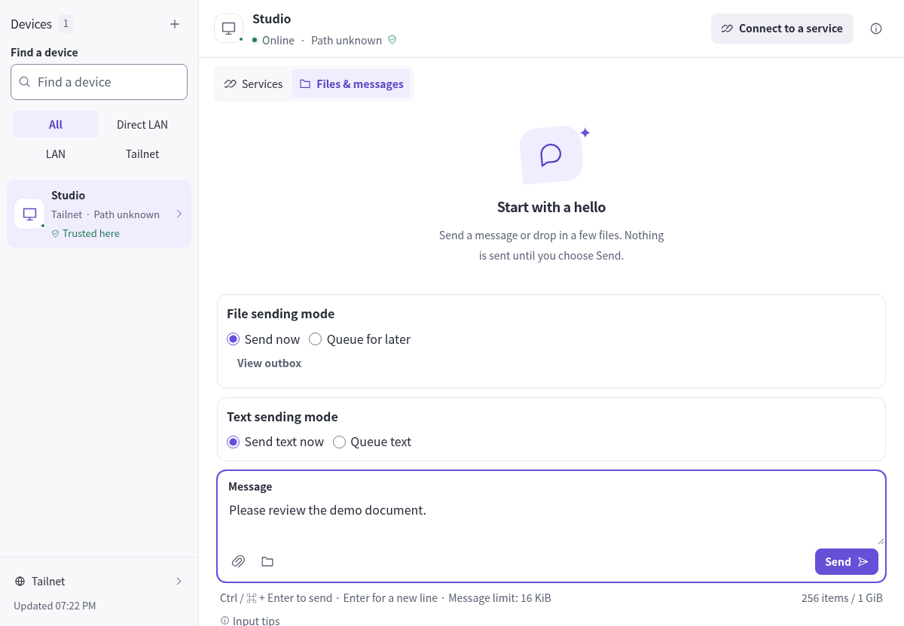
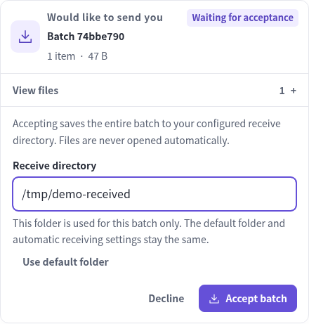
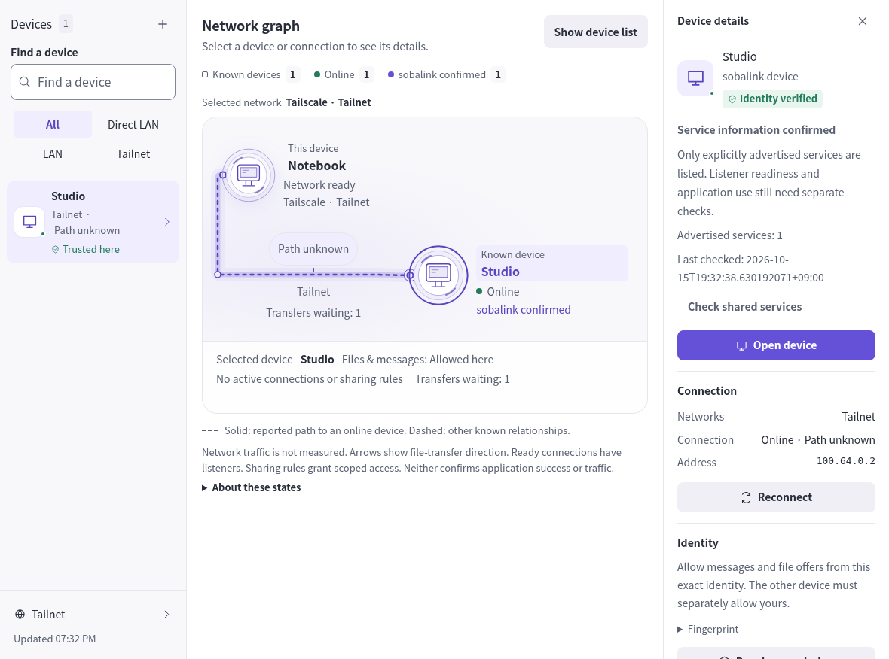
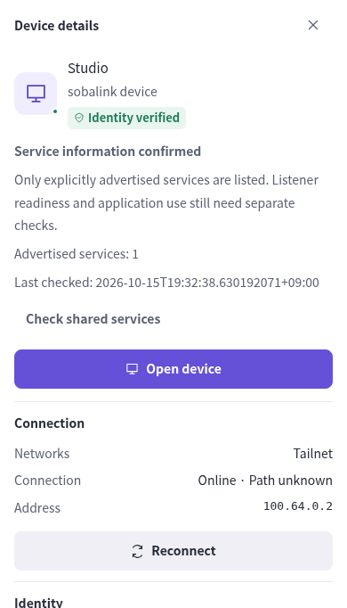
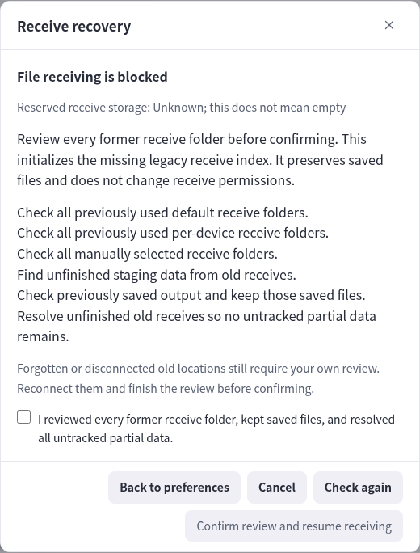
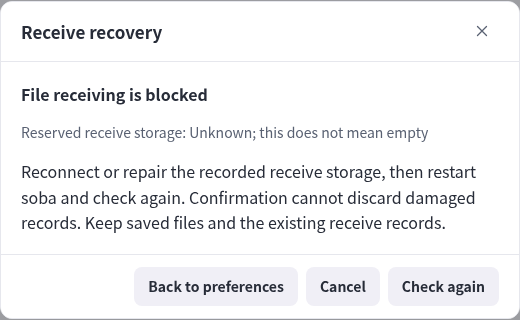
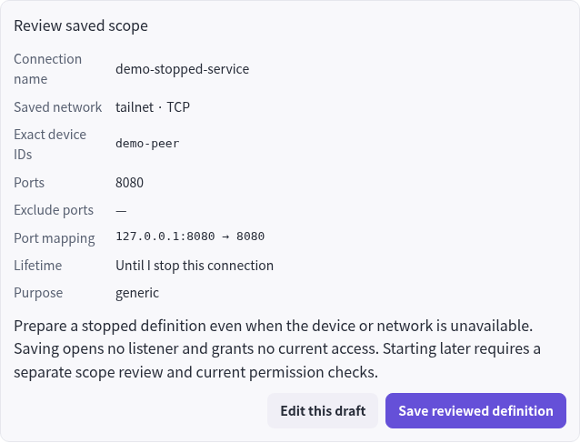
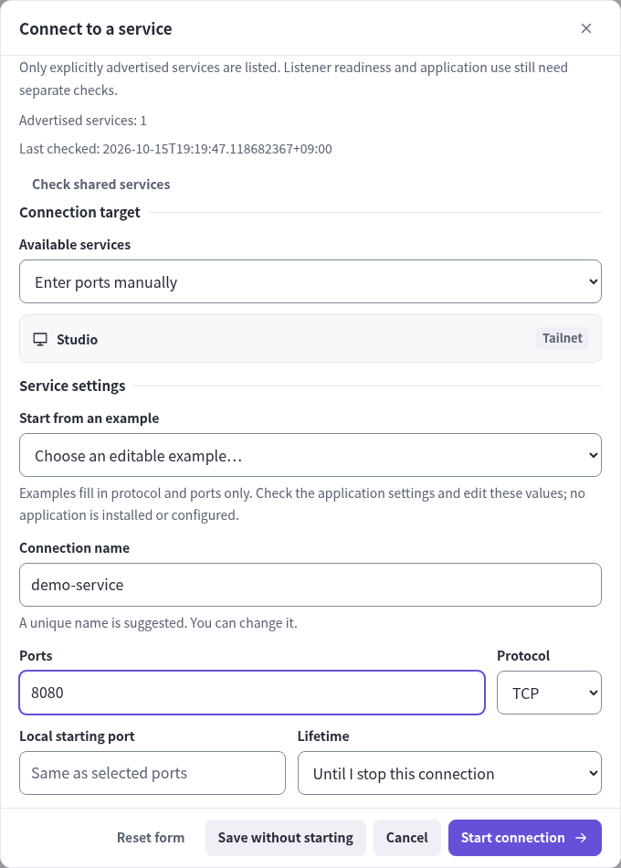
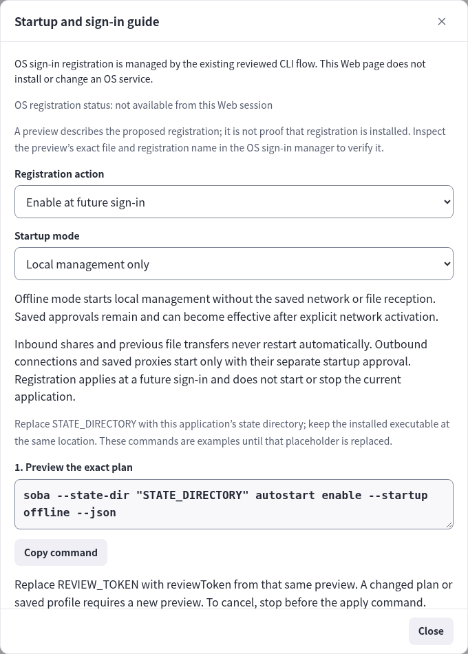
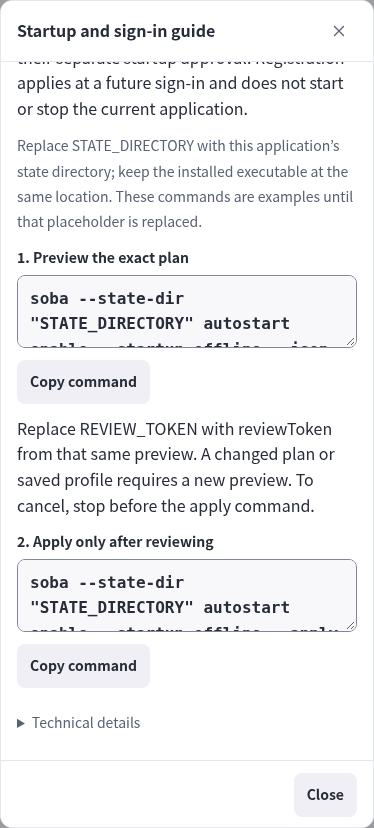

# Local Web controls

[日本語](WEB_CONTROLS.ja.md) · [Saved services](SAVED_SERVICES.en.md) · [Startup and logout](LIFECYCLE.en.md)

The local Web UI supports service connections, reviewed sharing, files and messages, saved definitions, diagnostics, optional scoped proxies, and Tailnet sign-out. The controls below use the same local command API as the CLI. Browser checks, real-device compatibility and OS sign-in behavior remain separate acceptance gates.

## Open the UI and choose one task

1. Start `soba`, then run `soba ui` if you need a fresh code.
2. On this same device, open the exact printed numeric-loopback URL and enter the separately printed one-time code. Keep both sign-in output and screenshots private.
3. Choose a device for a connection, share or transfer; use **Saved services** for reusable definitions and **Preferences** for local settings.
4. Review the target, ports/content and lifetime before applying. Check status after an uncertain response before repeating an action.

| What you see | What it establishes |
| --- | --- |
| Device online | Network observation, not message/file permission |
| Saved service | Stored settings, not a running listener |
| Ready listener | Transport readiness, not application success |
| Outbox accepted | Local acceptance, not receiver save |

The following sections explain each control and its recovery boundaries.

### Where to send a message and review incoming files

Screen example with demo data. This does not establish real-device connection, delivery or application compatibility.

<picture>
  <source media="(max-width: 600px)" srcset="assets/screenshots/message-context-en-narrow-input.png">
  
</picture>

[Open full size](assets/screenshots/message-context-en.png) · [Narrow version](assets/screenshots/message-context-en-narrow-input.png)

1. Select the peer on the left.
2. Enter the message. On narrow screens, scroll to the composer.
3. Check the peer and content before sending. This example is a draft, not a sent message.



[Open full size](assets/screenshots/receive-en.png)

Review the file list, the destination for this batch, and whether to accept, in that order. The folder is fictional. Displaying this review does not accept or save files.

## Use the device list and network graph

See the [verification record](VERIFICATION.en.md#current-integration-and-published-baseline) for the target version and completed checks. Physical-device and OS-lifecycle acceptance are separate. The dedicated guides are authoritative for [durable files](DURABLE_OUTBOX.en.md), [durable text](DURABLE_TEXT.en.md) and [connection setup](CONNECTION_SETUP.en.md).

**Device list** and **Network graph** use the same search and filter. Counts refer to remote devices and exclude this device. Use **Clear filters** when filtering hides the desired device. Select a node or line to open that peer's details; Close or Escape returns to the previous control. On narrow screens, details replace the graph.

Online status, a confirmed sobalink response and local communication permission are separate facts. A Tailcat peer without a response is **Response not confirmed**, not necessarily offline or missing software. An ordinary Tailnet peer can still be used through manually entered approved service ports when discovery is unconfirmed. Messages and files require their separate permission.

Lines represent relationships with this device. A backend that does not report its actual route remains **Path unknown**. A configured relay is not an observed route; Relay does not establish Internet use, and Direct does not establish the same LAN. The graph does not infer an OS, form factor or successful application operation.

Service rows keep the endpoint, state and lifetime visible. Open **Manage service** for copy, edit, remove and diagnostic actions; active **Stop** remains directly available. Settings open by topic. Long forms scroll their contents while retaining the heading and close control. Closing an unapplied form does not change runtime or saved configuration. Language and theme take effect immediately and are stored in this browser.

### From the graph to peer details

Screen example with demo data. This does not establish real-device connection, delivery or application compatibility.

<picture>
  <source media="(max-width: 600px)" srcset="assets/screenshots/navigation-graph-en-narrow.png">
  
</picture>

[Open full size](assets/screenshots/navigation-graph-en-wide.png) · [Narrow version](assets/screenshots/navigation-graph-en-narrow.png)

1. Select the peer.
2. Read online presence, confirmed response, permission and route separately.
3. On narrow screens, details replace the graph. Close details to return.



[Open full size](assets/screenshots/navigation-detail-en-narrow.png)

## Choose a connection mode

Start offline and open **Set up network**. [Direct LAN](DIRECT_LAN.en.md) pairs exact numeric private-network endpoints without a relay. [Mixed connections](MIXED_CONNECTIONS.en.md) explicitly selects backends and requires fresh authenticated binding before treating multiple routes as the same peer; unbound routes remain individually usable. [LAN destination restrictions](LAN_DESTINATIONS.en.md) constrain admitted destinations; they do not bind physical interfaces or override VPN routing. WAN discovery is a separate opt-in to selected numeric STUN destinations and/or IPv6 candidates, incompatible with strict LAN destination restrictions. None requires administrator privileges or LAN-router changes.

Review configuration and network effects before applying. Local readiness is not confirmed peer response. The direct-LAN cold-start regression is fixed with localhost TCP/UDP lifecycle evidence. The historical 0.3.0-alpha.5 exact-source browser and four-target release gates passed as recorded in [verification](VERIFICATION.en.md); actual-device reachability and application success remain separate checks.

## Prepare route recovery

In LAN setup, expand “Advanced: prepared relay candidates”. Add/remove exact additional relay endpoint/pin/scope tuples within saved-state and exchange-format capacity while started with `--offline`, review the change, then restart. The original relay and paired identities remain. Adding a candidate does not host a new relay. [Relay resource budgets](RELAY_OPERATIONS.en.md) separately bound runtime presence and attempts; they are adjustable, not a four-candidate permission ceiling.

In a paired device's details, expand “Route recovery”. Create a private update for that peer, or inspect one received from it. Check the peer/recipient, exact endpoints, pins and expiry, then review the lifetime and explicitly select candidates. New offers and eligible approvals initially show Until revoked; finite/v1 offers allow only a finite deadline, no later than their expiry. The lifetime has a clearly labeled confirmation, and no exact candidate is checked automatically. Optional finite dates have no arbitrary 30-day ceiling. Certificate validity/pin changes are a separate availability boundary. Review a saved update to change approval, or revoke all local route approvals; refresh state after an uncertain response before retrying. The local UI applies the same Core checks as the CLI. Offer creation also has an optional, initially unchecked withdrawal choice. A received empty offer gets a distinct withdrawal review: applying it records the sequence and removes local route approvals. Merely exporting a withdrawal changes no local approval.

Cancel/back clears private update text; copying is explicit. Creating, importing or saving an update does not prove reachability or grant message/file/service access. `local` is a relay address class, not a strict LAN traffic restriction. Existing TCP may need application reconnect; file retry does not resume from its last byte. [Step-by-step preparation and limits](LAN.en.md#prepare-another-route)

## Review blocked file receiving

Open **Preferences → File receiving → Review receiving**, or select the **File receiving is blocked** notice in preferences or peer autosave settings. **Receive recovery** reads the current recovery state. Sending files, messages and service operations remain available while file reception is blocked; saved autosave permission is shown separately.

For a missing legacy index, complete the [six checks and recovery decision](CAPACITY.en.md#receiver-recovery), then select the acknowledgment checkbox and **Confirm review and resume receiving**. Opening or closing the dialog does not confirm anything. The confirmation initializes only the missing index; it does not delete files, resume old transfers or re-enable disabled autosave permission.

Damaged or unknown records do not offer that confirmation. Follow the storage repair/reconnection and restart guidance; the UI does not discard the records or reset accounting to zero. The CLI alternative is `soba receive recovery confirm`, followed by `--reviewed` only after completing the same legacy review. [Recovery details and limits](CAPACITY.en.md#receiver-recovery)

Screen example with demo data. This does not establish real-device connection, delivery or application compatibility.

**Legacy record: review items are available**



[Open full size](assets/screenshots/receive-legacy-en-wide.png)

**Damaged record: the same review cannot resume receiving**



[Open full size](assets/screenshots/receive-damaged-en-wide.png)

Unknown does not mean empty. Inspect earlier destinations and keep saved files; proceed only when all six checks can actually be completed. These examples remain unchecked and do not execute resume.

## Save and manage a service while offline

Open **Saved services** in the header, then **Save a connection** or **Save a share**. Choose the saved network and enter the exact device ID, ports, mapping and lifetime. The visible-device picker is optional. A missing device stays an explicit saved reference; saving neither verifies it nor grants current access.

Choose **Review stopped definition**, check the complete scope, then **Save reviewed definition**. Use **Edit this draft** to correct it or **Cancel** to leave it unsaved. Definitions stay stopped. Open **Manage service** on a catalog entry for **Edit saved definition**, **Copy saved definition** and **Remove definition**, including entries whose peers are unavailable. An active definition must be stopped before editing; a copy gets a separate identity. Changing an existing definition's network requires a copy.

Edits use the authoritative saved revision. After a conflict, reload the definition and review again. Removal reviews the current definition, any active service and affected groups; canceling leaves them intact. Task ownership and lease information appear when supplied. Manual operations cannot take another task's ownership; use the owning task or wait for its lease to end.

For live starts, advertised services follow the [freshness decision](GENERIC.en.md#when-advertised-information-changes); purpose and bound ports cannot be edited independently. **Refresh advertised review** explicitly accepts the currently displayed metadata; **Enter ports manually** explicitly clears the advertised reference. Saving or copying historical references while offline does not authorize a live connection.

Screen example with demo data. This does not establish real-device connection, delivery or application compatibility.



[Open full size](assets/screenshots/stopped-review-en-focused.png)

Review peer and port mapping, then lifetime, then save. This stores a stopped definition; starting it requires a separate review.

## Read service discovery results

Device details and connection setup show the last service-information observation. A confirmed empty reply means no services are currently advertised; known approved ports can still be entered manually. Pending, unconfirmed and unsupported replies do not prove that software is absent or the device/application is offline. A limited result points to the configured framing budget; review **Preferences → Capacity and history** and check again. A stale result needs another check before selecting an advertised service. **Check shared services** explicitly queries service metadata without restarting active transports. Ordinary peers remain selectable for explicit sharing.

Screen example with demo data. This does not establish real-device connection, delivery or application compatibility.



[Open full size](assets/screenshots/service-review-en.png)

Review the displayed peer, shared scope and lifetime. A changed scope requires review again before starting. This example does not start a connection.

## Sign out of Tailnet

Open **Set up network → Sign out of Tailnet**. The review lists active services, proxies and transfers. **Cancel** leaves them running. **Stop traffic and sign out** stops local traffic, requests embedded-node logout and exits the application, so this control page disconnects.

Use the [logout outcomes and retry decision](LIFECYCLE.en.md#tailnet-logout) to distinguish backend acknowledgement from cleanup and process exit. The result panel provides copyable status, same-profile restart, logout and fresh-access-code commands. Saved approvals, definitions and files remain; LAN pairing has separate revoke controls.

## Review startup at OS sign-in

Open **Preferences → Startup and sign-in guide**. OS registration is deliberately CLI-managed: Core has no reviewed OS-registration operation. The Web guide does not claim to know whether registration is installed and does not execute OS commands.

Choose **Restore saved network and receive approvals** or **Local management only**, and enable or disable. Copy the preview command, replace `STATE_DIRECTORY` with this application's state directory, and run it with the installed executable. Review the exact registration plan, network and automatic-receiving destinations. Only then run the matching apply command with that preview's `reviewToken` replacing `REVIEW_TOKEN`. Stop before the apply command to cancel. If the plan/profile changes or the service manager reports an error, inspect it and preview again; do not force replacement.

Registration applies at a future sign-in. Saved mode restores the saved network and previously approved, unpaused receiving; offline mode starts only local management. Saving definitions or registering startup alone does not authorize service or proxy launch. Optional launch behavior requires a separate reviewed startup approval; offline mode suppresses it. See the [startup approval guide](STARTUP.en.md) for its exact scope. Previous file transfers are not resumed. Disabling registration does not stop the currently running application. The preview is a plan, not an installed-status check; inspect its exact file/name in the OS sign-in manager to verify registration.


Screen example with demo data. This does not establish real-device connection, delivery or application compatibility.



[Open full size](assets/screenshots/startup-guide-en-wide.png)



[Open full size](assets/screenshots/startup-guide-en-narrow-actions.png)

Do not rely on a screenshot as the sole command source. Replace `STATE_DIRECTORY` and the `REVIEW_TOKEN` returned by the actual preview in these examples.

```sh
soba --state-dir STATE_DIRECTORY autostart enable --startup offline --json
soba --state-dir STATE_DIRECTORY autostart enable --startup offline --apply --review REVIEW_TOKEN --json
```

## Set up a client from saved services

Open **Saved services → Connection helpers → Save a RustDesk group** for an existing server. Choose the ID-server and relay devices separately, or enter their exact saved IDs if unavailable. Enter the server public key, remote/local ID and relay ports, numeric loopback and lifetime. Use only the public key, never a private key or password.

**Review four flows** shows NAT TCP, ID TCP, heartbeat UDP and relay TCP with each exact device and mapping. NAT uses the ID port minus one. Read the public key and the common-relay guidance, then **Save reviewed group**. **Back to settings** discards that preview; **Cancel** leaves definitions untouched. A profile conflict requires a fresh preview. A differing same-name group requires another name; an identical group is already saved. Saving does not open listeners. Use **Open saved group → Review start** for the separate runtime action.

**Client settings** on a service, or **Settings for selected services** under Connection helpers, shows actual saved mappings and current listener readiness. Copy the endpoint or SSH command as needed. SSH keeps a peer-specific HostKeyAlias; verify its host key independently. An HTTP URL is only a candidate; HTTPS still requires the original TLS hostname, SNI, origin and certificate verification. Ranges show addresses and exact port mappings instead of inventing a scalar endpoint. Use **Refresh settings** after changes. A failed copy leaves selectable text.

RustDesk settings include ID/relay endpoints, public key, blank proxy, enabled UDP and `/r`. All participating endpoints must use the same local relay address and port and have the four required forwards and server permissions. Back up existing RustDesk settings before changing them; stopping soba does not restore those settings. These controls never launch or configure an external application. Planned/saved/ready states do not verify application success. Import review names helper groups whose key or role metadata will be removed or changed.

## Choose a lifetime for one group start

In **Review start**, **Lifetime for this start** defaults to each saved lifetime. Choose one hour or a custom positive duration for any selection. All-forward selections also offer **Until stopped**; all-share selections offer **Until revoked**. Review the effective lifetime shown for every service, then start or cancel. The choice affects only this invocation. Saved definitions stay unchanged, and retrying does not extend an active permission. If a service is already active under another lifetime, explicitly stop it and review a new start. Client settings show the active runtime lifetime when one exists.


## Approve optional future startup

Select saved outbound connections or an outbound group, then open **Connection helpers → Review automatic startup**. The same screen also lists existing approvals without a selection. Enter an approval name and choose **Review future startup**. Check the network, node name, all device IDs, ports, mappings and lifetimes. If replacing a named approval, explicitly check that choice before **Approve reviewed future startup**. Cancel/back changes nothing. Saving starts nothing now and does not register an OS service.

On a future online process launch, each exact approved selection is attempted once after network readiness. Finite lifetimes start anew then. Offline launch suppresses startup for that process. Definition/group/network/hostname changes or peer revocation require fresh review; re-trusting does not restore old approvals. Stopping or expiring a run does not immediately restart it. A still-enabled future-process approval remains until disabled. The displayed launch result is not proof of current listener readiness or application success.

**Review disabling startup** shows the exact approval and its effect. Confirming disables future/pending startup without stopping existing services. A stale revision requires reloading and reviewing. If private storage fails, do not assume the approval or disable was saved; repair storage and reload before retrying. See [startup and private-profile details](STARTUP.en.md).

## Save optional private proxy credentials

In **Preferences → Advanced connections**, review an exact proxy scope as usual. **Continue to authentication** keeps the ordinary ephemeral flow. **Save this reviewed proxy** instead explains private storage, offers explicit generation or private input, and leaves **Also approve this exact proxy on future online launches** unchecked. Saving/generating stores credentials only in the protected local state directory, separately from portable definitions; it starts no listener. Generation never displays credentials automatically. Existing-name replacement requires a separate checkbox and a stopped same-name listener.

Open **Saved proxy credentials → Manage saved proxies** to inspect sanitized scopes and state. **Review saved proxy start** rechecks current identities and shows the complete listener/targets. Use **Review disabling future launch** or **Review deleting saved credentials** for those separate actions; canceling either review changes nothing. Their different effects on credentials, startup and current sessions are shown in [private proxy state and actions](STARTUP.en.md#private-socks-profiles).

**Reveal credentials temporarily** is the only display action. Hide/close and scope changes clear the private fields. Exports/history exclude them, and automated browser evidence capture rejects the private view. Copying is explicit and leaves the chosen value on the system clipboard until you replace it. Never include credentials in command arguments, source code, screenshots or shared files. Failed/uncertain saves clear input; reload the saved record and make a fresh scope review before retrying. All controls retain the local session/Host/Origin/CSRF boundary. Real installed startup, file ACL and external-client behavior still need their separate acceptance checks.

## Readable, compact controls introduced in 0.3.0-alpha.2

The device list keeps a visible search label and a persistent selected row. In the device view, service actions and file/message shortcuts form separate action groups without repeating the current tab heading. Service rows align the saved name and kind, runtime state and immediate actions; endpoint, lifetime and management details remain beneath them. The same row wraps into a compact two-line header in a narrow panel.

Service forms group destination/access separately from service settings, followed by the exact review. Preferences groups display, receiving and management. Advanced options still open on request. Closing a form preserves the existing draft behavior; changing its grouping does not apply settings.

Inputs and copyable values use a readable 16px scale. Secondary text and compact metadata retain separate sizes. Buttons and utilities use readable text/icons and restrained tonal fills before hover in both themes. Input boundaries remain distinct. Focus follows the field’s existing contour for both pointer and keyboard editing, without a detached second frame. The message editor highlights its outer container; its toolbar buttons retain their own keyboard indicator. Unavailable actions use neutral styling while retaining readable captions, and read-only values stay selectable. Selected tabs use a fill and type weight. Sparse dividers and aligned rows establish structure without framing every control or underlining every action. Touch layouts retain at least 44px principal controls while avoiding oversized cards. These presentation changes shipped in 0.3.0-alpha.2. The 0.3.0-alpha.5 connection controls have their own exact-source browser evidence in [verification](VERIFICATION.en.md); any later UI changes need separate acceptance.

## Opt-in durable file outbox

`soba send --queue --peer PEER_ID --expires-in 24h --json PATH` prepares a queue review without sending. The Web UI has the same explicit mode and deadline review. Queued means local acceptance, not delivered; unknown outcomes must be looked up by their original request ID. See [durable outbox](DURABLE_OUTBOX.en.md) for confirmation, restart, cancellation and the additive API contract.
