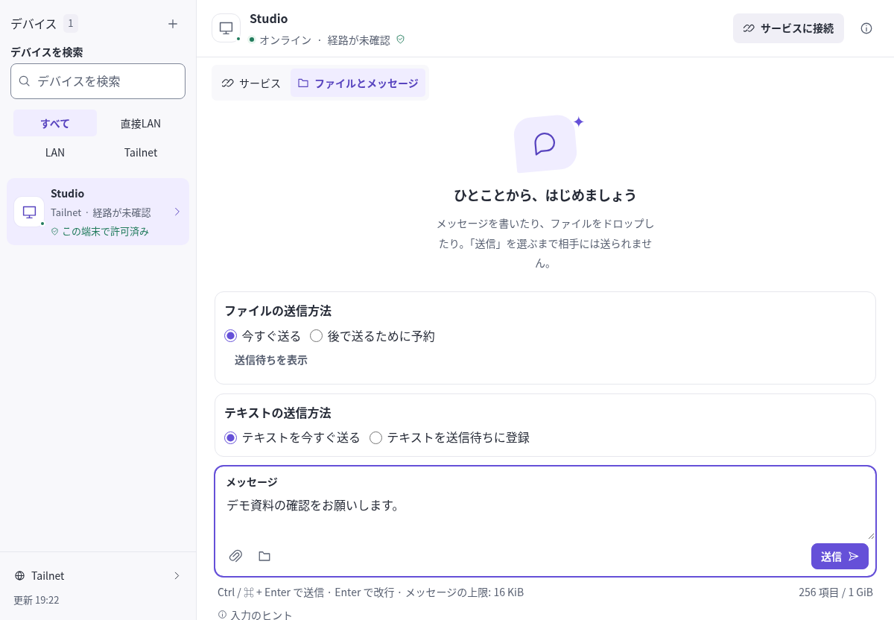
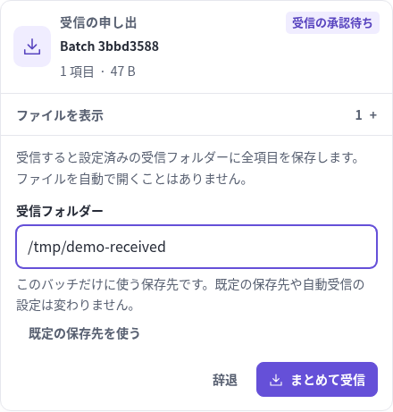
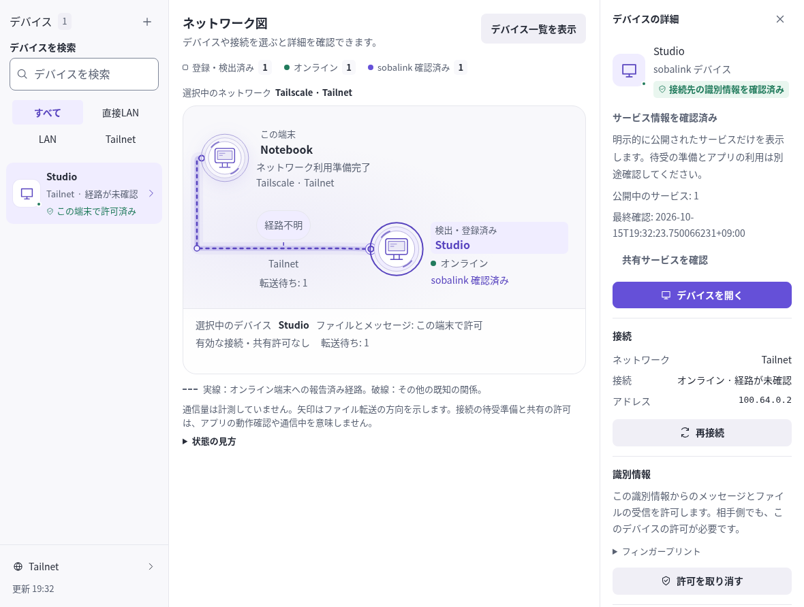
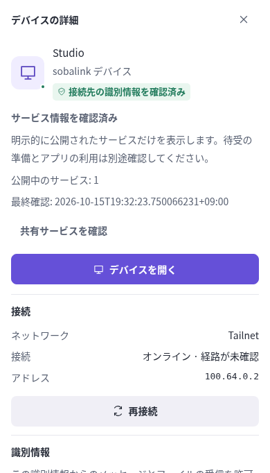
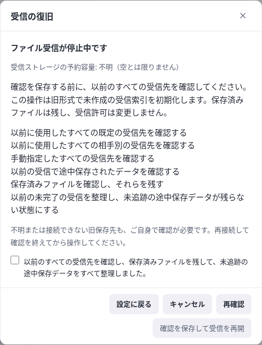
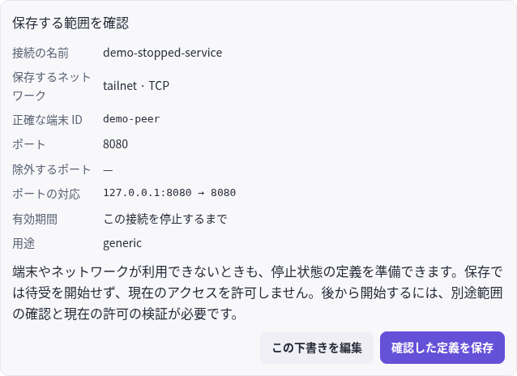
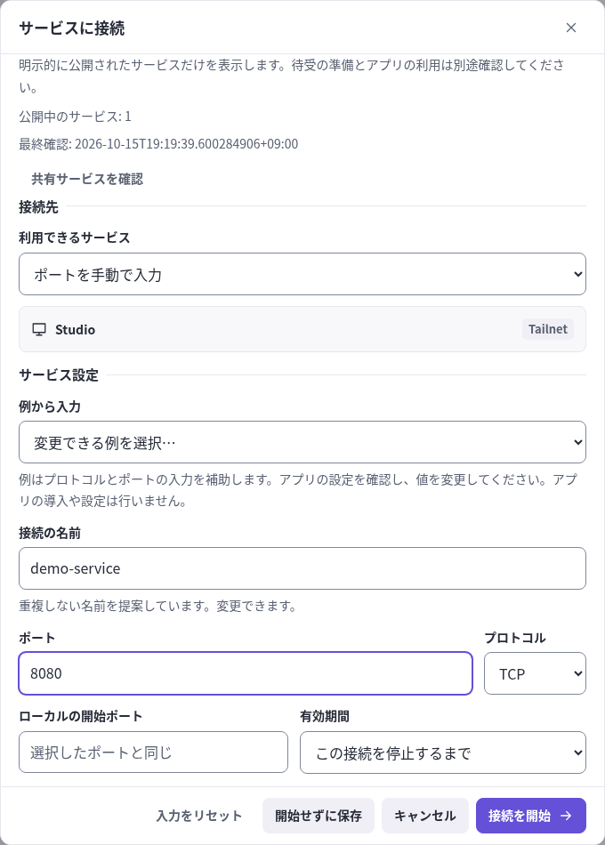
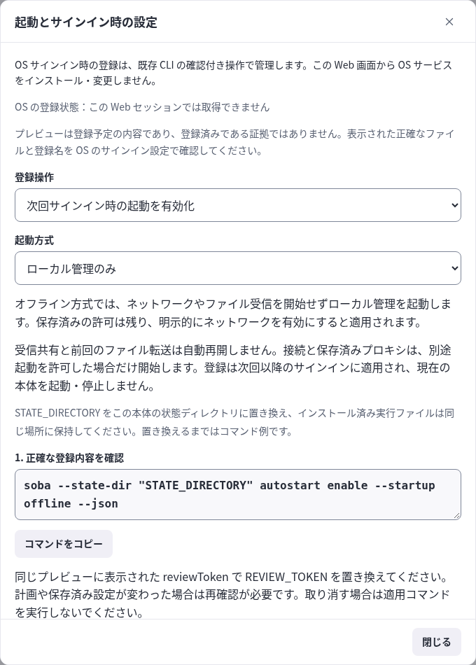
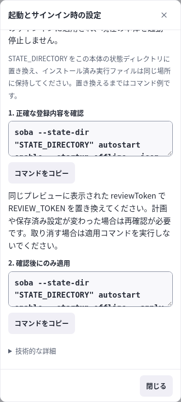

# ローカル Web 画面の操作

[English](WEB_CONTROLS.en.md) · [保存サービス](SAVED_SERVICES.ja.md) · [起動とログアウト](LIFECYCLE.ja.md)

ローカル Web 画面では、サービス接続、範囲を確認した共有、ファイルとメッセージ、保存済み定義、接続診断、任意の範囲付きプロキシ、Tailnet ログアウトを操作できます。CLI と同じローカルコマンド API を使います。ブラウザー、実機の互換性、OS サインイン時の動作確認は別の受入項目です。

## 画面を開いて目的を選ぶ

1. `soba` を起動し、新しいコードが必要なら `soba ui` を実行します。
2. 同じ端末で、表示された数値ループバック URL をそのまま開き、別に表示された一回限りのコードを入力します。サインイン出力やスクリーンショットは非公開に保ちます。
3. 接続・共有・転送では相手を選びます。再利用する定義は **保存済みサービス**、ローカル設定は **設定** から開きます。
4. 適用前に相手・ポートや内容・有効期間を確認します。応答が不明な場合は、操作を繰り返す前に状態を確認します。

| 表示 | 分かること |
| --- | --- |
| 端末がオンライン | ネットワークの観測。文字・ファイルの許可とは別 |
| 保存済みサービス | 保存した設定。待受中とは限らない |
| 待受の準備完了 | 通信の準備。アプリの成功とは別 |
| 送信待ちの受付 | ローカル受付。相手の保存とは別 |

以下では、各操作と復旧時の制約を説明します。

### メッセージを送る場所と受信の確認

デモデータでの画面例。実機での接続・配送・アプリ動作を検証した結果ではありません。

<picture>
  <source media="(max-width: 600px)" srcset="assets/screenshots/message-context-ja-narrow-input.png">
  
</picture>

[原寸で開く](assets/screenshots/message-context-ja.png) · [狭幅版](assets/screenshots/message-context-ja-narrow-input.png)

1. 左の相手を選びます。
2. 本文を入力します。狭い画面では入力欄までスクロールします。
3. 相手と内容を確かめて送信します。この例は下書きで、送信済みを意味しません。



[原寸で開く](assets/screenshots/receive-ja.png)

ファイル一覧 → 今回の保存先 → 受信するか、の順に確認します。保存先の例は架空です。画面を表示しただけでは受信も保存も行いません。

## 端末一覧とネットワーク図を使う

対象版と確認済みの範囲は[検証記録](VERIFICATION.md#現在の統合と公開済みの基準)を参照してください。実端末と OS ライフサイクルの受入は別です。[ファイル送信待ち](DURABLE_OUTBOX.ja.md)、[テキスト送信待ち](DURABLE_TEXT.ja.md)と[接続セットアップ](CONNECTION_SETUP.ja.md)は、それぞれの手順と制約を正本とします。

ヘッダーの **デバイス一覧** と **ネットワーク図** は、同じ検索・絞込みを使います。件数は接続先の端末を数え、この端末を含めません。絞込みで見つからない場合は **絞り込みを解除** で戻せます。図の端末または線を選ぶと、その相手の詳細を開きます。閉じる・Escape で元の操作へ戻ります。狭い画面では詳細が図に代わって表示されます。

オンライン、sobalink の応答確認、この端末での通信許可は別の状態です。Tailcat で応答がない相手は **応答未確認** と表示し、端末の停止や未導入とは断定しません。サービス情報を確認できなくても、通常の Tailnet 相手には許可済みポートを手動指定して接続できます。文字・ファイルには別途通信許可が必要です。

線はこの端末との関係を示します。現在のバックエンドが実際の経路を報告しない場合は **経路不明** のままです。設定済みの中継先は経路の実測を意味せず、中継だからインターネット経由、直接だから同じLANとも判断しません。図から相手のOS・機種・アプリの動作成功を推測しません。

サービスの接続先・状態・有効期間は行内で確認できます。コピー・編集・削除・診断は **サービスを管理** を開きます。稼働中の **停止** は直接操作できます。設定画面は項目ごとに開き、長いフォームでは見出しと閉じる操作を残して内容をスクロールします。確認・保存前のフォームを閉じるだけでは、通信や保存設定を変更しません。表示言語とテーマは選択時に反映し、このブラウザーへ保存します。

### 図から相手の詳細へ

デモデータでの画面例。実機での接続・配送・アプリ動作を検証した結果ではありません。

<picture>
  <source media="(max-width: 600px)" srcset="assets/screenshots/navigation-graph-ja-narrow.png">
  
</picture>

[原寸で開く](assets/screenshots/navigation-graph-ja-wide.png) · [狭幅版](assets/screenshots/navigation-graph-ja-narrow.png)

1. 相手を選びます。
2. オンライン、応答確認、許可、経路を別々に読みます。
3. 狭幅では詳細が図の代わりに開きます。閉じると図に戻ります。



[原寸で開く](assets/screenshots/navigation-detail-ja-narrow.png)

## 接続方式を選ぶ

オフラインで起動し、**ネットワークを設定**を開きます。[中継なしLAN](DIRECT_LAN.ja.md)は明示した数値のプライベートアドレス同士をペアリングします。[方式の併用](MIXED_CONNECTIONS.ja.md)はバックエンドを明示して選び、複数経路を同じ相手として扱う前に、新しい認証確認で対応付けます。未対応付けの経路も個別には利用できます。[LAN送信先制限](LAN_DESTINATIONS.ja.md)は許可する宛先の制限で、物理NICの固定やVPN経路の変更ではありません。WAN探索は数値STUN宛先やIPv6候補を別途明示する機能で、厳格なLAN送信先制限と併用できません。管理者権限やLANルーター変更は前提にしません。

保存前に設定と通信範囲を確認します。ローカルの準備完了は相手からの応答確認ではありません。中継なしLANの初回接続の不具合は修正し、localhostのTCP／UDP継続試験で確認しました。過去の 0.3.0-alpha.5 の同一ソースによるブラウザー試験と4対象配布ゲートは[検証記録](VERIFICATION.md)のとおり合格しています。実端末の到達性やアプリの動作成功は別に確認します。

## 経路復旧を準備する

LAN 設定で「詳細: 準備済みリレー候補」を開きます。`--offline` で起動中に、保存状態・交換形式の容量内で、正確な接続先・ピン・区分を持つ追加候補を追加・削除し、確認後に再起動します。元の中継とペアの識別は維持します。候補追加で新しい中継を起動することはありません。[中継のリソース予算](RELAY_OPERATIONS.ja.md)は実行時の接続・試行数を別に制限し、調整できます。候補の許可数を4件に固定する制約ではありません。

ペアの詳細で「接続経路の復旧」を開き、相手向けの非公開更新情報を作るか、相手から受け取った情報を検査します。相手・受信者・正確な接続先・ピン・期限を確認し、期間を確認して候補を明示して選びます。新しい提供と対応する許可は「取り消すまで」を初期表示し、有限・v1情報ではその期限以内の有限許可だけを選べます。期間は明確な確定操作で確認し、正確な候補を自動選択しません。任意の有限日時に30日という上限はありません。証明書の期限・ピン変更は別の到達性の条件です。保存済み情報の再確認で許可を変えたり、ローカル経路許可を全件取消したりできます。結果が不確かなときは再試行前に状態を更新します。CLI と同じ Core の検査を使います。情報作成には、初めは未選択の撤回オプションもあります。受信した空の情報は別の撤回確認へ進み、適用すると順序番号を記録して手元の経路許可を削除します。撤回情報の書出しだけでは手元の許可を変えません。

取消・戻るで非公開の更新文字列を消し、コピーは明示操作だけです。作成・取込み・保存は到達性を証明せず、文字・ファイル・サービスを許可しません。`local` は中継アドレスの区分で、厳密な LAN 通信制限ではありません。既存 TCP はアプリで再接続が必要な場合があり、ファイルを途中バイトから再開しません。[具体的な準備と限界](LAN.ja.md#別の経路を準備する)

## 停止中のファイル受信を確認する

**表示設定 → ファイルの受信 → 受信状態を確認**、または設定や相手別の自動保存にある **ファイル受信が停止中です** の案内を開きます。**受信の復旧** で現在の状態を読み取ります。ファイル受信の停止中も、ファイル送信・メッセージ・サービス操作は使えます。保存済みの自動保存許可は別の状態として表示します。

旧形式で索引が未作成なら、[6項目の確認と復旧の分岐](CAPACITY.ja.md#受信容量の復元)を終えてからチェックを入れ、**確認を保存して受信を再開** を選びます。画面を開く・閉じるだけでは確認しません。未作成の索引だけを初期化し、ファイルの削除・古い転送の再開・無効化した自動保存の再許可は行いません。

記録が破損・不明の場合は、この確認操作を表示しません。保存領域の修復・再接続と再起動の案内に従ってください。記録を破棄したり、容量計上を0へ戻したりする操作はありません。CLI では `soba receive recovery confirm` で表示し、同じ旧受信の確認を終えた後だけ `--reviewed` を指定できます。[復旧の詳細と制限](CAPACITY.ja.md#受信容量の復元)

デモデータでの画面例。実機での接続・配送・アプリ動作を検証した結果ではありません。

**旧形式の記録：確認項目がある場合**



[原寸で開く](assets/screenshots/receive-legacy-ja-wide.png)

**破損した記録：同じ確認では再開できない場合**


[原寸で開く](assets/screenshots/receive-damaged-ja-wide.png)

「不明」は空という意味ではありません。以前の保存先と保存済みファイルを調べ、6項目を実際に確認できる状態だけで確認を進めます。画面例は未確認のままで、再開操作を実行していません。

## オフラインでサービス定義を管理する

ヘッダーの **保存サービス** から **接続定義を保存** または **共有定義を保存** を開きます。保存するネットワーク、正確な端末 ID、ポートと対応、有効期間を指定してください。表示中の端末からの選択は任意です。見つからない端末も明示的な参照として保存できますが、保存だけでは現在の端末を検証せず、アクセスも許可しません。

**停止状態の定義を確認** で全範囲を見直し、**確認した定義を保存** を選びます。修正する場合は **この下書きを編集**、保存しない場合は **キャンセル** を使います。定義は停止状態のままです。各定義の **サービスを管理** に **保存済み定義を編集**、**保存済み定義をコピー**、**定義を削除** があり、相手が利用できなくても操作できます。有効な定義は編集前に停止し、コピーは別の識別情報で保存します。既存定義のネットワークを変える場合もコピーを使います。

編集には現在の保存内容のリビジョンを使います。競合した場合は再読み込みし、確認し直してください。削除前には現在の定義、有効なサービス、影響するグループを確認します。キャンセルでは変更しません。所有タスクとリース情報がある場合は表示します。手動操作で別のタスクの所有権を取得できないため、所有タスクで操作するかリース終了を待ってください。

公開サービスの開始は[公開情報の鮮度による分岐](GENERIC.ja.md#公開情報が確認中に変わったら)に従い、用途と公開範囲のポートは個別に編集できません。**公開情報を更新して確認** で表示中の情報を明示的に受け入れ、**ポートを手動で入力** では公開情報への参照を解除します。オフラインで過去の参照を保存・コピーしても接続開始は許可されません。

デモデータでの画面例。実機での接続・配送・アプリ動作を検証した結果ではありません。



[原寸で開く](assets/screenshots/stopped-review-ja-focused.png)

相手とポート対応 → 有効期間 → 保存、の順に確認します。ここで保存するのは停止中の定義です。開始は別の確認になります。

## サービスの探索結果を読む

端末の詳細と接続設定には、サービス情報の最終確認を表示します。確認済みの空の応答は、現在公開中のサービスがないという意味です。許可済みポートが分かる場合は手動で入力できます。確認中・未確認・対応応答なしという結果から、ソフトウェアが存在しない、端末やアプリがオフラインとは判断できません。容量超過の場合は **表示設定 → 容量と履歴** を見直して再確認します。古い情報では公開サービスを選択せず、**共有サービスを確認** で明示的に再照会してください。通常の端末も明示的な共有対象として選べます。

デモデータでの画面例。実機での接続・配送・アプリ動作を検証した結果ではありません。



[原寸で開く](assets/screenshots/service-review-ja.png)

表示中の相手・共有範囲・期限を確認します。確認中に範囲が変われば、同じまま開始せず再確認が必要です。この例では開始していません。

## Tailnet からログアウトする

**ネットワークを設定 → Tailnet からログアウト** を開きます。有効なサービス、プロキシ、進行中の転送を確認し、**キャンセル** で変更せず戻れます。**通信を停止してログアウト** はローカル通信を止め、埋め込みノードにログアウトを要求して本体を終了するため、この管理画面も切断されます。

[ログアウト結果と再試行の分岐](LIFECYCLE.ja.md#tailnet-からのログアウト)で、バックエンドの確認応答・終了処理・本体の終了を区別してください。結果欄には状態確認・同じプロフィールでの再起動・ログアウト・新しいローカルアクセスコード取得のコマンドがあります。保存済みの許可・定義・ファイルは残り、LANペアリングの取消は別操作です。

## OS サインイン時の起動を確認する

**表示設定 → 起動とサインイン時の設定** を開きます。OS 登録は CLI で管理します。Core に確認付き OS 登録 API はないため、Web 画面は登録済みかどうかを断定せず、OS コマンドも実行しません。

**保存済みネットワークと受信許可を復元** または **ローカル管理のみ** と、有効化・無効化を選びます。プレビューコマンドをコピーし、`STATE_DIRECTORY` をこの本体の状態ディレクトリに置き換えて、インストール済み実行ファイルで実行してください。正確な登録内容、ネットワーク、自動受信の相手と保存先を確認した後にのみ、同じプレビューの `reviewToken` で `REVIEW_TOKEN` を置き換えた適用コマンドを実行します。取り消す場合は適用前にやめます。計画・設定の変更やサービス管理のエラーがあれば、内容を調べて再度プレビューし、強制置換はしません。

登録は次回以降のサインインに適用されます。保存済み方式は保存ネットワークと許可済み・未停止の自動受信を復元し、オフライン方式はローカル管理だけを起動します。定義の保存や OS 起動登録だけでは、サービスやプロキシの自動開始を許可しません。任意の自動開始には別途確認した起動許可が必要で、オフライン方式では抑制します。正確な範囲は[起動許可ガイド](STARTUP.ja.md)を参照してください。前回のファイル転送は再開しません。登録を無効にしても実行中の本体は停止しません。プレビューは計画であり登録状態の確認ではないため、正確なファイル・登録名を OS のサインイン設定で確認してください。


デモデータでの画面例。実機での接続・配送・アプリ動作を検証した結果ではありません。



[原寸で開く](assets/screenshots/startup-guide-ja-wide.png)



[原寸で開く](assets/screenshots/startup-guide-ja-narrow-actions.png)

画面内のコマンドを唯一の入力元にしないでください。以下は `STATE_DIRECTORY` と、実際のpreviewで得た `REVIEW_TOKEN` を置き換える例です。

```sh
soba --state-dir STATE_DIRECTORY autostart enable --startup offline --json
soba --state-dir STATE_DIRECTORY autostart enable --startup offline --apply --review REVIEW_TOKEN --json
```

## 保存済みサービスからクライアントを設定する

既存サーバーを使う場合は **保存サービス → 接続設定の補助 → RustDesk グループを保存** を開きます。ID・リレーサーバーの端末をそれぞれ選びます。現在利用できない端末は正確な保存済み ID を入力できます。サーバーの公開鍵、接続先とローカルの ID・リレーポート、数値のループバックアドレス、有効期間を指定します。入力するのは公開鍵だけで、秘密鍵やパスワードは入力しないでください。

**4つの通信経路を確認** で、NAT TCP・ID TCP・ハートビート UDP・リレー TCP の正確な端末とポート対応を確認します。NAT は ID ポートから1を引いた番号です。公開鍵と全端末で共通のリレー設定に関する説明を読み、**確認したグループを保存** します。**設定に戻る** とプレビューを破棄し、**キャンセル** では定義を変更しません。プロファイルが変わった場合は再確認します。同名で異なる設定がある場合は新しい名前を使います。同じ設定は保存済みとして扱います。保存だけでは待受を開始しません。**保存済みグループを開く → 開始内容を確認** から別途開始します。

各サービスの **クライアント設定**、または「接続設定の補助」の **選択したサービスの設定** で、実際の保存済み対応と現在の待受準備を確認できます。必要な接続先や SSH コマンドをコピーしてください。SSH は相手固有の HostKeyAlias を使います。ホスト鍵は別の方法でも確認します。HTTP URL は候補にすぎず、HTTPS では元の TLS ホスト名・SNI・オリジン・証明書検証が必要です。範囲の場合は単一の接続先を作らず、アドレスと正確なポート対応を表示します。変更後は **設定を再読み込み** を使います。コピーが失敗しても文字列を選択してコピーできます。

RustDesk 設定には ID・リレーの接続先、公開鍵、空欄のプロキシ、有効な UDP、末尾の `/r` を表示します。参加する全端末で同じローカルリレーアドレスとポートを使い、4つの転送とサーバーへの許可を用意してください。既存の RustDesk 設定は変更前に控えを保存します。soba を停止しても元には戻りません。この画面は外部アプリを起動・設定しません。予定・保存済み・準備完了の状態だけではアプリの成功を確認できません。インポートの確認では、公開鍵や役割情報を削除・変更する補助グループ名を表示します。

## グループの今回だけの有効期間を選ぶ

**開始内容を確認** の **今回の開始に使う有効期間** は、最初は各サービスの保存済み有効期間です。任意の選択で1時間または正の整数秒を指定できます。すべて接続なら **停止するまで**、すべて共有なら **取り消すまで** も選べます。各サービスに表示する期間を確認し、開始またはキャンセルしてください。変更は今回の開始だけに適用し、保存済み定義は維持します。再試行で有効な許可を延長しません。別の期間で実行中の場合は明示的に停止し、改めて開始内容を確認します。実行中のサービスのクライアント設定には実際の有効期間を表示します。

**共有サービスを確認** は公開情報だけを再照会し、実行中の通信を再起動しません。新しい接続の開始条件は[公開情報の確認](GENERIC.ja.md#公開情報が確認中に変わったら)を参照してください。


## 任意で今後の起動を許可する

保存済みの外向き接続または外向き接続だけのグループを選び、**接続設定の補助 → 自動開始の内容を確認** を開きます。未選択でも既存の許可を一覧できます。許可の名前を入力し、**今後の起動内容を確認** でネットワーク・端末名・全端末 ID・ポート・対応・有効期間を確認します。同名の許可を置き換える場合はチェックを入れてから **確認した今後の起動を許可** を選びます。キャンセル・戻るでは変更せず、保存しても今すぐ開始せず、OS の起動登録も行いません。

次回以降のオンライン起動では、ネットワークの準備後、正確に許可した選択ごとに1回だけ開始を試みます。有限の有効期間はその時点から新たに始まります。オフライン起動ではそのプロセスの自動開始を抑制します。定義・グループ・ネットワーク・端末名の変更や相手の取消では再確認が必要で、再び許可しても古い起動許可は復活しません。実行を停止したり期限切れになっても直ちに再開しません。今後のプロセス起動の許可は無効にするまで残ります。起動処理の結果は現在の待受準備やアプリの成功を証明しません。

**起動許可の無効化を確認** で対象と影響を確認できます。確定すると今後・未実行の起動を無効にし、実行中のサービスは停止しません。確認が古い場合は再読み込みして確認します。非公開領域への保存に失敗した場合は有効化・無効化が保存されたと判断せず、保存先を修復して再読み込みしてください。[起動と非公開設定の詳細](STARTUP.ja.md)も参照できます。

## プロキシ認証情報を任意で非公開保存する

**表示設定 → 高度な接続** で正確なプロキシ範囲を確認します。**認証情報の入力へ** は通常の一時的な利用です。**確認したプロキシを保存** では非公開保存の影響を読み、明示的な生成または非公開入力を選べます。**この正確なプロキシを今後のオンライン起動時にも許可する** は最初は無効です。保存・生成は保護されたローカル状態ディレクトリへ行い、持ち出す定義とは分離し、待受を開始しません。生成しても認証情報は自動表示しません。同名の保存内容を置き換える場合は別のチェックが必要で、同名の実行中待受を事前に停止します。

**保存済みのプロキシ認証情報 → 保存済みプロキシを管理** で、認証情報を含まない範囲と状態を確認します。**保存済みプロキシの開始を確認** は現在の端末情報と正確な待受・接続先を再確認します。**今後の起動の無効化を確認** と **保存済み認証情報の削除を確認** は別操作で、キャンセルでは変更しません。認証情報・今後の起動・現在の接続への違いは[非公開プロキシの状態と操作](STARTUP.ja.md#非公開-socks-設定)を参照してください。

認証情報の表示は **認証情報を一時的に表示** だけです。非表示・閉じる・範囲変更で非公開欄を消去し、エクスポート・履歴には含めません。自動のブラウザー受入確認では非公開欄のある画面を撮影しません。コピーは明示操作で、選んだ値は別の内容へ置き換えるまでシステムのクリップボードに残ります。認証情報をコマンド引数・ソースコード・画像・共有ファイルへ含めないでください。保存失敗・結果不明の場合は入力を消去し、記録を再読み込みして新しい範囲確認から再試行します。既存のローカルセッション・Host・Origin・CSRF の保護を維持します。インストール済み本体の起動、ファイル権限、外部クライアントの実動作は別途受入確認が必要です。

## 0.3.0-alpha.2 で導入した読みやすいコンパクトな操作

端末一覧には常に検索ラベルを表示し、選択行を維持します。端末画面では、サービスの操作とファイル・メッセージの操作を別グループへ整理し、現在のタブの見出しを繰り返さないようにしました。サービス行は保存名と種別・実行状態・直接操作を揃え、接続先・有効期間・管理の詳細をその下に表示します。狭いパネルでは同じ内容をコンパクトな2段の見出しへ折り返します。

サービスの入力は「接続先・アクセス」と「サービス設定」を分け、その後に正確な確認内容を表示します。表示設定は表示・受信・管理のまとまりに整理し、詳細な選択肢は必要なときに開けます。閉じるときの既存の下書き保持は維持し、分類の変更だけで設定を適用しません。

入力値とコピー用の値は16pxで表示し、補助説明とコンパクトなメタ情報は別の文字サイズで区別します。ボタンやユーティリティは、両テーマでマウスを重ねる前から読める文字・アイコンと控えめな面の色で識別します。入力欄の境界は残し、クリックとキーボードのどちらでも、入力中は既存の輪郭に沿って強調します。離れた二重枠は付けません。メッセージ入力は外側の枠を強調し、付属する操作ボタンには個別のキーボードフォーカスを表示します。利用できない操作は文字が読める中立的な表示とし、読み取り専用の値は選択できます。選択中のタブは面の色と文字の強さで区別します。全ての操作を枠や下線で強調せず、少数の区切り線と行の整列で構造を示します。タッチ画面では主な操作を44px以上に保ち、大きすぎるカードを避けています。この表示変更は 0.3.0-alpha.2 に含まれます。0.3.0-alpha.5 の接続操作には独自の同一ソース・ブラウザー証拠があり、[検証記録](VERIFICATION.md)に示します。後続の画面変更には別の受入が必要です。

## 明示的に選ぶ永続ファイル送信待ち

`soba send --queue --peer PEER_ID --expires-in 24h --json PATH` は送信せずに予約の確認を準備します。Web でも送信方法・期限を明示確認します。予約済みはローカル受付で、配達完了ではありません。結果不明なら元の要求 ID を照会してください。承認・再起動・停止・追加 API は[永続送信待ち](DURABLE_OUTBOX.ja.md)を参照してください。
