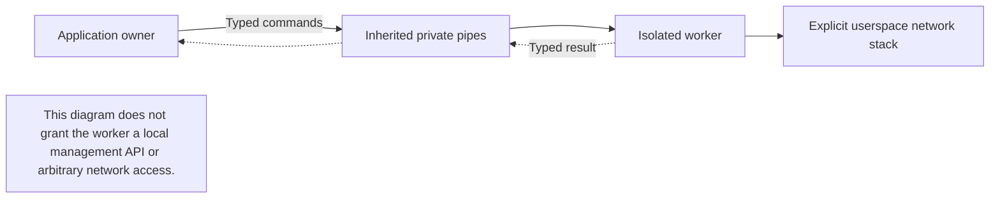

# Isolated backend worker transport

This package carries a typed network engine over inherited owner pipes. It supports numeric netstack dialing, listeners, current identity checks, TCP streams, UDP datagrams, half-close and explicitly scoped TCP fallback admission. It does not expose an OS-network application fallback, execute shell commands or launch a network engine by itself.

Worker framing, request concurrency and open handles are finite configurable resource budgets. Large streams are chunked, so frame size is not a file-size limit. The minimum frame preserves one full legal UDP datagram. Reserved control capacity prevents data reads from blocking revocation and closure. Budget changes apply to a new worker generation after restart.

A scope reduction closes old child streams before acknowledgment. A stale accepted connection is rejected after its permission generation is retired. Owner EOF closes worker-owned listeners and streams. Request cancellation affects only that request and any abandoned stream/handle it creates. Retained request slots bound late-result cleanup; unrelated streams stay open. Already-canceled calls send nothing, and canceling a completed call does not retire the worker. No application bytes are replayed, and an existing TCP stream may fail if its worker exits.

Tests include socket-free framing, cancellation, peer-stream data, owner shutdown and real helper-process isolation. Synthetic helpers do not establish real Tailnet enrollment or NAT compatibility. The surrounding application must still bind exact backend identities, independently enforce resource grants and obtain explicit cross-backend route approval.

## Trace ownership and closure

Text equivalent: the application owner controls the worker through inherited typed pipes; the worker uses the selected userspace stack. There is no OS-network application fallback.

Review in this order: exact backend identity and resource permission, finite frame/request/handle budgets, cancellation cleanup, then generation retirement and owner EOF. New budgets take effect on a new worker generation; they never grant broader access.
