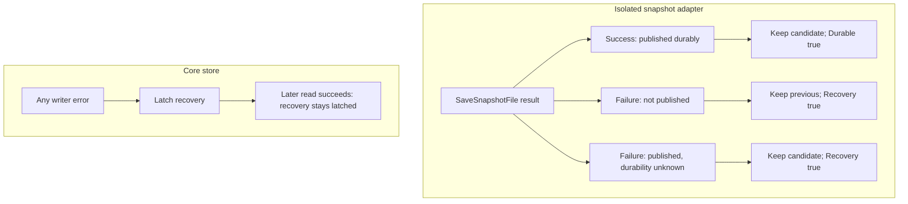
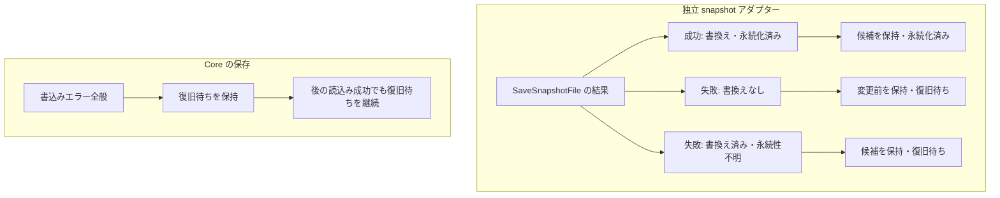

# Endpoint metadata contracts

This package provides data contracts for authenticated endpoint updates. Core
uses its records and validators for private direct-LAN state v3, stopped-state
transactions and the managed context/endpoint-following candidate. Source
integration is distinct from exact-source runtime and release acceptance; see
the [historical integration snapshot](../../docs/CONVENIENCE_PLAN.en.md#current-alpha6-evidence-snapshot).

## Read the contract by operation

| Operation | Review first | Preserve on uncertainty |
| --- | --- | --- |
| Load existing state | Reader version and exact state format | Original state; no automatic migration |
| Review/apply stopped-state migration | Current process, file and revision | No implicit pair context or new grants |
| Save an isolated snapshot | Positive byte budget and exclusive ownership | Published-but-uncertain durability and recovery requirement |
| Follow a managed endpoint | Current context and reviewed authority | Pending recovery; no legacy fallback |

日本語: 既存状態は形式と読取り版を確認し、自動移行しません。停止中の移行は現在のプロセス・ファイル・版を確認し、ペア文脈や許可を暗黙に追加しません。独立した snapshot 保存は容量上限と排他的所有を必要とし、保存済みでも永続性が不明なら復旧待ちを保持します。管理対象の端点追従は現在の文脈と確認済み許可を使い、従来方式へ自動で戻しません。

The detailed English/Japanese contracts below remain authoritative. Current release evidence is in [verification](../../docs/VERIFICATION.en.md); the convenience-plan link records the earlier integration checkpoint.
Core still owns one `direct-lan.json` file, its identity and selected endpoint.
Valid v2 files load without an automatic rewrite. The stopped/offline
`direct-lan.migration.review` and `direct-lan.migration.apply` actions require a
review revision bound to the current process, exact file and state. Migration
wraps existing peers without creating pair contexts, following consent or
application grants. The v3 file requires a v3 reader; older binaries must not
strip its metadata or downgrade it. No real profile has been migrated as part
of this source work.

Legacy-only v3 records use the existing exact-endpoint path. Managed records
require current context, reviewed authority and the managed activation path;
they cannot silently fall back to legacy mutations. Core integrates authenticated
context exchange, durable pair-removal markers and signed endpoint controls.
Pending recovery is never automatically cleared. Endpoint withdrawal, disabling
following, application revocation and terminal pair removal remain distinct actions.

It provides strict, bounded wire encodings, context-bound signatures and fixed
synthetic vectors, plus candidate records, persistence-result models and an
unused private-file adapter for isolated snapshots. A saved eligibility result
describes the supplied model; it is not current application authority or evidence
that a connection is ready.

`ReadSnapshotFile` and `SaveSnapshotFile` require an explicit positive byte
budget and use the existing canonical snapshot encoding. Reads return evidence
without initializing missing files, reconciling pending changes or confirming
durability. Saves call `config.AtomicWritePrivate` once and preserve its original error.
`ErrAtomicCommitted` identifies the published-but-uncertain branch below.
`ResolveSave` retains the appropriate model and recovery outcome. No identity secrets or current application grants belong in these
files.

### Which save outcomes require recovery?

Text equivalent: a successful save keeps the candidate as durable; an unpublished failure keeps the previous model, and a published-but-uncertain failure keeps the candidate. Both errors require recovery. Core latches recovery on every writer error; a later read cannot clear it.

Implementation references: [private_file.go](private_file.go) · [transition.go](transition.go) · [direct_lan_context_store.go](../core/direct_lan_context_store.go) · [lan.go](../core/lan.go).

Atomic publication is not a logical compare-and-swap. The caller must exclusively
own model and file lifecycle access, perform current authorization checks and
reconcile uncertain outcomes. The reader rejects symlink and nonregular targets
and bounds reads independently of file size checks; it does not establish safety
against malicious concurrent pathname substitution. This adapter introduces no
application caller, migration or new live profile schema.

The Core integration uses its store mutex and the existing exclusive profile
lifecycle, keeps the published/uncertain AtomicWrite result and latches recovery
after any write error. It does not use this package's separate snapshot-file
adapter as a second store. Core owns context establishment, current authorization
and activation; their integrated acceptance is recorded separately. No runtime or crash-recovery guarantee is
established by this package's synthetic storage tests. Restoring an entire old
profile is also outside its rollback-detection guarantees.

Focused checks: `go test -race ./internal/endpointmeta` and
`go vet ./internal/endpointmeta`. Test keys and addresses are public test vectors
or synthetic data; they are not credentials for a running service.

## 日本語

このpackageは認証済み接続先更新のデータ契約を提供します。
Coreの非公開direct LAN状態v3、停止中の保存操作、管理対象の文脈と端点追従の候補に、
記録と検証処理を組み込んでいます。ソース統合と同一sourceの実行・配布受入は区別し、
[過去の統合時点の証拠](../../docs/CONVENIENCE_PLAN.ja.md#alpha6の現在の証拠)を参照してください。

Coreは引き続き1個の `direct-lan.json` と、識別情報・選択済み接続先を管理します。
有効なv2ファイルは自動で書き換えずに読み込みます。停止・オフライン状態での
`direct-lan.migration.review` と `direct-lan.migration.apply` は、現在のプロセス・
ファイル全体・保存状態に結び付いた確認リビジョンを必要とします。移行は既存ペアを
新しい記録形式で包むだけで、ペア文脈・接続先追従・アプリの許可を作りません。
v3ファイルにはv3対応の読取り実装が必要です。古い実装のために情報を削除したり、
形式を戻したりしてはいけません。このソース作業で実際のプロファイルは移行していません。

従来ペアだけを含むv3は既存の固定接続先経路を使います。管理対象の記録には、
現在の文脈・確認済み許可・管理対象の有効化経路が必要で、従来方式の変更処理へ
自動で戻しません。Coreには認証付き文脈交換、永続的なペア削除記録、署名付き
端点操作を組み込んでいます。復旧待ちは自動解除しません。端点の撤回、追従無効化、
アプリ許可解除、ペアの最終削除は別の操作です。

厳密で容量制限のある交換形式、組合せに結び付く署名と固定テストデータ、変更候補の
記録と保存結果のモデル、および独立したスナップショット用の未使用の非公開ファイル
アダプターを提供します。保存済みの利用条件を満たすという判定は、
渡されたモデルについての結果です。現在のアプリの許可や接続準備完了を示しません。

`ReadSnapshotFile` と `SaveSnapshotFile` は明示的な正のバイト上限を必要とし、
既存の正規化されたスナップショット形式を使います。読み込みは記録を返すだけで、
存在しないファイルの初期化、保留中の変更の整合確認、永続性の確認は行いません。
保存は `config.AtomicWritePrivate` を1回呼び、元のエラーを保持します。
`ErrAtomicCommitted` は下図の書換え済み・永続性不明の分岐を示します。
`ResolveSave` で対応するモデルと復旧状態を保持してください。
識別用の秘密鍵や現在のアプリの許可情報は、これらのファイルに含めません。

### どの保存結果で復旧待ちを保持するか

文章での説明: 保存成功は候補を永続化済みとして保持します。書換え前の失敗は変更前、書換え済みで永続性不明の失敗は候補を保持し、どちらも復旧待ちです。Core は全書込みエラーで復旧待ちを保持し、後の読込み成功では解除しません。

実装参照: [private_file.go](private_file.go) · [transition.go](transition.go) · [direct_lan_context_store.go](../core/direct_lan_context_store.go) · [lan.go](../core/lan.go).

ファイルのアトミックな書き換えは、モデルの論理的な比較更新ではありません。
呼出し側はモデルとファイルのライフサイクルを排他的に管理し、現在の許可確認と
結果が不確かな場合の整合確認を行う必要があります。読み込みはシンボリックリンクと
通常ファイル以外を拒否し、ファイルサイズ確認とは別に読み込み量を制限します。
悪意ある同時のパス差し替えに対する安全性は保証しません。このアダプターは、
アプリからの呼出し、移行、新しい実プロファイル形式を導入しません。

Coreの組込みは既存の保存ロックとプロファイルの排他的所有を使い、AtomicWriteの
書換え済み・永続性未確認という結果を保持し、書込みエラー後は復旧待ちにします。
このpackageの独立したファイルアダプターを2個目の保存先として使いません。
文脈の確立、現在の許可確認、有効化はCoreが管理し、その統合受入は別に記録します。
合成データの保存試験は実通信や異常終了後の復旧保証ではありません。
古いプロファイル全体の復元を検出できる保証もありません。

対象の確認は `go test -race ./internal/endpointmeta` と
`go vet ./internal/endpointmeta` です。テスト用の鍵とアドレスは公開テストベクトルまたは
架空のデータで、稼働中のサービスの認証情報ではありません。
