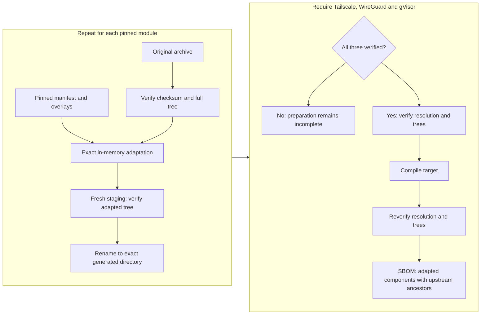
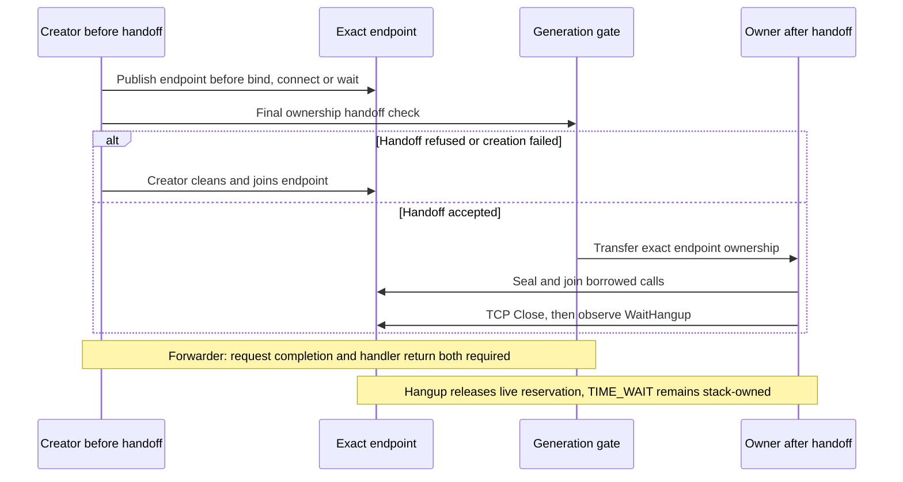
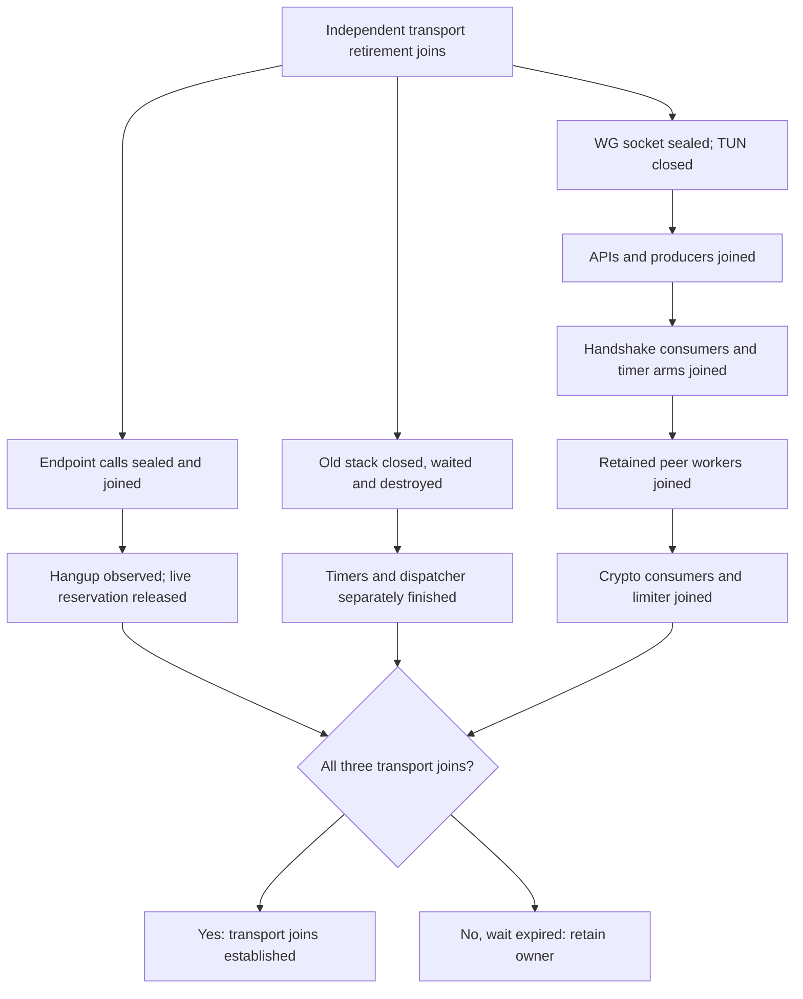
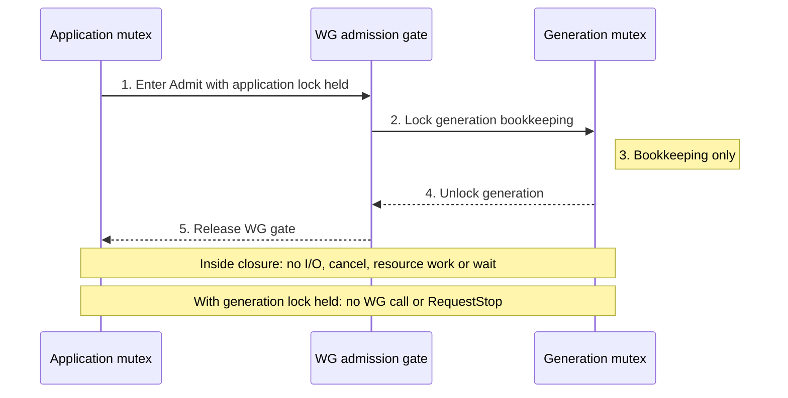

# Pinned transport dependency adaptations

Sobalink prepares three exact local dependency trees with `go run ./cmd/prepare-engine`:

| Upstream module | Version | Generated directory |
| --- | --- | --- |
| tailscale.com | v1.104.0 | .sobalink-deps/tailscale |
| github.com/tailscale/wireguard-go | v0.0.0-20260928213032-417aef361226 | .sobalink-deps/wireguard |
| gvisor.dev/gvisor | v0.0.0-20260915211658-a6f909f08a72 | .sobalink-deps/gvisor |

The version-qualified replacements in `go.mod` are a fixed set. Other modules,
versions, output paths or extra replacements are rejected. Preparation imports
only the standard library and local preparation packages, so it can start before
any generated dependency directory exists. It does not compile or start transport
code. The low-level Tailscale-only validator remains available for its own source
fixtures; the product command always selects the three-module configuration.

## Source and license identity

WireGuard comes from revision `417aef361226c869ab29e15fe3539b01173c4719` at
<https://github.com/tailscale/wireguard-go/tree/417aef361226c869ab29e15fe3539b01173c4719>
and retains its MIT license. gVisor comes from revision
`a6f909f08a7250c080b5b70f3513e8b27b75f64a` at
<https://github.com/google/gvisor/tree/a6f909f08a7250c080b5b70f3513e8b27b75f64a>
and retains Apache-2.0. The existing Tailscale record is described in
[engineadaptation/UPSTREAM.md](../engineadaptation/UPSTREAM.md).

`wireguard.json` and `gvisor.json` bind each original module/archive checksum,
go.mod checksum, immutable revision, original file hashes, complete original
source-tree digest, overlay hashes and complete adapted-tree digest. `pin.go`
independently authenticates the manifest bytes. `sources/` contains only changed
or added files, with `.txt` appended so upstream packages are not compiled as
part of the preparation tool. Original notices remain in modified files; added
files carry the corresponding license and modification notices.

The complete pinned gVisor license is also retained at
`licenses/gvisor/LICENSE` for standalone source delivery. Its SHA-256 is
`0fbab5c58efbdf6d31e8085214f2dd821659c03d73cff3ed2b08e98826ea1cd9`, matching the
manifest's original LICENSE entry. Distribution retains each complete original
module notice inventory, all overlays, manifests, preparation sources and
explanations. Source components use distinct identities
`internal/lifecycleadaptation/wireguard` and `internal/lifecycleadaptation/gvisor`;
these identify the two manifest groups, not separate source checkouts.

## Preparation and verification

The preparer checks every selected checkout input before creating output. It
obtains only the original pinned Go archives and verifies their canonical Go h1
checksums and full source trees. `PrepareArchive` applies overlays in memory;
`MaterializePinned` writes a fresh staging tree outside the module cache, checks
it again, and renames it into its exact generated location. Upstream extracted
source is never patched in place. Existing output is fully rehashed; links,
reparse points, unknown files and source drift are rejected rather than silently
repaired. Inspect and explicitly remove a changed generated directory before
preparing it again.

### How do three original modules become verified build inputs?

Text equivalent: each original archive and full tree is authenticated before applying its separately pinned adaptation. Only verified staging trees become generated inputs, and all three are required. Distribution checks resolution and trees before and after compilation and retains separate original/adapted provenance. Existing generated output is fully rehashed and rejected on drift; a verified partial preparation can resume without being called complete.

Implementation references: [main.go](../../cmd/prepare-engine/main.go) · [materialize.go](materialize.go) · [archive.go](../engineadaptation/archive.go) · [main.go](../../cmd/package-tool/main.go).

`go run ./cmd/prepare-engine --verify` performs read-only verification of all three
input sets and generated trees. With the pinned toolchain and original archives
already cached, `GOPROXY=off go run ./cmd/prepare-engine` uses the same preparation
path offline. Partial preparation retains only verified output trees; the all-three gate above
still applies on a resumed invocation.

Distribution checks exact package/module resolution and complete generated trees
before and after compilation. Its build metadata records actual target-linked
inputs as well as the retained adaptation recipes. The SBOM identifies each
adapted component separately and records the original module as an ancestor;
it does not label a modified runtime as the unmodified upstream module. Package
and installation verification independently checks retained manifests, overlays,
licenses, recipes and source identities.

## Lifecycle boundaries

The additive gVisor forwarder API admits a request before launching its handler,
publishes its endpoint before waiting for the handshake, wakes on cancellation,
and transfers ownership through the generation's final handoff check. Only the
creator cleans an endpoint before handoff. Request completion and handler return
are separate obligations. Creator completion does not establish stack or dispatcher
completion; outgoing creators and ingress must follow their own generation fences.

### Who owns a created endpoint?

Text equivalent: the creator owns cleanup until the final generation handoff succeeds. The receiving owner then seals and joins borrowed calls before terminal endpoint observation. Request completion, handler return and stack retirement remain separate obligations.

Implementation references: [creator.go](../directlan/creator.go) · [endpoint_owner.go](../directlan/endpoint_owner.go) · [forwarder.go.txt](sources/gvisor/pkg/tcpip/transport/tcp/forwarder.go.txt) · [endpoint_owned.go.txt](sources/gvisor/pkg/tcpip/transport/tcp/endpoint_owned.go.txt).

The additive gVisor `Endpoint.WaitHangup` observes the same TCP hangup event
as an already-registered upstream `Wait`, including entry into `TIME_WAIT`.
It registers before checking `CLOSE`, `ERROR`, and `TIME_WAIT`, so a late
observer cannot miss the hangup and wait for the default one-minute timer.
The direct-LAN endpoint owner uses it after sealing and joining all borrowed
calls. Normal close keeps TCP's `TIME_WAIT` behavior intact; retirement still
aborts an unfinished close. This observation releases the application's live
endpoint reservation, not the stack-owned timer or dispatcher. Generation
retirement must still close, wait, and destroy the old stack independently.
The ordinary upstream `Wait` API and protocol timeouts are unchanged.

The opt-in WireGuard facade restricts configuration to one initial bind/start,
non-lazy peers, zero persistent keepalive and the documented nonblocking callbacks.
It seals/wakes the exact socket and TUN before application cancellation bookkeeping,
then joins API/producers, handshake consumers, timer arms, retained peer workers,
crypto queues/consumers and limiter cleanup. Ordinary empty bind Close remains
distinct from terminal SealAndClose. BeginSetup must span initial configuration
and be released before waiting. A wait timeout retains the owner; it does not
manufacture terminal completion. Retained peer admission is capped at MaxPeers.

### What still has to finish after endpoint hangup?

Text equivalent: endpoint hangup, stack shutdown and the restricted WireGuard worker join are distinct completion requirements. WireGuard wakes socket/TUN operations before joining producers and then consumers. A timeout proves none of the missing joins and retains ownership. Outer creators, handlers and retained application participants still need their own joins. This obligation map does not establish that RetireTransport or replacement publication is complete.

Implementation references: [endpoint_owner.go](../directlan/endpoint_owner.go) · [generation.go](../directlan/generation.go) · [owned.go.txt](sources/wireguard/device/owned.go.txt).

Peer callbacks include a nonzero immutable registration token scoped to one WG
owner. Values never repeat; explicit exhaustion rejects rather than wrapping.
Same-key re-pair receives a new identity. PeerRegistered runs synchronously before
publication/start, outside owner.mu, and must bind the exact session selected for
that configuration transaction. Later callbacks reject mismatched tokens; owned
receive never falls back to key-only attribution.

### Which lock direction is allowed inside Admit?

Text equivalent: acquire application mutex → WG admission gate → generation mutex, and release in reverse order. The short bookkeeping closure must not perform I/O, cancellation, resource operations or waits. A generation-lock holder must never enter the WG facade or request stop.

Implementation references: [owned.go.txt](sources/wireguard/device/owned.go.txt).

Bind/TUN/callback implementations must satisfy their documented behavior; Go
interfaces alone do not prove those properties. The joint lifecycle and caller
lock graph requires its own review.

The additive `device/owned_lifecycle_testing.go` overlay is compiled only when
both `directlan_integration` and `directlan_lifecycle` are selected. Its fixture
stats copy the existing atomic handshake timestamps and the actual session-expiry
deadline under its existing mutex, preserving the deadline's monotonic time.
Completion time is not a proxy for key derivation. No UAPI serialization, peer
identity, endpoint or key material is exposed. Three named test operations
invoke the existing expiry, flush and scheduled-on-next-send methods without
changing their behavior or protocol thresholds. Each takes an API completion
lease, holds the existing configuration serializer, rejects terminal stop and
stale/non-running registrations, and invokes the operation after the admission
gate and peer lookup lock are released. The lease lasts through synchronous
session-state notifications. No raw handle or arbitrary callback escapes, and
the production facade has no added surface when either fixture tag is absent.

Source identity, compilation, lifecycle correctness, application compatibility and
installed-binary verification are separate results. A successful source verification
does not demonstrate worker termination, retained-listener behavior or network
compatibility. Platform, race, lifecycle, reproducibility, signing and distribution
checks remain necessary for the final integrated source.
