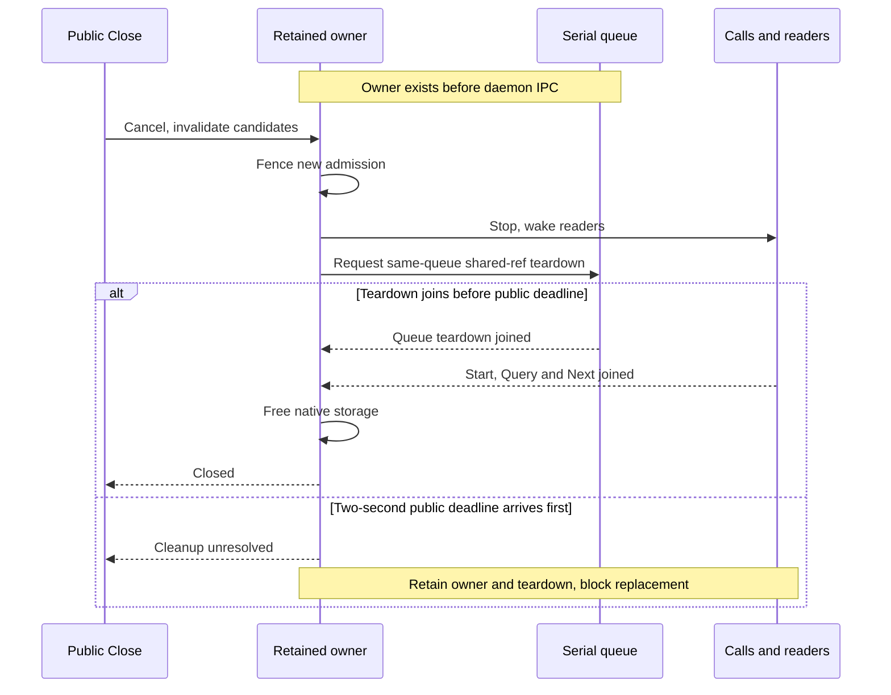
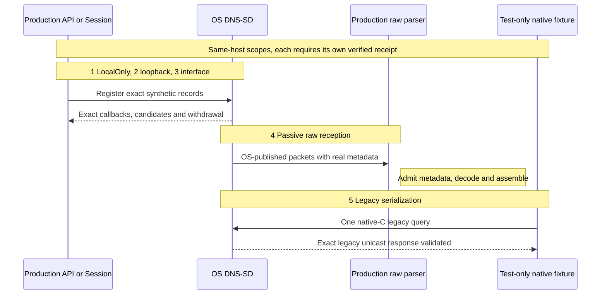

# macOS DNS-SD discovery boundary

The macOS adapter uses the system DNS-SD service on the explicitly selected interface. It produces untrusted setup hints. A selected hint never grants trust or permission to connect; the existing numeric bootstrap endpoint, current remote session, full fingerprint comparison and both peers' approval remain mandatory.

## Review the provider result

1. Confirm the explicitly selected interface and current random discovery session.
2. Treat the returned records as setup hints with the documented OS visibility limits.
3. Authenticate the selected endpoint and obtain the existing approvals independently.
4. If permission or provider availability fails, show unavailable and use manual setup. Do not widen the interface scope or change OS settings automatically.

[Provider selection and shared limits](README.md) · [Current verification](../../docs/VERIFICATION.en.md)

## Scope and privacy

The adapter registers four bounded records for the current random session: PTR, SRV, TXT and one A record. Instance and host names derive only from that session, never the OS hostname. The A record contains only the selected IPv4 address. Queries follow only the exact service and validated session-derived instance/host names. No default hostname/domain, interface Any, automatic rename, P2P inclusion, generic hostname resolver or wider fallback is used.

DNSService selects an interface, not an IPv4-only packet transport. The advertised/bootstrap address stays within the approved IPv4 prefix, but the system API does not expose the original UDP source, source port, destination, IP TTL, packet family or complete datagram. It does not attest that the daemon used the selected IPv4 source. Linux and Windows retain actual packet admission checks; their bounded assembler accepts independently scoped advertised addresses and separate DNS records without treating packet source as endpoint ownership.

Permission denial is an unavailable result. Tests and the product do not accept Local Network permission prompts or change OS/network settings automatically. The user can use manual setup when the selected discovery mode is unavailable.

## Lifetime and cancellation

All exact queries remain active while their hints are displayed, for at most the immutable 120-second setup owner lifetime. These are OS-cached hints, not evidence of fresh wire traffic or reachability. Removal, zero TTL, conflicting/malformed updates, query failure, detected interface/address change and cancellation invalidate them. An invalidated observation cannot regain its old candidate ID. The selected binding is checked before operations/admission and by an independent one-second watcher during callback silence. The authenticated remote session remains the final freshness check.

There are at most 64 session bundles, 193 queries, four registrations, 512 setup/query calls, 512 callbacks, 16 parsed callbacks per second and 512 KiB admitted record bytes per owner. One C ring holds at most 64 observations; Go delivery is unbuffered. Exhaustion or malformed state updates stop admission rather than discard a possible invalidation. These are application work limits, not a daemon wire-packet budget.

### Why does a Close timeout retain the owner?

Text equivalent: cancellation invalidates candidates and fences calls, then wakes readers and deallocates the shared reference on its serial queue. Native storage is freed only after the queue and every in-flight call/read join. The two-second public timeout returns uncertainty while ownership remains; it does not cancel mandatory teardown.

Implementation references: [session.go](session.go) · [dnssd_owner.go](dnssd_owner.go) · [provider_darwin.go](provider_darwin.go) · [dnssd_bridge_darwin.c](dnssd_bridge_darwin.c).

Calls and native callbacks use one serial dispatch queue. C retains no Go
pointers or handles. Mandatory teardown still runs after an admission budget
is exhausted.

Deallocation terminates application registrations/queries, but does not acknowledge remote cache eviction, queued daemon packets or delivery of goodbye records. Canceled Core sessions and bootstrap listeners reject selection/commit regardless of cached hints elsewhere.

## Build and evidence

The adapter requires Darwin+cgo, the system SDK's dns_sd.h and dispatch headers, and the automatically linked libSystem umbrella that reexports DNS-SD and dispatch. It uses no package-specific linker flag or standalone libdns_sd SDK stub. There is no third-party FFI. A Darwin build without cgo explicitly reports unavailable. Native package provenance must record the compiler/SDK/system inputs and target cgo mode; Linux cross-compilation of the no-cgo fallback does not verify this adapter.

Required macOS CI compiles one race-enabled nearby test binary and runs all five scopes once through one ordinary Terminal launch. Each scope must emit its exact RUN/PASS lifecycle and a verified closed receipt; unavailable or skipped diagnostics fail this required gate. The receipt binds the actual CI source commit/tree (the test merge for a pull request), producing run/attempt, tracked-source inventory, prepared-input exclusions, compiler/SDK/binary and launch/parser/native-driver policy hashes. Source/toolchain rechecks, native/converter zero exits and all owned-resource joins are mandatory. The coverage and release validators require the exact single-member artifact and successful native job; a carried-forward success retains its original producing attempt and execution timestamps.

This is same-host evidence. The selected OS scopes exercise reciprocal OS-backed Session candidates, lookup and Close invalidation. Passive UDP reception requires source port 5353, the approved private family/prefix, selected interface, destination and TTL 255, then uses unchanged production `validatePacket` → `decodeRecordPacket` → `recordAssembler`/store and requires the PTR/SRV/TXT/A mask 15. It proves OS-published data entering the production raw parser only. The legacy native-C one-shot query/selected-interface response is a separate test fixture. Neither proves production raw-mDNS-send → OS resolver, two-OS/physical peers, automatic Core/browser discovery, TCC cause or responsible-code identity. Ordinary Terminal launch changes no permissions/settings, never accepts prompts and stops safely on denial or finite blocked execution. Owned-child joins do not claim Terminal application/window cleanup. The optional create-event diagnostic remains separate and may report unavailable honestly.

### Which direction does each native scope verify?

Text equivalent: scopes 1–3 exercise OS-backed API/session observations; scope 4 follows OS advertisements into the unchanged production raw parser. Scope 5 sends one test-only native-C legacy query and validates its unicast response. These are same-host directions, not production raw-send → OS or physical-device/Core/browser proof.

Implementation references: [dnssd_native_acceptance_test.go](dnssd_native_acceptance_test.go) · [dnssd_raw_receive_test.go](dnssd_raw_receive_test.go) · [dnssd_legacy_native_test.go](dnssd_legacy_native_test.go) · [dnssd_socket_native_test.go](dnssd_socket_native_test.go).

Each scope has a separate closed opt-in and proof direction. The numbers match the diagram.

| Scope | Explicit opt-in | Verified boundary and condition |
| --- | --- | --- |
| 1. LocalOnly | `SOBALINK_DNSSD_LOCAL_ONLY=1` | Two API registrations, reciprocal exact callbacks and withdrawal; same-host LocalOnly sentinel |
| 2. Selected loopback | `SOBALINK_DNSSD_SELECTED_LOOPBACK=1` | Two actual providers/Sessions on the exact loopback binding; unsupported remains unavailable |
| 3. Selected interface | `SOBALINK_DNSSD_SELECTED_INTERFACE=1` | Separately authorized hosted-only synthetic test on one unambiguous existing private IPv4 multicast scope; no fallback |
| 4. Passive raw reception | `SOBALINK_DNSSD_RAW_RECEIVE=1` | OS advertisements into production metadata checks and record assembler on a strictly selected hosted scope; receive only |
| 5. Legacy serialization | `SOBALINK_DNSSD_LEGACY_SERIALIZATION=1` | One test-only native-C query and exact legacy unicast response; the separate controls and limits follow below |

These four tests publish separate `NEARBY_DNSSD_CAPABILITY` markers after bounded owner cleanup. The passive raw receipt adds fixed counters for received packets, copied bytes, metadata admission/rejection, decode outcomes, rate-limited packets and a four-bit exact-record-kind mask. `receivedBytes` measures bytes copied into the bounded read buffer, not the full wire length of a truncated datagram. The passive and legacy sockets each have a lifetime cap of 512 receives and 614,912 copied bytes (512 × 1201), separate from the provider's admitted-record budget. Invalid/truncated metadata is never decoded.

A fifth, independent opt-in, `SOBALINK_DNSSD_LEGACY_SERIALIZATION=1`, runs `TestDNSServiceLegacySerializationCapability`. After all four exact synthetic records are observed through the API, it sends one compressed [RFC 6762 legacy query](https://www.rfc-editor.org/rfc/rfc6762.html#section-6.7) from an exact selected-local ephemeral UDP port to the fixed multicast destination. The current comparison uses one native C `sendto` on that existing exact-bound, nonblocking descriptor. It makes no preceding Go/ancillary write or fallback resend; the earlier Go `host_unreachable` observation remains historical evidence, not a proven cause. A test-only helper package, absent from the production import/link closure, retains no pointers and opens no socket. Immediately before sending, it reads back the exact bound endpoint, `IP_BOUND_IF`, `IP_MULTICAST_IFINDEX`, `IP_MULTICAST_IF`, multicast TTL 255, loopback and `O_NONBLOCK`. Mandatory missing/mismatched controls prevent sending. The positive multicast interface index must match; its address-form readback is contextual and may describe the interface's primary address, while `getsockname` establishes the exact source. The direct C syscall is bounded by nonblocking mode and a pre-call deadline check; Go's write deadline alone cannot cancel it. EINTR/EAGAIN and other errors are terminal, with no retry.

One private, bounded `/sbin/route -n get -ifscope` lookup targets only `224.0.0.251` on the original selected interface. It has a one-second subdeadline within the original owner deadline, an 8192-byte private output cap and requires physical child/worker join for a verified receipt. Unresolved cleanup remains a failed, retained-owner result. Only fixed status, equality booleans and allowlisted flags are exported, never addresses, interface names, routing strings or raw errors. Route absence is contextual: [pinned XNU](https://github.com/apple-oss-distributions/xnu/blob/xnu-12377.1.9/bsd/netinet/ip_output.c#L646-L657) bypasses ordinary lookup when the multicast interface is explicitly selected. Neither route success nor `host_unreachable` diagnoses Local Network permission or multicast reachability. The receipt separately records socket readback, route snapshot, actual native-send attempt, deadline/send stage and closed error category.

The same eight-second owner deadline covers registration, readiness, one send and receive; cleanup has the existing two-second bound. The response must echo the nonzero ID and four exact questions, have no truncation/cache-flush bits, contain all four exact synthetic records with positive TTLs no greater than 10 seconds, and remain within the 512-byte legacy envelope. All receive work, including rejected traffic, counts toward the socket limits; legacy parse-rate exhaustion is terminal.

The separate `NEARBY_DNSSD_LEGACY_CAPABILITY` marker proves only legacy unicast DNS serialization when verified. Actual metadata must show selected-local:5353 as source, the selected-local address and actual bound ephemeral port as destination, and IP TTL 255. The receive interface must be either the selected interface or an independently resolved, still-up loopback interface; the receipt distinguishes `selected_interface` from `local_loopback`. Both original bindings are rechecked before admission and during silence. This does not verify production multicast reception, reverse-direction discovery, physical cross-device reachability or Core/browser setup. It cannot change any of the four existing proof meanings. API success does not become raw-packet or physical cross-device proof. All use random session names and generic aliases, no bootstrap connection or OS/network changes. Local tests of backend seams prove ownership/contracts only; native execution and opposite-platform physical-network acceptance must be reported separately.

## Primary API contract

The implementation follows Apple's [pinned DNS-SD header](https://github.com/apple-oss-distributions/mDNSResponder/blob/mDNSResponder-2600.140.3/mDNSShared/dns_sd.h): QueryRecord callback cache TTL limitations, explicit interface selection, RegisterRecord conflict ownership, shared-reference deallocation and same-serial-queue teardown. No API record is wrapped in fabricated packet metadata.
