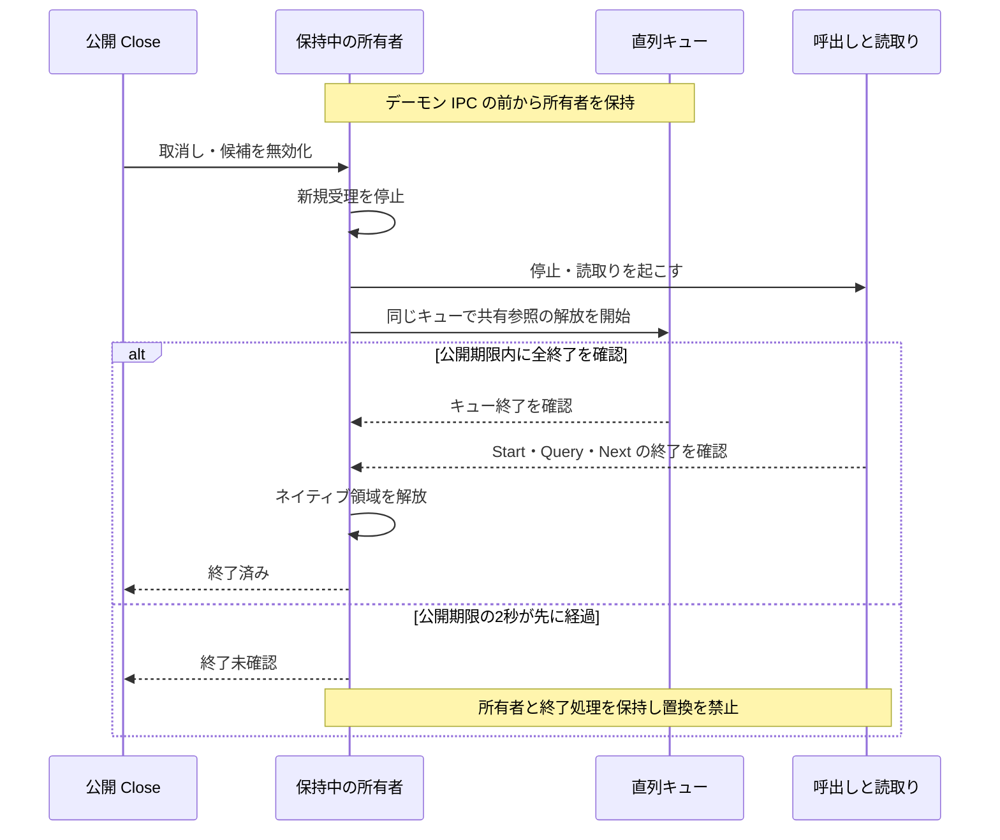
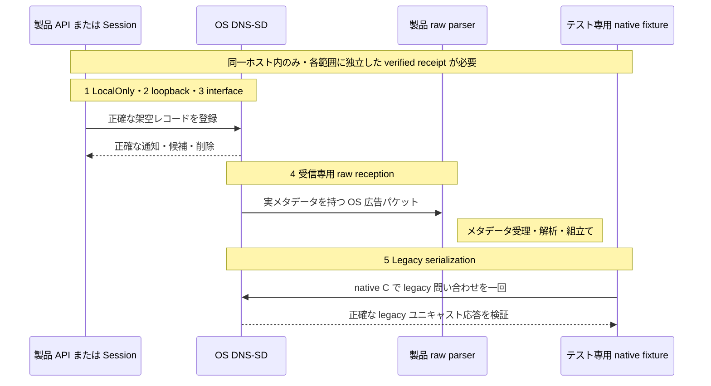

# macOS DNS-SD の近隣発見の境界

macOS アダプターは、明示的に選択したインターフェースで OS の DNS-SD サービスを使い、未認証のセットアップ候補を表示します。候補の選択だけでは信頼や接続許可は成立しません。数値のブートストラップ接続先、有効な相手セッション、完全なフィンガープリントの照合、双方の承認を引き続き必須とします。

## provider の結果を確認する

1. 明示的に選択したインターフェースと現在のランダム探索セッションを確認します。
2. 返された記録は、以下の OS から観測できる範囲に限ったセットアップ候補として扱います。
3. 選択した接続先を別途認証し、既存の承認を取得します。
4. 権限や provider が利用できない場合は利用不可と表示し、手動設定を使います。範囲を広げたり OS 設定を自動変更したりしません。

[provider の選択と共通上限](README.md) · [現在の検証](../../docs/VERIFICATION.md)

## 範囲とプライバシー

現在のランダムなセッションに対して、PTR・SRV・TXT・A の4レコードだけを登録します。インスタンス名とホスト名はセッションから生成し、OS のホスト名を使いません。A レコードは選択した IPv4 アドレスだけです。問い合わせ先は固定サービス名と、検証済みセッションから導出した正確な名前に限ります。既定のホスト名・ドメイン、全インターフェース、自動改名、P2P の追加、汎用の名前解決、範囲を広げる代替処理はありません。

DNSService が選択するのはインターフェースです。IPv4 パケットだけの送受信を指定する API ではありません。広告とブートストラップ接続先は承認済み IPv4 プレフィックス内に制限しますが、API は元の UDP 送信元・ポート・宛先・IP TTL・アドレスファミリー・完全なデータグラムを返しません。デーモンが選択した IPv4 を送信元に使ったとは証明できません。Linux・Windows は実パケットの受信条件を保ち、別々に届くレコードと範囲内の広告アドレスを制限付きで組み立てます。パケットの送信元を接続先の所有証明には使いません。

権限が拒否された場合は利用不可とします。製品やテストがローカルネットワークの権限画面を自動承認したり、OS・ネットワーク設定を変更したりすることはありません。利用できない場合は手動セットアップを使えます。

## 有効期間と終了

候補を表示する間は、必要な名前に対する全問い合わせを維持します。有効期間は変更できないセットアップ所有者の120秒の期限までです。OS のキャッシュに基づく候補であり、新しい通信や到達可能性の証明ではありません。削除、TTL 0、矛盾・不正な更新、問い合わせ失敗、検出したインターフェースやアドレスの変更、取り消しで候補を無効化します。無効化した観測は同じ候補 ID で復活しません。選択したローカル設定は操作・受信判定の前に確認し、コールバックがない間も独立した1秒間隔の監視で確認します。最終的な鮮度確認は認証済みの相手セッションが担います。

所有者ごとの上限は、64セッション、193問い合わせ、4登録、512回の開始・問い合わせ API 呼び出し、512コールバック、毎秒16回の解析、合計512 KiBの受理レコードです。C のリングだけが最大64観測を保持し、Go 側はバッファーなしで受け渡します。上限到達や不正な状態更新では、無効化通知を捨てて候補を残さず、受理を停止します。これはアプリ側の作業量の制限であり、OS デーモンが送るパケット数の保証ではありません。

### Close が時間切れでも所有者を保持する理由

文章での説明: 取消しで候補を無効化し新規呼出しを止め、読取りを起こして同じ直列キュー上で共有参照を解放します。キューと処理中の全呼出し・読取りの終了後だけネイティブ領域を解放します。公開 Close が2秒で時間切れになっても所有者と必須の終了処理を保持します。

実装参照: [session.go](session.go) · [dnssd_owner.go](dnssd_owner.go) · [provider_darwin.go](provider_darwin.go) · [dnssd_bridge_darwin.c](dnssd_bridge_darwin.c).

API 操作とネイティブコールバックは1本の直列ディスパッチキューで実行します。
C は Go ポインターやハンドルを保持しません。受理予算を使い切っても必須の終了処理は実行します。

参照解放はアプリの登録・問い合わせを終了しますが、相手キャッシュの消去、デーモン内で待機中のパケット、終了通知の到達までは確認できません。他の場所に候補が残っていても、取り消した Core セッションとブートストラップリスナーは選択・確定を拒否します。

## ビルドと検証

Darwin+cgo、システム SDK の dns_sd.h・dispatch ヘッダーと、DNS-SD・dispatch を再エクスポートする自動リンクの libSystem を使います。パッケージ固有のリンクフラグや単独の libdns_sd SDK スタブは使いません。外部 FFI は追加しません。cgo なしの Darwin ビルドは明示的に利用不可です。配布物はコンパイラー・SDK・システム入力と対象の cgo モードを記録します。Linux 上で cgo なしの代替処理をクロスコンパイルしても、このアダプターの実動作検証にはなりません。

必須の macOS CI は race 有効の nearby テストバイナリーを一度だけコンパイルし、通常の Terminal 起動一回で五つの範囲を各一回実行します。すべてに正確な RUN/PASS と verified の閉じた receipt が必要で、unavailable や skip は必須ゲートを通過しません。receipt は実際の CI commit/tree（PR では test merge）、生成元 run/attempt、追跡ソース一覧と準備済み入力の除外範囲、コンパイラー・SDK・バイナリー・起動・parser・native driver のポリシーハッシュに結び付きます。ソースとツールチェーンの再確認、native/converter の終了コード 0、所有リソースの join が必須です。coverage とリリースの検証は、正確な単一ファイル artifact と成功した native job を要求します。再実行に引き継がれた成功は元の生成 attempt と実行時刻を保持します。

これは同一ホスト内の証拠です。選択した OS 範囲では OS-backed Session の相互候補、lookup、Close による無効化を確認します。受信専用 UDP は送信元ポート 5353、承認済み private family/prefix、選択 interface、宛先、TTL 255 を要求し、変更のない製品の `validatePacket` → `decodeRecordPacket` → `recordAssembler`/store に通して PTR/SRV/TXT/A の mask 15 を確認します。証明するのは OS 公開データ → 製品 raw parser の方向だけです。legacy native-C の一回の query と selected-interface response は別のテスト専用経路です。製品 raw mDNS 送信 → OS resolver、二つの OS／物理端末、Core/browser の自動発見、TCC の原因・responsible-code identity は証明しません。通常の Terminal 起動は権限・設定を変更せず、prompt を承認せず、拒否や有限時間内に完了しない実行では安全に失敗します。所有する子処理の join は Terminal アプリ／window の終了を意味しません。任意の create-event 診断は別に残し、unavailable をそのまま報告できます。

### 各ネイティブ試験はどの方向を確認するか

文章での説明: 1～3は OS API と Session の観測、4は OS 広告から変更のない製品 raw parser への受信方向です。5はテスト専用のネイティブ C による一回の legacy 問い合わせとユニキャスト応答です。同一ホスト内に限り、製品 raw 送信から OS・別の物理端末・Core やブラウザーの証明にはなりません。

実装参照: [dnssd_native_acceptance_test.go](dnssd_native_acceptance_test.go) · [dnssd_raw_receive_test.go](dnssd_raw_receive_test.go) · [dnssd_legacy_native_test.go](dnssd_legacy_native_test.go) · [dnssd_socket_native_test.go](dnssd_socket_native_test.go).

各範囲は独立した明示的な opt-in と証明方向を持ちます。番号は図と対応します。

| 範囲 | 明示的な opt-in | 確認する境界と条件 |
| --- | --- | --- |
| 1. LocalOnly | `SOBALINK_DNSSD_LOCAL_ONLY=1` | 同一ホストの LocalOnly で2登録・正確な相互通知・削除 |
| 2. 選択 loopback | `SOBALINK_DNSSD_SELECTED_LOOPBACK=1` | 正確な loopback binding 上の2 provider と Session。非対応は利用不可 |
| 3. 選択 interface | `SOBALINK_DNSSD_SELECTED_INTERFACE=1` | 別途承認したホスト型 CI の既存 private IPv4 multicast 範囲1個で架空データを確認。曖昧なら利用不可・代替なし |
| 4. 受信専用 raw reception | `SOBALINK_DNSSD_RAW_RECEIVE=1` | 厳密に選択したホスト型 CI 範囲で OS 広告から製品 metadata 判定・record assembler への受信だけ |
| 5. Legacy serialization | `SOBALINK_DNSSD_LEGACY_SERIALIZATION=1` | テスト専用 native C による一回の問い合わせと正確な legacy ユニキャスト応答。独立した条件と上限は後述 |

有限時間の終了確認後に、この4テストが独立した `NEARBY_DNSSD_CAPABILITY` を出力します。受信専用テストは、受信パケット数、コピー済みバイト数、メタデータの受理・拒否、デコード結果、レート制限数、架空の正確な4レコード種別を表すビットマスクも記録します。`receivedBytes` は有限長のバッファーにコピーした量であり、切り詰められたデータグラムの完全な通信量ではありません。受信専用・legacy ソケットはそれぞれ、所有期間全体で512回の受信、614,912コピー済みバイト（512 × 1201）を上限とします。プロバイダーの受理レコード予算とは別です。不正・切り詰め済みのメタデータを持つパケットはデコードしません。

独立した5番目の opt-in `SOBALINK_DNSSD_LEGACY_SERIALIZATION=1` は `TestDNSServiceLegacySerializationCapability` を実行します。正確な架空の4レコードを API で確認してから、選択したローカルアドレスの一時 UDP ポートより、固定マルチキャスト宛先へ圧縮した [RFC 6762 の legacy 問い合わせ](https://www.rfc-editor.org/rfc/rfc6762.html#section-6.7)を1回だけ送信します。現在の比較は、既存の正確にバインドした非ブロッキングの記述子で、ネイティブ C の `sendto` を1回だけ実行します。その前に Go や補助制御データ付きの送信を行ったり、失敗後に代替送信したりしません。以前の Go の `host_unreachable` は過去の観測として保持し、原因が証明済みとは扱いません。テスト専用ヘルパーパッケージは製品のインポート・リンク対象に入らず、ポインターを保持せず、ソケットも作りません。送信直前に、正確なバインド先、`IP_BOUND_IF`、`IP_MULTICAST_IFINDEX`、`IP_MULTICAST_IF`、マルチキャスト TTL 255、ループバック、`O_NONBLOCK` を読み戻します。必須設定を確認できない・一致しない場合は送信しません。マルチキャストの正のインデックスは選択値との一致を必須とします。アドレス形式の読み戻しはインターフェースの主アドレスの場合もあるため参考値とし、正確な送信元は `getsockname` で確認します。直接の C 呼び出しは非ブロッキングと呼び出し前の期限確認で制限し、Go の書き込み期限だけで取り消せるとは扱いません。EINTR・EAGAIN を含むエラーで終了し、再試行しません。

元の選択インターフェース上の `224.0.0.251` だけを対象に、`/sbin/route -n get -ifscope` で有限の読み取り専用照会を1回行います。元の所有期間内の1秒の短い期限、非公開出力8192バイトの上限を設け、成功の結果には子プロセス・ワーカーの終了確認を必須とします。終了未確認では所有者を保持した失敗の結果とします。出力は固定の状態、一致・不一致の真偽値、許可したフラグだけで、アドレス、インターフェース名、経路文字列、生のエラーは公開しません。経路がない場合も参考情報です。[固定版 XNU](https://github.com/apple-oss-distributions/xnu/blob/xnu-12377.1.9/bsd/netinet/ip_output.c#L646-L657)は、マルチキャストインターフェース指定時に通常の経路検索を省略します。経路照会の成功や `host_unreachable` から、ローカルネットワーク権限やマルチキャスト到達性の原因を断定しません。結果はソケットの読み戻し、経路の観測、ネイティブ送信を実際に試みたか、期限・送信の段階、固定エラー分類を分けて記録します。

登録、準備確認、1回の送信、受信を同じ8秒の期限に含め、終了確認は既存の2秒上限です。応答は0以外の ID と正確な4質問を返し、切り詰め・キャッシュ削除ビットがなく、正確な架空の4レコードを正の10秒以下の TTL で含み、legacy の512バイト以内である必要があります。拒否した通信もソケットの受信上限に数え、legacy の解析レート上限到達では終了します。

独立した `NEARBY_DNSSD_LEGACY_CAPABILITY` は、成功時に legacy ユニキャスト DNS のシリアライズだけを証明します。実メタデータで送信元が選択ローカルアドレスの5353番、宛先が選択ローカルアドレスと実際にバインドした一時ポート、IP TTL が255であることを確認します。受信インターフェースは選択したもの、または独立に解決・確認した稼働中のループバックに限定し、結果で `selected_interface` と `local_loopback` を区別します。元の両ローカル設定を受理前と無通信時にも再確認します。製品のマルチキャスト受信、逆方向の発見、別端末への到達、Core・ブラウザーのセットアップは証明しません。既存4テストの意味も変更しません。API の成功を実パケットや別端末間の証明に置き換えません。ランダムなセッション名と汎用の別名だけを使い、ブートストラップ接続や OS・ネットワーク変更を行いません。ローカルの模擬バックエンドテストは所有権・契約の確認であり、ネイティブ実行や他 OS・実ネットワークの検証は分けて報告します。

## 一次資料

Apple の[固定版 DNS-SD ヘッダー](https://github.com/apple-oss-distributions/mDNSResponder/blob/mDNSResponder-2600.140.3/mDNSShared/dns_sd.h)に記載された、QueryRecord のキャッシュ TTL 制約、インターフェース指定、RegisterRecord の競合時所有権、共有参照解放、同じ直列キューでの終了条件に従います。API レコードから架空のパケットメタデータを作りません。
