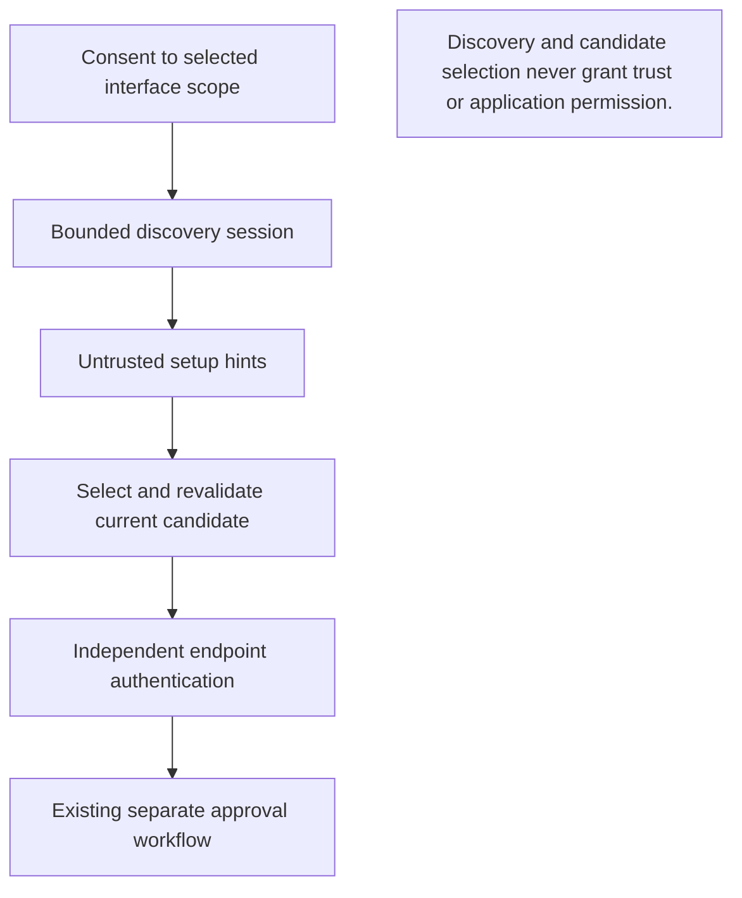

# Scoped nearby setup hints

[日本語](#日本語)

mDNS discovers services on the selected local network without a central DNS server. A provider is the platform adapter used for discovery. An owner is the object responsible for closing a discovery session and all its resources.

This package implements an opt-in, finite mDNS discovery adapter. A discovered
candidate is an **unauthenticated hint**, never a peer identity, permission,
certificate pin, trust grant, or evidence of connectivity. Core must consent to
and own the bootstrap listener, look up the exact selected candidate ID again,
and authenticate that endpoint independently.

## From a hint to an approved peer



Text equivalent: consent selects a scope; a bounded session produces untrusted hints; selection requires current-candidate revalidation and independent authentication. Discovery never grants access.

日本語: 明示的な同意で範囲を選び、上限付きセッションで未認証の候補を取得します。選択後は現在の候補を確認し直し、接続先を別途認証します。発見だけではアクセス許可になりません。

## Current provider selection

Core uses `StartNative` only after scope and advertisement consent. Linux and
Windows use scoped raw IPv4 packets. Darwin+cgo uses the selected-interface
system DNS-SD API; see [its exact contract](DNSSD.en.md) ([日本語](DNSSD.ja.md)).
Darwin without cgo reports unavailable. The older explicit raw Darwin factory
and loopback fixture remain diagnostic code, not the selected product provider.
OS hints carry no invented packet metadata and may come from a daemon cache.

## Contract

- `Start` requires an explicit transport factory, selected interface index,
  numeric local address and exact private prefix. There is no implicit native
  discovery, interface expansion, unicast probe, DNS lookup, or fallback scan.
- The local advertisement includes only a fresh 256-bit setup session ID,
  explicitly supplied alias, fixed protocol/capability, and numeric high-port
  bootstrap endpoint. DNS instance/target labels derive only from the ephemeral
  session ID. No OS hostname, permanent identity, pin, invitation or files are
  included. The alias is visible to the selected scope during discovery.
- Raw packet sources and advertised addresses must independently lie in the
  selected prefix. Receive interface, destination, source port and TTL are checked.
  Record bundles bind their actual observation provenance; this does **not**
  authenticate an advertised endpoint or equate its ownership with packet source.
  OS observations instead bind the exact selected interface and live queries.
- A candidate ID binds the entire advertisement, observed source, selected scope,
  a fresh local discovery generation and an observation revision. A changed advertisement invalidates its old
  ID. Replaying an older advertisement, or returning after expiry, cannot revive
  a previously selected ID, including across local discovery restarts. Raw
  observations never merge cross-source session collisions. OS から取得したレコードの組s bind the
  selected interface and session and reject conflicting records; they cannot
  attribute records to distinct packet sources. An alias never establishes identity.
- Sessions last at most 120 seconds; raw candidate TTL is at most 30 seconds from
  each matching live observation. OS cached hints stay within active exact queries
  and the immutable session deadline. Neither path revives invalidated or expired
  IDs; at most 64 candidates are retained. Raw datagrams are at most
  1,200 bytes. DNS counts/types/TXT fields are bounded before interpretation.
  The 512th received datagram stops the session, including malformed traffic;
  at most 16 packets per second are parsed. At most 64 datagrams are sent.
- Initial announcements/queries and periodic advertisements (5 seconds),
  queries (15 seconds), and multicast responses (at most one per second) all
  share the finite send budget. No response is sent to an advertised endpoint.
- Cancel and expiry immediately invalidate candidates and request socket closure,
  including during blocked I/O. Successful shutdown joins all owned goroutines
  and stops timers. `Close` waits at most two seconds and retains the first close
  failure; `ErrCloseUncertain`/`ErrCloseUnresolved` require retaining the owner
  and blocking replacement. `Start` may return a nonnil Session with an error
  after uncertain constructor rollback; callers must preserve that owner. No
  candidate data is persisted. Transport `Close` must unblock its reads/writes.

## Native platform boundary

Advertised/bootstrap endpoints are IPv4-only. Raw transport is IPv4-only; the
Darwin system API does not attest the daemon packet family or wire metadata.
It does not change interface flags, routing, firewall rules, credentials or
permissions. Every startup option/bind failure fails closed. Interface binding
metadata, local address and exact prefix are rechecked before sending and after
receiving; changed bindings stop the session.

- Linux binds exactly `224.0.0.251:5353` through a native socket, disables `IP_MULTICAST_ALL`, joins only
  the selected interface, and uses x/net IPv4 packet metadata for ingress and
  exact local source/interface selection on every send.
- The diagnostic-only raw Darwin factory keeps an exact-group receive socket and a separate sender bound to
  the exact selected local address on port 5353. Both use `IP_BOUND_IF`; the
  sender also fixes the multicast interface, TTL 255 and multicast loopback.
  Source-only pktinfo preserves the exact source, while the sticky bound
  interface confines egress. Any partial setup failure closes both resources;
  uncertainty retains the complete owner and prevents fallback or replacement.
  Physical close workers must join before `Done`; finite waits at Session and
  constructor boundaries retain unfinished close attempts without retrying them.
- Windows binds exactly the selected local address on port 5353. It uses the
  socket-local `IP_IFLIST` with one interface, one group membership, and
  `IP_PKTINFO`/TTL metadata. `ReadMsgUDP` retains strict receive metadata;
  `WriteToUDP` uses the exact bound source with selected-index `IP_MULTICAST_IF`
  and TTL 255. Both multicast egress and membership use the documented 24-bit
  network-order interface index, including when interfaces share a local IP.
  Zero or unrepresentable indices are unsupported. Each send revalidates binding, has a one-second deadline, and
  requires the full payload count without retry. The ancillary codec uses bounded byte operations,
  without `unsafe`. Required options may be unavailable on older Windows.
- Raw Unix sockets use `net.FilePacketConn` only after the exact native bind because Go's
  ordinary UDP listener rewrites multicast bind addresses to a wildcard before
  its control callback. The original descriptor is close-on-exec/nonblocking;
  both the original and Go-owned duplicate have explicit rollback ownership.
  A failed original close prevents successful startup and retains uncertainty.
- No raw path retries a wildcard bind, global membership or another NIC.
  The Darwin system provider does not bind an application UDP5353 socket.
  Unsupported or blocked discovery must leave Core's manual/QR setup available.

The protocol/store/lifecycle tests use synthetic transports and a fake clock;
they do not discover surrounding devices. Platform test-binary compilation is
not native multicast acceptance. Native socket delivery and confinement,
physical-device discovery, real pairing, and application compatibility remain
unverified until separately recorded tests run on the exact release source.

Platform implementation evidence:

- Pinned x/net IPv4 source: `sys_darwin.go`, `payload_cmsg.go`,
  `control_windows.go`, `sys_windows.go`. Windows x/net does not supply the
  required controls, so the Windows adapter uses public Go UDP I/O.
- Pinned Go Windows poll implementation: `internal/poll/fd_windows.go`.
- Microsoft [IPPROTO_IP options](https://learn.microsoft.com/en-us/windows/win32/winsock/ipproto-ip-socket-options),
  [IP_MREQ interface selection](https://learn.microsoft.com/en-us/windows/win32/api/ws2ipdef/ns-ws2ipdef-ip_mreq),
  [IN_PKTINFO](https://learn.microsoft.com/en-us/windows/win32/api/ws2ipdef/ns-ws2ipdef-in_pktinfo),
  and [SDK definitions](https://github.com/microsoft/win32metadata/blob/main/generation/WinSDK/RecompiledIdlHeaders/shared/ws2ipdef.h).

## 日本語

mDNS は、中央の DNS サーバーを使わずにローカルネットワークのサービスを探す仕組みです。プロバイダーは OS ごとの探索処理、所有オブジェクトは探索セッションと関連リソースの終了を管理するものです。

このパッケージは、明示的に選んだ一つの範囲で、短時間だけ mDNS 探索を行う。
候補は未認証の手掛かりであり、相手の識別情報、権限、証明書の指紋、信頼、接続成功
の証明ではない。Core が初期接続待受への同意と有効期間を管理し、選択した候補 ID
を直前に再確認してから、その正確な接続先を別途認証する。

- 広告は一時的な 256ビットのセッション ID、利用者が選んだ表示名、固定プロトコルと
  対応機能の情報、数値指定の初期接続先だけ。表示名は探索中に選択範囲へ公開される。
  OS ホスト名、恒久識別情報、招待、証明書の指紋、ファイル情報は含まない。
- 受信パケットの送信元と広告接続先は、それぞれ選択アドレス範囲内である必要がある。
  インターフェース、宛先、送信元ポート、TTL とレコードの観測由来を検証するが、広告接続先の
  所有者や送信元の真正性は保証しない。OS 観測は選択インターフェースと継続中の正確な
  問い合わせに結び付け、パケットメタデータを捏造しない。
- 候補の変更・失効で古い選択 ID は無効になる。古い広告が再送されても ID は
  復活しない。生の観測は送信元の違う同一セッションを統合しない。OS から取得したレコードの組 は
  選択インターフェースとセッションに結び付けて矛盾するレコードを拒否するが、異なる
  パケット送信元を識別できない。表示名の一致を識別情報の証明にしない。
- セッションは最大120秒、直接受信したパケットに基づく候補は同じ有効な広告の最終観測から最大30秒、最大64件。
  OS キャッシュの候補は正確な問い合わせの継続中かつ元のセッション期限内だけ保持する。
  どちらも失効・無効化した ID を復活させない。以下のパケット上限は直接パケットを扱う経路のもの。
  データグラムは最大 1,200 バイト、受信 512 件で停止、解析は毎秒最大 16 件、
  送信はセッション全体で最大 64 件。応答はマルチキャストのみで毎秒最大 1 回。
- Cancel・期限切れは候補を即座に無効化して I/O の終了を要求する。正常終了は
  goroutine とタイマーの終了まで確認する。Close は最大 2 秒で、不確定なら所有オブジェクトを
  保持して再開始を止める。Start が所有オブジェクトとエラーの両方を返した場合も所有オブジェクトを
  捨てない。候補は保存せず、初期接続の試行はこのパッケージの対象外。

Core は同意後に StartNative を使う。Linux は正確なマルチキャストグループへのバインドと選択
インターフェース、Windows は選択したローカル数値アドレス待受設定とインターフェース制限を用いる。
macOS+cgo は選択インターフェースのシステム DNS-SD API を使う。広告接続先は IPv4 だが、
API は デーモンのパケットのアドレス系統や通信時のメタデータを証明しない。詳細は
[API 契約](DNSSD.ja.md)を参照。cgo なしは利用不可とする。
直接パケットを扱う経路をワイルドカード待受設定、別 NIC、全 IP・ポートの探索、OS・ファイアウォール・経路の変更へ拡張しない。
安全なソケットを作れない場合は停止し、Core の手動/QR 導線を利用できる状態にする。
Unix では Go の通常の UDP 待受がマルチキャストのバインド先をワイルドカードに変更するため、
OS のソケットを正確なグループにバインドした後だけ `net.FilePacketConn` に渡す。
診断専用の旧 macOS パケット処理の生成関数 は受信用の正確なグループ待受設定と送信用の選択アドレス:5353 待受設定を分離し、
両方に `IP_BOUND_IF` を設定する。送信は固定したマルチキャストインターフェース・TTL255 と、
送信元だけを指定したパケット補助情報（pktinfo）を用い、選択アドレスとインターフェースを維持する。片方の準備失敗も
両方を終了し、不確定なら全所有オブジェクトを保持して代替・再開始を止める。
実際にソケットを閉じる処理 が終了する前に `Done` を閉じない。Session と生成処理 の
制限時間を超えた終了処理 は所有オブジェクトに保持し、同じ記述子の終了を再試行しない。
元の記述子と Go が複製した記述子を個別に管理し、元の終了が不確定なら
起動成功とせず所有オブジェクトを保持する。別プログラム実行時の自動クローズ（close-on-exec）と非ブロッキング設定を必須とする。

模擬通信基盤・偽時計の試験や他 OS 向けコンパイルは、OS 上のマルチキャストの実動
確認ではない。ネイティブ通信と範囲制限、実機の探索・ペアリング・アプリ互換性は、
別途そのソースの試験結果が記録されるまで未検証として扱う。

## Opt-in raw native loopback capability test

The default suite skips `TestNativeLoopbackDiscoveryCapability` without opening
sockets. A separately authorized native runner can opt in with:

```sh
SOBALINK_NATIVE_NEARBY_LOOPBACK=1 go test -count=1 -run '^TestNativeLoopbackDiscoveryCapability$' -v ./internal/nearby
```

This test selects only an up loopback interface owning exactly `127.0.0.1`, with
a test scope of `127.0.0.1/32`. It exercises the same socket adapter, bounded
wire parser and session owners using a private test-only construction seam.
The exported production API still rejects loopback. No interface flags, routes,
firewall rules or global network settings are changed; a missing multicast
interface flag is not changed to make the test work. No other NIC is tried.
The two synthetic advertisements carry distinct random sessions and high-port
endpoint hints; no bootstrap TCP listener or connection is started.

Linux retains its production exact-group mDNS socket. Darwin retains the
exact-group receiver plus exact-selected-address sender, and Windows retains
its exact selected-address socket. The required mDNS port remains 5353; bind
conflicts or unsupported native options produce `unavailable`, not a wildcard
fallback. Both native transports are fully opened before announcements (Darwin owns
four sockets across the two transports); observation is
limited to eight seconds and owner cleanup/join to two seconds.

A `NEARBY_NATIVE_CAPABILITY` JSON の結果記録 reports `verified`, `unavailable`,
`not_run`, or `failed`. Only `verified`, with bidirectional current candidates
and both owners joined, counts as capability evidence. A skipped test can still
leave the enclosing Go package with a `PASS` exit status: **a runner must check
the marker, not that status**. Foreign/missing packet metadata and unresolved
cleanup fail the test. A bind/receive limitation is explicitly unavailable. The additional
`socketFailureStage` field is a fixed enum (`none` when there was no socket
failure); it contains no raw platform errors, interface identifiers or addresses.

Even a verified result proves only exact loopback adapter behavior on that
native target. It does not prove physical-NIC multicast, multi-device discovery,
bootstrap authentication, application compatibility or the manual fallback.
Those acceptance results remain separate.

### native loopback 試験について

通常の試験ではソケットを開かず、この試験を実行しない。別途許可されたネイティブ
実行環境だけが上の環境変数で実行する。対象は実際に `127.0.0.1` を持つ稼働中の
ループバックインターフェース一つと `/32` の試験範囲だけ。製品 API のループバック拒否は変えず、
インターフェースのフラグ・経路・ファイアウォール・全体設定を変更しない。別 NIC への代替や TCP 接続はない。

専用 JSON の結果記録 の `verified` と、双方向の候補確認・両所有オブジェクトの終了確認だけを
能力試験の根拠にする。`unavailable` / `not_run` による未実行 は、Go パッケージ全体が
`PASS` と表示されても合格証拠ではない。メタデータの範囲不一致や終了不能は失敗。
`socketFailureStage` は固定の選択肢 で失敗段階を示し、失敗がなければ `none` とする。
OS の生エラー、インターフェースの識別情報、アドレスは出力しない。
ループバック上の合格は、実 NIC・別端末の探索、初期接続認証、手動導線の合格とは別。

## Platform diagnosis boundary

The diagnostic-only raw Darwin sender follows the published
[XNU 12377.1.9 UDP source](https://github.com/apple-oss-distributions/xnu/blob/xnu-12377.1.9/bsd/netinet/udp_usrreq.c#L1401-L1739):
bound-source validation precedes temporary source selection, and a nonzero
pktinfo interface index overrides the requested source address. This source
analysis justifies the correction; it does not prove the exact hosted error or
establish native acceptance by itself.

Darwin bind failures additionally carry fixed `bindSocketRole` and
`bindFailureKind` values, separating the group receiver from the local sender
without printing an address, identifier or raw errno. Address construction uses
the selected IPv4 bytes and port 5353 with checked ownership. The pinned
[XNU bind rules](https://github.com/apple-oss-distributions/xnu/blob/xnu-12377.1.9/bsd/netinet/in_pcb.c#L948-L999)
can reject nonmulticast exact-local port sharing across different socket-owner
UIDs despite reuse options. This is a possible coexistence limit, not an
established cause of a particular run. A confirmed conflict is a platform/design
blocker; it does not authorize changing services, ports or bind scope.

On Windows, the pinned Go 1.27.1 `WriteMsgInet4` passes no synchronous byte-count
pointer to `WSASendMsg`. Its immediate-success path can therefore report zero
bytes; this does not establish whether that message was transmitted. A bounded
test-only `WriteToUDP` probe verified exact metadata and cleanup on the same
loopback scope. Production now uses that exact-bound send primitive, retaining
full-byte-count checks. Only a new reciprocal Session result can verify the
corrected production path; the probe alone cannot.

The fixed `sendFailureKind` distinguishes known OS error categories from short
payload/control counts without emitting raw errors or numeric codes. The closed
`windowsNoAncillaryProbe` schema retains the earlier test-only observation and
its non-upgrade/safety checks. Current runs emit null: the extra probe was retired
when production adopted the same send primitive, avoiding a redundant retry.
Its historical result never establishes production discovery acceptance.

A Linux result cannot establish Darwin or Windows support. A target reporting
`unavailable` has no automatic-discovery proof, even if its diagnostic job is
green. Loopback discovery, manual-contact Core/browser setup and physical-LAN
automatic setup remain distinct acceptance results.

### プラットフォーム別の診断範囲

診断専用の旧 macOS 直接パケットを扱う経路の送受信分離は上記の固定 XNU ソースの bound-source 検証順序と、pktinfo の
インターフェース指定がソース指定に優先する動作に基づく修正である。ソース調査だけで
実行環境のエラー原因やネイティブ動作確認の完了を断定しない。

待受設定失敗は `bindSocketRole` と `bindFailureKind` の固定値で受信グループ / 送信ローカル
ソケットとエラー分類を区別し、アドレス・識別子・生の errno は出力しない。
選択 IPv4 とポート 5353、既存の所有権確認は維持する。上記 XNU 待受設定規則では、
所有 UID が異なる既存ソケットとの正確なローカルアドレスのポート共有が reuse 設定下
でも拒否され得る。これは共存制限の候補であり、個別実行の原因を断定するものではない。
競合が確認された場合はプラットフォーム・設計上の阻害要因とし、サービス・ポート・待受設定
範囲の変更で代替しない。

Windows の固定 Go 1.27.1 `WriteMsgInet4` は `WSASendMsg` に同期バイト数の出力先を
渡さず、即時成功時に零バイトを返し得る。実際に未送信だったとは断定できない。
同じループバック範囲の `WriteToUDP` 補助試験では正確なメタデータと終了を確認したため、
製品経路もこの正確なアドレスにバインドした送信処理を使用する。送信直前の関連付け確認、
送信・グループへの参加ともネットワークバイト順の24ビットのインターフェースインデックスで指定し、同じ
ローカル IP を持つ別インターフェースと区別する。零・表現範囲外のインデックスは未対応とする。
TTL 255、一秒期限、全バイト数の一致必須、再試行なしを維持する。
修正後の製品確認には新しい双方向 Session 結果が必要で、補助試験だけでは完了としない。

`sendFailureKind` は既知の OS エラー分類と転送データ・制御データの不足だけを固定値で示す。
従来の試験専用結果を扱う `windowsNoAncillaryProbe` の閉じたデータ形式と、製品確認へ
昇格させない検証は維持する。製品が同じ送信処理を採用したため、追加接続検査は
廃止し、現在の実行では null とする。同一経路の冗長な再送は行わない。
過去の補助結果を製品探索の動作確認として扱わない。

Linux の結果を macOS/Windows の対応証拠として流用しない。`unavailable` はジョブが
緑でも自動探索未確認である。ループバック探索、手動連絡先の Core・ブラウザーの接続、
実 LAN の自動セットアップはそれぞれ別の確認結果として扱う。
