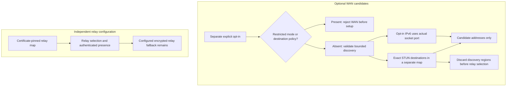

# Adapted internal transport source

This package is a bounded adaptation of Tailcat used by the LAN transport
implementation currently under verification. Implementation and packaging
inventory do not establish release, real-device, direct-path, migration, or
strict-egress acceptance.

Source: https://github.com/tailscale/tailcat/tree/b4dc28e8aa89

Pinned module: `github.com/tailscale/tailcat v0.7.1-0.20260929145319-b4dc28e8aa89`

Copied source files: `tailcat.go`, `wire.go`, `disco.go`, `listen.go`.
Their copyright/SPDX headers are retained in the adapted files, and the original
BSD-3-Clause terms are preserved verbatim in `LICENSE`. The locally added
`regions.go` has its own explicit MIT header; this package is not presented as an
unmodified upstream module.
The executable dependency is the repository's pinned `tailscale.com v1.104.0` with a separately inventoried, hash-verified generated-source adaptation. See `internal/engineadaptation/UPSTREAM.md`. No downloaded module-cache source is changed.

Changes: remove network map fetching and implicit region defaults; validate and
canonicalize numeric certificate-pinned one-node regions within the nonzero
16-bit region-ID namespace and an explicit adjustable presence budget; keep all
configured server regions present in one engine; update each peer's relay from the DERP
connection carrying its key-checked meow; keep clients single-candidate; bound
presence work by server lifetime; normalize failed concrete TCP dial results
before converting them to connection interfaces so cleanup cannot dereference
a typed-nil connection. A meow is relay-authenticated discovery, not
end-to-end application authentication. WireGuard plus the outer pairing/trust
coordinator remains responsible for that boundary.

PrivateOnly rejects builds that retain UDP underlay transport. It confines maps
to private/loopback literals, disables region diagnostics, and never fetches a
public/default map. Public/direct-enabled product builds cannot silently turn
this into a runtime egress sandbox. The stricter build still needs captured
traffic acceptance and packaging review before use.

An optional per-engine `DestinationPrefixes` policy now wires the adapted engine before socket setup, restricts advertised endpoints, and revokes admitted UDP/TCP on retirement. Nil preserves the normal behavior; the policy does not bind a NIC or establish VPN isolation.

### Can WAN discovery change relay selection or peer authority?

Text equivalent: WAN discovery is rejected with PrivateOnly or any non-nil destination policy. Otherwise, explicitly allowed STUN/IPv6 discovery supplies candidates only. Discovery-region information is removed before relay selection; the certificate-pinned encrypted relay remains configured for fallback. A non-nil destination policy includes an empty slice. Discovery grants neither peer authority nor a direct-path reachability result.

Implementation references: [wan_candidates.go](wan_candidates.go) · [tailcat.go](tailcat.go) · [manifest.json](../engineadaptation/manifest.json).

`WANCandidates` is a separate, explicit local opt-in for trusted-relay transport.
It accepts exact numeric STUN destinations and/or native IPv6 candidate
advertisement. Metadata is bounded by the configurable private-state byte
budget and the inherent nonzero 16-bit discovery-ID namespace. An adjustable
per-netcheck destination budget defaults to four; a rotating subset and bounded
retries keep each run finite without imposing a four-endpoint metadata cap. Nil preserves existing behavior. WAN opt-in is incompatible with either `PrivateOnly` or any non-nil
`DestinationPrefixes`.
Discovery settings never enter a peer capability, pinned relay map, or relay
presence connection. The generated engine uses a separate STUN-only netcheck
map, admits only those exact discovery destinations at its STUN writer, removes
synthetic discovery-region information before relay selection, and uses the
actual IPv6 socket port for opted-in interface candidates. Opt-in discovery
does not query cloud metadata or introduce DNS, HTTPS/ICMP diagnostic fallback,
port mapping, router configuration, or privileged network changes. STUN reveals
the source address and port to each selected discovery service and does not
authenticate a peer or establish direct-path reachability. The authorized
certificate-pinned encrypted relay remains configured for fallback; its
presence does not establish current reachability.
Socket-free validation and a separately opted-in loopback STUN fixture do not
prove WAN NAT traversal, relayless WAN operation, or real-device compatibility.

There is intentionally no live UpdateRegions method: candidate removal, policy
changes, key admission, active flow cancellation and durable configuration need
one outer transaction. Restarting with unchanged identities is the bounded first
implementation. No established-TCP preservation is promised.

Release packaging inventories this adaptation separately from module
dependencies when it appears in the target's runtime package closure. It retains
`LICENSE`, `UPSTREAM.json` and this document under the archive's
`share/sobalink/licenses/source/internal/routecat/` directory. Notice JSON and
build metadata record the original upstream hashes separately from the hashes
of selected adapted source/build inputs. CycloneDX records this main-module
component as modified and identifies Tailcat only as its upstream ancestor.

The reviewed upstream pin and exact license bytes are checked independently of
`UPSTREAM.json`; changing upstream requires a corresponding packaging review.
Selected compile/embed inputs, `go.mod`, `go.sum`, and retained provenance are
hashed deterministically. Target-filtered source inventory does not itself prove
which functions survive linking or that any network behavior has been accepted.
The product archive still contains only its existing executable; no additional
helper executable is packaged by this source-component inventory.
