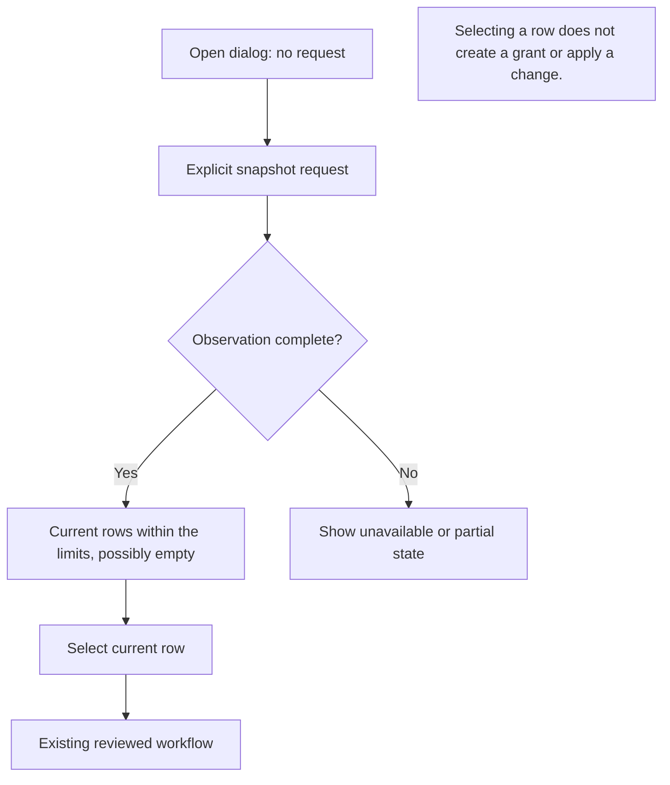

# Unified local resource view

This source connects the authenticated-local `resource.catalog.snapshot` command to a Japanese/English dialog for settings, saved services and transfer activity, with explicit size limits. The Core command and `State.resourceCatalogProcessId` are required. This process token identifies the current Core instance; the browser treats it as an uninterpreted value. Existing inspection/management grants do not establish a remote catalog capability.

## Follow a catalog action

Text equivalent: opening sends no request; explicit refresh obtains observations within the configured limits; a current row navigates to an existing workflow whose own fresh review remains required. A row does not create a grant or perform an action.

For integration review, inspect explicit reads first, invalidation second, and the existing destination workflow last. Failed or stale observations must stay distinguishable from a complete empty result.

## Explicit reads and existing workflows

- Opening the dialog or receiving `/api/state` polls performs no catalog request. Local settings resolution and snapshot refresh are explicit controls. An unresolved selected category is never silently omitted.
- At most five exact sources and one remote peer are selected. No remote listing, grant creation, protocol fallback or automatic retry is added.
- Decoders match every source to the pinned request, process token and finite limits. Aggregate revision and scope ID are opaque correlation digests, not browser-verified authorization. Existing API JSON parsing cannot retain duplicate wire keys; authoritative Core framing remains responsible for that check.
- The browser accepts no more than 8,192 rows or 8 MiB, further narrowed by current finite policy. Capacity failures remain visible and do not change policy or source admission.
- Refresh marks the prior candidate stale and disables its actions. Failed, limited and unconfirmed observations remain distinct from complete empty. No cross-refresh history or durable cache is claimed.
- One app-lifetime settings controller owns all retained operation barriers. Catalog navigation freshly resolves a local target or selects the exact supplied remote selector, then opens the existing view. It never injects a preview or dispatches inspect, apply or status automatically.
- Saved-service navigation preselects exactly one saved ID. Existing definition/configuration and selection reviews obtain their own current evidence; the user still confirms mutations.
- A separate generic **Open service connections** control opens the ordinary blank manual form for one explicitly selected current peer. It carries no catalog service ID, advertisement, revision, ports or lifetime and makes no discovery or connection request. Existing user-controlled review remains authoritative; stale rows still have no connection action.
- Transfer navigation uses the opaque boot token, current peer, original batch ID and direction. It focuses the existing card without invoking any transfer action. Catalog navigation does not add IDs to browser history.
- Authentication, stale state, backend/key/peer identity or boot-token changes invalidate visible catalog data synchronously. The boot token additionally invalidates single-device settings (W1) previews without deleting retained ambiguous attempts. The controller rechecks state after subscriber callbacks and ignores replies that no longer belong to the current request.

## Boundaries and acceptance

Cached discovery observations are always stale and have no connection action until publication-origin validation is separately implemented. Transfer activity is not a durable file-share provider. Remote catalog disclosure/capability, group UI, production browser/Core/provider behavior, full native CI, real devices, installed binaries and signed release remain independent acceptance gates. This local view alone does not establish those broader results.

Focused synthetic tests are authored alongside the module and in `App.catalog.test.tsx`; a separate test run against a fixed source revision must establish execution results. The prior settings App gate applies only to its earlier source. No tests or real-provider behavior are implied by this document.
