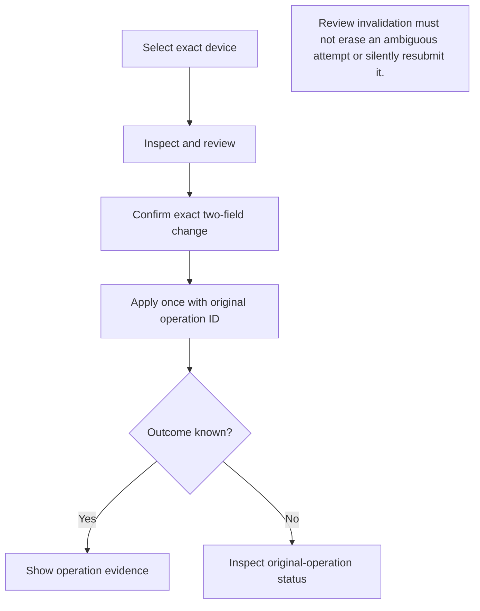

# Transfer-settings Web integration

**Integration checkpoint record.** The standalone W1 controller, decoders, and dialog passed whole-Web typecheck and 59 focused tests at that checkpoint. The App/API hookup and integration tests below were then authored pending their separate reviewed execution gate. This module covers local settings plus inspection v1 or management v2 for one explicitly selected remote device. Later catalog and group UI integration are documented separately in [catalog](../catalog/INTEGRATION.md) and [group](../group/INTEGRATION.md); those modules do not imply that all original remote-provider scope is complete.

## Operation and recovery at a glance

Text equivalent: select, inspect, review and confirm the exact change before one apply. If the outcome is unknown, recover the original operation's status rather than submitting another change. Authentication or navigation changes invalidate the review without erasing retained ambiguous attempts.

The counts and pending execution statements below are integration-checkpoint records. For the current release, consult [verification](../../../docs/VERIFICATION.en.md); a later aggregate result must not be presented as proof of every individual scenario.

## Existing contract

- `types.ts`: closed current resource command payloads, now included in `api.CommandPayloads`. No arbitrary command string, provider, listener, grant operation, or wire field is introduced.
- `decode.ts`: closed object readers, exact schema/target/action/selector/operation correspondence, finite safe integers, complete provider outcome validation, and immutable returned values. Malformed success is not operation evidence. The existing authenticated API remains the only transport/JSON owner.
- `controller.ts`: one app-lifetime `ResourceSettingsController`, one current selection, frozen review, abortable explicit operations, and at most 64 non-evicted attempts. No constructor, timer, React effect, status response, or reconnect dispatches an apply. Synchronous ownership checks cover reentrant invalidation immediately before transport.
- `ResourceSettingsDialog.tsx`: explicit local list/inspect and advanced manual remote selector; requested/effective values; exact two-field review and checkbox confirmation; one-shot apply; independent historical evidence/current observation; manual status recovery. Existing Modal handles Escape/focus isolation and opener restoration. The entry uses the app's effective EN/JA locale.

## Shared App/API hookup

1. `api.ts` adds only the closed resource payload map and optional numeric `State.processId`, matching the field Core already emits. Endpoint, envelope, CSRF, same-origin, redirects, timeout and error behavior remain unchanged.
2. `App.tsx` creates one controller in a ref above authentication and dialog branches. The adapter uses `api.command(name, payload, api.requestID(), signal)` and returns `.result` to the strict decoders. The current error-handler ref forwards to the existing `server.handleError`. No `server.run`, reused uncertain request ID, fallback, or retry is used.
3. `useServer.ts` accepts the fixed resource controller as an optional internal observer. Its current reference does not recreate refresh or polling effects. After authoritative refs change, it synchronously invokes only `updateContext(resourceContextFromSession(...))`, before React state publication. Refresh success/failure, authentication loss and lifecycle cleanup are covered. The observer adds no transport and changes no existing returned Server shape, authentication policy, generic command retry, or message guard.
4. `app-context.ts` projects only authenticated presence, freshness, existing auth epoch, actual process ID, selected backend, local DirectLAN public key, local readiness hints, and `{key, name}` from current saved DirectLAN peers. Missing/malformed process data and stale reads disable controls. Malformed/duplicate/oversized peer input fails closed. Names, routes, trust, incoming grants and service permissions never establish remote authority.
5. The process ID, auth epoch, local key and saved-key membership are invalidation hints. They are not an authoritative provider generation or pair-binding token. A PID or same-key re-pair can be reused without a new frontend field; Core's current generation/admission checks remain the final guard. Observed context changes require explicit reselection, and unchanged polling performs no resource request.
6. Preferences exposes a localized Transfer settings entry while keeping Capacity and history unchanged. Peer navigation, Back/Forward, dialog replacement and modal cleanup invalidate the current review/selection and abort waiting. Mounting the settings dialog performs no network operation automatically.
7. Authentication loss clears visible resource data and previews. The same App instance retains attempted identities privately in memory across login/modal transitions. Checking status after a context change requires explicit reselection of the same peer/resource/grant identity. A current status grant revision never rewrites the original attempted selector or review. No resource data is put in storage, history or URLs. Full reload history/recovery is not implemented or claimed.

The exact authenticated local `ApiError('resource_revision_conflict')` is a definite pre-admission rejection under the current provider. It permits a new explicit review/confirmation, never an automatic retry. The rejected historical attempt remains visible. A different fresh review can use the same unconsumed local operation ID. Remote generic errors, arbitrary text, timeout, abort, malformed replies and synchronous transport throws never use this exception.

## Integration-test source

The existing 59 standalone W1 cases remain unchanged. New source adds:

- `resource/app-context.test.ts`: 16 cases for exact projection, finite process identity, auth/stale failure, backend/trust separation, malformed/duplicate/bounded peer input, identity hints, and unchanged polling/display-only updates.
- `resource/server-context.test.ts`: five mounted-hook cases for immediate auth invalidation without Server-shape changes, stale/unmount invalidation, ignored late state success after auth loss, and reentrant authentication loss during successful/failed observations.
- `App.resource-settings.test.tsx`: 13 mounted-App cases for bilingual entry, explicit exact payloads, no resource polling, no trust inference, unchanged-poll/display-only review preservation, modal/auth persistence, ignored late state/apply replies, failed refresh during apply, same-process key changes, browser navigation and StrictMode lifecycle.

These are authored tests, not passed results for this integration. Exact execution files, fully expanded names, shared regressions, source/tool/dependency hashes, and permitted initialization side effects must be independently frozen before execution. Typecheck reads the whole Web project. Vitest loads existing React/Tailwind/png plugins, jsdom, setup modules and reviewed native bindings, may start ordinary test workers, and may write owned cache/temp/build-info files. Tests mock the existing API fetch boundary; they do not reach a real provider or start a production app/browser server. No dependency or configuration changes belong to this source slice.

## Remaining evidence gates

The standalone 59-case pass does not establish this shared integration, production authentication/CSRF, Go-backed browser behavior, keyboard focus cycling, narrow/light/dark readability, native lifecycle, physical devices, installed binaries, distribution, or release acceptance. Those remain separate gates. No live grants, security settings, provider runtime, publication or release action is part of this source hookup.
